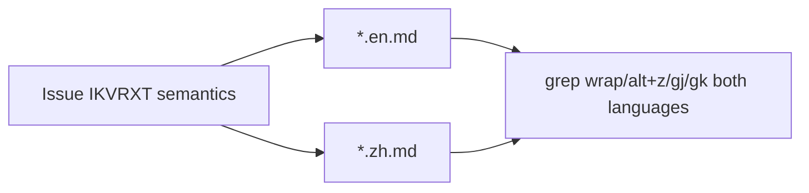

# Soft Wrap - Plan F: bilingual docs (en/zh, same wave)

> Source of truth: `overview.md` + issue IKVRXT §七. Pure documentation.
> Depends on Plans A-E semantics being finalized (option name `wrap`, key
> `alt+z`, vim `gj/gk`). Approval: unattended (auto-approved).

## 1. Goal / non-goals

- Goal: document the new `wrap` option, `alt+z` toggle, vim `gj/gk` display-line
  motion in all required bilingual docs, en and zh in the SAME wave (hard
  constraint per doc-conventions §三 / project memory).
- Non-goals: no code changes. Pure doc change -> per misc-rules §三 the test
  gate may be waived for this wave alone; the FINAL gate still runs everything.

## 2. Facts (verified anchors, file:line)

- `yate/resources/manual.en.md`: `## 5. Key Bindings` :356 (vsc :389, vim :535),
  `### 10.2 Option reference` :960, `## 18. Key Binding Cheat Sheet` :1635.
  `manual.zh.md`: 键位总览 :324 (vsc :354, vim :495), 选项参考 :874,
  键位速查表 :1454.
- `yate/docs/yaterc.en.md`: `## Option reference` :65; `.zh.md` :57.
- `yate/docs/which-key.en.md`: `## 2. Keymap differences` :45; `.zh.md` :37.
- `FEATURES.md`: `## 3. Two Built-in Keymaps` :37, `## 8. Configuration (yaterc)` :86;
  `FEATURES.zh.md` :29 / :70.
- `README.md`: `### Common keys (vsc keymap)` :118, `## Configuration (yaterc)` :152;
  `README.zh.md` :144 / :176.
- `CHANGELOG.md` / `CHANGELOG.zh.md`: add an Unreleased/feature entry at the
  top per existing format (large files -- insert only, do not reformat).

## 3. Content to add (exact semantics)

- Option: `wrap = on|off` (yaterc) and `:set wrap=on|off`; default `off`.
  Line wrapping is display-only: buffer text, undo history and file bytes are
  never modified. Long lines fold at the viewport width using display cells
  (tabs expanded, wide chars kept whole). Continuation rows show a blank line
  number; diagnostics are shown per logical row. Horizontal scrolling applies
  only when wrap is off.
- Key: `alt+z` toggles wrap on/off in both vsc and vim keymaps.
- vim only: `gj` / `gk` move by display row (can land on a continuation row),
  degenerating to logical-row motion when wrap is off; `j`/`k` remain logical.
  Count repeats by display rows. `gg`, counts and unknown-prefix behavior
  unchanged. vsc has no `gj`/`gk`.
- Where to put: key tables (vsc + vim sections), option reference tables,
  cheat sheets, yaterc option reference, which-key keymap differences
  (mention alt+z shared, gj/gk vim-only), FEATURES / README overview, CHANGELOG.

## 4. Files (exclusive)

All 12 files, edited as 6 en/zh pairs:
1. `yate/resources/manual.en.md` + `manual.zh.md`
2. `yate/docs/yaterc.en.md` + `yaterc.zh.md`
3. `yate/docs/which-key.en.md` + `which-key.zh.md`
4. `FEATURES.md` + `FEATURES.zh.md`
5. `README.md` + `README.zh.md`
6. `CHANGELOG.md` + `CHANGELOG.zh.md`

## 5. Steps & acceptance commands

1. For each pair, apply the same semantic additions to en and zh; keep each
   language's existing tone and table format; do not introduce absolute paths.
2. After all edits, grep both languages for `wrap`, `alt+z`, `gj`, `gk` and
   confirm presence in every file where the anchor exists.
3. Verify (doc wave self-check):
   - `.venv\Scripts\python.exe -m tools.smoke_test run --jobs 4` (manual/help
     smoke paths still load) -- optional for doc-only wave but recommended.
   - `git -C <worktree> diff --check`

## 6. Risks / rollback

- Risk: en/zh drift -> edit pairs back-to-back and grep both.
- Risk: CHANGELOG large-file edit conflict -> insert at top only, no reformat.
- Rollback: `git checkout -- <listed files>` (all doc-only).

## 7. Mermaid

