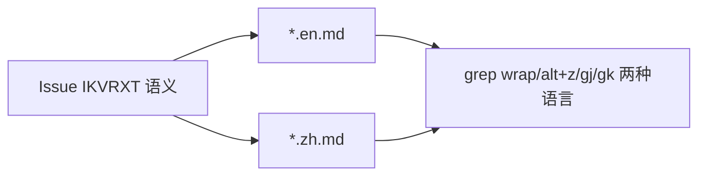

# 软换行 - 计划 F：双语文档（en/zh，同一波次）

> 唯一规范来源：`overview.md` + issue IKVRXT §七。纯文档。
> 依赖计划 A-E 的语义定稿（选项名 `wrap`、按键
> `alt+z`、vim `gj/gk`）。审批：无人值守（自动批准）。

## 1. 目标 / 非目标

- 目标：在所有必需的双语文档中记录新的 `wrap` 选项、`alt+z` 切换、
  vim `gj/gk` 显示行移动，en 和 zh 在**同一波次**完成（依据
  doc-conventions §三 / 项目记忆的硬性约束）。
- 非目标：不改代码。纯文档变更 -> 依据 misc-rules §三，仅本波次可
  豁免测试门禁；最终门禁仍运行全部检查。

## 2. 事实（已核实锚点，文件:行号）

- `yate/resources/manual.en.md`：`## 5. Key Bindings` :356（vsc :389、vim :535），
  `### 10.2 Option reference` :960、`## 18. Key Binding Cheat Sheet` :1635。
  `manual.zh.md`：键位总览 :324（vsc :354、vim :495）、选项参考 :874、
  键位速查表 :1454。
- `yate/docs/yaterc.en.md`：`## Option reference` :65；`.zh.md` :57。
- `yate/docs/which-key.en.md`：`## 2. Keymap differences` :45；`.zh.md` :37。
- `FEATURES.md`：`## 3. Two Built-in Keymaps` :37、`## 8. Configuration (yaterc)` :86；
  `FEATURES.zh.md` :29 / :70。
- `README.md`：`### Common keys (vsc keymap)` :118、`## Configuration (yaterc)` :152；
  `README.zh.md` :144 / :176。
- `CHANGELOG.md` / `CHANGELOG.zh.md`：按现有格式在顶部新增一条
  Unreleased/feature 条目（大文件 —— 只插入，不重排格式）。

## 3. 要新增的内容（精确语义）

- 选项：`wrap = on|off`（yaterc）和 `:set wrap=on|off`；默认 `off`。
  软换行仅影响显示：缓冲区文本、撤销历史与文件字节永不改动。
  长行按视口宽度以显示 cell 折行（制表符展开，宽字符保持完整）。
  续行显示空白行号；诊断按逻辑行显示。水平滚动仅在关闭换行时生效。
- 按键：`alt+z` 在 vsc 和 vim 两套 keymap 中切换换行开关。
- 仅 vim：`gj` / `gk` 按显示行移动（可落在续行上），
  关闭换行时退化为逻辑行移动；`j`/`k` 仍为逻辑移动。
  计数按显示行重复。`gg`、计数与未知前缀行为不变。vsc 没有 `gj`/`gk`。
- 放置位置：按键表格（vsc + vim 小节）、选项参考表格、
  速查表、yaterc 选项参考、which-key keymap 差异
  （说明 alt+z 共享、gj/gk 仅 vim）、FEATURES / README 概览、CHANGELOG。

## 4. 文件（独占）

全部 12 个文件，按 6 组 en/zh 配对编辑：
1. `yate/resources/manual.en.md` + `manual.zh.md`
2. `yate/docs/yaterc.en.md` + `yaterc.zh.md`
3. `yate/docs/which-key.en.md` + `which-key.zh.md`
4. `FEATURES.md` + `FEATURES.zh.md`
5. `README.md` + `README.zh.md`
6. `CHANGELOG.md` + `CHANGELOG.zh.md`

## 5. 步骤与验收命令

1. 每一对都对 en 和 zh 施加相同的语义新增；保持各自语言
   现有的语气与表格格式；不引入绝对路径。
2. 全部编辑完成后，在两种语言中 grep `wrap`、`alt+z`、`gj`、`gk`，
   确认在锚点存在的每个文件中都出现。
3. 验证（文档波次自检）：
   - `.venv\Scripts\python.exe -m tools.smoke_test run --jobs 4`（manual/help
     冒烟路径仍可加载）—— 纯文档波次可选，但推荐执行。
   - `git -C <worktree> diff --check`

## 6. 风险 / 回滚

- 风险：en/zh 漂移 -> 成对连续编辑，并 grep 两种语言。
- 风险：CHANGELOG 大文件编辑冲突 -> 只在顶部插入，不重排格式。
- 回滚：`git checkout -- <listed files>`（全部为纯文档）。

## 7. Mermaid

