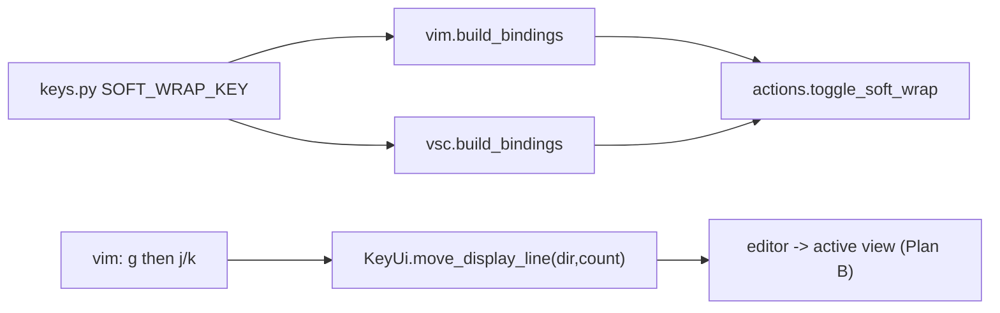

# Soft Wrap - Plan D: key bindings, gj/gk and guards (L0/L1/L3 + tests)

> Source of truth: `overview.md` + issue IKVRXT. Depends on Plan C (toggle
> action exists) and Plan B (view display-line move exists).
> Approval: unattended (auto-approved).

## 1. Goal / non-goals

- Goal: `alt+z` toggles wrap in both keymaps via a shared constant; vim `gj/gk`
  move by display line (degenerate to logical when wrap off); which-key hints;
  reserved-key check; key-drift guards.
- Non-goals: no vsc `gj/gk`; no change to `j/k` logical semantics; no breakage
  of `gg`, count, unknown-g-prefix drop.

## 2. Facts (verified, file:line)

- `keymaps/keys.py:60` `HOVER_DOC_KEY = "<f7>"`; `:62-66` `MACRO_*_KEY`;
  `:173-176` `MACRO_CONTROL_KEYS` (parse_key composition); `:108-167` `parse_key`
  maps `<alt-z>` -> `"\x1bz"` (single char + ESC prefix, not CSI).
- `keymaps/vim.py:147-245` `build_bindings`: hover `:235`, macro `:237-239`,
  `gg` `:159`; `:755+` `_handle_normal`: g-prefix `gg` resolve `:793-795`,
  find followers `:796-808`, unknown follower drop `:809-811`, arm prefix
  `:824-829`, motion dispatch `:840-843`; `_handle_visual:514-693` gg `:549-551`,
  unknown drop `:576-577`, motion `:681-688`; `chord_hints:336-396` g line
  `:377-378` `(("g","go to line N / first line (gg)"),)`.
- `keymaps/base.py:55-69` `KeyUi` frozen dataclass (6 fields, no defaults);
  single prod construction `editor_compose.py:397-404` (keyword args);
  5 test constructions (conftest.py:356, test_vim_keymap.py:51,
  test_registries.py:26, test_input_assist.py:76, test_editor_core.py:770).
  Add a field WITH a default -> all test constructions unchanged.
- `keymaps/vsc.py:8` re-exports `HOVER_DOC_KEY` from base; `:13` imports
  `MACRO_*` from keys; `build_bindings:42-132` table-driven `_k(spec, action, ...)`.
- `vim.RESERVED_KEYS:93-95` does not contain `"\x1bz"` -> alt+z safe as a
  table binding; base `reserved_keys:105` same.
- `actions.populate` `toggle_keymap` `:233` precedent for toggle action binding.
- `whichkey_flows.py:121-122` consumes `pending_prefix()`, `:199` `chord_hints()`.
- `tests/test_architecture.py:1615` `test_hover_key_is_shared_and_identical`
  (AST: both keymaps' build_bindings mention HOVER_DOC_KEY, no `"<f7>"` literal;
  runtime: both resolve to action) and `:1653`
  `test_macro_keys_are_shared_and_identical` -- templates for the new guard.

## 3. Design

- `keys.py`: add
  `SOFT_WRAP_KEY: str = "<alt-z>"` near `HOVER_DOC_KEY` (with `#:` doc comment).
  Add a `SOFT_WRAP_CONTROL_KEYS` tuple if a shared guard wants it (optional).
- `vim.py` / `vsc.py` `build_bindings`: add one binding
  `KeyBinding(SOFT_WRAP_KEY, "toggle_soft_wrap", ...)` importing the constant
  from `yate.keymaps.keys` (absolute import per coding-style §1.3). Never
  inline `"<alt-z>"` / `"\x1bz"` literal.
- `base.py::KeyUi`: append field
  `move_display_line: Callable[[int, int], None] | None = None`
  (direction +/-1, count>=1; `None` = headless). Per §三.5/IKJUWP a callback
  field on a dataclass is an instance attribute, not a module alias -> no
  `type` statement needed; pyright strict accepts `Callable[[int,int], None] | None`.
- `editor_compose.py::397` inject `move_display_line=ed.move_display_line`
  (Plan B/C adds `editor.move_display_line` thin delegate to active view's
  `EditorView.move_display_line`).
- vim gj/gk:
  - In `_handle_normal`, after `gg` resolve (`:795`) add:
    ```python
    if self.prefix == "g" and key in ("j", "k"):
        count = self._typed_count()
        self.prefix = None
        self.count_str = ""
        if self.ui.move_display_line is not None:
            self.ui.move_display_line(1 if key == "j" else -1, count)
        else:
            self._motion(ctx, key, count, select=False)  # headless: logical
        return True
    ```
    (count by display rows via injected callback; wrap-off the view layer
    degenerates to logical rows. headless fallback keeps logical semantics.)
  - In `_handle_visual`, after gg (`:551`) add the same branch with
    `select=True` equivalent: when callback present call it (it operates on
    the active selection via the view/buffer); else existing `_motion(...,
    select=True)`. Keep unknown-follower drop intact (new branch only claims
    j/k).
  - `chord_hints:377-378`: extend text to include `j`/`k`
    (e.g. `"g: gg / gj / gk (display line)"`), no new key tuple.
- which-key: binding `description` auto-exposes alt+z; no manual table edit.
- Reserved-key check: assert in tests that `parse_key(SOFT_WRAP_KEY)` is not
  in `vim.RESERVED_KEYS` nor base `reserved_keys()` output.

## 4. Files (exclusive)

- `yate/keymaps/keys.py`
- `yate/keymaps/vim.py`
- `yate/keymaps/vsc.py`
- `yate/keymaps/base.py`
- `yate/editor_compose.py`
- `tests/test_architecture.py` (add ONE guard, mirror hover/macro guards)
- NEW `tests/test_soft_wrap_keys.py` (gj/gk behavior + alt+z + reserved check)

## 5. Steps & acceptance commands

1. Add shared constant + both bindings (import constant, no literals).
2. Add `KeyUi.move_display_line` default-None field + injection in editor_compose.
3. Add vim normal + visual gj/gk branches + chord_hints text.
4. Add architecture drift guard `test_soft_wrap_key_is_shared_and_identical`
   (AST both keymaps mention `SOFT_WRAP_KEY` and no `"<alt-z>"`/`"\x1bz"`
   literal in build_bindings; runtime both resolve `toggle_soft_wrap`).
5. Add behavior tests: `3gj` moves 3 display rows with a stub callback
   (assert direction/count), wrap-off stub degenerates, `gg` still works,
   unknown `gq` still dropped, alt+z in both keymaps resolves toggle action.
6. Verify:
   - `.venv\Scripts\python.exe -m pyright yate/keymaps/ tests/test_architecture.py tests/test_soft_wrap_keys.py`
   - `.venv\Scripts\python.exe -m pytest tests/test_vim_keymap.py tests/test_soft_wrap_keys.py -q -n 1`
   - `.venv\Scripts\python.exe -m pytest tests/test_architecture.py -q` (now 42 guards)

## 6. Risks / rollback

- Risk: `KeyUi` field without default breaks 5 test constructions -> always give
  a default; run full keymap tests.
- Risk: gj/gk branch steals unknown-g drop semantics -> only claim `j`/`k`;
  add explicit `gq` regression test.
- Risk: `chord_hints` string change breaks which-key snapshot test ->
  run `tests/test_whichkey*.py` too.
- Risk: architecture guard narrow-cased literal scan false positive on the
  constant definition line -> scan only `build_bindings` bodies (mirror the
  hover guard's AST scoping).
- Rollback: revert listed files; guard/test additions are isolated.

## 7. Mermaid


