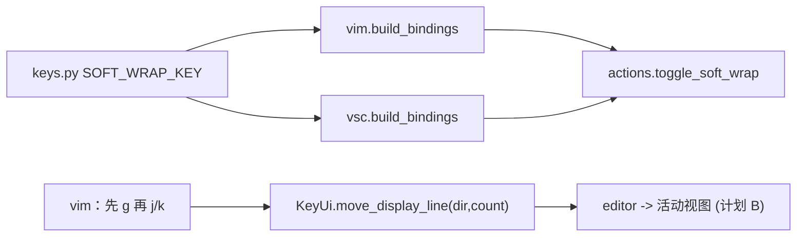

# 软换行 - 计划 D：按键绑定、gj/gk 与守卫（L0/L1/L3 + 测试）

> 唯一规范来源：`overview.md` + issue IKVRXT。依赖计划 C（切换动作已存在）
> 和计划 B（视图显示行移动已存在）。
> 审批：无人值守（自动批准）。

## 1. 目标 / 非目标

- 目标：`alt+z` 通过共享常量在两套 keymap 中切换换行；vim 的 `gj/gk`
  按显示行移动（关闭换行时退化为逻辑行）；which-key 提示；
  保留键检查；按键漂移守卫。
- 非目标：不做 vsc 的 `gj/gk`；不改变 `j/k` 的逻辑语义；不破坏
  `gg`、计数、未知 g 前缀的丢弃。

## 2. 事实（已核实，文件:行号）

- `keymaps/keys.py:60` 的 `HOVER_DOC_KEY = "<f7>"`；`:62-66` 的 `MACRO_*_KEY`；
  `:173-176` 的 `MACRO_CONTROL_KEYS`（parse_key 组合）；`:108-167` 的 `parse_key`
  将 `<alt-z>` 映射为 `"\x1bz"`（单字符 + ESC 前缀，不是 CSI）。
- `keymaps/vim.py:147-245` 的 `build_bindings`：hover `:235`、宏 `:237-239`、
  `gg` `:159`；`:755+` 的 `_handle_normal`：g 前缀 `gg` 解析 `:793-795`，
  查找后续键 `:796-808`，未知后续键丢弃 `:809-811`，武装前缀
  `:824-829`，动作分发 `:840-843`；`_handle_visual:514-693` 中 gg `:549-551`、
  未知丢弃 `:576-577`、动作 `:681-688`；`chord_hints:336-396` 的 g 行
  `:377-378` 为 `(("g","go to line N / first line (gg)"),)`。
- `keymaps/base.py:55-69` 的 `KeyUi` 冻结 dataclass（6 个字段，无默认值）；
  唯一的生产构造点 `editor_compose.py:397-404`（关键字参数）；
  5 处测试构造（conftest.py:356、test_vim_keymap.py:51、
  test_registries.py:26、test_input_assist.py:76、test_editor_core.py:770）。
  新增一个带默认值的字段 -> 所有测试构造保持不变。
- `keymaps/vsc.py:8` 从 base 重新导出 `HOVER_DOC_KEY`；`:13` 从 keys 导入
  `MACRO_*`；`build_bindings:42-132` 为表驱动 `_k(spec, action, ...)`。
- `vim.RESERVED_KEYS:93-95` 不含 `"\x1bz"` -> alt+z 作为表格绑定是安全的；
  base 的 `reserved_keys:105` 同理。
- `actions.populate` 的 `toggle_keymap` `:233` 是切换动作绑定的先例。
- `whichkey_flows.py:121-122` 消费 `pending_prefix()`，`:199` 消费 `chord_hints()`。
- `tests/test_architecture.py:1615` 的 `test_hover_key_is_shared_and_identical`
  （AST：两套 keymap 的 build_bindings 都提及 HOVER_DOC_KEY，无 `"<f7>"` 字面量；
  运行时：两者都解析到 action）和 `:1653` 的
  `test_macro_keys_are_shared_and_identical` —— 新守卫的模板。

## 3. 设计

- `keys.py`：在 `HOVER_DOC_KEY` 附近加入
  `SOFT_WRAP_KEY: str = "<alt-z>"`（带 `#:` 文档注释）。
  如果共享守卫需要，可加入 `SOFT_WRAP_CONTROL_KEYS` 元组（可选）。
- `vim.py` / `vsc.py` 的 `build_bindings`：加入一个绑定
  `KeyBinding(SOFT_WRAP_KEY, "toggle_soft_wrap", ...)`，从 `yate.keymaps.keys` 导入常量
  （按 coding-style §1.3 使用绝对导入）。绝不内联 `"<alt-z>"` / `"\x1bz"` 字面量。
- `base.py::KeyUi`：追加字段
  `move_display_line: Callable[[int, int], None] | None = None`
  （方向 +/-1，count>=1；`None` = 无头）。按 §三.5/IKJUWP，dataclass 上的回调
  字段是实例属性，而非模块别名 -> 无需 `type` 语句；pyright strict 接受
  `Callable[[int,int], None] | None`。
- `editor_compose.py::397` 注入 `move_display_line=ed.move_display_line`
  （计划 B/C 为活动视图的 `EditorView.move_display_line` 增加 `editor.move_display_line` 薄委托）。
- vim gj/gk：
  - 在 `_handle_normal` 中，`gg` 解析（`:795`）之后加入：
    ```python
    if self.prefix == "g" and key in ("j", "k"):
        count = self._typed_count()
        self.prefix = None
        self.count_str = ""
        if self.ui.move_display_line is not None:
            self.ui.move_display_line(1 if key == "j" else -1, count)
        else:
            self._motion(ctx, key, count, select=False)  # headless: logical
        return True
    ```
    （通过注入的回调按显示行计数；关闭换行时视图层退化为逻辑行。
    无头回退保持逻辑语义。）
  - 在 `_handle_visual` 中，gg（`:551`）之后加入等价的 `select=True` 分支：
    当回调存在时调用它（它通过视图/缓冲区作用于当前选区）；否则沿用现有
    `_motion(..., select=True)`。保持未知后续键丢弃不变（新分支只认领
    j/k）。
  - `chord_hints:377-378`：扩展文本以包含 `j`/`k`
    （例如 `"g: gg / gj / gk (display line)"`），不新增键元组。
- which-key：绑定 `description` 自动暴露 alt+z；无需手工修改表格。
- 保留键检查：在测试中断言 `parse_key(SOFT_WRAP_KEY)` 既不在
  `vim.RESERVED_KEYS` 中，也不在 base 的 `reserved_keys()` 输出中。

## 4. 文件（独占）

- `yate/keymaps/keys.py`
- `yate/keymaps/vim.py`
- `yate/keymaps/vsc.py`
- `yate/keymaps/base.py`
- `yate/editor_compose.py`
- `tests/test_architecture.py`（新增一个守卫，仿照 hover/macro 守卫）
- 新建 `tests/test_soft_wrap_keys.py`（gj/gk 行为 + alt+z + 保留键检查）

## 5. 步骤与验收命令

1. 加入共享常量 + 两处绑定（导入常量，不写字面量）。
2. 加入 `KeyUi.move_display_line` 默认 None 字段 + 在 editor_compose 中注入。
3. 加入 vim 的 normal + visual gj/gk 分支 + chord_hints 文本。
4. 加入架构漂移守卫 `test_soft_wrap_key_is_shared_and_identical`
   （AST：两套 keymap 都提及 `SOFT_WRAP_KEY`，且 build_bindings 中无
   `"<alt-z>"`/`"\x1bz"` 字面量；运行时：两者都解析 `toggle_soft_wrap`）。
5. 加入行为测试：`3gj` 用桩回调移动 3 个显示行
   （断言方向/计数），关闭换行桩退化为逻辑行，`gg` 仍有效，
   未知 `gq` 仍被丢弃，两套 keymap 中的 alt+z 都解析到切换动作。
6. 验证：
   - `.venv\Scripts\python.exe -m pyright yate/keymaps/ tests/test_architecture.py tests/test_soft_wrap_keys.py`
   - `.venv\Scripts\python.exe -m pytest tests/test_vim_keymap.py tests/test_soft_wrap_keys.py -q -n 1`
   - `.venv\Scripts\python.exe -m pytest tests/test_architecture.py -q`（现为 42 个守卫）

## 6. 风险 / 回滚

- 风险：`KeyUi` 字段没有默认值会破坏 5 处测试构造 -> 始终给出
  默认值；运行完整 keymap 测试。
- 风险：gj/gk 分支抢占未知 g 丢弃语义 -> 只认领 `j`/`k`；
  加入显式 `gq` 回归测试。
- 风险：`chord_hints` 字符串变更破坏 which-key 快照测试 ->
  也运行 `tests/test_whichkey*.py`。
- 风险：架构守卫的小写化字面量扫描在常量定义行误报 ->
  只扫描 `build_bindings` 函数体（仿照 hover 守卫的 AST 作用域）。
- 回滚：还原所列文件；守卫/测试新增内容是隔离的。

## 7. Mermaid


