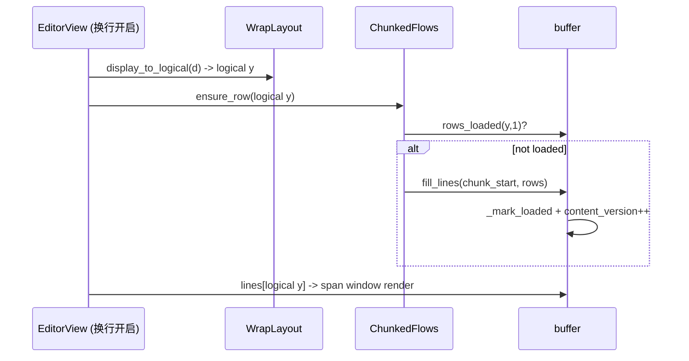

# 软换行 - 计划 E：分块/性能测试与边界守卫

> 唯一规范来源：`overview.md` + issue IKVRXT。对 AC2/AC6/AC7/AC8 的
> 横切验证。依赖计划 A-D 已合入 worktree。
> 审批：无人值守（自动批准）。本计划只负责测试文件，外加
> 测试中发现的最小生产修复（修复必须在 overview 回填中登记为偏离）。

## 1. 目标 / 非目标

- 目标：证明换行在分块文档上可用且不破坏惰性加载、
  区间表、占位行、锁定缓冲区的写保护（AC7）；证明逐帧渲染
  不会重扫整个文件（AC8）；覆盖窗口尺寸变化 / 标签切换 / keymap 切换
  时的重排与光标可见性（AC2）。
- 非目标：不做新的架构变更；除非测试暴露真实 bug，否则不做生产重构
  （若暴露则附实测证据登记偏离）。

## 2. 事实（已核实，文件:行号）

- `editor_core/chunked.py:159-169` 的 `chunk_for_row(row)`（bisect，逻辑行）；
  `:171-195` 的 `read_rows(start, count)` 为逻辑行。
- `flows/chunked_flows.py:86-117` 的 `ensure_row(doc, row)`：`rows_loaded` 命中
  则直接返回；否则 `chunk_for_row` -> `read_rows` -> `buf.fill_lines(chunk_start,
  rows)`；`:57-72` 附加首个分块；`:149-176` 的 `_scan_to_completion`
  后台扫描 + `_extend_placeholders:178-181`；`:121-136` 的 promote_to_full。
- `editor.py:302-314` 的 `_ensure_chunked_row(leaf_id, row)` 路由视图的
  `ensure_row` 回调；`:289-300` 的 `make_view` 注入
  `partial(self._ensure_chunked_row, leaf_id)`。
- `buffer.py:168-176` 的 `_loaded_starts/_loaded_ends` + `_fill_lock`；
  `:279-295` 的 `rows_loaded`；`:297-320` 的 `_mark_loaded`；`:322-343` 的 `fill_lines`
  （忽略锁定，递增 content_version）；`:345-357` 的 `extend_placeholders`；
  `:160` 的 `locked: bool = False` + 写保护契约 `:124-131`。
- 现有分块测试：`tests/test_chunked*.py`（通过搜索列出）覆盖逻辑行契约 ——
  必须保持通过。

## 3. 测试设计（全部新建于 `tests/test_soft_wrap_chunked.py`）

- 构造一个分块文档，在靠后的分块中放一条长行；开启换行；渲染
  属于该逻辑行的显示行；断言：
  - 渲染后 `buf.rows_loaded(logical_row, 1)` 为 True（通过以映射后的
    逻辑行而非显示行调用 `_ensure_row`）。
  - `_loaded_starts/_loaded_ends` 恰好包含预期的分块范围 ——
    没有额外加载分块，切换换行时不清空。
  - 跨换行切换 + 滚动，`doc.locked` 保持 True 且内容不变
    （写保护完好）。
- 分块文档打开时反复开关换行：断言 `content_version` 只因真实加载递增
  （而非因换行切换），无重复 `fill_lines`（用 spy 包装统计调用次数），
  无重入滚动。
- 性能/AC8：用 spy 统计 `WrapLayout.update` 的重建次数；
  模拟 100 次 `render_line` 调用，内容/宽度不变 -> 断言
  重建次数保持为 1。逻辑行数很大（如 50k）且可见窗口很短时，断言
  每帧没有 O(total_lines) 的工作（断言 `cell_offsets` 只对可见逻辑行
  调用 —— spy 主题函数，或在 WrapLayout 中保留一个内部计数器供测试访问）。
- AC2 视口变化：改变视图宽度 -> `on_resize` -> 重排 ->
  `reveal_cursor` 使光标显示行保持在可见区域内；切换标签
  （两个叶视图使用不同换行设置）-> 各自独立缓存；切换
  keymap -> 配置中的换行状态不变且视图正确重渲染。

## 4. 文件（独占）

- 新建 `tests/test_soft_wrap_chunked.py`
- （仅当测试暴露 bug 时）对相关生产文件做最小修复，
  在 `overview.md` 中连同失败断言 + 原因登记为偏离。

## 5. 步骤与验收命令

1. 用现有分块 fixtures/辅助函数编写分块换行测试。
2. 编写性能 spy 测试。
3. 编写视口/标签/keymap 重排测试。
4. 验证：
   - `.venv\Scripts\python.exe -m pyright tests/test_soft_wrap_chunked.py`
   - `.venv\Scripts\python.exe -m pytest tests/test_soft_wrap_chunked.py -q -n 1`
   - `.venv\Scripts\python.exe -m pytest tests/test_chunked_flows.py tests/test_chunked_loading.py -q -n 1`（现有分块套件）

## 6. 风险 / 回滚

- 风险：`WrapLayout` 重建计数器的测试替身需要生产钩子 ——
  增加一个公开 `rebuild_count` 属性，字段带 `#:` 文档，而非
  私有 spy；这是一个测试接缝，按现有模式可接受
  （`langdefs` 测试访问器先例）。
- 风险：`-n auto` 下 pilot/时序偶发失败 -> 本套件使用 `-n 1`；
  最终全量门禁仍须通过 `-n auto`（修复真实的偶发失败，绝不放松断言）。
- 回滚：删除新测试文件；还原任何最小生产修复并
  重新运行暴露的测试以确认变红（负向演练）。

## 7. Mermaid

