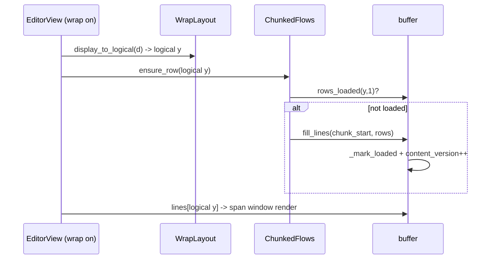

# Soft Wrap - Plan E: chunked/performance integration tests & edge guards

> Source of truth: `overview.md` + issue IKVRXT. Cross-cutting verification of
> AC2/AC6/AC7/AC8. Depends on Plans A-D being merged in the worktree.
> Approval: unattended (auto-approved). This plan owns TEST files only plus
> any minimal production fix found during tests (fixes must be logged as
> deviations in the overview backfill).

## 1. Goal / non-goals

- Goal: prove wrap works on chunked documents without breaking lazy loading,
  interval tables, placeholders, locked-buffer write protection (AC7); prove
  per-frame rendering does not re-scan the whole file (AC8); cover window
  resize / tab switch / keymap switch rewrap with cursor visibility (AC2).
- Non-goals: no new architecture changes; no production refactor unless a test
  exposes a real bug (then file a deviation with measured evidence).

## 2. Facts (verified, file:line)

- `editor_core/chunked.py:159-169` `chunk_for_row(row)` (bisect, logical);
  `:171-195` `read_rows(start, count)` logical.
- `flows/chunked_flows.py:86-117` `ensure_row(doc, row)`: `rows_loaded` hit
  returns; else `chunk_for_row` -> `read_rows` -> `buf.fill_lines(chunk_start,
  rows)`; `:57-72` attach first chunk; `:149-176` `_scan_to_completion`
  background scan + `_extend_placeholders:178-181`; `:121-136` promote_to_full.
- `editor.py:302-314` `_ensure_chunked_row(leaf_id, row)` routes view's
  `ensure_row` callback; `:289-300` `make_view` injects
  `partial(self._ensure_chunked_row, leaf_id)`.
- `buffer.py:168-176` `_loaded_starts/_loaded_ends` + `_fill_lock`;
  `:279-295` `rows_loaded`; `:297-320` `_mark_loaded`; `:322-343` `fill_lines`
  (ignores locked, bumps content_version); `:345-357` `extend_placeholders`;
  `:160` `locked: bool = False` + write-protection contract `:124-131`.
- Existing chunked tests: `tests/test_chunked*.py` (list via search) cover the
  logical-row contract — must stay green.

## 3. Design of tests (all NEW in `tests/test_soft_wrap_chunked.py`)

- Build a chunked doc with a long line in a later chunk; enable wrap; render
  the display rows that belong to that logical line; assert:
  - `buf.rows_loaded(logical_row, 1)` is True after render (via `_ensure_row`
    called with the mapped logical row, not display row).
  - `_loaded_starts/_loaded_ends` contain exactly the expected chunk range —
    no extra chunks loaded, no clearing on wrap toggle.
  - `doc.locked` stays True and content unchanged across wrap toggle +
    scroll (write protection intact).
- Toggle wrap on/off repeatedly while a chunked doc is open: assert
  `content_version` increments only from real loads (not from wrap toggles),
  no duplicate `fill_lines` (spy wrapper counting calls), no re-entrant scroll.
- Performance/AC8: instrument `WrapLayout.update` rebuild count via a spy;
  simulate 100 `render_line` calls with unchanged content/width -> assert
  rebuild count stays 1. With a large logical-line count (e.g. 50k) and a
  short visible window, assert no O(total_lines) work per frame (assert
  `cell_offsets` called only for visible logical rows — spy on theme function
  or keep an internal counter in WrapLayout exposed for tests).
- AC2 viewport changes: resize the view width -> `on_resize` -> rewrap ->
  `reveal_cursor` keeps cursor display row inside visible region; switch tab
  (two leaf views with different wraps) -> each caches independently; switch
  keymap -> wrap state in config unchanged and view re-renders correctly.

## 4. Files (exclusive)

- NEW `tests/test_soft_wrap_chunked.py`
- (Only if tests expose a bug) minimal fix in the implicated production file,
  logged as a deviation in `overview.md` with the failing assertion + cause.

## 5. Steps & acceptance commands

1. Write chunked wrap tests using existing chunked fixtures/helpers.
2. Write performance spy tests.
3. Write viewport/tab/keymap rewrap tests.
4. Verify:
   - `.venv\Scripts\python.exe -m pyright tests/test_soft_wrap_chunked.py`
   - `.venv\Scripts\python.exe -m pytest tests/test_soft_wrap_chunked.py -q -n 1`
   - `.venv\Scripts\python.exe -m pytest tests/test_chunked_flows.py tests/test_chunked_loading.py -q -n 1` (existing chunked suite)

## 6. Risks / rollback

- Risk: test double for `WrapLayout` rebuild counter needs a production hook —
  add a public `rebuild_count` attribute with a `#:`-documented field instead
  of a private spy; this is a test seam, acceptable per existing pattern
  (`langdefs` test accessors precedent).
- Risk: pilot/timing flake under `-n auto` -> use `-n 1` for this suite; final
  full gate `-n auto` must still pass (fix any real flake, never relax asserts).
- Rollback: delete the new test file; revert any minimal production fix and
  re-run the exposed test to confirm red (negative drill).

## 7. Mermaid

