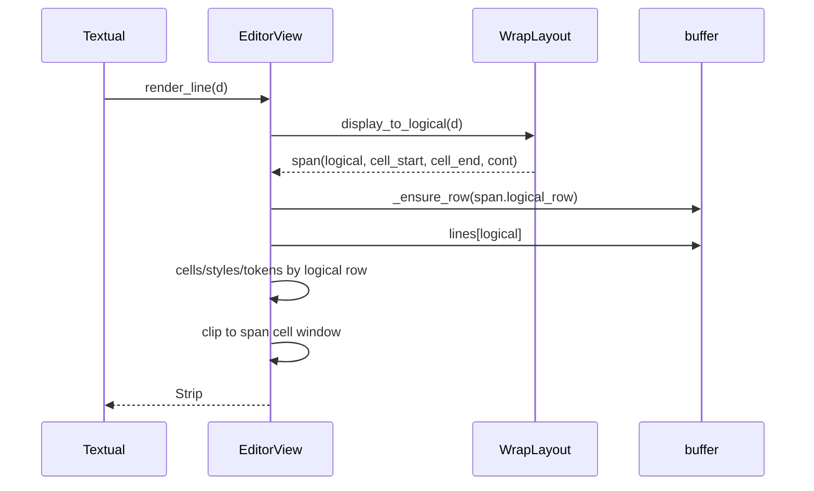

# 软换行 - 计划 B：视图集成（L2 渲染）

> 唯一规范来源：`overview.md` + issue IKVRXT。依赖计划 A（`WrapLayout`）。
> 本子计划只负责 `view.py`。审批：无人值守（自动批准）。

## 1. 目标 / 非目标

- 目标：将 `WrapLayout` 接入 `EditorView`，使开启换行时的渲染、虚拟尺寸、
  鼠标命中测试、光标可见性、行号栏和高亮全部使用显示行->逻辑行的映射；
  关闭换行时行为与现有实现逐字节一致。
- 非目标：不做配置/按键变更（计划 C/D），不新增控件类（R15 保持
  干净 —— 我们扩展现有的 `EditorView(ScrollView)`），不修改缓冲区。

## 2. 事实（已核实，文件:行号）

- `view.py:72` 的 `EditorView(ScrollView, HighlightMixin)`；构造函数
  `view.py:90-102` 的参数为 `leaf_id, panes, session, lsp, keymaps, handle_key,
  handle_mouse, ensure_row, **kwargs`。
- `view.py:109-111` 的 `_ensure_row` 钩子；`view.py:121` 的 `self.scroll_col = 0`。
- `view.py:230-235` 的 `_update_virtual_size()`：`Size(width, max(1, buf.line_count))`
  -> 开启换行时高度必须变为 `wrap.display_count()`。
- `view.py:237-239` 的 `on_resize()` -> `_update_virtual_size()`（视口变化）。
- `view.py:252-267` 的 `buffer_pos_from_mouse()`：`row=clamp(event.y+scroll_offset.y)`，
  `cell=event.x-gutter_width()+scroll_col` -> 开启换行时必须通过 WrapLayout 将显示行映射为
  逻辑行 + cell 窗口。
- `view.py:312-343` 的 `reveal_cursor()`：设置 `scroll_col`（水平）和
  `scroll_to(y=row)`（垂直）。开启换行时：垂直滚动以显示行为单位；
  水平滚动禁用（依照 overview §7.4 第 5 项，scroll_col 强制为 0）。
- `view.py:345-347` 的 `page_delta()` 以逻辑行为单位使用 `size.height` -> 开启换行时
  翻页应按显示行移动（具体语义暂缓：保持按逻辑行翻页可接受；需记录说明）。
- `view.py:349-351` 的 `gutter_width()` = `max(3, len(str(line_count)))+3` —— 不变。
- `view.py:353-369` 的 `_syntax_kinds(y, ...)` 接收逻辑行 y 和 cell 长度。
- `view.py:373-499` 的 `render_line(y)`：`y += scroll_offset.y`（405），对逻辑 y
  调用 `_ensure_row(y)`（408-409），`line=buf.lines[y]`（414），`offsets=cell_offsets`（422），
  cell 展开（425-435），`_syntax_kinds/_diagnostic_underlines/_row_style_ranges`
  全部按逻辑 y 计算（439-443），行号 `num=str(y+1).rjust(digits)`（461），
  文本窗口 `end=min(scroll_col+text_w, n_cells)`（474-499）。
- `view.py:533-561` 的 `_diagnostic_underlines`、`563-626` 的 `_row_style_ranges`、
  `628-646` 的 `_matches_for_row`、`648-668` 的 `_cell_style` —— 全部以逻辑行为键。
- `highlighting.py:192-229` 的 `_tokens_for(row)` 以逻辑行为键（缓存键
  `(doc, filetype, content_version)`）-> 续行以 cell 偏移量复用同一逻辑行的 token；
  无需修改 highlighting.py。
- `buffer.py:341/356` 在填充/占位时递增 `content_version` -> 缓存失效。

## 3. 设计

- 新增构造函数参数 `wrap_enabled: Callable[[], bool]`（默认容忍 `None`：
  将 `None` 视作 lambda:False 以适配无头/遗留测试）。沿用
  `which_key_enabled` 的注入先例（`editor_compose.py:381-382`）。L2
  从不导入 config（符合 R4）。
- 新增字段 `self._wrap = WrapLayout()`；`self._wrap_key: tuple = ()`。
- 新增方法 `_sync_wrap(text_w: int) -> tuple[bool, int]`：读取 `wrap_enabled()`；
  计算 `text_w = max(1, self.size.width - gutter_width())`；调用
  `self._wrap.update(buf.content_version, text_w, buf.lines, buf.tab_width, on)`；
  返回 `(on, text_w)`。在 `render_line`、`_update_virtual_size`、
  `buffer_pos_from_mouse`、`reveal_cursor` 的开头调用。
- `render_line` 开启换行时的路径：
  1. `display_row = y + scroll_offset.y`。
  2. `span = wrap.display_to_logical(display_row)`；若为 None -> 填充背景并返回。
  3. `logical_y = span.logical_row`；调用 `self._ensure_row(logical_y)`（逻辑
     行传入分块加载器 —— 保持 AC7 契约，仅 y 的语义改变）。
  4. `line = buf.lines[logical_y]`；用 `offsets`、`cells`、`styles`、`kinds`、
     `line_diags`、`underlines`、`_row_style_ranges` 全部按 `logical_y` 构建，与现有做法一致。
  5. 文本窗口：不使用 `[scroll_col, scroll_col+text_w)`，改用 span 的
     `[span.cell_start, span.cell_end)` cell 窗口。换行模式下 `scroll_col` 为 0。
     行号栏：仅当 `span.continuation == 0` 时显示行号，否则用空格填充至
     `digits` 宽度；每个显示行都显示诊断标记（同一逻辑行的诊断）。
     选中/光标样式仍按逻辑行计算，再裁剪到 span 窗口（使续行上的光标
     显示在正确的 cell 处 —— AC6）。
  6. 关闭换行路径：现有代码不变（`span` 恒等映射来自计划 A，
     两条路径得以统一；优先采用单一代码路径，使用 span 窗口，
     关闭换行时保留 `scroll_col`，由 `on` 守卫）。
- `buffer_pos_from_mouse` 开启换行时：将 `display_row` 映射为 `span`，然后
  `cell = span.cell_start + (event.x - gutter_width())`，再在映射出的逻辑行上
  调用 `theme.cell_to_char(offsets, cell, tab_width)`。
  先确保 `_ensure_row(logical_y)`，以免占位行被当作文本处理。
- `reveal_cursor` 开启换行时：`wrap.logical_to_display(cursor_row, cursor_col)`
  -> 目标显示行；以显示行调用 `scroll_to(y=...)`；跳过水平的
  `scroll_col` 分支（强制为 0）。关闭换行时：不变。
- `content_changed` / `on_resize` 已调用 `_update_virtual_size` 和
  `refresh`；换行缓存通过 `content_version`/宽度键自失效。

## 4. 文件（独占）

- 仅 `yate/editor_components/view.py`（通过绝对路径
  `from yate.editor_components.wrap_layout import WrapLayout` 导入 `WrapLayout`）。

## 5. 步骤与验收命令

1. 新增构造函数参数 + 字段 + `_sync_wrap` 辅助方法。
2. 将 `render_line` 重构为统一的 span 窗口路径（关闭换行 = 恒等 span）。
3. 更新 `_update_virtual_size`、`buffer_pos_from_mouse`、`reveal_cursor`。
4. 验证：
   - `.venv\Scripts\python.exe -m pyright yate/editor_components/view.py`
   - `.venv\Scripts\python.exe -m pytest tests/test_app_render.py tests/test_editor_view.py -q -n 1`（现有渲染测试，关闭换行回归 = AC3）
   - `.venv\Scripts\python.exe -m pytest tests/test_architecture.py -q`（R15、层级 rank）

## 6. 风险 / 回滚

- 风险：统一代码路径导致关闭换行回归（AC3）-> 保持恒等
  span 路径最小化，先运行现有渲染测试。
- 风险：光标/鼠标定位错误（AC6）-> 用一条已知长行编写表驱动视图测试；
  检查续行点击映射到正确的（行, 列）。
- 风险：`_ensure_row` 传入显示行而非逻辑行 -> 破坏 AC7；
  代码审查断言：调用点始终使用 `span.logical_row`。
- 回滚：git checkout `view.py`（计划 A 的模块保留，无害）。

## 7. Mermaid

