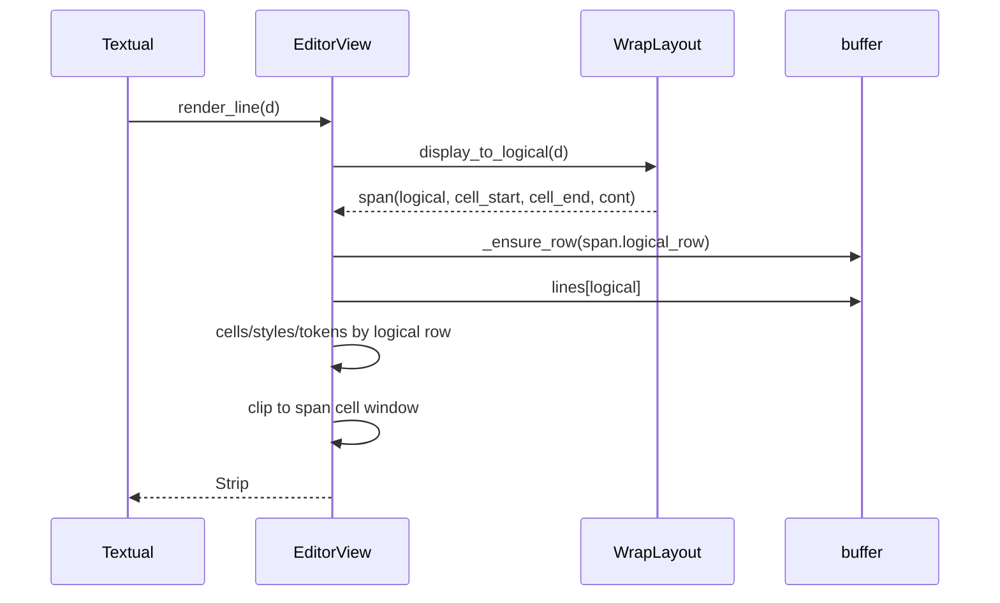

# Soft Wrap - Plan B: view integration (L2 rendering)

> Source of truth: `overview.md` + issue IKVRXT. Depends on Plan A (`WrapLayout`).
> This sub-plan owns `view.py` only. Approval: unattended (auto-approved).

## 1. Goal / non-goals

- Goal: wire `WrapLayout` into `EditorView` so wrap-on rendering, virtual
  size, mouse hit-testing, cursor exposure, gutter and highlight all use the
  display->logical mapping; wrap-off is byte-for-byte existing behavior.
- Non-goals: no config/key changes (Plan C/D), no new widget class (R15 stays
  clean -- we extend the existing `EditorView(ScrollView)`), no buffer edits.

## 2. Facts (verified, file:line)

- `view.py:72` `EditorView(ScrollView, HighlightMixin)`; constructor
  `view.py:90-102` params `leaf_id, panes, session, lsp, keymaps, handle_key,
  handle_mouse, ensure_row, **kwargs`.
- `view.py:109-111` `_ensure_row` hook; `view.py:121` `self.scroll_col = 0`.
- `view.py:230-235` `_update_virtual_size()`: `Size(width, max(1, buf.line_count))`
  -> wrap-on height must become `wrap.display_count()`.
- `view.py:237-239` `on_resize()` -> `_update_virtual_size()` (viewport change).
- `view.py:252-267` `buffer_pos_from_mouse()`: `row=clamp(event.y+scroll_offset.y)`,
  `cell=event.x-gutter_width()+scroll_col` -> wrap-on must map display row to
  logical row + cell window via WrapLayout.
- `view.py:312-343` `reveal_cursor()`: sets `scroll_col` (horizontal) and
  `scroll_to(y=row)` (vertical). Wrap-on: vertical scroll in display rows;
  horizontal disabled (per overview §7.4 item 5, scroll_col forced 0).
- `view.py:345-347` `page_delta()` uses `size.height` in logical rows -> wrap-on
  should move display rows when paginating (defer exact semantics: keep page by
  logical rows, acceptable; document).
- `view.py:349-351` `gutter_width()` = `max(3, len(str(line_count)))+3` -- unchanged.
- `view.py:353-369` `_syntax_kinds(y, ...)` takes logical row y and cell length.
- `view.py:373-499` `render_line(y)`: `y += scroll_offset.y` (405), `_ensure_row(y)`
  on the logical y (408-409), `line=buf.lines[y]` (414), `offsets=cell_offsets` (422),
  cells expanded (425-435), `_syntax_kinds/_diagnostic_underlines/_row_style_ranges`
  all by logical y (439-443), gutter `num=str(y+1).rjust(digits)` (461),
  text window `end=min(scroll_col+text_w, n_cells)` (474-499).
- `view.py:533-561` `_diagnostic_underlines`, `563-626` `_row_style_ranges`,
  `628-646` `_matches_for_row`, `648-668` `_cell_style` -- all logical-row keyed.
- `highlighting.py:192-229` `_tokens_for(row)` keyed by logical row (cache
  `(doc, filetype, content_version)`) -> continuation rows reuse the same
  logical row's tokens with a cell offset; no highlighting.py change needed.
- `buffer.py:341/356` bump `content_version` on fill/placeholder -> cache invalidation.

## 3. Design

- New constructor param `wrap_enabled: Callable[[], bool]` (default `None`-
  tolerant: treat `None` as lambda:False for headless/legacy tests). Mirror the
  `which_key_enabled` injection precedent (`editor_compose.py:381-382`). L2
  never imports config (R4 compliant).
- New field `self._wrap = WrapLayout()`; `self._wrap_key: tuple = ()`.
- New method `_sync_wrap(text_w: int) -> tuple[bool, int]`: read `wrap_enabled()`;
  compute `text_w = max(1, self.size.width - gutter_width())`; call
  `self._wrap.update(buf.content_version, text_w, buf.lines, buf.tab_width, on)`;
  return `(on, text_w)`. Called at top of `render_line`, `_update_virtual_size`,
  `buffer_pos_from_mouse`, `reveal_cursor`.
- `render_line` wrap-on path:
  1. `display_row = y + scroll_offset.y`.
  2. `span = wrap.display_to_logical(display_row)`; if None -> fill bg, return.
  3. `logical_y = span.logical_row`; call `self._ensure_row(logical_y)` (logical
     row into chunked loader -- AC7 contract preserved, y semantics changes only).
  4. `line = buf.lines[logical_y]`; build `offsets`, `cells`, `styles`, `kinds`,
     `line_diags`, `underlines`, `_row_style_ranges` all with `logical_y` as today.
  5. Text window: instead of `[scroll_col, scroll_col+text_w)`, use the span's
     `[span.cell_start, span.cell_end)` cell window. `scroll_col` is 0 in wrap
     mode. Gutter: show line number only when `span.continuation == 0`, else
     blank padded to `digits`; diagnostic mark shown on every display row (same
     logical row's diag). Selection/cursor styles still computed for the logical
     row and clipped to the span window (so a cursor on a continuation row is
     visible at the correct cell -- AC6).
  6. Wrap-off path: existing code unchanged (`span` identity mapping from Plan A
     makes the two paths converge; prefer a single code path using span windows
     with `scroll_col` retained for wrap-off, guarded by `on`).
- `buffer_pos_from_mouse` wrap-on: map `display_row` -> `span`, then
  `cell = span.cell_start + (event.x - gutter_width())`, then
  `theme.cell_to_char(offsets, cell, tab_width)` on the mapped logical line.
  Ensure `_ensure_row(logical_y)` first so a placeholder is not treated as text.
- `reveal_cursor` wrap-on: `wrap.logical_to_display(cursor_row, cursor_col)` ->
  target display row; `scroll_to(y=...)` with display row; skip the horizontal
  `scroll_col` branch (force 0). Wrap-off: unchanged.
- `content_changed` / `on_resize` already call `_update_virtual_size` and
  `refresh`; wrap cache self-invalidates via `content_version`/width key.

## 4. Files (exclusive)

- `yate/editor_components/view.py` ONLY (import `WrapLayout` via absolute path
  `from yate.editor_components.wrap_layout import WrapLayout`).

## 5. Steps & acceptance commands

1. Add constructor param + fields + `_sync_wrap` helper.
2. Refactor `render_line` to a unified span-window path (wrap-off = identity span).
3. Update `_update_virtual_size`, `buffer_pos_from_mouse`, `reveal_cursor`.
4. Verify:
   - `.venv\Scripts\python.exe -m pyright yate/editor_components/view.py`
   - `.venv\Scripts\python.exe -m pytest tests/test_app_render.py tests/test_editor_view.py -q -n 1` (existing render tests, wrap-off regression = AC3)
   - `.venv\Scripts\python.exe -m pytest tests/test_architecture.py -q` (R15, layer ranks)

## 6. Risks / rollback

- Risk: wrap-off regression (AC3) from unifying code paths -> keep the identity
  span path minimal and run existing render tests first.
- Risk: cursor/mouse misplacement (AC6) -> table-driven view tests with a known
  long line; check continuation-row click maps to correct (row, col).
- Risk: `_ensure_row` called with display row instead of logical -> AC7 break;
  code review assertion: call site always uses `span.logical_row`.
- Rollback: git checkout `view.py` (Plan A module remains, harmless).

## 7. Mermaid

