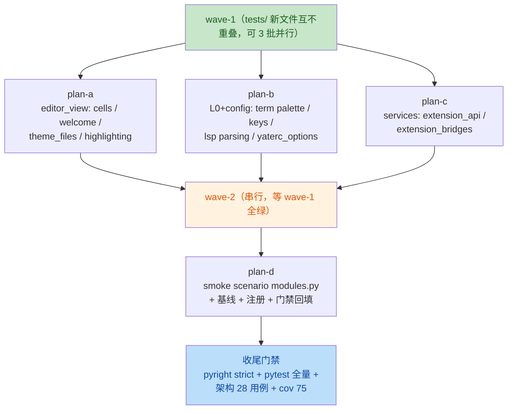

# split-module-tests 总纲（issue IKKS9X：新拆分子模块的单元测试与冒烟测试）

任务：为 big-module-split（a-f 波）与 extensions-split 拆出的子模块补齐专属单元
测试，并新增冒烟 scenario。工作树 `D:/Programming/yate-split-module-tests`（分支
`enh/split-module-tests`），`yate/` 产品代码零改动。

## 一、目标与非目标

### 目标

1. 为 14 个新拆分子模块补齐**缺口处**的专属单元测试（`tests/test_<module>.py`），
   逐模块给出"现有测试 ↔ 缺口"映射，不重复既有覆盖；
2. 新增冒烟 scenario（挂在 `tools/smoke_test/scenarios/` 注册表，复用既有
   harness 与基线机制），覆盖新拆分模块的端到端协同路径；
3. 验收门禁：pyright strict 零诊断、`pytest tests/ -q` 全绿、架构测试
   （`tests/test_architecture.py` 28 用例）通过、覆盖率
   `--cov-fail-under=75` 不降。

### 非目标

- 不改产品代码（`yate/` 零改动是硬约束；唯一产品侧改动是
  `tools/smoke_test/scenarios/__init__.py` 注册新组——属冒烟工具而非 yate 包）；
- 不动 smoke harness 本体（`tools/smoke_test/harness.py` / `baselines.py` /
  `cli.py` / `report.py`）与既有 4 个 `tests/test_smoke_*.py`；
- 不为已有充分覆盖的模块重建重复测试文件（映射表见 §三）；
- 不新增 TAGS、不新增 Protocol / TYPE_CHECKING / Any。

## 二、调研取证（关键事实，均已核实）

### 2.1 冒烟基础设施现状

- harness：`tools/smoke_test/harness.py`——`new_app()` / `Scenario` / `Check` /
  `ScenarioResult` / `run_scenarios` / `TAGS`（11 个 tag，harness.py:87-99，
  不新增）；SVG 行提取 `snapshot_svg`（Textual 8.2.8 格式锚定）。
- scenario 注册表：`tools/smoke_test/scenarios/__init__.py` 拼接 18 个组文件的
  `SCENARIOS` 列表；scenario 形态 `async def run(tmp: Path) -> ScenarioResult`
  + `Scenario(name, run, tags, slow=)`；助手在 `scenarios/_base.py`
  （`type_text` / `run_command`（F5 进命令行）/ `goto` / `wait_until` /
  `message_text`）。
- 基线：`tools/smoke_test/smoke_baselines/<scenario>.json`，由
  `python -m tools.smoke_test snapshot --scenario <name>` 生成，`compare` 做漂移。
- 既有 pytest 冒烟测试只测 harness 纯函数与 CLI 契约；scenario 本体不在
  pytest 内全量执行（`test_smoke_harness.py` 模块 docstring 明示），由
  `python -m tools.smoke_test run`（release gate）执行。
- 注册表守卫已存在（`test_smoke_harness.py`：name 唯一 / tag 已声明 /
  协程 / docstring / primary_tag），新增 scenario 自动受检。

### 2.2 现有测试 ↔ 模块映射与缺口（grep + 用例名逐条核实）

| # | 模块 | 现有覆盖（测试文件：证据） | 缺口 → 处置 |
|---|---|---|---|
| 1 | `editor_syntax/langdefs.py` | `test_highlight.py` 64 用例直接覆盖包根 re-export（register_language / available_filetypes / format_filetype_candidates 截断 / resolve / language_name / 各语言词表）+ `test_ts_backend.py` import langdefs | 无实质缺口 → **不新建文件** |
| 2 | `editor_view/diff_pane.py` | `test_diffview.py` 49 用例直接 import `DiffPane`（render_line / 宽字符 / 编辑模式 / vim 表 / unmount 安全 / reveal 滚动） | 无缺口 → **不新建文件** |
| 3 | `editor_view/highlighting.py` | 仅 `test_app_render.py` monkeypatch `_tokenize_with_states`（app 级） | mixin 的 token 缓存 / 编辑失效 / probe / 延迟调度零直测 → `test_highlighting.py` |
| 4 | `editor_view/welcome.py` | 仅 app 级欢迎页测试（`test_app_textual` / `test_app_render`） | 纯函数缓存键 / 居中 / vim 分支零直测 → `test_welcome.py` |
| 5 | `editor_view/themes.py` | `test_theme_palettes.py` 经门面直接覆盖全部公开 API（validate / to_textual / textual_theme_name / register / set / THEMES） | 无缺口 → **不新建文件** |
| 6 | `editor_view/cells.py` | 无任何测试 | 全公开纯函数 → `test_cells.py`（13 用例） |
| 7 | `editor_view/theme_files.py` | `test_theme_palettes.py` 经门面 `load_theme_paths` | `load_theme_file` 直测（坏文件 / 幂等缓存 / `_` 前缀跳过）零覆盖 → `test_theme_files.py` |
| 8 | `editor_term/palette.py` | `test_terminal_emulator.py:19` 仅 2 符号（ANSI_16_RGB / palette_color 主路径） | 16 色 / 676 彩色公式 / 灰度 / 越界钳制分支 → `test_term_palette.py` |
| 9 | `editor_term/keys.py` | 无任何测试 | 全部分支 → `test_term_keys.py`（11 用例） |
| 10 | `editor_lsp/parsing.py` | `test_diagnostics.py:24` 仅 `_parse_diagnostics` | 其余 6 函数（UTF-16 往返 / unwrap / range / completion item 分支）→ `test_lsp_parsing.py` |
| 11 | `yaterc_options.py` | 经 `yate.yaterc` 门面（`test_config.py` / `test_set_options.py`） | `_extract_*` 逐函数分支与错误消息 → `test_yaterc_options.py` |
| 12 | `services/extension_api.py` | `test_extensions.py` 22 用例经门面（rollback / guarded callback / unknown keymap / teardown） | bind_key 装饰器 / both / normal 别名 / 位置参数、command 装饰器、accessors、二次 start_scope 警告 → `test_extension_api.py` |
| 13 | `services/extension_bridges.py` | 仅 `test_ts_backend.py` 用 `SyntaxExtensionBridge`；其余 3 桥零直测 | Lsp / Highlight / Sprite 桥 → `test_extension_bridges.py` |
| 14 | `services/extension_loader.py` | `test_extensions.py` 22 用例（顺序 / trust / symlink / 去重 / sys.modules 清理 / teardown 隔离） | 无实质缺口 → **不新建文件** |

私有面取舍：`parsing.py` 与 `yaterc_options.py` 的 `_` 前缀函数全部列入
`__all__`（模块 docstring 明示 wave-a private-registry precedent，是经
manager / yaterc re-export 的**事实包内公共 API**），直接 import 测试不算
白盒；沿用存量 `test_diagnostics.py` 的文件级
`# pyright: reportPrivateUsage=false` 惯例。`_parse_diagnostics` 已有覆盖
不迁移，新增用例只测其余函数。

### 2.3 测试基建约束

- `tests/conftest.py`：autouse `isolated_home`（Path.home → 临时目录，防触碰
  真实 `~/.yate`）、`YATE_PYTHON_LSP=off`；助手 `wait_until` / `plain_text` /
  `message_text` / `make_key_ui` / `make_action_context`。
- 覆盖率为 opt-in 门禁：`python -m pytest tests --cov=yate --cov-branch
  --cov-report=term-missing --cov-fail-under=75`（pyproject.toml:132，
  CI gate 75）。
- 全局注册表污染面：`themes.register_theme`（进程全局）、
  `editor_sprites.register_character`（进程全局）——测试必须 fixture 保存/恢复。
- `misc-rules.md` §四：测试注释与 docstring 一律英文。

## 三、子计划索引与执行波次

| 子计划 | 波次 | 独占文件清单（新建/修改） |
|---|---|---|
| plan-a editor_view 单测 | wave-1 | 新建 `tests/test_cells.py`、`tests/test_welcome.py`、`tests/test_theme_files.py`、`tests/test_highlighting.py` |
| plan-b L0/配置纯函数单测 | wave-1 | 新建 `tests/test_term_palette.py`、`tests/test_term_keys.py`、`tests/test_lsp_parsing.py`、`tests/test_yaterc_options.py` |
| plan-c extension 三件套单测 | wave-1 | 新建 `tests/test_extension_api.py`、`tests/test_extension_bridges.py` |
| plan-d 冒烟 scenario | wave-2 | 新建 `tools/smoke_test/scenarios/modules.py` + 基线 `tools/smoke_test/smoke_baselines/integration_extension_roundtrip.json`、`integration_custom_theme_file.json`；修改 `tools/smoke_test/scenarios/__init__.py`（注册 2 行） |



波次纪律：wave-1 三个子计划文件互不重叠，按 subagent-workflow 以 2~3 个一批
并行；每波验收（各自 pytest + pyright 退出码 0）通过才进入下一波；
wave-2 的 scenario 端到端触碰所有新模块，且基线生成 / compare 不宜与
pilot 并发（subagent-workflow §三.3 timing 干扰），故串行收尾。

## 四、统一验收命令（每子计划文档内有细化版）

```text
.venv\Scripts\python.exe -m pytest tests/test_<新文件>.py -q
.venv\Scripts\python.exe -m pyright <改动文件>
.venv\Scripts\python.exe -m pytest tests/test_architecture.py -q
```

收尾全量门禁：

```text
.venv\Scripts\python.exe -m pytest tests/ -q
.venv\Scripts\python.exe -m pyright yate/ tests/ tools/
.venv\Scripts\python.exe -m pytest tests --cov=yate --cov-branch --cov-report=term-missing --cov-fail-under=75
python -m tools.smoke_test compare
```

## 五、风险清单（总览，细项在各子计划）

| 风险 | 缓解 | 回滚 |
|---|---|---|
| `highlighting.py` mixin 直测需要 Textual host，`set_timer`/`run_worker` 在无 App 上下文抛错 | 用例在 `app.run_test()` 内以最小 host widget 测（conftest 既有模式）；若 mixin 与 EditorView 强耦到无法轻量宿主，**降级**为经 EditorView 集成用例，不改产品代码（需用户知悉取舍） | 删除该测试文件，其余不受影响 |
| 进程全局注册表污染（themes / sprites）跨用例泄漏 | fixture 保存/恢复（仿 `test_smoke_cli.py::restore_theme`） | fixture 化，无产品影响 |
| `_` 前缀 import 触发 pyright reportPrivateUsage | 文件级 `# pyright: reportPrivateUsage=false`（存量 15+ 模块惯例，如 `test_diagnostics.py`） | 无需回滚 |
| 新 scenario 的 SVG 基线对 Textual 版本漂移敏感 | snapshot 后立即 `compare` 验证零漂移；基线与用例同波提交 | 删除基线 json + scenario 注册行即可 |
| 并行子代理跑 pytest 的偶发 timing 失败 | 失败先重跑确认（subagent-workflow §三.3），不直接改断言 | — |
| `extension_bridges` 的 sprites 注册污染内置花名册 | 用 `test_sprite_...` 前缀名 + teardown/unregister 清理，断言后恢复 | fixture 恢复 |

## 六、批准记录

用户已指示无人值守执行（2026-10-12），本方案批准权已预授权；批准后直接进入
执行，无需等待确认。执行中的偏离须按 plan-before-execute §二.4 显式记录于
各子计划"执行记录"节。
