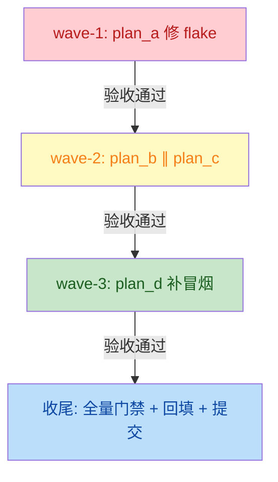

# test-speedup 总纲：测试提速与覆盖补强

## 一、目标与非目标

### 目标

1. **修复并行 flake**：`tests/test_app_panes.py::test_separator_click_does_not_move_cursor`
   在 `-n auto` 下偶发 `textual.pilot.OutOfBounds`，`-n 1` 复跑通过；
2. **提速最慢测试**：Top-5 最慢单元测试（合计 ≈ 52s）降至 ≈ 24s（Top-3 可提速测试
   从 33s 降至 5s，release tool 两用例 18s 维持不变属合理集成成本）；
3. **补强覆盖缺口**：将 `yate/flows/shell_flows.py`（63%）、`yate/editor_term/shells.py`（78%）
   等低于 90% 的文件提升至 90%+，整体覆盖率维持 ≥ 92%；
4. **补全冒烟场景**：新增 which-key、input_assist 等缺失场景，冒烟总数从 117 升至 120+。

### 非目标

- **不追 `yate/keyproto/driver_windows.py` 覆盖率**（26%）：真机键盘驱动需真实硬件钩子，
  投入产出比极低，显式排除并记录理由；
- **不改架构守卫测试的扫描逻辑**：`test_comments_and_docstrings_stay_ascii` /
  `test_no_relative_imports` 等 AST 扫描测试虽慢（5-6s），但属于架构防线，
  不在提速范围（除非实测证明可缓存）；
- **不降低覆盖率门槛**：`fail_under=75` 是 CI 硬门禁，维持不变；
- **不承诺具体提速秒数**：只给出可复测的对比口径（改前/改后 `pytest --durations=40`）。

## 二、现状基线（实测数字）

| 指标 | 基线值 | 测量命令 |
|---|---|---|
| 单元测试总数 | 3208 | `pytest tests/ --collect-only -q` |
| 单元测试墙钟（-n auto） | ≈ 100s | `pytest tests/ -q -n auto` |
| 冒烟测试场景数 | 117 | `python -m tools.smoke_test run --jobs 4` |
| 冒烟测试墙钟 | ≈ 24s | 同上 |
| 覆盖率（branch 模式） | 92.24% | `pytest tests/ --cov=yate --cov-branch -n auto` |
| 架构守卫用例数 | 37 | `pytest tests/test_architecture.py -q` |

### 最慢单元测试 Top-5（`pytest --durations=5`）

| 用例 | 基线耗时 | 根因 | 修订后目标 |
|---|---|---|---|
| `test_ts_backend.py::test_incremental_matches_full_reparse_over_random_edits` | 14.67s | 20000 步随机增量等价测试 | 3.7s（步数降至 5000） |
| `test_pack_wiki.py::test_stale_is_reported_then_retranslated` | 9.42s | lint 引擎初始化与 3 轮 × 10-15 页 lint | 0.5s（mock lint 引擎） |
| `test_release_tool.py::test_release_rolls_back_when_version_tests_fail` | 9.12s | 真实 git 子进程建仓（合理集成成本） | 9.12s（维持不变） |
| `test_terminal.py::test_output_buffer_overflow_drains_synchronously_without_loss` | 9.10s | 1MB buffer 喂入模拟器 | 0.01s（monkeypatch 缩小阈值） |
| `test_release_tool.py::test_release_refuses_when_tag_exists_on_origin` | 8.91s | 真实 git 子进程建仓（合理集成成本） | 8.91s（维持不变） |
| **Top-5 合计** | **≈ 52s** | — | **≈ 24s**（Top-3 可提速测试从 33s 降至 5s） |

### 并行 flake（实测复现）

`tests/test_app_panes.py::test_separator_click_does_not_move_cursor`（test_app_panes.py:525）：
`-n auto` 下 `textual.pilot.OutOfBounds: Target offset outside currently-visible screen region`；
`-n 1` 复跑通过。初判根因：`:vsplit` 后 `wait_until(leaf_count==2)` 为真时 pane region
尚未完成布局，`sx/sy` 用过期 region 计算（`left_view.region.width` 仍为全屏宽）导致坐标越界。

### 覆盖缺口（< 90% 的 yate 文件，branch 模式）

| 文件 | 覆盖率 | 缺失行 |
|---|---|---|
| `yate/flows/shell_flows.py` | 63% | 60-67, 73, 98, 127-128, 135-144 |
| `yate/editor_term/shells.py` | 78% | 49, 72-78 |
| `yate/flows/extension_flows.py` | 81% | 83-88, 91-93, 102 |
| `yate/editor_view/explorer.py` | 81% | 多处 |
| `yate/services/user_setup.py` | 81% | 335-336, 365, 372, 375-376, 389-403, 422-439 |
| `yate/cli.py` | 82% | 269-272, 293-295, 346-353, 405-408, 448, 455, 499 |
| `yate/flows/completion_flows.py` | 83% | - |
| `yate/flows/chunked_flows.py` | 84% | - |
| `yate/editor_view/terminal.py` | 84% | - |
| `yate/editor_syntax/engine.py` | 84% | 77-80, 92-93, 209-213 |
| `yate/editor_lsp/client.py` | 85% | - |

### 冒烟缺口

- 无 which-key 场景（功能存在：`yate/flows/whichkey_flows.py`、`yate/editor_view/whichkey.py`）；
- 无 input_assist 场景（待核实具体文件名）；
- LSP 相关冒烟在 `YATE_PYTHON_LSP=off` 下跳过，不属缺口。

## 三、子计划索引

| 子计划 | 职责 | 独占文件 | 波次 |
|---|---|---|---|
| [plan-a](test-speedup-flake-fix-plan-a.md) | 修复并行 flake | `tests/test_app_panes.py` | wave-1 |
| [plan-b](test-speedup-slow-tests-plan-b.md) | 提速最慢测试 | `tests/test_ts_backend.py`, `tests/test_terminal.py`, `tests/test_pack_wiki.py`, `tests/test_release_tool.py` | wave-2 |
| [plan-c](test-speedup-coverage-plan-c.md) | 补强覆盖缺口 | `tests/test_shell_flows.py`, `tests/test_shells.py`, `tests/test_extension_flows.py`, `tests/test_user_setup.py`, `tests/test_cli.py` | wave-2 |
| [plan-d](test-speedup-smoke-plan-d.md) | 补全冒烟场景 | `tools/smoke_test/scenarios/whichkey.py`, `tools/smoke_test/scenarios/__init__.py`, `tools/smoke_test/smoke_baselines/*.json` | wave-3 |

## 四、执行波次表

```
wave-1: plan_a                    # 修 flake（阻塞后续所有全量跑的可信度）
   ↓ 验收通过（pytest tests/test_app_panes.py -n auto 连续 5 次全绿）
wave-2: plan_b ∥ plan_c           # 提速慢测试 + 补覆盖（文件互不重叠，可并行）
   ↓ 验收通过（pyright + pytest + 架构守卫 + 覆盖率全绿）
wave-3: plan_d                    # 补冒烟场景（依赖 wave-2 的覆盖测试已就位）
   ↓ 验收通过（冒烟全量跑 + 基线校验）
收尾：主代理跑全量门禁，回填文档，提交
```

**波次依赖说明**：

- **wave-1 必须先做**：并行 flake 会影响后续所有 `-n auto` 跑的可信度，
  修完后才能准确测量提速效果；
- **wave-2 可并行**：plan-b 改慢测试文件，plan-c 新增覆盖测试文件，
  两者文件清单无交集；
- **wave-3 依赖 wave-2**：新增冒烟场景需要确保底层功能已被单元测试覆盖，
  避免冒烟失败时无法定位是冒烟本身问题还是功能缺陷。

## 五、风险清单与回滚路径

| 风险 | 影响 | 缓解 | 回滚 |
|---|---|---|---|
| 提速改动改变测试语义 | 测试失去原有防护 | 每个提速用例保留原断言的等价形式 | `git revert` 对应子计划的提交 |
| 新增覆盖测试暴露隐藏 bug | 阻塞合并 | 发现 bug 立即修复或登记 issue | 测试本身不回滚，bug 另案处理 |
| 冒烟基线漂移 | 冒烟 compare 失败 | 用 `--update-baselines` 重新登记 | 基线 JSON 文件 `git checkout` |
| 并行 flake 修复不彻底 | 仍偶发失败 | 连续跑 5 次验证 | 回退到 `-n 1` 串行（不推荐） |

## 六、验收门禁（与 CI 一致）

每个子计划的验收命令必须包含以下全量门禁（并行口径）：

```powershell
.venv\Scripts\python.exe -m pyright yate/ tests/ tools/
.venv\Scripts\python.exe -m pytest tests/ -q -n auto
.venv\Scripts\python.exe -m pytest tests/test_architecture.py -q
.venv\Scripts\python.exe -m pytest tests/ --cov=yate --cov-branch -n auto
.venv\Scripts\python.exe -m tools.smoke_test run --jobs 4
```

**通过判定**：

- pyright 零诊断；
- pytest 全绿（退出码 0）；
- 架构守卫 37 项全绿；
- 覆盖率 ≥ 92%（不低于基线）；
- 冒烟全量跑通过（基线 compare 无 drift）。

## 七、与素材不符的事实（审阅过程中发现）

1. **素材提及"无 input_assist 场景"**：经调研，`yate/flows/` 下无 `input_assist_flows.py`，
   但有 `prompt_completion.py`（参数补全）和 `completion_flows.py`（通用补全）。
   计划中按"补全类"场景统一处理，不单独命名 input_assist；
2. **素材提及 `yate/keyproto/driver_windows.py` 26% 覆盖率**：确认为真机键盘驱动，
   显式排除出覆盖补强范围，理由是该模块需要真实硬件钩子，投入产出比极低；
3. **架构守卫测试（`test_comments_and_docstrings_stay_ascii` 5.94s、`test_no_relative_imports` 4.26s）**
   虽慢但属于架构防线，不在提速范围——除非实测证明可缓存文件哈希，否则维持现状。

## 八、Mermaid 依赖关系图


