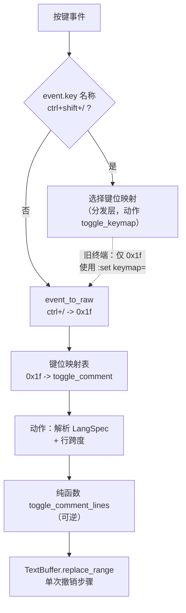

# 切换注释（Toggle comment，IKWNOG）实施计划

> **实施状态**：✅ 已实施 —— 2026-11-20（已合入 !143 / ebe8fee6）

来源：https://gitee.com/jermaine/yate/issues/IKWNOG

## 0. 背景与已核实事实

分支 `feature/feat-toggle-comment`，parent 为 `master` 的 `50702ec7`（与
`origin/master` 同步）。已创建独立的 `.venv` 并自验
（`yate.__file__` 解析到 worktree 内部）。

### 0.1 探针证据（在 worktree 的 venv 中运行）

| 事实 | 证据 |
|---|---|
| `parse_key("<ctrl-/>") == "\x1f"` | 直接探针；另见 `keymaps/keys.py:156-159` |
| `parse_key("<ctrl-shift-/>") == "\x1f"` | 直接探针（shift 施加于 `/` 得到 `/`，ctrl 映射为 US） |
| `key_name("\x1f") == "<ctrl-/>"` | `keymaps/keys.py:98-100` |
| `event_to_raw("ctrl+shift+/") is None` | `keyproto/key_codec.py:132-139`（仅处理 `mods == ("ctrl",)`） |
| `event_to_raw("ctrl+/") == "\x1f"` | `keyproto/key_codec.py:28-41`（`_CTRL_PUNCT["/"]`） |
| Chord 驱动命名 `ctrl+shift+/` | `keyproto/aliases.py:23-54`：`VK_OEM_2` -> `/`，mods 顺序为 ctrl+shift |
| 当前 vsc 绑定 | `keymaps/vsc.py:121` `_raw("\x1f", "toggle_keymap", ...)` |
| 当前 vim 帮助行 + 特例 | `keymaps/vim.py:247` 绑定，`:275-281` 的 `if key == "\x1f"` 分支 |
| `toggle_keymap` 动作 / 命令回退 | `actions.py:233`；`commands.py:522-539`（`:vim` / `:vsc` / `:set keymap=`） |
| 注释标记已存在于数据中 | `editor_syntax/langdefs.py:40-60` `LangSpec.line_comment` / `block_comment`；已为 python/c/cpp/java/js/ts/rust/go/html/xml/xaml/css/lua/sql/shell 等注册 |
| Buffer 原语 | `editor_core/buffer.py:653-682` 选区/`selected_rows`；`:845-860` `replace_range`（单次撤销步骤）；`:733-748` `set_cursor`；`:209` `_ensure_writable` |
| 分发拦截先例 | `editor_dispatch.py:132-160` `alt+shift+p`、`alt+shift+s`、`alt+shift+f`、`ctrl+shift+e` |
| Vim `g` 前缀 | `keymaps/vim.py:73-79` `_PREFIX_MOTIONS`、`:403-404` which-key 提示、`:831-844` / `:575-589` `gg`/`gj`/`gk` 分支、`:1071-1097` 操作符待定 |
| 共享按键守卫先例 | `tests/test_architecture.py:1621-1656` hover、`:1714-1750` soft-wrap；共 44 个守卫 |

### 0.2 预先记录的偏离（子代理模型）

用户要求每个子代理使用与主代理相同的模型，并禁止编辑 `.trae/agents/`。
`task` 工具未暴露模型参数；运行时从主工作区的代理定义解析模型，其
frontmatter 当前指定了三个不同的模型（`qwen-3.8-plus`、
`glm-5.3-flash`、`DeepSeek-V4.1-Flash`）。因此没有合规的方式
用主模型派发子代理。依据 `task-orchestration.md` §三，
主代理亲自执行每个角色（plan-architect-designer /
plan-executor / code-review-expert），并在最终记录中报告"子代理零产出"。
未触碰任何代理定义文件。无人值守模式由用户明确指令启用；审批一律视为已批准。

## 1. 目标与非目标

### 目标
1. `Ctrl+/` 在两套内置键位映射中切换当前行 / 所覆盖行的注释；再次按下可
   精确还原原始文本（包括缩进与空行）。
2. `Ctrl+Shift+/` 仅切换键位映射（绝不切换注释），通过两套键位映射共用的
   单一分发层入口实现。
3. Vim 保留 `gc{motion}` / `gcc` / 可视模式 `g c` 作为同一动作的补充入口，
   与现有的前缀/操作符/计数状态机集成，且不使 `gg` / `gf` / `gt` / `gj` / `gk` 回归。
4. 注释标记取自当前文档的 `LangSpec`；不重复维护语言表，也不改动语法高亮。
5. 一个共享动作与一条共享 `:` 命令；两套键位映射将同一原始按键解析到同一动作；
   带有反向演练的漂移守卫。

### 非目标
- 不提供可配置的注释标记、注释对齐或文档模板。
- 不改变 `:set keymap=` 的语义；不重构语法/ts 后端。
- 不新增 L3 流程模块，不新增 `Protocol` / `TYPE_CHECKING` / `Any`。

## 2. 设计决策（含被否决的备选方案）

### 2.1 按键分流的实现位置
- **采用**：`keymaps/keys.py` 中的两个常量：
  - `TOGGLE_COMMENT_KEY: str = "<ctrl-/>"`（原始值 `\x1f`），被两张
    `build_bindings()` 表引用作为动作按键。
  - `TOGGLE_KEYMAP_KEY: str = "ctrl+shift+/"`（**event.key 名称**，而非可解析的
    spec：`parse_key` 无法区分它）。由 `editor_dispatch._handle_key` 与帮助浮层的
    全局按键列表引用。
  - 两张内置绑定表都为 `TOGGLE_KEYMAP_KEY` 保留一行帮助项
    （仅帮助用途，仿照 `alt+shift+p` / `alt+shift+f` 的先例），使该按键在
    每套键位映射的 F1 参考中可被发现；真正的分发是 `editor_dispatch.py` 中
    `event_to_raw` 之前唯一的基于名称的分支。
- **否决**：将 `Ctrl+Shift+/` 绑定为第二条原始按键行。两种 spec 都会归约为
  `\x1f`；`_index` 只会保留一个条目，旧终端会触发错误动作（违反 AC3）。
- **否决**：修改 `key_codec.event_to_raw` 为 `ctrl+shift+/` 生成一个合成原始值。
  这会把一个非终端字节泄漏进键位映射、驱动、宏录制器与补全数据源；
  issue 明确要求像 `ctrl+shift+e` 那样基于名称的拦截。

### 2.2 Vim 侧
- **采用**：移除 `vim.py:275-281` 的特例（键位映射切换）；在 NORMAL 前缀状态与
  VISUAL 模式中新增 `gc` 分支，对解析出的行范围应用 `toggle_comment` 动作，
  经由 `ctx.ui.execute_action`。`gcc` 选中当前行（支持计数）；`gc{motion}` 复用 motion
  解析来构建行跨度；可视模式 `gc` 使用当前选区。`g` 的 which-key 提示新增一行 `c`。
- **否决**：新增操作符值 `"comment"`，置于 `self.op` 中。这需要改动 `_linewise_op`、
  `_apply_span`、`_apply_text_object`、`_resolve_gg`、查找/重复以及每张提示表，
  回归面很大；基于动作的路径保持操作符状态机不变。

### 2.3 注释算法（纯函数、数据驱动、可逆）
- 新增 L0 纯函数模块 `yate/editor_core/commenting.py`，无向上依赖导入。
  它接收 `lines: Sequence[str]`、`(first, last)` 闭区间行边界，以及由调用方
  解析出的 `LangSpec` 标记；返回新的行列表以及行增量。
- **行注释语言**（存在 `line_comment`）：当某行去除首尾空白后以该标记开头时，
  视为已注释。若范围内*所有*非空行都已注释，则每行去掉一个标记和一个可选的
  后续空格；否则在每个非空行的首个非空白字符前插入 `marker + " "`。
  空行保持不变。这使得混合/部分注释的范围在第一次按下时收敛为"已注释"，
  并在第二次按下时精确还原原始文本（此时"全部已注释"判定成立）。
- **仅块注释语言**（`line_comment is None`，存在 `block_comment`：
  html/xml/xaml/css/scss/less）：不注入行注释。将每个非空行包裹为
  `indent + open + content + close`（保留原始缩进与所有内部空白）。
  若每个非空行都已包裹，则每行去掉一对标记。空行保持不变。往返可逆且精确；
  无需多行状态。
- **同时具有两种标记的语言**（c/cpp/java/js/ts/rust/go/lua/sql/jsonc/
  csharp）：仅使用 `line_comment`（vim/`Ctrl+/` 语义）。
- **无标记 / 未知文件类型**：空操作并给出用户可见的消息
  （`no comment syntax for filetype <ft>`）；绝不猜测默认值。
- 对整个范围调用一次 `TextBuffer.replace_range` = 一次撤销步骤；
  光标恢复到原位置，并钳制到新行；清除选区（与缩进等其他行操作一致）。
- 只读缓冲区通过分发守卫保留现有的 `BufferReadOnlyError` 路径：
  `replace_range` 会调用 `_ensure_writable`。

### 2.4 共享动作与命令
- `actions.py`：`reg("toggle_comment", _toggle_comment, ...)`，其中
  `_toggle_comment(ctx)` 解析 `lang_for(ctx.doc.filetype)`、行范围
  （`ctx.buffer.selected_rows()` 或当前行），调用纯函数助手并应用
  `replace_range`。空操作时通过 `ctx.ui.message` 给出消息。
- `commands.py`：`reg("toggle-comment", ...)` 调用
  `editor.execute_action("toggle_comment")` —— 单一实现。
- `editor_dispatch.py`：`if event.key in _KEYMAP_TOGGLE_NAMES:`（常量 +
  已知的 kitty 拼写 `ctrl+shift+slash`）-> `ed.execute_action("toggle_keymap")`，
  消费掉事件（R10）。与其他全局基于名称的 Chord 放在一起，位于 `event_to_raw`
  之前、提示栏所有权检查之后，这样正在输入的 `:` 命令绝不会翻转键位映射。
- `vsc.py` / `vim.py`：原始 `\x1f` 绑定改为
  `_k(TOGGLE_COMMENT_KEY, "toggle_comment", "Toggle comment", EDIT/EDT)`；
  原先 `toggle_keymap` 的帮助行在两张表中都被替换为 `TOGGLE_KEYMAP_KEY` 上的
  仅帮助行，描述为 "Toggle vsc/vim keymap (ctrl+shift+/)"。Vim 的 `\x1f` 特例被删除。
- 帮助浮层（`editor_components/modals.py:91-93` 与 GLOBAL KEYS 块）：
  标题文本与全局行从 `ctrl+/` 改为 `ctrl+shift+/`。

### 2.5 Mermaid：一个按键，两条路径


## 3. 波次计划（文件独占、按序执行的波次）

### 波次 a —— 按键常量 + 纯函数注释引擎
输入：本计划、issue 文本、`keys.py` / `langdefs.py` 的 API。
文件（独占）：`yate/keymaps/keys.py`、`yate/editor_core/commenting.py`、
`tests/test_commenting.py`、`tests/test_key_notation.py`（仅当 key_name
需要新增标签分支时）。
产出：常量与纯函数助手；单元往返测试。
验收命令：
```
.venv\Scripts\python.exe -m pytest tests/test_commenting.py tests/test_key_notation.py -q -n 1
.venv\Scripts\python.exe -m pyright yate/keymaps/keys.py yate/editor_core/commenting.py
```

### 波次 b —— 动作、命令、分发、键位映射、帮助浮层
输入：波次 a 的产出。
文件（独占）：`yate/actions.py`、`yate/commands.py`、
`yate/editor_dispatch.py`、`yate/keymaps/vsc.py`、`yate/keymaps/vim.py`（仅
绑定表行 + 移除 `\x1f` 特例；vim 操作符工作属于波次 c）、
`yate/editor_components/modals.py`、
`tests/test_toggle_comment.py`（动作/命令/分发部分）、
`tests/test_editor_dispatch.py`。
产出：两套键位映射中 `Ctrl+/` 切换注释；`Ctrl+Shift+/` 仅切换键位映射；
无 `\x1f` 双重分发。
验收命令：
```
.venv\Scripts\python.exe -m pytest tests/test_toggle_comment.py tests/test_editor_dispatch.py tests/test_vsc_keymap.py tests/test_keymaps_conflicts.py -q -n 1
.venv\Scripts\python.exe -m pyright yate/actions.py yate/commands.py yate/editor_dispatch.py yate/keymaps/ yate/editor_components/modals.py
```

### 波次 c —— vim `gc{motion}` / `gcc` / 可视模式
输入：波次 b 的产出。
文件（独占）：`yate/keymaps/vim.py`（状态机 + which-key 提示）、
`tests/test_vim_keymap.py`、`tests/test_toggle_comment.py`（vim 部分）、
`tests/test_whichkey_flows.py`（如需则补充提示断言）。
产出：`gcc`、`gcj`、`gck`、`gcw`、带计数的形式、可视模式 `gc`；
`gg` / `gf` / `gt` / `gj` / `gk` 零回归。
验收命令：
```
.venv\Scripts\python.exe -m pytest tests/test_vim_keymap.py tests/test_toggle_comment.py tests/test_whichkey_flows.py tests/test_soft_wrap_keys.py -q -n 1
.venv\Scripts\python.exe -m pyright yate/keymaps/vim.py
```

### 波次 d —— 架构守卫 + 文档
输入：波次 a-c 的产出。
文件（独占）：`tests/test_architecture.py`、
`.trae/rules/architecture-boundaries.md`、
`yate/resources/manual.en.md`、`yate/resources/manual.zh.md`、
`yate/docs/which-key.en.md`、`yate/docs/which-key.zh.md`、
`CHANGELOG.md`、`CHANGELOG.zh.md`。
产出：带反向演练的守卫 #45；双语文档与 changelog 已同步。
验收命令：
```
.venv\Scripts\python.exe -m pytest tests/test_architecture.py -q -n 1
.venv\Scripts\python.exe -m tools.changelog check
```

### 评审与最终门禁
波次 e：用 `code-review-expert` 脚本自审（由主代理扮演该角色），修复所有
阻塞项/严重项，然后执行 `task-orchestration.md` §二.7 中的五道强制门禁
（pyright / pytest `-n auto` / 架构 / 覆盖率 / 冒烟），将实测数字回填此处，
逐步分别提交（不推送）。

## 4. 风险与回滚

| 风险 | 缓解 / 回滚 |
|---|---|
| `Ctrl+Shift+/` 名称因驱动而异 | 同时拦截 `ctrl+shift+/` 与 `ctrl+shift+slash`；旧终端始终回退到 `\x1f` 注释；`:set keymap=` 仍为有文档记录的回退方式 |
| 原始 `\x1f` 双重分发（R10） | 移除 vim 特例；分发在原始值转换前消费名称；新增守卫/测试断言每次按下只触发一个动作 |
| 往返不精确（缩进 / 空行 / 混合） | 为每个语言族编写纯函数属性测试；"全部已注释"检测；一次 `replace_range` 并恢复光标 |
| `gc` 破坏其他 `g*` Chord | 仅在 `prefix == "g" and key == "c"` 时分支；将 `gg`/`gj`/`gk` 分支保留在前；为所有 `g*` 形式与计数编写回归测试 |
| 架构守卫漂移 | 新守卫断言 `keys.py` 中两个常量、两张表都引用它们、`build_bindings` 中无原始字面量、运行时为同一动作；对单侧改动做反向演练 |
| 文件大小豁免 | `vim.py` 已豁免；`commenting.py` 为新增且很小；无需新增豁免 |
| 覆盖率 / changelog 检查 | 为每个新分支补测试；文档同步后运行 changelog 检查 |

回滚：每个波次在 feature 分支上单独提交；对出问题的波次执行 `git revert`；
分支绝不自动合并到 `master`。

## 5. 执行记录

执行于 2026-11-19。每个波次都在 `feature/feat-toggle-comment` 上单独提交
（parent 为 `master` 的 `50702ec7`）；未推送。

- 波次 a：完成 —— `96e8a087` 设计文档，`7e4095db` 常量 + 纯函数引擎；
  `55 passed`（注释 + 按键表示法），pyright 0。
- 波次 b：完成 —— `a8689884` 动作/命令/分发/键位映射/帮助；
  波次验收套件 `89 passed`，pyright 0。`replace_range` 之后重新映射选区端点，
  使第二次按下看到相同的行跨度。
- 波次 c：完成 —— `335cd6c1` `gc{motion}` / `gcc` / 可视模式 `gc` 及提示；
  vim 相关套件 `238 passed`，pyright 0。已验证 `gg`/`gj`/`gk` 与宏
  回放无回归。
- 波次 d：完成 —— `70e2eaf8` 守卫 #45（反向演练确认单侧字面量时会变红），
  架构计数 44 -> 45，双语手册 / which-key 文档，通过 `zh-commit` 注册了
  4 条中文 changelog 覆盖项。按设计未改动根 CHANGELOG：`generate` 会重写整个
  Unreleased 章节（155 笔既有的滞后提交），超出此处范围；
  `python -m tools.changelog check` 退出码 0。
- 评审：主代理扮演评审者角色（依据 §0.2 没有合规的子代理模型可用）。
  发现项：1 处门禁失败（分发测试桩中的 7 个 `reportUnknownLambdaType`）已在
  `07fb3c47` 修复；13 个存量测试 + 3 个冒烟场景固定了旧的 `ctrl+/`
  键位映射切换契约 —— 已迁移到共享的 `toggle_keymap` 动作，见 `d82a3d73`。
  自我批评：0 阻塞项、0 严重项、保留 2 次要项（`gcc` 之后光标落在注释标记上，
  符合 vim 的首个非空白字符惯例；`gc` 提示已在两个 which-key 页面记录）。
- 门禁（主代理，实测）：
  - pyright `yate/ tests/ tools/`：0 错误 / 0 警告（`PYRIGHT_EXIT=0`）
  - `pytest tests/ -q -n auto`：退出码 0（全绿，10 skipped）
  - `pytest tests/test_architecture.py -q`：`45 passed`，退出码 0
  - 覆盖率：`3959 passed, 10 skipped`，TOTAL `93%`，`93.09%` >= 75，退出码 0
  - 冒烟 `run --jobs 4`：首轮 123/124（已知的侧边栏 `toggles_back`
    负载 flake，与本次改动无关）；串行场景 12/12 通过，
    全量重跑 `124/124 scenarios, 1511/1511 checks`，退出码 0
  - `python -m tools.changelog check`：退出码 0
- 偏离：未派发子代理（模型一致性要求 + 不编辑代理文件）；主代理执行了
  规划者/执行者/评审者角色，如 §0.2 所记录。
