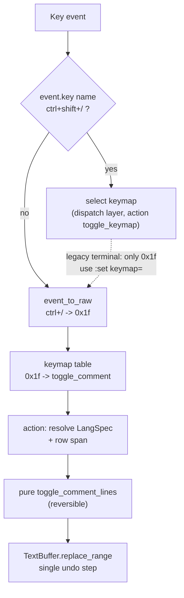

# Toggle comment (IKWNOG) implementation plan

Source: https://gitee.com/jermaine/yate/issues/IKWNOG

## 0. Context and verified facts

Worktree: `D:/Programming/yate-toggle-comment`, branch
`feature/feat-toggle-comment`, parent `master` at `50702ec7` (synced with
`origin/master`). Independent `.venv` created and self-verified
(`yate.__file__` resolves inside the worktree).

### 0.1 Probe evidence (run in the worktree venv)

| Fact | Evidence |
|---|---|
| `parse_key("<ctrl-/>") == "\x1f"` | direct probe; also `keymaps/keys.py:156-159` |
| `parse_key("<ctrl-shift-/>") == "\x1f"` | direct probe (shift applied to `/` yields `/`, ctrl maps to US) |
| `key_name("\x1f") == "<ctrl-/>"` | `keymaps/keys.py:98-100` |
| `event_to_raw("ctrl+shift+/") is None` | `keyproto/key_codec.py:132-139` (only `mods == ("ctrl",)` handled) |
| `event_to_raw("ctrl+/") == "\x1f"` | `keyproto/key_codec.py:28-41` (`_CTRL_PUNCT["/"]`) |
| Chord driver names `ctrl+shift+/` | `keyproto/aliases.py:23-54`: `VK_OEM_2` -> `/`, mods ordered ctrl+shift |
| Current vsc binding | `keymaps/vsc.py:121` `_raw("\x1f", "toggle_keymap", ...)` |
| Current vim help row + special case | `keymaps/vim.py:247` binding, `:275-281` `if key == "\x1f"` branch |
| `toggle_keymap` action / command fallback | `actions.py:233`; `commands.py:522-539` (`:vim` / `:vsc` / `:set keymap=`) |
| Comment markers already in data | `editor_syntax/langdefs.py:40-60` `LangSpec.line_comment` / `block_comment`; registered for python/c/cpp/java/js/ts/rust/go/html/xml/xaml/css/lua/sql/shell/etc. |
| Buffer primitives | `editor_core/buffer.py:653-682` selection/`selected_rows`; `:845-860` `replace_range` (single undo step); `:733-748` `set_cursor`; `:209` `_ensure_writable` |
| Dispatch interception precedent | `editor_dispatch.py:132-160` `alt+shift+p`, `alt+shift+s`, `alt+shift+f`, `ctrl+shift+e` |
| Vim `g` prefix | `keymaps/vim.py:73-79` `_PREFIX_MOTIONS`, `:403-404` which-key hint, `:831-844` / `:575-589` `gg`/`gj`/`gk` branches, `:1071-1097` operator-pending |
| Shared-key guard precedent | `tests/test_architecture.py:1621-1656` hover, `:1714-1750` soft-wrap; 44 guards total |

### 0.2 Deviation recorded up front (subagent model)

User requires every subagent to use the same model as the main agent and
forbids editing `.trae/agents/`. The `task` tool exposes no model parameter;
the runtime resolves models from the main-workspace agent definitions, whose
frontmatter currently names three different models (`qwen-3.8-plus`,
`glm-5.3-flash`, `DeepSeek-V4.1-Flash`). There is therefore no compliant way
to dispatch a subagent with the main model. Per `task-orchestration.md` §三
the main agent personally executes every role (plan-architect-designer /
plan-executor / code-review-expert) and reports "subagent zero output" in the
final record. No agent definition file is touched. Unattended mode is active
by explicit user instruction; approvals are treated as granted.

## 1. Goal and non-goals

### Goals
1. `Ctrl+/` toggles comments on the current line / covered rows in both
   built-in keymaps; a second press restores the original text exactly
   (indentation and blank lines included).
2. `Ctrl+Shift+/` toggles the keymap only (never comments), through one
   dispatch-layer entry shared by both keymaps.
3. Vim keeps `gc{motion}` / `gcc` / visual `g c` as a supplementary entry to
   the same action, integrated with the existing prefix/operator/count state
   machine without regressing `gg` / `gf` / `gt` / `gj` / `gk`.
4. Comment markers come from the current document's `LangSpec`; no language
   table is duplicated and syntax highlighting is untouched.
5. One shared action and one shared `:` command; both keymaps resolve the
   same raw key to the same action; a drift guard with negative drill.

### Non-goals
- No configurable comment markers, no comment alignment, no doc templates.
- No `:set keymap=` semantic change; no syntax/ts backend refactor.
- No new L3 flow module and no new `Protocol` / `TYPE_CHECKING` / `Any`.

## 2. Design decisions (with rejected alternatives)

### 2.1 Where the key split lives
- **Chosen**: two constants in `keymaps/keys.py`:
  - `TOGGLE_COMMENT_KEY: str = "<ctrl-/>"` (raw `\x1f`), referenced by both
    `build_bindings()` tables as the action key.
  - `TOGGLE_KEYMAP_KEY: str = "ctrl+shift+/"` (an **event.key name**, not a
    parseable spec: `parse_key` cannot distinguish it). Referenced by
    `editor_dispatch._handle_key` and by the help overlay's global-key list.
  - Both built-in binding tables keep a help row for `TOGGLE_KEYMAP_KEY`
    (help-only, mirroring the `alt+shift+p` / `alt+shift+f` precedent) so the
    key is discoverable in each keymap's F1 reference; the real dispatch is
    the single name-based branch in `editor_dispatch.py` before `event_to_raw`.
- **Rejected**: binding `Ctrl+Shift+/` as a second raw row. Both specs collapse
  to `\x1f`; `_index` would keep only one entry and a legacy terminal would
  fire the wrong action (AC3 violation).
- **Rejected**: changing `key_codec.event_to_raw` to emit a synthetic raw for
  `ctrl+shift+/`. That would leak a non-terminal byte into keymaps, drivers,
  the macro recorder and completion feed; the issue explicitly asks for a
  name-based interception like `ctrl+shift+e`.

### 2.2 Vim side
- **Chosen**: remove `vim.py:275-281` special case (the keymap toggle); add a
  `gc` branch in the NORMAL prefix state and in VISUAL mode that applies the
  `toggle_comment` action over the resolved rows via `ctx.ui.execute_action`.
  `gcc` selects the current line (with count); `gc{motion}` reuses the motion
  resolution to build a row span; visual `gc` uses the active selection.
  which-key hint for `g` gains a `c` row.
- **Rejected**: a new operator value `"comment"` in `self.op`. That would
  require changes in `_linewise_op`, `_apply_span`, `_apply_text_object`,
  `_resolve_gg`, find/repeat and every hint table, with high regression
  surface; the action-based path keeps the operator state machine untouched.

### 2.3 Comment algorithm (pure, data-driven, reversible)
- New L0 pure module `yate/editor_core/commenting.py`, no upward imports.
  It takes `lines: Sequence[str]`, `(first, last)` inclusive row bounds and
  the `LangSpec` markers resolved by the caller; it returns a new list of
  lines plus the row delta.
- **Line-comment languages** (`line_comment` present): a row is considered
  commented when its stripped form starts with the marker. If *all*
  non-blank rows in the span are commented, strip one marker and one optional
  following space from each; otherwise insert `marker + " "` before the
  first non-blank character of each non-blank row. Blank rows are left
  untouched. This makes mixed/partially commented ranges converge to
  "commented" on the first press and restores the exact original text on the
  second press (the "all commented" test then holds).
- **Block-only languages** (`line_comment is None`, `block_comment` present:
  html/xml/xaml/css/scss/less): do not inject line comments. Wrap each
  non-blank row `indent + open + content + close` (preserving the original
  indentation and all interior whitespace). If every non-blank row is already
  wrapped, unwrap one marker pair per row. Blank rows untouched. Round-trip
  is exact; no multi-line state is needed.
- **Languages with both markers** (c/cpp/java/js/ts/rust/go/lua/sql/jsonc/
  csharp): use `line_comment` only (vim/`Ctrl+/` semantics).
- **No markers / unknown filetype**: no-op with a user-visible message
  (`no comment syntax for filetype <ft>`); never guess a default.
- One `TextBuffer.replace_range` call over the full span = one undo step;
  cursor is restored to its original position, clamped to the new line;
  selection is cleared (consistent with other line operations like indent).
- Read-only buffers keep the existing `BufferReadOnlyError` path via the
  dispatch guard: `replace_range` calls `_ensure_writable`.

### 2.4 Shared action and command
- `actions.py`: `reg("toggle_comment", _toggle_comment, ...)` where
  `_toggle_comment(ctx)` resolves `lang_for(ctx.doc.filetype)`, the row span
  (`ctx.buffer.selected_rows()` or current row), calls the pure helper and
  applies `replace_range`. Message on no-op through `ctx.ui.message`.
- `commands.py`: `reg("toggle-comment", ...)` calls
  `editor.execute_action("toggle_comment")` — single implementation.
- `editor_dispatch.py`: `if event.key in _KEYMAP_TOGGLE_NAMES:` (constant +
  known kitty spelling `ctrl+shift+slash`) -> `ed.execute_action("toggle_keymap")`,
  consume (R10). Placed with the other global name-based chords, before
  `event_to_raw`, after prompt-bar ownership check so a `:` command being
  typed never flips the keymap.
- `vsc.py` / `vim.py`: raw `\x1f` binding becomes
  `_k(TOGGLE_COMMENT_KEY, "toggle_comment", "Toggle comment", EDIT/EDT)`;
  the previous help row for `toggle_keymap` is replaced by a help-only row
  on `TOGGLE_KEYMAP_KEY` with description "Toggle vsc/vim keymap
  (ctrl+shift+/)" in both tables. Vim's `\x1f` special case is deleted.
- Help overlay (`editor_components/modals.py:91-93` and GLOBAL KEYS block):
  header text and global row change from `ctrl+/` to `ctrl+shift+/`.

### 2.5 Mermaid: one key, two paths


## 3. Wave plan (file-exclusive, sequential waves)

### Wave a — key constants + pure comment engine
Input: this plan, issue text, `keys.py` / `langdefs.py` API.
Files (exclusive): `yate/keymaps/keys.py`, `yate/editor_core/commenting.py`,
`tests/test_commenting.py`, `tests/test_key_notation.py` (only if key_name
need a new label case).
Output: constants and pure helper; unit round-trip tests.
Acceptance:
```
.venv\Scripts\python.exe -m pytest tests/test_commenting.py tests/test_key_notation.py -q -n 1
.venv\Scripts\python.exe -m pyright yate/keymaps/keys.py yate/editor_core/commenting.py
```

### Wave b — action, command, dispatch, keymaps, help overlay
Input: wave a output.
Files (exclusive): `yate/actions.py`, `yate/commands.py`,
`yate/editor_dispatch.py`, `yate/keymaps/vsc.py`, `yate/keymaps/vim.py` (only
the binding-table row + removal of the `\x1f` special case; vim operator work
is wave c), `yate/editor_components/modals.py`,
`tests/test_toggle_comment.py` (action/command/dispatch parts),
`tests/test_editor_dispatch.py`.
Output: `Ctrl+/` comments in both keymaps; `Ctrl+Shift+/` switches keymap
only; no `\x1f` double dispatch.
Acceptance:
```
.venv\Scripts\python.exe -m pytest tests/test_toggle_comment.py tests/test_editor_dispatch.py tests/test_vsc_keymap.py tests/test_keymaps_conflicts.py -q -n 1
.venv\Scripts\python.exe -m pyright yate/actions.py yate/commands.py yate/editor_dispatch.py yate/keymaps/ yate/editor_components/modals.py
```

### Wave c — vim `gc{motion}` / `gcc` / visual
Input: wave b output.
Files (exclusive): `yate/keymaps/vim.py` (state machine + which-key hint),
`tests/test_vim_keymap.py`, `tests/test_toggle_comment.py` (vim parts),
`tests/test_whichkey_flows.py` (hint assertion if needed).
Output: `gcc`, `gcj`, `gck`, `gcw`, counted forms, visual `gc`; zero regression
for `gg` / `gf` / `gt` / `gj` / `gk`.
Acceptance:
```
.venv\Scripts\python.exe -m pytest tests/test_vim_keymap.py tests/test_toggle_comment.py tests/test_whichkey_flows.py tests/test_soft_wrap_keys.py -q -n 1
.venv\Scripts\python.exe -m pyright yate/keymaps/vim.py
```

### Wave d — architecture guard + documentation
Input: waves a-c output.
Files (exclusive): `tests/test_architecture.py`,
`.trae/rules/architecture-boundaries.md`,
`yate/resources/manual.en.md`, `yate/resources/manual.zh.md`,
`yate/docs/which-key.en.md`, `yate/docs/which-key.zh.md`,
`CHANGELOG.md`, `CHANGELOG.zh.md`.
Output: guard #45 with negative drill; bilingual docs and changelog synced.
Acceptance:
```
.venv\Scripts\python.exe -m pytest tests/test_architecture.py -q -n 1
.venv\Scripts\python.exe -m tools.changelog check
```

### Review and final gate
Wave e: self-review with the `code-review-expert` script (main agent playing
the role), fix all blocker/major, then the five mandatory gates in
`task-orchestration.md` §二.7 (pyright / pytest `-n auto` / architecture /
coverage / smoke), write real numbers back here, commit each step separately
(no push).

## 4. Risks and rollback

| Risk | Mitigation / rollback |
|---|---|
| `Ctrl+Shift+/` name differs by driver | Intercept both `ctrl+shift+/` and `ctrl+shift+slash`; legacy always falls to `\x1f` comment; `:set keymap=` remains the documented fallback |
| Raw `\x1f` double dispatch (R10) | Remove vim special case; dispatch consumes name before raw conversion; add guard/test asserting one action per press |
| Round-trip not exact (indent / blank / mixed) | Pure-function property tests for each language family; "all commented" detection; one `replace_range` with cursor restore |
| `gc` breaks other `g*` chords | Branch only on `prefix == "g" and key == "c"`; keep `gg`/`gj`/`gk` branches ahead; regression tests for all `g*` forms and counts |
| Architecture guard drift | New guard asserts both constants in `keys.py`, both tables reference them, no raw literals in `build_bindings`, same action at runtime; negative drill on one-sided edit |
| File-size exemption | `vim.py` already exempt; `commenting.py` new and small; no new exemption needed |
| Coverage / changelog check | Add tests for every new branch; run changelog check after doc sync |

Rollback: each wave is a separate commit on the feature branch; `git revert`
the offending wave; branch never merges to `master` automatically.

## 5. Execution record

Executed 2026-11-19. Every wave was committed separately on
`feature/feat-toggle-comment` (parent `master` at `50702ec7`); no push.

- Wave a: done — `96e8a087` design doc, `7e4095db` constants + pure engine;
  `55 passed` (commenting + key notation), pyright 0.
- Wave b: done — `a8689884` action/command/dispatch/keymaps/help;
  `89 passed` on wave acceptance suite, pyright 0. Selection endpoints are
  remapped after `replace_range` so a second press sees the same row span.
- Wave c: done — `335cd6c1` `gc{motion}` / `gcc` / visual `gc` and hints;
  `238 passed` on vim-related suite, pyright 0. `gg`/`gj`/`gk` and macro
  replay regressions verified.
- Wave d: done — `70e2eaf8` guard #45 (with negative drill confirmed red on a
  one-sided literal), architecture count 44 -> 45, bilingual manual /
  which-key docs, 4 Chinese changelog overrides registered via `zh-commit`.
  Root CHANGELOG left untouched by design: `generate` rewrites the whole
  Unreleased section (155 pre-existing lagging commits), out of scope here;
  `python -m tools.changelog check` exits 0.
- Review: main agent played the reviewer role (no compliant subagent model
  was available per §0.2). Findings: 1 gate failure (7 `reportUnknownLambdaType`
  in the dispatch test stub) fixed in `07fb3c47`; 13存量 tests + 3 smoke
  scenarios pinned the old `ctrl+/` keymap-toggle contract — migrated to the
  shared `toggle_keymap` action in `d82a3d73`. Self-criticism: 0 blocker,
  0 major, 2 minor kept (cursor lands on the comment marker after `gcc`,
  matching vim's first-non-blank convention; `gc` hint documented in both
  which-key pages).
- Gates (main agent, real measurements):
  - pyright `yate/ tests/ tools/`: 0 errors / 0 warnings (`PYRIGHT_EXIT=0`)
  - `pytest tests/ -q -n auto`: exit 0 (all green, 10 skipped)
  - `pytest tests/test_architecture.py -q`: `45 passed`, exit 0
  - coverage: `3959 passed, 10 skipped`, TOTAL `93%`, `93.09%` >= 75, exit 0
  - smoke `run --jobs 4`: first run 123/124 (known sidebar `toggles_back`
    load flake, unrelated to this change); serial scenario 12/12 pass and
    full rerun `124/124 scenarios, 1511/1511 checks`, exit 0
  - `python -m tools.changelog check`: exit 0
- Deviation: no subagent dispatch (model-consistency requirement + no agent
  file edits); main agent executed planner/executor/reviewer roles, as
  recorded in §0.2.
