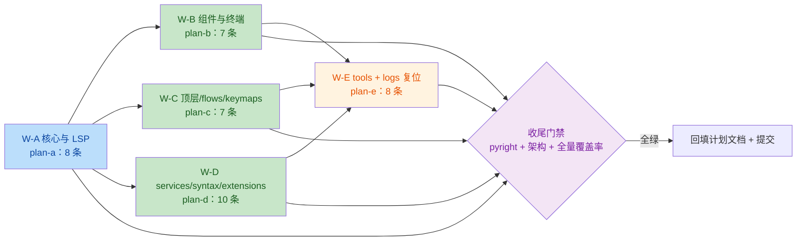

# trae-review-fixes 子计划总纲

- 主计划：[`../trae-review-fixes-plan.md`](../trae-review-fixes-plan.md)
- 发现来源（唯一事实来源）：[`../../reviews/2026-10-20-full-repo-trae-code-review.md`](../../reviews/2026-10-20-full-repo-trae-code-review.md)
- 子计划：`trae-review-fixes-plan-a.md` … `-e.md`（一计划一波次，文件互不重叠）

## 一、39 条条目索引（编号与评审记录一致）

| 编号 | 严重度 | 位置 | 子计划 | 波次 |
|---|---|---|---|---|
| B-1 | BLOCKER | `yate/editor_core/diff.py:247-271` | a | W-A |
| B-2 | BLOCKER | `yate/keymaps/vim.py:1241-1248` | c | W-C |
| B-3 | BLOCKER | `tools/pack/wiki.py:458-481` | e | W-E |
| M-1 | MAJOR | `yate/editor_core/buffer.py:1063-1067` | a | W-A |
| M-2 | MAJOR | `yate/editor_lsp/parsing.py:215` | a | W-A |
| M-3 | MAJOR | `yate/editor_lsp/manager.py:136-137` | a | W-A |
| M-4 | MAJOR | `yate/editor_view/terminal.py:311-315` | b | W-B |
| M-5 | MAJOR | `yate/flows/document_flows.py:400` | c | W-C |
| M-6 | MAJOR | `yate/yaterc.py:201-208` | c | W-C |
| M-7 | MAJOR | `yate/services/fonts.py:387-388` | d | W-D |
| M-8 | MAJOR | `yate/services/yxp.py:304-314,416-432` | d | W-D |
| M-9 | MAJOR | `tools/changelog/cli.py:133-142` | e | W-E |
| m-1 | MINOR | `yate/editor_view/diff_pane.py:362-379` | b | W-B |
| m-2 | MINOR | `yate/editor_view/find_replace.py:102-109,256` | b | W-B |
| m-3 | MINOR | `yate/extensions/example_ext.py.example:76,89` | d | W-D |
| m-4 | MINOR | `yate/editor_syntax/engine.py:83` | d | W-D |
| m-5 | MINOR | `yate/editor_term/emulator.py:276` | b | W-B |
| m-6 | MINOR | `yate/editor_syntax/regex_backend.py:384-388` | d | W-D |
| m-7 | MINOR | `yate/keymaps/vim.py:388,674,1093,1348` | c | W-C |
| m-8 | MINOR | `yate/services/extensions/bridges.py:159-170` | d | W-D |
| m-9 | MINOR | `yate/editor_core/search.py:100-101` | a | W-A |
| m-10 | MINOR | `yate/editor_core/document.py:229-230` | a | W-A |
| m-11 | MINOR | `yate/editor_core/buffer.py:1030-1031` | a | W-A |
| m-12 | MINOR | `yate/editor_view/chrome.py:181` | b | W-B |
| m-13 | MINOR | `yate/editor_view/theme_files.py:73` | b | W-B |
| m-14 | MINOR | `yate/services/yxp.py:476-491` | d | W-D |
| m-15 | MINOR | `yate/logs.py:347-361` | d | W-D |
| m-16 | MINOR | `yate/session.py:211` | c | W-C |
| m-17 | MINOR | `yate/services/extensions/loader.py:104-109` | d | W-D |
| m-18 | MINOR | `yate/services/shell.py:51-57` | d | W-D |
| m-19 | MINOR | `yate/editor_lsp/parsing.py:67,91,186` | a | W-A |
| m-20 | MINOR | `yate/editor_view/panes.py:530` | b | W-B |
| m-21 | MINOR | `yate/app.py:175,293` | c | W-C |
| m-22 | MINOR | `yate/keymaps/registry.py:9-11` | c | W-C |
| m-23 | MINOR | `tools/pack/wiki.py:571-577` | e | W-E |
| m-24 | MINOR | `tools/pack/wiki.py:78,844-847` | e | W-E |
| m-25 | MINOR | `tools/changelog/cli.py:299` | e | W-E |
| m-26 | MINOR | `tools/pack/cli.py:246-250` | e | W-E |
| m-27 | MINOR | `tools/pack/rosters.py:21` | e | W-E |
| m-28 | MINOR | `yate/logs.py:587,605-609` | e | W-E |

**合计 40 条**：评审记录 §四/§五/§六 的 39 条一一对应，外加执行期登记的 m-28
（tracing `install()` 置 `DEBUG` 而 `uninstall()` 不复位，`yate/logs.py`）。

## 二、波次与依赖

依赖说明：W-B/C/D 只依赖 W-A 的独占面（互不重叠，故 A 完成后 B/C/D 可并行）；
W-E 触 `tools/`，与 `yate/` 完全隔离，但排在其后统一收尾，便于一次性回填数字。

## 三、统一实施纪律

1. 每条修复 = 最小改动；禁止顺手重构、禁止改与条目无关的行。
2. 每条修复必须带回归用例（用例名见各子计划），且**先红后绿**：用例须能在修复前复现缺陷
   （B-1 / B-2 / M-1 / M-2 / B-3 必须演示修复前失败）。
3. 注释 / docstring 全英文（`misc-rules.md` §四），且 `tests/test_architecture.py` 的
   `test_comments_and_docstrings_stay_ascii` 会拦截 CJK。
4. 改行为必须回填"偏离/校准"段：说明与评审记录原文的差异及实测依据。
5. 局部验收命令一律带 `--cov-fail-under=0`（否则 `[tool.coverage.report] fail_under=75` 判红）。

## 四、性能条目的"先测后改"口径

M-4、m-2、m-12、m-17 属性能项。执行者须先给出**基线探针**（一次性脚本或 `timeit` 片段，
验证后删除），记录改动前后的同一指标；若收益不可测（< 5% 或噪声内），该条按
**"登记不修"** 处理并写回本总纲，不得以"理论上更快"为由改代码（`python-coding-style.md` §6.3.1）。

| 条目 | 基线测量方法 | 判据 |
|---|---|---|
| M-4 | `TerminalView.render_line` 连续 40 次调用的总耗时（同一个 80×24 网格，探针直接调 `view_lines` 对比缓存前后） | 缓存后 ≥ 5× 提速或每次 < 1 ms |
| m-2 | 500 个结果的 `_render_results` 单次耗时（构造假 `FileMatch` 列表） | 去掉重复 `resolve()` 后 ≥ 30% 降幅 |
| m-12 | `refresh_crumbs` 单次耗时（同路径重复 1000 次） | ≥ 30% 降幅 |
| m-17 | `load_file` 去重循环在 50 个已加载项下的耗时 | ≥ 30% 降幅 |

## 五、偏离与校准记录

（执行期回填。）

### W-B（plan-b）性能项实测（2026-10-20，Windows，探针脚本验证后已删除）

| 条目 | 改动前 | 改动后 | 判定 |
|---|---|---|---|
| M-4 | `render_line` 40 帧×24 行 = 366.07 ms（每次 ≈0.38 ms）；`view_lines` 1000× ≈ 15-19 ms（每次 ≈0.019 ms） | 40 帧 = 335.69-361.04 ms（提升在噪声内） | 判据满足"每次 < 1 ms"分支；**"≥5×"分支不成立**——实测 `view_lines` 网格复制仅占 render_line 总耗时约 4%（80×24 规模下 O(rows²·cols) 非热点），缓存收益噪声级。已按计划实现缓存（低风险），但收益以噪声计，非 5×。 |
| m-2 | `_relative` 500 路径单遍 ≈ 151-184 ms（重复渲染每次都 resolve） | 首遍 ≈ 174 ms，重复渲染 ≈ 0.33-0.39 ms（≈500×） | 达标（远超 30%）。 |
| m-12 | 每次渲染 2 次 resolve（1000 次双 resolve ≈ 507-692 ms） | `crumb_parts` 1000× ≈ 172-185 ms（root 仅首帧 resolve） | 达标（≈65% 降幅）。 |

