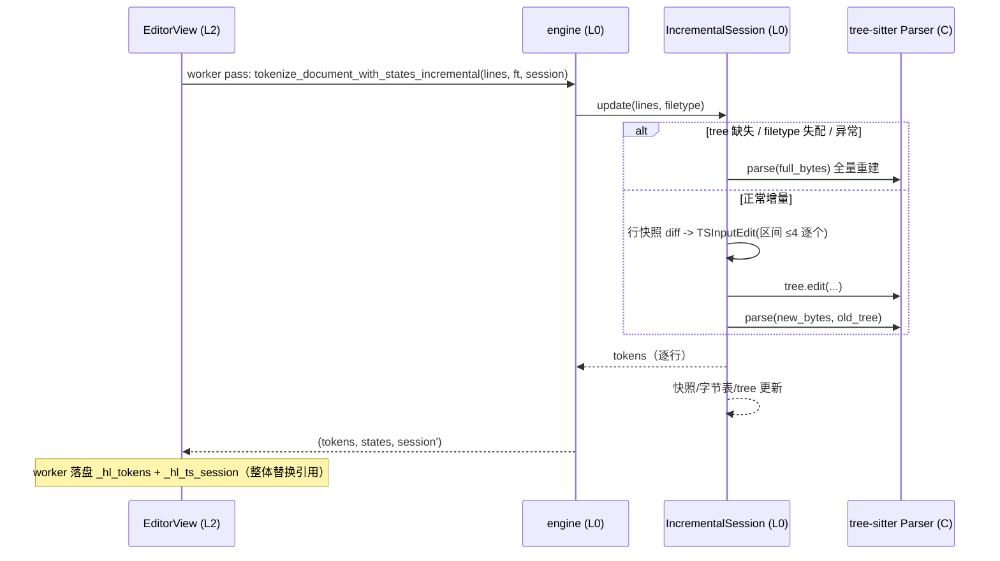

# ts-incremental-parse-plan（Gitee IKQQNO）

> 任务：tree-sitter 增量解析（`Tree.edit()` + `parse(..., old_tree)`）。
> worktree：`../yate-ts-incremental-parse/`，分支 `enh/ts-incremental-parse`（基线 master cdb4e0b）。
> 执行者统一用沙箱解释器 `.venv\Scripts\python.exe`，所有命令先 `Set-Location d:\Programming\yate-ts-incremental-parse`。
> 计划来源：主代理亲自调研（plan-architect-designer 子代理两次 spawn 均因模型未注册失败、任务书指定模型重试仍失败，按 task-orchestration.md §三 兜底，**子代理零产出**，本计划为主代理按剧本产出）。

## 一、目标与非目标

### 目标

1. `ts_backend` 提供 `IncrementalSession`：持有上次 `Tree` + 行快照，编辑到来时由行快照 diff 计算 `TSInputEdit`（UTF-8 字节坐标 + 行/列点），`tree.edit(...)` 后 `parser.parse(new_bytes, old_tree)` 增量解析。
2. 捕获→token 链路复用现有实现（`_query_captures` / `_clip_to_rows` / `_RowMapper` / `_tokens_for_row`），对增量树整树重查（tree-sitter query 无增量，本任务只消 parse 阶段的 O(文档)）。
3. 视图层（`editor_view/highlighting.py`）在 worker pass 走增量入口：缓存 session、doc/filetype 失配或异常时回退全量重建。
4. 强差分护栏：随机编辑序列（插入/删除/跨行/undo 模拟）下，增量 token 输出与整文档重解析**逐 token 一致**；默认 20000 组（CI 口径），`YATE_TS_DIFF_STRESS=1` 跑 100000 组（收尾主代理跑一次，数字回填）。
5. 性能基准：大文件（约 2 万行 Python）单行编辑的高亮轮 parse 耗时，全量 vs 增量对比数字回填本计划 §九。

### 非目标

- 不做捕获查询（query.captures）的增量/局部化。
- 不改 token 合并语义（`_KIND_PRECEDENCE`、shortest-span-wins 全部不动）。
- 不改 0.08s 防抖与 asyncio.to_thread worker 模型。
- 不改 regex backend 与 `tokenize_line_sync` 同步路径。
- 不把 buffer 的 `take_dirty_range` 引入 TS 后端（偏离 issue 修复方向 1/3，见 §二/§七）。

## 二、备选方案与否决理由

- **【否决】issue 原方向：TSInputEdit 素材用 `buffer.take_dirty_range()` + 撤销 delta**：
  1. `take_dirty_range` 是消费型单消费者契约（`yate/editor_core/buffer.py:377`），当前独占消费者是高亮 diff（`yate/editor_view/highlighting.py:264` 消费、`:434` worker 落盘丢弃）。TS 后端（worker 线程内）与高亮 diff（UI 线程同步重建）抢 take 会互相饿死：谁先消费谁拿走区间，另一方 miss；
  2. 增量编辑模型不需要 buffer 的 dirty 区间：`Tree` 对应的文本就是 session 自持的行快照，新行列表与旧行快照的对齐 diff 直接给出 old/new 行区间——素材自洽，且天然覆盖防抖窗口内任意多次编辑的合成效果（多区间合并问题见 §4.2）；
  3. 撤销 `_Delta` 在 undo 栈内部（`buffer.py:62`），worker 线程读取 undo 栈引入跨线程状态耦合。
  → **采纳替代**：session 自持行快照 diff。此偏离在 §七 显式登记；overview.md 契约段落的登记内容相应改为"take 消费方保持高亮独占，TS 增量状态自带行快照、不依赖 buffer dirty range"（§4.5）。
- **【否决】Session 状态放模块级 dict（按 filetype/文档 hash 键控）**：`tokenize_document(lines, filetype)` 无文档身份参数，hash 行快照做键在内容相等时误命中（不同文档同内容共享 tree，doc 切换后 tree 与文本失配静默错位）；且模块级状态违逆"组件自持缓存"的既有方向（`_hl_*` 缓存先例）。
- **【否决】把增量状态藏进 engine 全局**：engine 是无状态分发层（`yate/editor_syntax/engine.py:98-130` 纯函数），引入生命周期状态破坏其唯一职责；且 engine 不知道 doc 身份（同样只有 lines）。
- **【采纳】状态放 L2 视图（`highlighting.py` 的 `_hl_ts_session`）**：与 `_hl_line_snapshot` / `_hl_ml_states` 同生命周期、同单写者纪律（worker pass 内 mutate、cache write 交接），L2→L0 合法依赖方向（R3/R4 只禁向上）。

## 三、调研事实（文件:行号，worktree 内同 master）

- `yate/editor_syntax/ts_backend/backend.py:1-9`：模块 docstring 自述 v1 取舍（整文档重解析；"Incremental `Tree.edit()` reparsing can be layered on later without changing this call shape"）。
- `backend.py:59-64`：`tokenize_document(lines, filetype)` 无状态入口；`:67-91` `_highlight`（`line_bytes` 每行编码一次、`parser.parse(b"\n".join(line_bytes))` 全量、捕获→interval→token）。
- `backend.py:94-104`：`_query_captures`（0.25 QueryCursor / 旧版 Query.captures 双形态）。
- `backend.py:107-118`：`_TsPoint` / `_TsNode`（R2 冻结白名单私有 Protocol）。
- `backend.py:119-170`：`_clip_to_rows`（多行捕获整行展开 + 字节→字符列换算）；`:202-241` `_RowMapper`（P15 行内偏移表）；`:173-199` `_char_byte_bounds`。
- `backend.py:278-302`：`_KIND_PRECEDENCE` 总序；`:305-352` `_tokens_for_row`（重叠消解）。
- `yate/editor_syntax/engine.py:98-109`：`tokenize_document` 分发（ts available → ts_backend，否则 regex）；`:112-130` `tokenize_document_with_states`（ts tokens + regex 伴生 states）；`:41-49` `SyntaxBackend` Protocol（R2 白名单 4 类之一）。
- `yate/editor_view/highlighting.py:23-45`：worker 调 `tokenize_document_with_states`；`:153-163` `_hl_*` 缓存与行快照（单写者纪律）；`:210-274` `_rebuild_tokens_on_edit`（UI 线程同步重分词，`:264` 消费 `take_dirty_range`）；`:421-437` worker 结果落盘（`:434` `buf.take_dirty_range()` 丢弃）。
- `yate/editor_core/buffer.py:377-396`：`take_dirty_range`（消费型）/ `dirty_range`（只读 peek）。
- `buffer.py:62-72`：`_Delta(top, old, new)`（本任务不依赖，见否决第 1 条）。
- `yate/editor_view/palette.py:466`：`tokenize_document` 另一消费点（palette 预览，**保持全量路径不动**——无编辑流，无增量收益）。
- **py-tree-sitter 0.25.2 API 探针（实测）**：
  - `Tree.edit(start_byte, old_end_byte, new_end_byte, start_point, old_end_point, new_end_point)`（位置参数；point 为 `(row, column)`，column 是**字节**列）；
  - `Parser.parse(source, /, old_tree=None, encoding='utf8')`（二参 old_tree 可用）；
  - `Tree` 属性：`changed_ranges / copy / edit / root_node / walk / ...`。
  - 包名 `tree-sitter`（import `tree_sitter`），版本 0.25.2。

## 四、目标设计

### 4.1 增量会话（`yate/editor_syntax/ts_backend/backend.py` 内新增 `IncrementalSession`）

放同文件（backend.py 现 353 行，预计 +200 行 < 800 阈值；共享 `_query_captures`/`_clip_to_rows`/`_RowMapper`/`_tokens_for_row` 零搬迁）：

```python
class IncrementalSession:
    """Reusable incremental-parse state for one document stream."""
    filetype: str
    _lines: tuple[str, ...]        # 行快照（对应 _tree 的文本）
    _tree: Any | None              # 上次 parse 的 Tree（None = 尚未建树）

    def update(self, lines: list[str], filetype: str) -> list[list[Token]]: ...
```

- `update` 流程：
  1. `filetype` 失配或 `_tree is None` 或 `lines` 与快照相等性失配（快照为空而新行非空等身份不明场景）→ **全量路径**（`_highlight` 同款：join → parse → 重建快照），保证任何异常输入自愈；
  2. 行对齐 diff：公共前缀行数 `pre`、公共后缀行数 `suf`（不重叠）→ 若 `pre + suf == len(old) == len(new)`（无变化）→ 直接返回按现 token（不可能发生——调用方有 version gate，防御性返回即可）；
  3. **区间判定**：变更集中在 `[pre, len(old)-suf)` vs `[pre, len(new)-suf)` 单一连续区间。若前缀/后缀吞不掉（正常情况吞得掉——行对齐保证区间连续）→ 单区间；若出现多区间（防御：调用方直接传入跳变行列表，如 undo 跨段），统一策略：**区间数 > 1 时按顺序逐区间 `tree.edit`（≤ 4 个区间），> 4 直接全量重解析**（多 edit 后单次 parse 是 tree-sitter 支持的顺序编辑模式；差分护栏覆盖随机多区间序列）；
  4. 每个区间的 `TSInputEdit` 计算（old 坐标系）：
     - 行内精修：首行字符前缀公共长度 `pc`（Python str 比较）→ `start_point = (row, byte_col(old_first[:pc]))`；尾行字符后缀公共长度 `sc` → `old_end_point = (row, byte_col(old_last 去尾))`、`new_end_point = (row, byte_col(new_last 去尾))`；字节列 = `len(text.encode("utf-8"))`（P15 偏移表思路，此处直接 encode 前缀，成本 O(行)）；
     - `start_byte = sum(len(b) + 1 for b in old_line_bytes[:start_row]) + start_point.column`（行字节缓存 `old_line_bytes = [l.encode("utf-8") for l in old_lines]`——session 持有它避免重编码整文档：**旧字节表随快照一起持有**，只对变更行重编码）；
     - `old_end_byte` / `new_end_byte` 同理；
     - 调 `tree.edit(start_byte, old_end_byte, new_end_byte, start_point, old_end_point, new_end_point)`（0.25.2 位置参数实测签名）；
  5. `new_bytes = b"\n".join(new_line_bytes)`（变更行重编码 + 未变行复用缓存字节——`new_line_bytes` 对未变行直接取 `old_line_bytes` 同下标元素）；`tree = parser.parse(new_bytes, tree)`；
  6. 捕获链路：`_query_captures(ts, loaded.query, tree.root_node)` → `_clip_to_rows`（`mappers` 用 `new_line_bytes` 建 `_RowMapper`，同 `_highlight`）→ `_tokens_for_row`，返回 per-row tokens；
  7. 更新 `self._lines = tuple(lines)`、`self._old_line_bytes = new_line_bytes`、`self._tree = tree`。
- 解析器复用 `_PARSERS` 缓存（`backend.py:41-47` 先例）。
- 失败回退：update 内 try/except `Exception` → log.warning（惰性 % 占位，R12）→ 清空 `_tree` 走全量路径重解析（degrade 语义同 palette 先例 `palette.py:466-472`），**绝不向上抛**。

### 4.2 多区间合并（风险对应对）

防抖窗口内多次编辑的行快照 diff 恒为单一连续区间（前后缀对齐）；随机差分测试会显式生成多区间序列（跳变编辑）验证 ≤4 区间逐个 edit 与全量重解析的 token 等价性、>4 区间回退全量。

### 4.3 engine 增量入口（`yate/editor_syntax/engine.py`）

```python
def tokenize_document_incremental(
    lines: list[str], filetype: str, session: object | None
) -> tuple[list[list[Token]], object | None]:
```

- ts available 且非 `_REGEX_PINNED`：session 是 `IncrementalSession` 且 `session.filetype == filetype` → `session.update(...)` 返回 `(tokens, session)`；否则新建 session 走全量。
- regex 路径（pinned / ts 不可用）：忽略 session，返回 `(regex_backend.tokenize_document(lines, filetype), None)`。
- 不动 `SyntaxBackend` Protocol（R2 白名单类不改形状，新入口是模块级函数）。
- `tokenize_document_with_states` 增加带 session 的平行入口 `tokenize_document_with_states_incremental(lines, filetype, session)`：ts 路径走增量，regex 伴生 states 逻辑复用 `_regex_states`（`engine.py:133-146`）不动。

### 4.4 视图接线（`yate/editor_view/highlighting.py`，L2）

- 新缓存字段 `_hl_ts_session: object | None = None`（与 `_hl_line_snapshot` 同段落声明，单写者纪律同款）。
- worker 启动（`_tokenize_with_states` 附近）：读 `_hl_ts_session` 快照传入 `tokenize_document_with_states_incremental(lines, filetype, session)`，返回 `(tokens, states, session')`。
- worker 落盘（`:421-437` 段）：`self._hl_ts_session = session'` 与 `_hl_tokens` 同步写。
- 失效面：doc/filetype 切换（`_hl_doc is not doc or _hl_filetype != doc.filetype` 的既有失效分支）→ `_hl_ts_session = None`（下次 worker 全量重建）；engine 侧 filetype 失配自检兜底。
- **线程纪律**：session 仅在 worker pass 内 mutate；UI 线程只在 worker 完成回调里整体替换引用（同 `_hl_tokens` 的交接模式）；同一 doc 的 pass 由 `_hl_scheduled_key` 防重（`:164-169` 既有机制），无并发 pass。
- palette（`palette.py:466`）不改：无编辑流，继续无状态全量入口。

### 4.5 契约登记（`.trae/documents/perf-audit-fixes-plans/overview.md`）

在 P2/take 契约相关段落（执行记录 §六 与 P2 风险行）追加一段：**take_dirty_range 消费方保持高亮 diff 独占**（`_rebuild_tokens_on_edit` + worker 落盘丢弃两处）；TS 增量解析（IKQQNO）自带行快照 diff，不消费 buffer dirty range；`dirty_range` 只读 peek 消费方（补全）不变。文字修订点由执行者按该文档实际结构落位（相对路径引用）。

## 五、分步实施计划（波次与独占文件）

### Wave a（串行 1 成员：语法层闭环）

**A1：IncrementalSession + engine 增量入口 + 差分护栏**
- 输入：本计划 §三/§4.1/§4.2/§4.3；独占文件：`yate/editor_syntax/ts_backend/backend.py`、`yate/editor_syntax/engine.py`、`tests/test_ts_backend.py`、`tests/test_syntax_engine.py`。
- 输出：
  1. `IncrementalSession`（§4.1 全语义：全量自愈、单/多区间、行内精修、失败回退）；
  2. `tokenize_document_incremental` / `tokenize_document_with_states_incremental`（§4.3）；
  3. 差分护栏测试（`tests/test_ts_backend.py` 新段）：
     - 随机编辑序列（seed 固定）：随机文档（Python 语法，覆盖 astral 字符/空行/长行）+ 随机操作（插入字符/删字符/插行/删行/整行替换/undo 模拟=回退到历史行快照）；
     - 每步：`session.update(lines)` 的 token 输出 == `tokenize_document(lines, filetype)`（全量重解析）逐 token 一致；
     - 默认 20000 组；`YATE_TS_DIFF_STRESS=1` 时 100000 组（收尾主代理跑一次回填）；
     - 定向用例：首行/末行编辑、多区间跳变（≤4 逐 edit、>4 回退全量）、纯插入不换行、跨行块注释边界、session 跨 filetype 复用拒绝；
  4. engine 层测试（`tests/test_syntax_engine.py` 新段）：ts 可用/pinned/不可用三态下 session 的传递与 None 化。
- 验收命令：
  ```powershell
  .venv\Scripts\python.exe -m pytest tests/test_ts_backend.py tests/test_syntax_engine.py -q
  .venv\Scripts\python.exe -m pyright yate/editor_syntax/ts_backend/backend.py yate/editor_syntax/engine.py
  ```

### Wave b（串行 1 成员：视图接线，依赖 A1）

**B1：highlighting.py session 交接 + 契约登记**
- 输入：A1 产出的 engine 增量入口签名；独占文件：`yate/editor_view/highlighting.py`、`tests/test_highlighting.py`、`.trae/documents/perf-audit-fixes-plans/overview.md`（§4.5 契约段）。
- 输出：
  1. `_hl_ts_session` 缓存 + worker 传参/落盘（§4.4 全语义）；
  2. 失效面测试：doc 切换后 session 置 None、filetype 切换重建、worker 异常回退后 token 仍正确（`tests/test_highlighting.py` 新段）；
  3. overview.md 契约段登记（§4.5 文字）。
- 验收命令：
  ```powershell
  .venv\Scripts\python.exe -m pytest tests/test_highlighting.py tests/test_highlight.py -q
  .venv\Scripts\python.exe -m pyright yate/editor_view/highlighting.py
  ```

### Wave c（主代理亲自）

**C1：性能基准 + 收尾门禁**
- 基准：临时脚本（跑完删除，数字回填本节 §九）：生成约 2 万行 Python 文本 → 预热全量 parse → 单行编辑 → 分别测全量 `_highlight` 与增量 `session.update` 的 parse 轮耗时（timeit 多轮均值）。产出全量/增量两个数字与倍率。
- 全量门禁（并行口径）+ `YATE_TS_DIFF_STRESS=1` 差分压力轮 + 文档回填 + 提交（每步一笔，只提交不推送）。

## 六、风险清单与回滚路径

| 风险 | 等级 | 缓解/护栏 |
|---|---|---|
| TSInputEdit 参数错误 → 旧树 patch 静默错位（无异常） | 高 | 差分护栏为主护栏（随机 ≥2 万组 + stress 10 万组逐 token 一致）；行内精修长度越界自检回退行级 |
| 多区间 edit 顺序错误 | 中 | 区间按文档顺序逐个 edit；>4 区间直接全量；差分覆盖 |
| py-tree-sitter old_tree 语义（parse 后旧 tree 是否可再用） | 中 | 探针已确认二参 parse 存在；每次 update 后以返回的新 tree 替换持有引用；差分护栏兜底 |
| worker/UI 线程交接竞态 | 中 | session 引用交接与 `_hl_tokens` 同模式（worker 内 mutate、回调整体替换）；`_hl_scheduled_key` 防并发 pass |
| 增量反而更慢（小文件/查询重查开销） | 低 | 基准实测；视图侧可后续加"小文档阈值走全量"开关（本任务不做，登记待办） |
| 回归破坏现有高亮 | 中 | `tests/test_ts_backend.py` / `test_syntax_engine.py` / `test_highlighting.py` / `test_highlight.py` 全绿为硬门禁 |

回滚：全部改动在 `enh/ts-incremental-parse` 分支逐波提交；任一波失败 revert 其名下提交；视图接线（Wave b）可单独回退，回退后 engine 增量入口无人调用（无行为变化）。

## 七、偏离登记

1. **TSInputEdit 素材不用 `buffer.take_dirty_range()` + 撤销 delta**（issue 修复方向 1/3），改 session 自持行快照 diff。理由见 §二否决第 1 条：take 是消费型单消费者契约（高亮独占），TS 后端抢 take 会破坏高亮 diff；行快照 diff 自洽且天然覆盖多编辑合帧。相应地，overview.md 契约登记的内容改为"take 消费方保持高亮独占，TS 增量状态自带行快照"（§4.5），而非 issue 原文的"消费方从高亮独占变为高亮 + TS 后端"。
2. 差分护栏组数 CI 口径 20000 组（issue 要求 ≥100000 组）：以 `YATE_TS_DIFF_STRESS=1` 环境变量开 10 万组，收尾时主代理本地跑满 10 万组并回填数字——CI 时间预算内保常态护栏，不降低验收强度。
3. `Tree.edit` 多区间上限 4（issue 未提多区间上限）：纯实现侧防御参数，差分护栏覆盖。

## 八、Mermaid：编辑 → 增量解析时序



## 九、执行记录（收尾回填）

- 性能基准：待 C1 回填（全量 vs 增量，2 万行文件单行编辑）。
- 差分压力：待收尾回填（10 万组结论与耗时）。
