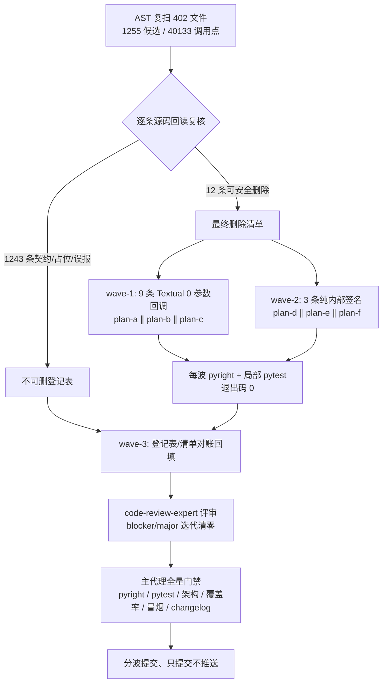

# IKTR5Q 无用变量与函数形参清理 — 方案总纲

> 闭环流程步骤 2【方案】产物（含 wave-1 / wave-2 实测回填）。输入素材见
> [`../unused-symbols-cleanup-issue-brief.md`](../unused-symbols-cleanup-issue-brief.md)；
> 交付清单见 [`../unused-symbols-cleanup-keep-register.md`](../unused-symbols-cleanup-keep-register.md)
> 与 [`../unused-symbols-cleanup-delete-list.md`](../unused-symbols-cleanup-delete-list.md)。
> 无人值守：用户本次显式指令「所有问题无须过问」，【批准】按通过处理，方案落盘即进入执行。

## 一、目标与非目标

**目标**

1. 对全仓 `yate/` / `tools/` / `tests/` / `pack/` 共 402 个 `.py` 的未使用形参与
   未使用局部名**逐条判定**，能安全删除的全部删除，并同步修正所有调用点
   （位置与关键字两种传参都核）。
2. 优先收敛 `yate/` 产品代码，其次 `tools/`；`tests/` 只处理确认无 fixture 副作用、
   非桩函数签名的部分。
3. 以 `yate/app.py:186 watch_theme` 为首个样例落地为无参 watcher，并补运行时/pilot
   证据证明主题变更仍触发重绘。
4. 产出「不可删登记表」（六类以上）与「最终删除清单」，数量可对账。

**非目标**（issue §六）

重命名、性能优化、架构/分层调整、未使用导入专项清理、`_` 解包占位批量替换、
pytest fixture 重构、引入 linter（ruff / ARG\*）、改 `pyproject.toml` 制造告警、
为消除告警新增任何豁免注释或改动门禁配置。
**例外**：因删除形参而**必然连带**的未使用类型导入与 docstring 同步，属签名删除的
一致性维护，不是专项清理（见 §七 偏离登记 D4）。

## 二、备选方案与否决理由

| 方案 | 内容 | 裁决 | 否决理由 |
| --- | --- | --- | --- |
| A | 按 issue 的 AST 粗扫数字 587 / 653 直接全删 | **否决** | issue §五.5 明令禁止；粗扫含 fixture / Protocol / 命令回调 / 解包占位等契约类误报，直接删会造成 `TypeError` 与测试隔离静默失效 |
| B | 只删 `yate/app.py:186` 一个样例，其余 1254 条全部登记保留 | **否决** | 未完成目标 1「能安全删除的全部删除」；issue 已点名 4 组纯内部签名候选与 Textual 回调组 |
| C | 引入 ruff `ARG*` / 改 `pyproject.toml` 把未使用参数变成告警，再按告警清理 | **否决** | issue §四 红线；且告警无法区分框架固定签名，仍需逐条判定 |
| D | AST 复扫 → 逐条源码回读复核 → 保守六类登记 → 分波删除 + 运行时证据 → 全量门禁 | **采纳** | 唯一同时满足「能删则删」「契约类登记保留」「数量可对账」「不改公开 API」的路线 |

## 三、事实基础与数量对账（实测，非估计）

主代理用临时 AST 探针（402 文件 / 40133 条调用点）复扫，口径为「函数体内无任何
`Load` 引用的形参（排除 `self`/`cls`）、赋值后无任何 `Load` 引用的局部名，含嵌套
作用域」。排除接收者后 `yate/` 70、`tools/` 10 与 issue 表格**逐域精确吻合**；
215 处 `_` 解包占位亦精确吻合。

| 域 | 未使用形参 | 未使用局部名 | issue 粗扫（形参 / 局部） | 本轮差额 |
| --- | --- | --- | --- | --- |
| `yate/` | 70 | 81 | 70 / 81 | 0 / 0 |
| `tools/` | 10 | 20 | 10 / 20 | 0 / 0 |
| `tests/` | 511 | 563 | 507 / 552 | +4 / +11 |
| `pack/` | 0 | 0 | 0 / 0 | 0 / 0 |
| **合计** | **591** | **664** | **587 / 653** | **+4 / +11** |

`tests/` 域差额来自含嵌套类作用域的保守 AST 口径差异（本轮把嵌套类体内的类属性
赋值也纳入 `Store`，逐条复核后确认其为误报并登记保留）。**本轮以自身复扫的
1255 行为唯一判定基准**，issue 的 587 / 653 仅作规模估计，不作删除清单。

**最终判定对账（wave-2 改判后）**：`1255 = 12 删除 + 1243 保留`。删除项全部为
`yate/` 产品代码的未使用形参；`local` 664 条经逐条复核**全部保留**（见 §四）。

## 四、判定口径与六类登记

按 issue §三，判定只依据「源码回读 + 调用点清单 + AST 事实」，不依据告警数：

| 类别 | 登记小计 | 典型证据 |
| --- | --- | --- |
| pytest fixture 形参 | 112 | `tests/conftest.py` 的隔离家目录 fixture；删掉会关闭副作用 |
| Protocol / 接口桩 | 22 | `yate/editor_syntax/engine.py:33-49` `SyntaxBackend`（R2 冻结）；`yate/editor_components/highlighting.py:115-148` 镜像 Textual 宿主协议 16 条 |
| `@override` 覆写 | 3 | `yate/editor_components/manual.py:265 get_content_height`；pyright `reportImplicitOverride` 要求签名一致 |
| 开放 API | 1 | `tools/pack/wiki/run.py:198 force`，CLI 门面且有 3 处 `force=` 关键字传参 |
| `_` 解包占位 | 215 | `_, x = ...` / `for _ in ...`，删除会改变解包结构 |
| 框架固定签名 | 39 | 命令注册表回调 27 条、keymap 回调、`@on(...)`/ctypes/CONPTY、平台占位构造契约 2 条、进度适配器、场景 driver、monkeypatch 桩 |
| 其它语义占位 / AST 误报 | 851 | 349 解包、90 循环目标、5 `nonlocal`、1 `global`、4 嵌套类属性误报、399 测试桩签名、1 `_*` 有意忽略 |

登记表逐条格式 `文件:行号 → 类别 → 保留理由`，另有对账总表与分类小计。

## 五、分步实施与执行波次

**每波内文件互不重叠、2~3 个一批并行；波次间串行，上一波全部验收命令退出码 0
才进入下一波。**

| 波次 | 子计划 | 输入 | 独占改动文件 | 输出 | 验收命令 |
| --- | --- | --- | --- | --- | --- |
| wave-1 | [plan-a](unused-symbols-cleanup-textual-watcher-plan-a.md) | issue §二.3、运行时探针实测 | `yate/app.py`、新增 `tests/test_zero_arg_callbacks.py` | 无参 watcher + 3 个运行时/pilot 证据用例 | `.venv\Scripts\python.exe -m pytest tests/test_zero_arg_callbacks.py -q --cov-fail-under=0` + pyright |
| wave-1 | [plan-b](unused-symbols-cleanup-textual-chrome-plan-b.md) | 探针实测、删除清单 #2-4 | `yate/editor_components/chrome.py`、`yate/editor_components/diff/pane.py` | 3 处 0 参数 `on_resize` | 局部 pytest + pyright |
| wave-1 | [plan-c](unused-symbols-cleanup-textual-views-plan-c.md) | 探针实测、删除清单 #5-9 | `yate/editor_components/view.py`、`terminal.py`、`manual.py`、`find_replace.py` | 5 处 0 参数 `on_*` | 局部 pytest + pyright |
| wave-2 | [plan-d](unused-symbols-cleanup-cmdline-completions-plan-d.md) | 删除清单 #10、6 处调用点 | `yate/cmdline_completions.py`、`yate/editor_compose.py`、`tests/test_app_find.py`、`tests/test_cmdline_completions.py` | 删 `session` 形参 + 同步 6 处 | 局部 pytest + pyright |
| wave-2 | [plan-e](unused-symbols-cleanup-file-manager-model-plan-e.md) | 删除清单 #11、8 处调用点 | `yate/editor_components/file_manager/model.py`、`screen.py`、`tests/test_file_manager_model.py` | 删 `sort_key` 形参 + 同步 8 处 | 局部 pytest + pyright |
| wave-2 | [plan-f](unused-symbols-cleanup-buffer-pty-plan-f.md) | 删除清单 #12、3 处调用点 | `yate/editor_core/buffer.py`、`yate/keymaps/base.py`、`yate/keymaps/vim.py`、`tests/test_input_assist.py` | 删 `language` 形参 + 同步 3 处（PTY 改判后不碰 `pty_proc.py`） | 局部 pytest + pyright |
| wave-3 | 主代理收尾 | 前两波全部产物 | 临时探针删除、文档回填、评审记录 | 全量门禁 + 提交 | §六 全量门禁 |



## 六、验收命令

**每波局部验收**（解释器统一 `.venv\Scripts\python.exe`，Windows PowerShell）：

```powershell
.venv\Scripts\python.exe -m pyright yate/ tests/ tools/ pack/
.venv\Scripts\python.exe -m pytest <该子计划列出的测试文件> -q --cov-fail-under=0
git diff --check
```

局部覆盖率运行必须带 `--cov-fail-under=0`（`task-orchestration.md` §二.7）。

**最终全量门禁**（`task-orchestration.md` §二.7 并行口径，与 CI 一致）：

```powershell
.venv\Scripts\python.exe -m pyright yate/ tests/ tools/ pack/
.venv\Scripts\python.exe -m pytest tests/ -q -n auto
.venv\Scripts\python.exe -m pytest tests/test_architecture.py -q
.venv\Scripts\python.exe -m pytest tests/ --cov=yate --cov-branch -n auto
.venv\Scripts\python.exe -m tools.smoke_test run --jobs 4
.venv\Scripts\python.exe -m tools.changelog check
```

附加：覆盖率 ≥ 75%、架构测试 37 passed、冒烟全通过、changelog check 通过。
并行下出现时序 flake 必须用 `-n 1` 复核并修用例（`python-coding-style.md` §4.7），
不得记成「偶发」。

## 七、偏离登记（显式记录，附实测依据）

| # | 偏离 | 依据与处置 |
| --- | --- | --- |
| D1 | issue §四 要求「工作分支以 `develop` 为 parent」 | 与 `task-orchestration.md` §二.1（分支基线唯一规范来源）冲突：2026-11-08 起 `master` 单主干、`develop` 弃用。实测 `master` HEAD `fb3c398` 与 `origin/master` 同步，且 `git show master:.trae/rules/task-orchestration.md` 已是单主干口径。本任务分支 `feature/enh-unused-symbols-cleanup` 以 `master` 为 parent；不与 `develop` 合流/推送 |
| D2 | 【方案】角色由主代理亲自执行 | `plan-architect-designer` 两次 spawn 均报 `Model "qwen-3.7-plus" not found`（运行时按角色注册定义解析模型，CodeBuddy 插件无模型 spawn 参数）。按 `task-orchestration.md` §一.3 变更配置重试一次后仍失败，按 §三 判定「子代理零产出」，主代理按剧本兜底，如实登记 |
| D3 | 【批准】未向用户呈交等待 | 用户本次显式「进入无人值守，所有问题无须过问」；总纲 §二.5 与 `task-orchestration.md` §二.3 在无人值守下按通过处理 |
| D4 | 删除形参时连带删未使用类型导入与同步 docstring | pyright strict `reportUnusedImport` 是硬门槛；docstring 描述已删除形参会形成文档缺陷。属签名删除的一致性维护，非 issue §六 的「未使用导入专项清理」，不改动任何可执行逻辑 |
| D5 | 本轮复扫 591 / 664 与 issue 粗扫 587 / 653 有 +4 / +11 差额 | `yate/`、`tools/` 逐域精确吻合；差额集中在 `tests/` 的嵌套类作用域保守口径。以本轮 1255 行为唯一判定基准，issue 数字仅作规模估计（§三） |
| D6 | `local` 候选 664 条零删除 | 逐条源码回读确认全部为解包/循环语义占位、副作用写入或嵌套类属性 AST 误报；按 issue §三「确认无用后再删」判定保留，不按粗扫数字强删 |
| D7 | wave-1 遗漏一处直接调用点 | AST 调用点清单里的 `tests/test_terminal.py:552 view.on_resize(Resize(Size(80,24), Size(80,24)))` 被初判误读为「另一对象的方法调用」，方案写成「仓内 0 处直接调用」。三个 `plan-executor` 的 pyright / pytest 实测报 `reportCallIssue` 与 `TypeError` 后确认是真实调用点；主代理按 §三 兜底同步为 `view.on_resize()` 并删该用例两行未使用导入。已回填 delete-list 与 plan-b / plan-c |
| D8 | 修复既有用例的随机时序 flake | `tests/test_app_textual.py::test_syntax_highlight_and_theme_switch` 在 wave-1 状态重复 4 次出现 1 次失败；用 `git stash` 还原 wave-1 产品改动做基线，确认同类随机性存在，且 Textual `App` 自身用私有 `_watch_theme`，`YateApp.watch_theme` 非覆写，0 参数化无契约冲突。按 §二.7 / §4.7，把首次渲染即时断言改为 `wait_until` 轮询谓词，重复 6 次全过、pyright 零诊断；不记为「偶发」 |
| D9 | 【执行】wave-1 子代理实况 | 三个 `plan-executor` 以 `bypassPermissions` 并行派发，**全部成功交付**（非「子代理零产出」）；主代理按 `subagent-workflow.md` §三.2 / §五.6 独立复核 diff、重跑 pyright 与相关 pytest，并兜底修复 D7 调用点 |
| D10 | wave-2 两条删除项改判保留，对账由 14 / 1241 校正为 12 / 1243 | `yate/editor_term/pty_proc.py:754` / `:759` 两个平台占位类的 `owner` 形参原判可删。plan-f 执行实测发现同文件第 248 / 419 行另有 POSIX / NT **真实实现类**，其 `__init__(self, owner)` 消费 `owner`；`pty_proc.py:71` 的 `_UnixPty(self)` / `_ConPty(self)` 解析到真实类，删占位类形参与调用点实参会报 pyright `reportCallIssue`。按 issue §三「框架固定签名不可删」保守口径整体回退 PTY 改动，两行登记为 `framework-fixed-signature:platform-placeholder`。回退后 pyright 零诊断、`350 passed / 1 skipped` |
| D11 | plan-d 连带删除测试文件两行导入 | 删除 `session=EditorSession(YateConfig())` 实参后，`tests/test_cmdline_completions.py` 的 `YateConfig` / `EditorSession` 导入变为未使用，pyright strict 硬门槛要求一并删除；属 D4 同类连带，非独立专项清理 |
| D12 | 【审核】首轮 `code-review-expert` 裁决 `REQUEST_CHANGES` | 评审记录 `.trae/reviews/2026-11-08-pr-review-iktr5q-unused-symbols-cleanup.md`：0 BLOCKER / 1 MAJOR / 1 MINOR；产品侧 8 项重点审查全 PASS（12 条删除项 14 处调用点同步、契约类零误删、`pty_proc.py` 零 diff、对账 1243+12=1255）。MAJOR 为 `tests/test_zero_arg_callbacks.py:73` 在全量并行首跑的 `assert 1 > 1`；MINOR 为同文件 `:80-82` 函数体内局部 import。按 §二.6 进入迭代波 F1 |
| D13 | 迭代波 F1 清零 MAJOR 与 MINOR | MAJOR：断言移回 `async with app.run_test()` 上下文内，改为 `assert await wait_until(pilot, lambda: widget.resize_calls > baseline)`（`from conftest import wait_until`），与 `tests/test_app_textual.py:521-524` 同构；并行定向重复 3 次全过、全量 `pytest tests/ -q -n auto` 退出码 0、pyright 0、架构 37。MINOR：`Color` / `yate_theme` 导入提到模块顶层并按标准库 / 第三方 / conftest / 本地分组 |
| D14 | 收尾覆盖率门禁暴露第二个既有用例 flake | `tests/test_app_find_replace.py:555` 的 `assert "replaced 3" in message_text(app)` 是裸断言：`"replaced 3"` 由 `find_replace.py:558` 设置为瞬态消息，负载下会在磁盘写入可见前被 `commandline.py:400 idle()` 的 "Ready" 覆盖（首跑实测 `assert 'replaced 3' in '[#6c7086] Ready. Press F1 for help.[/]'`）。按 §二.7 / §4.7 修用例：在 `wait_until` 轮询谓词里用 `nonlocal seen_report` 闩锁捕获该报告，同时仍要求两个文件写入落地；隔离单跑与全量复核通过，不记为「偶发」 |
| D15 | safe-delete 钩子环境事实 | 本机会话的 `pytest` 收尾清理累计删除数 > 9999 会被钩子拦截杀进程（实测 `count=18729`）。同一工具调用轮次内串跑 3 次 pytest 会累计越界（隔离第 3 次 exit 1 且无 FAILED，属环境而非用例）。处置：每道 pytest 门禁拆到独立工具调用轮次、长时覆盖率用后台进程 + 退出码落盘；**不擅自清理 `%TEMP%` 积压**（用户此前明确取消过批量清理）。该现象不与代码缺陷混淆 |
| D16 | 【审核】第二轮复验 `APPROVE` | 评审记录 `.trae/reviews/2026-11-08-pr-review-iktr5q-unused-symbols-cleanup-r2.md`：0 BLOCKER / 0 MAJOR / 2 MINOR；首轮 M-1 / m-1 均销账，F1 范围（2 测试 + 2 文档）与产品代码零改动确认，对账仍为 1243 + 12 = 1255。复验亲跑门禁：pyright 0、全量 pytest `3473 passed / 10 skipped`、架构 37、覆盖率 92.94%、changelog 0、diffcheck 0、定向 3 轮 40 passed |
| D17 | 第二轮两条 MINOR 的处置 | m-1：冒烟 `tools/smoke_test` 的 `stress.py:157 toggles_back` 在 `--jobs 4` 下负载敏感（复验 2/4 次 `120/121`），`--jobs 1` 与第 3 次 `--jobs 4` 均 `121/121 · 1464/1464`；相关提交均在 `master` 基线内、非本任务引入 → 按 `task-orchestration.md` §二.6 登记为遗留待办，并补正首轮评审记录 §十 的冒烟/覆盖率数字。m-2：`tests/test_app_find_replace.py:510-511` docstring 仍宣称终态消息，与 D14 的瞬态闩锁断言口径失配 → 当轮改写 docstring，不遗留文档缺陷 |
| D18 | 收尾删除未入库的临时探针（不可逆动作登记） | AST 复扫与运行时证据由临时脚本产出：`_ast_probe.py` / `_ast_report.py` / `_ast_candidates.py` / `_ast_verdicts.py` / `_callback_probe.py`，以及 `_ast_facts.md` / `_ast_candidates.md` / `_ast_probe_output.json` / `_ast_probe_calls.json` / `_ast_verdicts.json`、`cov_final*.log` / `cov_exit*.txt` / 根目录 `__pycache__/`。它们自始至终为 `??` 未跟踪、从未进入任何提交（`doc-conventions.md` §五 与 issue §四 的 diff 约束要求如此）。按总纲 §二.5 先在本行落盘记录，再在收尾删除；删除清单在最终提交信息与收尾汇报中显式列出。交付物只保留登记表 / 删除清单 / 计划 / 评审记录与代码改动 |

## 八、风险清单与回滚路径

| 风险 | 触发信号 | mitigation | 回滚 |
| --- | --- | --- | --- |
| 关键字实参漏改 → `TypeError` | 局部 pytest / 全量门禁红 | 每处删除前按调用点清单逐处核对；`git diff` 只含签名与实参删除 | `git revert` 该波单独提交 |
| Textual 0 参数分派形态变化 | pilot / 冒烟红 | 先跑运行时探针（已实测：watcher 2 次、`resize_terminal` 后 0 参数 `on_resize` 被调用），再落地；新增 3 个证据用例 | `git revert` wave-1 三笔提交 |
| 未使用类型导入残留 → pyright 红 | pyright 诊断 | 逐文件复核 `Resize` / `Focus` / `EditorSession` / `SortKey` 引用 | 补删导入或整体 revert |
| fixture 形参误删 → 测试隔离静默失效 | 用例仍绿但环境已变 | 本轮 `tests/` 形参零删除，风险归零 | — |
| 平台占位类签名契约不一致 | pyright `reportCallIssue` | D10 已整体回退，占位类与真实类签名一致 | — |
| 覆盖率下降 / 架构守卫回归 | 覆盖率 < 75 或架构测试非 37 | 全量门禁统一复核 | 按评审结论迭代 |
| 行为语义被夹带改动 | `git diff` 出现函数体变更 | 每波提交前 `git diff --check` + 人工 diff 自查 | 该波 revert 重做 |

每波产物按 `git-commit-message.md` **单独提交一次**，只提交不推送；最终不自动合流。
