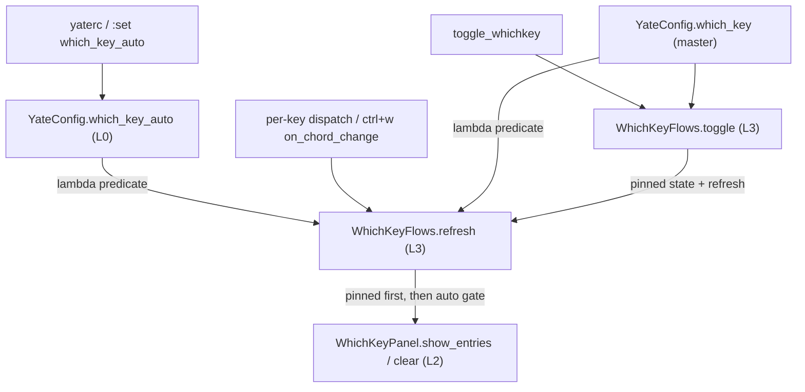
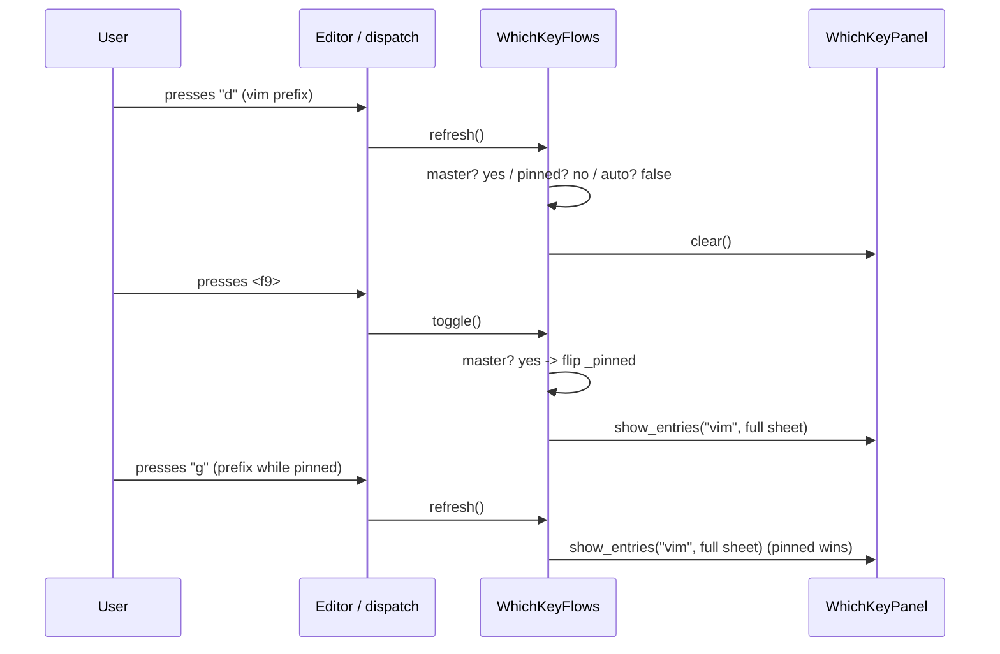

# IKU55P：which-key 自动触发独立开关（主计划）

- Issue：<https://gitee.com/jermaine/yate/issues/IKU55P>（enhancement，2026-11-10 06:24 +08:00，0 评论）
- 需求原文（唯一需求来源）：[which-key-auto-trigger-issue.md](which-key-auto-trigger-issue.md)
- 子计划总纲：[which-key-auto-trigger-plans/overview.md](which-key-auto-trigger-plans/overview.md)
- 基线：`master` = `origin/master` = `18e96d2a`；worktree `yate-which-key-auto-trigger`；分支 `feature/enh-which-key-auto-trigger`；独立 `.venv` 已自证生效
- 流程状态：【领会】完成并提交 `525f8bfb`；【方案】2026-11-10 落盘；【批准】无人值守自动批准（依据本次用户指令「所有问题无须过问」与总纲 §二.5，未向用户询问）；后续【执行】【审核】【迭代】【收尾】按闭环推进

## 一、目标

1. 新增 yaterc 布尔选项 `which_key_auto`（采用 issue 建议名，沿用小写 snake_case），默认 `True`，只门控**自动触发**（挂起前缀 / `ctrl+w` 和弦同步推面板）。
2. `which_key` 保持总开关，优先级更高；`False` 时面板一律隐藏、`<f9>` 仍为 no-op、钉住状态保留。
3. 无论 `which_key_auto` 取何值，手动 `<f9>` / `toggle_whichkey` 行为不变；已钉住的速查页不被清除、也不被前缀态覆盖。
4. 运行期 `:set which_key_auto=on|off` 与 `:set which_key=on|off` 同一套机制即时生效；非 bool 的 yaterc 值记入 `config.errors` 且保持默认。
5. 默认路径零行为变化：既有 which-key 单测与冒烟场景（`which_key_toggle`、`which_key_ctrl_w_chord`）零回归；vsc 仍不自动弹出。
6. 双语文档与示例配置同步；全量门禁（pyright / pytest / 架构 / 覆盖率 / 冒烟）由主代理亲自跑。

### 非目标

- 不引入延时 / 阈值 / 定时器；不改触发时机（仍是每键 `refresh()` 同步决策）。
- 不改 `<f9>` 绑定、`toggle_whichkey` 语义、`editor_components/whichkey.py` 渲染 / 分组 / 溢出 / 主题。
- 不新增命令行 toggle 命令；不重构 which-key 分层；不改 vsc 既有行为。

## 二、调研事实（`文件:行号`）

- 配置模型：`yate/config.py:34-39` `KNOWN_OPTIONS`；`:169-176` `which_key: bool = True` 及 `#:` 注释；`:211-223` `parse_bool`；`:283-285` `_parse_bool_option`；`:292-355` `SET_OPTION_SPECS`（`which_key` 在 `:349-354`）；`:359-363` `set_option_names()`。
- rc 校验：`yate/yaterc_options.py:467-469` `_extract_options` 取出 `KNOWN_OPTIONS`；`:552-559` `which_key` 的 `isinstance(..., bool)` 内联校验 + `config.errors.append(...)`；同构片段 `:543-550` `support_mouse`。模块 docstring `:10-12`：坏值不抛异常、保持默认。
- 运行期命令：`yate/commands.py:106-121` `_apply_which_key`（写 config → off 时 `editor.whichkey.clear()` → `editor.refresh_ui()` → message）；`:124-134` `SET_APPLY.update(...)`；`:411-442` `_set` 经 `SET_OPTION_INDEX` / `spec.parse` / `SET_APPLY` 分派；`:198-200` 补全器读 `set_option_names()`。
- 自动链：`yate/editor_dispatch.py:163-181`（`if handled: ed.refresh_ui()`）；`yate/editor.py:435-441,480-485`（`_refresh_chrome` 调 `self.whichkey.refresh()`）；`yate/flows/window_flows.py:220-257`（`ctrl+w` 置位后 `on_chord_change()`）；`yate/editor_compose.py:362-374`（`on_chord_change = ed.whichkey.refresh`）；`yate/keymaps/base.py:228-235` / `vim.py:294-301` `pending_prefix()`。
- 面板状态：`yate/flows/whichkey_flows.py:80-103` `refresh()` 四分支（总开关短路 → pinned → `ctrl+w` → pending → clear）；`:105-115` `toggle()` 只看总开关；`:78` `self._pinned`；`:117-124` `clear()`；`:30-35` `EnabledPredicate` 注入契约。
- 构造注入：`yate/editor_compose.py:363-370` `which_key_enabled=lambda: ed.config.which_key`。
- 测试基建：`tests/test_whichkey_flows.py:34-69` `_PanelRecorder` / `_make_flows(...)`（关键字参数）；`:279,307,330,342` 总开关闭路用例；`tests/test_config.py:37-49,249-267` `_load` + 三个 `which_key` 用例；`tests/test_set_options.py:19-32,86-125,159-187` 表一致性守卫 / `_ConfigEditor` / `which_key` 往返与非法值用例。
- 冒烟：`tools/smoke_test/scenarios/whichkey.py:26-79` 两场景与 `SCENARIOS` 注册；`tools/smoke_test/harness.py:362-381` `new_app(config=...)`；`tools/smoke_test/run --scenario NAME --jobs N` 可用（`--help` 实测）。
- 文档：`yate/docs/yaterc.en.md:81,105-107` ↔ `yaterc.zh.md:73,94-95`；`yate/docs/which-key.en.md:11,19-31` ↔ `which-key.zh.md:9,18-28`；`FEATURES.md:30-31,82-83,89-91,205` ↔ `FEATURES.zh.md:24,67,74,168`；`yate/yaterc.example:66-69`；`README*.md` 仅有 which-key 双语页索引（`:261-262,292-294` / zh `:277-278,308-310`），无开关条目；`yate/resources/manual.en.md:806-820` 是 `:set` 命令表，manual 双语全文**未出现 `which` 字面**（实测 0 命中）。
- changelog 机制：`CHANGELOG.md:3` 明写 `Generated by python -m tools.changelog — do not edit by hand`；`tools/changelog/cli.py:121-218` `generate` / `check`；`:180-206` `check` 只比对 released sections，`[Unreleased]` 允许滞后；`.github/workflows/test.yml:82-87` CI 跑 `python -m tools.changelog check`。
- 架构守卫：`tests/test_architecture.py:762-775`（UI-free 层）、`:778-806`（层秩）、`:1366-1374`（`support_mouse` 闸门先例）、`:1427-1442`（注释 ASCII）、`:1534-1548`（禁本机家目录路径）。本改动不新增 import 连线，无需新增架构守卫用例。

## 三、备选方案与裁决

| 方案 | 做法 | 裁决 |
| --- | --- | --- |
| **A（采纳）** | 在 `WhichKeyFlows` 注入第二个 `EnabledPredicate`（`editor.config.which_key_auto`），`refresh()` 在 pinned 分支之后、`ctrl+w`/pending 分支之前短路；`toggle()` 不变 | 采纳：门控落在拥有面板状态和四分支优先级的 owning module；`ctrl+w` 的 `on_chord_change` 也走 `refresh()`，单点覆盖；总开关短路位置不变，优先级天然成立；与既有 `which_key_enabled` 注入模式对称 |
| B | 在 `editor.py` / `editor_dispatch.py` 的 `refresh_ui` 通道加 `if config.which_key_auto` | 否决：会跳过 pinned sheet 的重绘（手动态与自动态耦合），且 `window_flows.on_chord_change -> whichkey.refresh` 不经该通道，门控遗漏；配置判断散落调度层 |
| C | 把新开关折进 `which_key_enabled` 谓词（`which_key and which_key_auto`） | 否决：`toggle()` 也读该谓词，`<f9>` 会变 no-op，直接违背核心需求 |
| D | 在 L2 `editor_components/whichkey.py` 的 `show_entries` 内判断配置 | 否决：渲染组件不应持有配置 / 流程语义；`clear()` 与 pinned 优先级会散到组件层，违反 R3 / 分层职责 |
| E | `refresh(auto: bool)` 由每个调用点传参控制 | 否决：调用点分散（`editor._refresh_chrome`、`window_flows.on_chord_change`、`commands._apply_*`），易漏；既有注入式谓词已是仓库标准（§四跨模块交互表） |

## 四、设计契约

- **状态优先级（不可调换）**：`which_key=False` → 隐藏 + F9 no-op；否则 `pinned` → 钉住全表；否则 `which_key_auto=False` → 隐藏（不影响 pinned）；否则 `ctrl+w` → 和弦表；否则 `pending_prefix()` → 候选表；否则隐藏。
- **命名**：`which_key_auto`（`YateConfig` 字段、`KNOWN_OPTIONS`、`SetOption.name`、`SET_APPLY` 键、配置错误文案均同名）；不设别名。
- **接口**：`WhichKeyFlows.__init__` 增加必填关键字参数 `which_key_auto_enabled: EnabledPredicate`（无隐式默认值，接线遗漏会立即暴露）；`editor_compose._build_pane_stack` 注入 `lambda: ed.config.which_key_auto`；`tests/test_whichkey_flows.py::_make_flows` 同步透传（wave-2 改 helper，wave-3 只追加用例）。
- **运行期切换**：`_apply_which_key_auto` 写 config → `editor.refresh_ui()` → message；**不**无条件调 `clear()`（否则会抹掉 pinned 面板）；`refresh()` 自己决定 pinned 保留 / 自动态清除。非法 `:set` 值由 `SetOption.invalid_message` 走既有提示，状态不变。
- **非 bool 的 rc 值**：`_extract_options` 追加 `which_key_auto must be True or False, got ...` 到 `config.errors`，字段保持 `True`（与 `which_key` 完全同构）。
- **行为矩阵**（对应 issue 四行，必须有单测覆盖）：

| `which_key` | `which_key_auto` | 前缀挂起自动弹出 | `<f9>` toggle |
| --- | --- | --- | --- |
| `True` | `True`（默认） | 是 | 可用 |
| `True` | `False` | 否 | 可用 |
| `False` | `True` | 否 | no-op |
| `False` | `False` | 否 | no-op |

## 五、模块交互图





## 六、分步实施与验收

波次表、独占文件清单、每步输入 / 输出 / 可执行验收命令、详细测试用例、风险与回滚见
[子计划总纲](which-key-auto-trigger-plans/overview.md) 及 plan-a..e。总纲是执行波次的唯一依据：

- wave-1：`plan-a`（配置与 `:set` 机制）∥ `plan-b`（双语文档）
- wave-2：`plan-c`（流程门控 + 构造接线 + helper 透传），依赖 wave-1 全绿
- wave-3：`plan-d`（单测）∥ `plan-e`（冒烟场景），依赖 wave-2 全绿

主代理收尾门禁（必须亲自跑，统一并行口径）：

```powershell
.venv\Scripts\python.exe -m pyright yate/ tests/ tools/ pack/
.venv\Scripts\python.exe -m pytest tests/ -q -n auto
.venv\Scripts\python.exe -m pytest tests/test_architecture.py -q
.venv\Scripts\python.exe -m pytest tests/ --cov=yate --cov-branch -n auto
.venv\Scripts\python.exe -m tools.smoke_test run --jobs 4
.venv\Scripts\python.exe -m tools.changelog check
```

局部覆盖率运行须加 `--cov-fail-under=0`；并行下出现时序 flake 必须 `-n 1` 复核并修用例，不得记成偶发。

## 七、范围裁决（显式记录，附实测依据）

- **CHANGELOG.md / CHANGELOG.zh.md 不手改**：文件头 `CHANGELOG.md:3` 明令生成式文档不得手改；`tools/changelog/cli.py:180-206` 的门禁只比对 released sections，`[Unreleased]` 由提交历史refresh；历史 which-key 条目（`CHANGELOG.md:597-598` 等）是已发布事实，改写会造成 released section drift，CI 反被判红。issue 的「同步 CHANGELOG」按生成器机制兑现：本次提交信息用规范英文 `feat(...)` / `fix(...)`，条目随 git 历史进入 `[Unreleased]`；收尾跑 `check` 实测并回填结果。双语翻译缺口如需补齐，按 `python -m tools.changelog zh-commit` 的既有流程另案处理，不在本任务改生成物。
- **README*.md**：实测无 `which_key` / 开关条目，仅有 which-key 双语页索引；plan-b 只做核对并登记结论，不虚构新条目（issue 措辞为「涉及 which-key 开关的条目」）。
- **`yate/resources/manual.{en,zh}.md`**：全文 0 处 `which` 字面，无现成 which-key 选项表；在 `:set` 命令表（en `:806-820` / zh 对应位置）补 `:set which_key=<bool>` 与 `:set which_key_auto=<bool>` 两行说明，满足「选项表与说明」同步且不扩写其它章节。
- **不新增 `tests/test_architecture.py` 守卫**：本改动不新增 import 连线 / 新模块 / 新协议，`:set` 表与 `SET_APPLY` 的一致性已有 `tests/test_set_options.py:19-32` 守卫自动覆盖新选项。

## 八、风险与回滚路径

| 风险 | 缓解 | 回滚 |
| --- | --- | --- |
| 新必填 predicate 漏注入，构造期 TypeError | `editor_compose` 与 `_make_flows` 同步接线；wave-2 跑既有 `test_whichkey_flows.py` 全绿 | 回退 `whichkey_flows.py` / `editor_compose.py` 两个文件的改动 |
| 关闭自动态时抹掉 pinned 面板 | pinned 分支置于 auto 闸门之前；`_apply_which_key_auto` 不无条件 `clear()` | 调整分支顺序并复跑 `test_refresh_auto_disabled_preserves_pinned_sheet` |
| `ctrl+w` 走 `on_chord_change` 绕过门控 | 门控位于 `refresh()` 内部，两条链共用 | 同上 |
| `:set` 表 / apply / 补全三处漂移 | 配置单点 `SET_OPTION_SPECS`，既有表一致性守卫 | 回退 `config.py` 的 spec 与 `commands.py` 的 apply 注册 |
| 文档双语不对称 / 生成式 changelog 被手改 | plan-b 成对改动 + 关键词存在性检查；changelog 按 §七裁决 | 回退对应文档提交 |
| 冒烟新场景引入 SVG baseline 漂移 | 新场景不新增 baseline、默认 `run` 不比对 SVG（`--with-svg` 才比较） | 删除新场景注册 |

整体回滚：`git revert` 本分支各步提交（不破坏其它 worktree）；配置项默认 `True`，删除新字段相关代码即恢复旧行为。

## 九、提交纪律与回填

- 每个闭环步骤产物单独提交（`docs(issue)` / `docs(plan)` / `feat(config)` / `docs(...)` / `feat(whichkey)` / `test(...)` / 评审记录 / 门禁回填），英文 `type(scope): subject`，**只提交不推送**，不自动合入 `master`。
- 收尾回填：真实前后数字、门禁退出码、偏离记录、评审结论、子代理存活 / 零产出情况写入本文件「十、执行与门禁回填」及各子计划。

## 十、执行与门禁回填（F1 回填，2026-11-10）

### 10.1 各波实测命令与退出码（主代理复核后登记）

| 波次 | 命令 | 结果 / 退出码 |
| --- | --- | --- |
| wave-1 plan-a | pyright `yate/config.py yate/yaterc_options.py yate/commands.py` | 3 文件 0 errors，0 |
| wave-1 plan-a | pytest `tests/test_config.py tests/test_set_options.py -q` | 全绿，0 |
| wave-1 plan-a | `git diff --check` | 无问题，0 |
| wave-1 plan-b | 双语关键词成对检查（8 文件） | `missing: []`，0 |
| wave-1 plan-b | `git diff --check` | 0 |
| wave-1 plan-b | README 核对 | 无 which-key 开关条目，两份 README 均未改动（issue 措辞为「涉及开关的条目」，不存在即不改） |
| wave-2 plan-c | pyright `yate/flows/whichkey_flows.py yate/editor_compose.py tests/test_whichkey_flows.py` | 0 |
| wave-2 plan-c | pytest `tests/test_whichkey_flows.py -q` | 既有 18 条用例全绿，0 |
| wave-2 plan-c | `git diff --check` | 0 |
| wave-3 plan-d | pyright 3 个测试文件 | 0 |
| wave-3 plan-d | pytest 3 文件 `-q` | 0；`-n 1` 复跑同样 0（无并行 flake） |
| wave-3 plan-d | `git diff --check` | 0 |
| wave-3 plan-d | 新增用例计数 | 15 条（9 条流程用例含 4 参数化行 + 4 条 config + 2 条 `:set`） |
| wave-3 plan-e | pyright 冒烟场景文件 | 0 |
| wave-3 plan-e | 冒烟 3 场景 `--jobs 1` | 40/40 checks 全绿，0 |
| wave-3 plan-e | `git diff --check` | 0 |
| wave-3 plan-e | SVG baseline | 未新增 baseline，SVG baseline 零改动 |

### 10.2 首轮评审（code-review-expert，REQUEST_CHANGES：0 BLOCKER / 1 MAJOR / 3 MINOR）

评审者亲跑六道门禁，全部 exit 0：

| 命令 | 实测结果 | 退出码 |
| --- | --- | --- |
| pyright `yate/ tests/ tools/ pack/` | 0 errors | 0 |
| pytest `tests/ -q -n auto` | 全绿 | 0 |
| 架构 `tests/test_architecture.py -q` | 38 passed | 0 |
| 覆盖率 `--cov=yate --cov-branch --cov-fail-under=75 -n auto` | `TOTAL 19838 1091 6326 582 93%`（93.03% ≥ 75） | 0 |
| 冒烟 `--jobs 4` | 124/124 scenarios · 1511/1511 checks | 0 |
| `tools.changelog check` | released sections up to date；`[Unreleased]` 滞后 8 commits（生成器机制，CI 只校验 released） | 0 |
| `git diff --check master..HEAD` | 无空白问题 | 0 |

发现：M-1（计划文档回填区为空，本节即其修复落点）+ 3 MINOR（m-1 双语分支计数 / m-2 `EnabledPredicate` 注释语义 / m-3 两条 `>=` 恒真断言），3 MINOR 由修复方案 F2 当轮处置。评审记录：[2026-11-10-which-key-auto-trigger-code-review.md](../reviews/2026-11-10-which-key-auto-trigger-code-review.md)。

### 10.3 偏离记录（显式登记，附实测依据）

1. **plan-d 用例 9 断言形态偏离**：原计划断言 `panel.shown == []`，实测不可达——`_PanelRecorder.shown` 是 append-only 历史，首次 `toggle()` 已留 `vim` 条目。改为 4 项等价强度断言：无新增 show、`clears` 增加、`panel.last == "clear"`、`vim.pending_prefix() == "g"`（契约等价：不重新弹出 + 回到隐藏态）。
2. **plan-e `snapshot_svg` 位置偏离**：首版在 `async with app.run_test(...)` 块外调用，实测抛真实 `ScreenStackError`；移入块内后通过，与全仓 25 个既有场景惯例一致；`--svg` 单跑新场景 18/18 PASS。
3. **迭代轮次 1 裁决（不重新设计）**：按 `task-orchestration.md` §二.6「存在 blocker / major → 回到步骤 2 重新设计」，本轮唯一 MAJOR（M-1）经评审记录 §四 实证产品行为与 issue 四行矩阵、7 条验收标准逐条吻合且六道门禁全绿，属流程 / 文档缺口而非设计缺陷；故不重做设计，修复由 F1（回填）/ F2（3 minor）+ 第二轮复审闭环。本裁决为显式登记的流程偏离，依据见评审记录 §一 / §四。

### 10.4 提交清单（截至 F1，共 7 笔，旧→新）

`525f8bfb` docs(issue) → `93804924` docs(plan) → `11bdd77b` feat(config) → `6e387a28` docs(which-key) → `dde0211b` feat(whichkey) → `f5321975` test(which-key) → `d52dfd11` test(smoke)。评审记录、修复方案与 F1/F2 产物待主代理后续提交。只提交不推送。

## 十一、子代理状态登记（如实）

- `plan-architect-designer`：本会话以 `.trae/agents/plan-architect-designer.md` spawn 三次均失败（`Model "qwen-3.7-plus" not found`，含按 `task-orchestration.md` §一.3 表格模型的重试）。按 §三 兜底：**主代理亲自按该角色剧本完成调研与方案**，标注「子代理零产出」，未修改角色定义文件、未造派生副本。
- `code-explorer`（内置只读探索）：成功，产出 `文件:行号` 级证据（98 次工具调用，报告落盘于工具结果缓存），本文件 §二事实清单已交叉复核。
- 后续 `plan-executor` / `code-review-expert` 的存活与产出在收尾按 `subagent-workflow.md` §五.6/§五.7 如实登记。
- 收尾实测登记：`plan-executor` 共 spawn 7 次（wave-1 ×2、wave-2 ×1、wave-3 ×2、迭代 F1/F2 ×2）**全部存活并交付落盘产物**；`code-review-expert` 2 次（首轮 REQUEST_CHANGES / 第二轮 APPROVE）**全部存活并交付**；每份自述结果均由主代理重跑其名下命令独立复核（详见 §十 / §十二）。无半途判死、无成员零产出（除上述规划角色）。内置 `code-explorer` 只读调研成功。

## 十二、最终收尾回填（第二轮评审后）

### 12.1 评审与迭代结论

- 首轮 `REQUEST_CHANGES`：0 BLOCKER / 1 MAJOR（M-1 计划回填缺失）/ 3 MINOR；修复波 F1 + F2 三笔提交闭环（记录见 [2026-11-10-which-key-auto-trigger-code-review.md](../reviews/2026-11-10-which-key-auto-trigger-code-review.md) 与 [which-key-auto-trigger-review-fixes-plan.md](which-key-auto-trigger-review-fixes-plan.md)）。
- 第二轮 `code-review-expert` 复审 **APPROVE：0 BLOCKER / 0 MAJOR / 2 MINOR**，七项强制核验逐条 PASS（含 m-3 负向演练：误清面板令 3 条用例判红），四行矩阵与 7 条验收标准零回归；记录见 [2026-11-10-which-key-auto-trigger-iteration-verification.md](../reviews/2026-11-10-which-key-auto-trigger-iteration-verification.md)，索引 #74。
- 2 项新 MINOR 当轮修复：删除双语导语重复段（en `which-key.en.md` 原 `:12-16` / zh 对应段）；`tests/test_whichkey_flows.py` 残留弱断言收紧为 `panel.clears == clears_before + 1`。局部复核 pyright 0 / pytest 0 / 双语关键词 `missing: []` / diffcheck 0。

### 12.2 主代理亲跑全量门禁（修复后，退出码权威）

| 命令 | 实测结果 | 退出码 |
| --- | --- | --- |
| `.venv\Scripts\python.exe -m pyright yate/ tests/ tools/ pack/` | `0 errors, 0 warnings, 0 informations` | 0 |
| `.venv\Scripts\python.exe -m pytest tests/ -q -n auto` | 全 `[100%]`，无 F/E | 0 |
| `.venv\Scripts\python.exe -m pytest tests/test_architecture.py -q` | `38 passed` | 0 |
| `.venv\Scripts\python.exe -m pytest tests/ --cov=yate --cov-branch --cov-report=term-missing --cov-fail-under=75 -n auto` | `TOTAL 19838 1103 6326 580 93%`；`Total coverage: 92.96%`；`3610 passed, 10 skipped` | 0 |
| `.venv\Scripts\python.exe -m tools.smoke_test run --jobs 4` | `124/124 scenarios` / `1511/1511 checks (100%)` | 0 |
| `.venv\Scripts\python.exe -m tools.changelog check` | `released changelog sections are up to date`（`[Unreleased]` 滞后为生成器机制，CI 只校验 released） | 0 |
| `git diff --check master..HEAD` / `git diff --check` | 无空白问题 | 0 / 0 |

覆盖率三轮时点差异如实登记：首轮 93.03% → 复审 93.07% → 终轮 92.96%（并行覆盖率正常波动 + minor 删行），均 ≥75 门槛；新增代码行零未覆盖。无并行 flake 需 `-n 1` / `--jobs 1` 复核；`-n 1` 局部复核已通过。

### 12.3 提交清单与状态

- 前 10 笔：`525f8bfb` / `93804924` / `11bdd77b` / `6e387a28` / `dde0211b` / `f5321975` / `d52dfd11` / `d5a92536` / `482221e0` / `3050d7f8`；收尾 3 笔按 scope 依次为 `fix(which-key)`（2 项新 MINOR）/ `docs(review)`（第二轮记录 + 索引 #74）/ `docs(plan)`（本节回填，本笔）。
- 基线 `master` `18e96d2a`（与 `origin/master` 同步），worktree `yate-which-key-auto-trigger` 独立 `.venv` 已自证；**只提交、未推送、未合并**，工作树在收尾提交后干净；后续合并 / 推送由用户显式发起。
