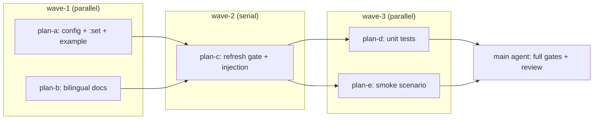

# IKU55P which-key 自动触发开关：子计划总纲

- 主计划：[../which-key-auto-trigger-plan.md](../which-key-auto-trigger-plan.md)
- 需求原文：[../which-key-auto-trigger-issue.md](../which-key-auto-trigger-issue.md)
- 状态：2026-11-10 落盘，无人值守自动批准（未向用户询问）
- 分支：`feature/enh-which-key-auto-trigger`；worktree：`yate-which-key-auto-trigger`；基线 `master` `18e96d2a`
- 解释器：worktree 内 `.venv\Scripts\python.exe`；所有命令以 worktree 根为 cwd；PowerShell

## 一、目标与非目标

见主计划 §一。核心：新增 `which_key_auto`（默认 `True`）只门控自动触发；`which_key` 总开关优先级更高；`<f9>` 手动 toggle 始终可用；钉住态与自动态互不干扰；运行期 `:set` 即时生效；默认路径零回归；双语文档同步。

## 二、子计划索引

| 波次 | 子计划 | 主题 | 独占文件 |
| --- | --- | --- | --- |
| wave-1 | [which-key-auto-trigger-config-plan-a.md](which-key-auto-trigger-config-plan-a.md) | 配置字段、rc 校验、`:set` 表与 apply、示例配置 | `yate/config.py`、`yate/yaterc_options.py`、`yate/commands.py`、`yate/yaterc.example` |
| wave-1 | [which-key-auto-trigger-docs-plan-b.md](which-key-auto-trigger-docs-plan-b.md) | 双语文档 / 手册 / 功能清单同步 | `yate/docs/which-key.en.md`、`yate/docs/which-key.zh.md`、`yate/docs/yaterc.en.md`、`yate/docs/yaterc.zh.md`、`yate/resources/manual.en.md`、`yate/resources/manual.zh.md`、`FEATURES.md`、`FEATURES.zh.md`、`README.md`、`README.zh.md` |
| wave-2 | [which-key-auto-trigger-gate-plan-c.md](which-key-auto-trigger-gate-plan-c.md) | `WhichKeyFlows` 自动态门控、构造注入、测试 helper 透传 | `yate/flows/whichkey_flows.py`、`yate/editor_compose.py`、`tests/test_whichkey_flows.py`（仅 `_make_flows` 一段） |
| wave-3 | [which-key-auto-trigger-tests-plan-d.md](which-key-auto-trigger-tests-plan-d.md) | 行为矩阵 / 配置 / `:set` 单测 | `tests/test_whichkey_flows.py`（仅追加用例）、`tests/test_config.py`、`tests/test_set_options.py` |
| wave-3 | [which-key-auto-trigger-smoke-plan-e.md](which-key-auto-trigger-smoke-plan-e.md) | 目标态冒烟场景 | `tools/smoke_test/scenarios/whichkey.py` |

## 三、执行波次表（唯一调度依据）

| 波次 | 并行关系 | 进入条件 | 退出条件 |
| --- | --- | --- | --- |
| wave-1 | plan-a ∥ plan-b（文件互不重叠） | 方案已批准、worktree 与 `.venv` 就绪 | 两者各自验收命令退出码 0 |
| wave-2 | plan-c（串行，单计划） | wave-1 两者全绿 | pyright + `tests/test_whichkey_flows.py` 既有用例全绿 |
| wave-3 | plan-d ∥ plan-e（文件互不重叠） | wave-2 全绿 | 两者各自验收命令退出码 0；随后主代理跑全量门禁 |

波次间串行理由：wave-2 的 `lambda: ed.config.which_key_auto` 依赖 wave-1 的 `YateConfig` 字段（否则 pyright 报未知属性）；wave-3 的单测 / 冒烟依赖 wave-2 的 `refresh()` 门控与 predicate 注入。wave-1 内 a 与 b 分别改产品配置与文档，无共享文件；wave-3 内 d 改 `tests/**`、e 改 `tools/**`，无共享文件。`tests/test_whichkey_flows.py` 在 wave-2 与 wave-3 都会被修改，但分属不同波次、串行执行，且 wave-3 **不得改动** wave-2 已落地的 `_make_flows` 签名（只追加用例）。

## 四、全局约束（所有子计划共同遵守）

- 严格按 `plan-before-execute.md` §二、`python-coding-style.md`、`architecture-boundaries.md`：无新增 import 连线、无新 `Protocol` / `TYPE_CHECKING` / `Any` / 相对导入；代码注释与 docstring 全 ASCII；`from __future__ import annotations` 保持；公共 API 命名不带下划线前缀（新增的是 `YateConfig` 公共字段与 `:set` 名称）。
- 配置项名统一 `which_key_auto`；默认值 `True`；错误文案 `which_key_auto must be True or False, got ...`（rc）与 `which_key_auto must be on|off (true/false/1/0/yes/no accepted)`（`:set`）。
- 既有 `which_key` 逻辑、`<f9>` 绑定、`toggle_whichkey` 语义、`editor_components/whichkey.py` 一律不动。
- CHANGELOG*.md 为生成式文档，按主计划 §七裁决**不手改**；收尾由主代理跑 `python -m tools.changelog check`。
- 每子计划只改自己独占清单内的文件；偏离即停下上报，由主代理裁决并回填。
- 每个子计划完成后由主代理单独提交一次（英文 `type(scope): subject`），不推送、不合并。

## 五、验收总表（各子计划验收命令的并集）

| 阶段 | 命令（worktree cwd） |
| --- | --- |
| wave-1 a | `.venv\Scripts\python.exe -m pyright yate/config.py yate/yaterc_options.py yate/commands.py`；`.venv\Scripts\python.exe -m pytest tests/test_config.py tests/test_set_options.py -q` |
| wave-1 b | 关键词成对存在性检查（见 plan-b）+ `git diff --check` |
| wave-2 c | `.venv\Scripts\python.exe -m pyright yate/flows/whichkey_flows.py yate/editor_compose.py tests/test_whichkey_flows.py`；`.venv\Scripts\python.exe -m pytest tests/test_whichkey_flows.py -q` |
| wave-3 d | `.venv\Scripts\python.exe -m pyright tests/test_whichkey_flows.py tests/test_config.py tests/test_set_options.py`；`.venv\Scripts\python.exe -m pytest tests/test_whichkey_flows.py tests/test_config.py tests/test_set_options.py -q` |
| wave-3 e | `.venv\Scripts\python.exe -m tools.smoke_test run --scenario which_key_toggle --scenario which_key_ctrl_w_chord --scenario which_key_auto_off_manual_toggle --jobs 1` |
| 主代理收尾 | 主计划 §六 六条命令（含 `pytest -n auto` / 架构 / 覆盖率 / 全量冒烟 / changelog check） |

`pytest -q` 在本环境无汇总行，以退出码为权威信号；覆盖率数字从输出解析；并行失败须 `-n 1` / `--jobs 1` 复核并修用例。

## 六、风险与回滚

见主计划 §八。单波失败不得带病进入下一波：先修复该波独占文件，复跑该波验收命令至退出码 0，并在回填区记录实测结果与偏离。

## 七、回填区（F1 回填，2026-11-10）

### 7.1 逐波验收命令与退出码

| 波次 | 验收命令 | 结果 / 退出码 |
| --- | --- | --- |
| wave-1 a | pyright 3 源文件 / pytest `tests/test_config.py tests/test_set_options.py -q` / `git diff --check` | 0 errors / 全绿 / 无问题，均 0 |
| wave-1 b | 双语关键词成对检查 / `git diff --check` | `missing: []` / 0；README 核对结论：无 which-key 开关条目，两份 README 未改动 |
| wave-2 c | pyright 3 文件 / pytest `tests/test_whichkey_flows.py -q` / `git diff --check` | 0 / 既有 18 条用例全绿 / 0 |
| wave-3 d | pyright 3 测试文件 / pytest 3 文件 `-q`（`-n 1` 复跑一致）/ `git diff --check` | 全 0；新增 15 条用例（9 流程含 4 参数化行 + 4 config + 2 `:set`） |
| wave-3 e | pyright 场景文件 / 冒烟 3 场景 `--jobs 1` / `git diff --check` | 0 / 40/40 checks 全绿 / 0；新场景 18 checks，SVG baseline 未动 |

### 7.2 子代理存活 / 零产出

- `plan-architect-designer`：spawn 3 次失败（`Model "qwen-3.7-plus" not found`，含 §1.3 模型重试）＝ **零产出**，主代理亲自按剧本完成规划。
- `code-explorer`（只读探索）：成功。
- `plan-executor`：5 次 spawn（wave-1 ×2、wave-2 ×1、wave-3 ×2）全部交付。
- `code-review-expert`：第 1 轮评审交付（REQUEST_CHANGES：0 BLOCKER / 1 MAJOR / 3 MINOR）。

### 7.3 评审结论与迭代裁决

首轮评审六道门禁全绿（pyright 0 / pytest `-n auto` 全绿 / 架构 38 / 覆盖率 93.03%，`TOTAL 19838 1091 6326 582 93%` / 冒烟 124/124 · 1511/1511 / changelog 0，`[Unreleased]` 滞后 8 commits 属生成器机制）。唯一 MAJOR（M-1）为流程 / 文档缺口：行为与 issue 四行矩阵、7 条验收标准逐条吻合、无设计缺陷，按 `task-orchestration.md` §二.6 裁决**不重新设计**，修复走 F1（回填）/ F2（3 minor）+ 第二轮复审——该裁决作为显式流程偏离登记（依据：评审记录 §一 / §四）。

### 7.4 偏离与依据

1. plan-d 用例 9 断言：`panel.shown == []` 不可达（`_PanelRecorder.shown` append-only，首 toggle 已留 `vim` 条目），改为 4 项等价强度断言（无新增 show / clears 增加 / `last == "clear"` / `pending_prefix() == "g"`）。
2. plan-e `snapshot_svg`：块外调用实测 `ScreenStackError`，移入 `async with app.run_test(...)` 块内（与全仓 25 场景惯例一致），`--svg` 单跑 18/18 PASS。
3. 迭代裁决偏离见 §7.3。

### 7.5 提交清单（7 笔，旧→新）

`525f8bfb` docs(issue) / `93804924` docs(plan) / `11bdd77b` feat(config) / `6e387a28` docs(which-key) / `dde0211b` feat(whichkey) / `f5321975` test(which-key) / `d52dfd11` test(smoke)。评审记录 + 修复方案 + F1/F2 产物待主代理提交。最终全量门禁由主代理收尾执行。
