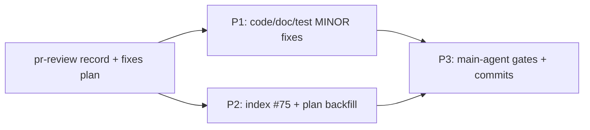

# IKU55P 合并前 pr-review 修复方案

- 来源评审记录：[2026-11-11-pr-review-feature-enh-which-key-auto-trigger.md](../reviews/2026-11-11-pr-review-feature-enh-which-key-auto-trigger.md)（`Overall: APPROVE`，0 BLOCKER / 0 MAJOR / 5 MINOR）
- 主计划：[which-key-auto-trigger-plan.md](which-key-auto-trigger-plan.md)；子计划总纲：[which-key-auto-trigger-plans/overview.md](which-key-auto-trigger-plans/overview.md)
- 日期：2026-11-11；状态：已落盘，无人值守自动批准（未向用户询问）

## 一、目标与非目标

- 目标：处理 pr-review 的 5 项 MINOR 报告（1 项经字符级复核撤回、4 项当轮修复）；归档 pr-review 记录并登记评审索引 #75；回填主计划 / 总纲的评审结论与门禁数字；复跑全量门禁；按 `git-commit-message.md` 分步提交。
- 非目标：不改任何产品行为（不改 `refresh()` 分支顺序、不改配置语义、不改 `<f9>` 绑定）；不改生成式 `CHANGELOG*.md` / `yate/resources/changelog.*.md`；不新增架构守卫（评审实证无新连线需求）；不合并、不推送、不重做设计。
- 范围基线：`master...HEAD`（merge-base `18e96d2a`），13 笔提交 / 30 文件；pr-review 记录与修复方案已落盘。

## 二、备选方案与否决理由

| 方案 | 做法 | 裁决 |
| --- | --- | --- |
| A（采纳） | 两项并行修复波：P1 改代码/测试/双语选项表，P2 改索引与计划回填；随后主代理复跑门禁并提交 | 采纳：文件互不重叠，可并行；5 项 MINOR 一次性清零，避免遗留待办 |
| B | 5 项 MINOR 全部按「仅 minor 登记待办」挂起，只归档记录 | 否决：均为低成本、可实证的文档/断言/索引问题；用户本次要求严格纪律，且其中 2 项影响索引可复核性 |
| C | 借 pr-review 重做门控设计或重构 which-key 分层 | 否决：三域评审实证产品行为与 issue 四行矩阵 / 7 条验收标准逐条吻合，硬门禁全绿，无设计缺陷 |

## 三、分步实施（输入 / 独占文件 / 输出 / 验收命令）

### P1（代码注释、断言强度、双语选项表）

- 输入：评审记录 §三第 1 / 2 / 3 条；本方案。
- 独占文件：`yate/flows/whichkey_flows.py`、`tests/test_whichkey_flows.py`、`yate/docs/yaterc.en.md`、`yate/docs/yaterc.zh.md`。
- 具体改动：
  1. `yate/flows/whichkey_flows.py:8-10` 模块 docstring 的结构化枚举插入 `the auto-trigger gate`（保持 ASCII、RST 引用、句子通顺；`:12-14` 既有说明不动，代码逻辑零改动）。
  2. `tests/test_whichkey_flows.py:431-434` 的 else 分支补 `assert panel.last == "clear"` 与一行 ASCII 注释；不得改其它断言 / helper。
  3. `yate/docs/yaterc.en.md:82` / `yaterc.zh.md:74` 反引号项：**执行时经主代理字符级复核撤回（误报）** —— 两行在 HEAD 本已反引号包裹，P1 对这两份文档零改动；按 pr-review skill Step 5 登记撤回，本会话不再重提。
- 输出：docstring 与五分支文档口径一致；矩阵 no-op 契约在两处用例等强度；双语文档保持原状（无需改动）。
- 验收命令（worktree 根，PowerShell；第 3 条用 `chr(96)` 构造反引号以规避 shell 转义，属验收命令的等价调整，已登记）：
  `.venv\Scripts\python.exe -m pyright yate/flows/whichkey_flows.py tests/test_whichkey_flows.py`
  `.venv\Scripts\python.exe -m pytest tests/test_whichkey_flows.py -q`
  `.venv\Scripts\python.exe -c "from pathlib import Path; import sys; bq=chr(96); needle=bq+'which_key=False'+bq; names=['yate/docs/yaterc.en.md','yate/docs/yaterc.zh.md']; bad=[n for n in names if needle not in Path(n).read_text(encoding='utf-8')]; print('missing:', bad); sys.exit(1 if bad else 0)"`
  `git diff --check`
  四条退出码须全 0；P1 实测 `missing: []`、`backticked` 两文件均命中、`bare_hits: []`。

### P2（评审索引 #75 与计划回填）

- 输入：评审记录 §二 / §三 / §六；`git log --oneline master..HEAD` 13 笔；本方案。
- 独占文件：`.trae/reviews/README.md`、`.trae/documents/which-key-auto-trigger-plan.md`、`.trae/documents/which-key-auto-trigger-plans/overview.md`。
- 具体改动：
  1. `.trae/reviews/README.md`：#73 散文段 `:210` 的「7 笔提交」与 #74 段 `:218` 的「10 笔提交」标注为各自评审时点（分支终态 13 笔见主计划 §12.3）；表格 #73 / #74 行同样标注；**不改数字本身**。
  2. `.trae/reviews/README.md`：#73 散文段 `:214` 末句「复审前状态 🔧 进行中」改为指向 #74 终态（消除双状态源），不再出现过期标记。
  3. `.trae/reviews/README.md`：散文段与索引表新增 **#75**（2026-11-11 合并前 pr-review，`Overall: APPROVE` 0 BLOCKER / 0 MAJOR / 5 MINOR，3 只读分域审查员 + 主代理逐条回读 + 八条硬门禁全 0，链接评审记录与本修复方案）；更新「编号分歧登记」为 #73 / #74 / #75 本分支、master 侧 #72、合并按日期重排。
  4. 主计划追加 §十三：pr-review 范围 / 方法 / 门禁数字 / 5 MINOR 及处置 / 结论 / 提交与推送状态；总纲追加 §7.8 精简版；两处均链接评审记录与修复方案。
- 输出：索引可复核（时点标注 + 单一状态源 + #75 登记）；主计划事实链补上合并前评审。
- 验收命令（worktree 根）：
  `.venv\Scripts\python.exe -c "from pathlib import Path; import re,sys; d=Path('.trae/reviews/README.md'); s=d.read_text(encoding='utf-8'); print('index_75:', '| 75 |' in s, 'prose_75:', '新增 #75' in s, 'stale_flag:', '复审前状态 🔧 进行中' in s); sys.exit(0 if '| 75 |' in s and '新增 #75' in s and '复审前状态 🔧 进行中' not in s else 1)"`
  `.venv\Scripts\python.exe -c "from pathlib import Path; import re,sys; docs=[Path('.trae/documents/which-key-auto-trigger-plan.md'),Path('.trae/documents/which-key-auto-trigger-plans/overview.md'),Path('.trae/documents/which-key-auto-trigger-pr-review-plan.md'),Path('.trae/reviews/2026-11-11-pr-review-feature-enh-which-key-auto-trigger.md')]; bad=[(str(d),t) for d in docs for t in re.findall(r'\]\(([^)]+\.md)\)', d.read_text(encoding='utf-8')) if not t.startswith('http') and '#' not in t and not (d.parent/t).exists()]; print('broken_links:', bad); sys.exit(1 if bad else 0)"`
  `git diff --check`
  三条退出码须全 0（纯文档变更按 `misc-rules.md` §三豁免测试门禁，全量门禁由主代理 P3 执行）。

### P3（主代理收尾）

- 独立复核 P1 / P2 的落盘结果（重跑其验收命令、逐条回读 diff）。
- 亲跑全量门禁八条：`pyright yate/ tests/ tools/ pack/`、`pytest tests/ -q -n auto`、`pytest tests/test_architecture.py -q`、`pytest tests/ --cov=yate --cov-branch --cov-fail-under=75 -n auto`、`tools.smoke_test run --jobs 4`、`tools.changelog check`、`git diff --check master...HEAD`、`git diff --check`。
- 回填本方案 §五、主计划 / 总纲的门禁数字与提交清单；按 scope 分笔提交（P1 修复 / P2 记录索引与回填 / 最终回填），**只提交不推送**；工作树收尾干净。

## 四、风险与回滚

| 风险 | 缓解 | 回滚 |
| --- | --- | --- |
| docstring 改动引入非 ASCII 或格式漂移 | P1 保持 ASCII 且只改枚举一句；pyright + 架构守卫（§六 ASCII）复核 | 回退 `whichkey_flows.py` 改动 |
| 新增断言与真实行为不符 | P1 跑 `test_whichkey_flows.py -q`；主代理复跑 | 回退该行断言并复核契约 |
| 索引 #75 编号与 master 冲突 | 沿用 #73/#74 惯例并更新编号分歧说明，合并时重排 | 调整编号说明 |
| 改动历史时点数字造成事实失真 | 只加时点标注、不改数字 | 回退标注 |
| 子代理零产出 | 按 `task-orchestration.md` §三 主代理兜底并如实登记 | 主代理按方案亲自执行 |

## 五、回填区（P3 完成，2026-11-11）

### 5.1 P1 / P2 复核结果（主代理独立重跑）

- P1 四条验收命令全部退出码 0：pyright 2 文件 0 诊断 / `pytest tests/test_whichkey_flows.py -q` 30 点全绿 / 反引号字符级检查 `missing: []` / `git diff --check` 0。实际改动仅 2 文件：`yate/flows/whichkey_flows.py:9` docstring 插入 `the auto-trigger gate`、`tests/test_whichkey_flows.py:435-436` 补 `assert panel.last == "clear"` 与 ASCII 注释；`yate/docs/yaterc.{en,zh}.md` 目标状态已存在、零改动。
- P2 三条验收命令全部退出码 0：`index_75: True prose_75: True stale_flag: False` / 4 份文档相对链接 `broken_links: []` / `git diff --check` 0。README #75 散文 + 表格、#73/#74 时点标注、编号分歧、主计划 §十三、总纲 §7.8 均落盘。
- `plan-executor` 2 次（P1 / P2）全部存活交付；`code-review-expert` pr-review 4 次（A / B 截断 / B 重试 / C）中 B 首次报告在输出阶段被截断，按 §五.4 变更任务粒度重试一次后交付完整报告，如实登记非零产出。

### 5.2 5 项 MINOR 处置

- 4 项有效 MINOR 全部当轮修复：① 模块 docstring 分支枚举补 auto 闸门；② 矩阵 else 分支补 `panel.last == "clear"`；③ README #73/#74 提交数补时点标注（不改数字）；④ #73 散文段过期状态标记改为指向 #74 终态。
- 1 项撤回：C 域「双语选项行 `which_key=False` 裸写」经主代理 `chr(96)` 字符级复核为误报（`backticked` 两文件命中、`bare_hits: []`、两文件 diff 为空），按 pr-review skill Step 5 在评审记录 §三第 3 条登记 `[WITHDRAWN]`，本会话不再重提；评审记录、索引、主计划、总纲与本方案的相关表述已同步更正为「5 项报告 / 1 项撤回 / 4 项修复」。
- 验收命令等价调整（已登记）：方案原第 3 条命令含反引号，在 shell 中会被转义，改用 `chr(96)` 构造同一检查串，判据不变。

### 5.3 修复后主代理亲跑八条门禁（全 exit 0）

| 命令 | 实测结果 | 退出码 |
| --- | --- | --- |
| `pyright yate/ tests/ tools/ pack/` | `0 errors, 0 warnings, 0 informations` | 0 |
| `pytest tests/ -q -n auto` | 全绿 | 0 |
| `pytest tests/test_architecture.py -q` | 38 全绿 | 0 |
| `pytest tests/ --cov=yate --cov-branch --cov-report=term-missing --cov-fail-under=75 -n auto` | `TOTAL 19838 1101 6326 578 93%`；`Total coverage: 92.98%`；`3610 passed, 10 skipped in 169.32s` | 0 |
| `tools.smoke_test run --jobs 4` | `124/124 scenarios` / `1511/1511 checks (100%)`，82.49s | 0 |
| `tools.changelog check` | `released changelog sections are up to date`，`[Unreleased]` 滞后 14 commits（生成器机制） | 0 |
| `git diff --check master...HEAD` / `git diff --check` | 无空白问题 | 0 / 0 |
| 文档自检（链接 / 撤回 / 索引） | `broken_links: [] withdrawn: True index75: True effective4: True` | 0 |

覆盖率时点：pr-review 修复前 92.99% → 修复后 92.98%（并行正常波动），闭环终轮 92.96%、首轮 93.03%、复审 93.07%，全部 ≥75 门槛；新增代码行零未覆盖。无并行 flake 需 `-n 1` / `--jobs 1` 复核。

### 5.4 提交与状态

- 本轮两笔提交按 scope：`fix(which-key)`（P1 两文件）/ `docs(review)`（评审记录、本方案、README #75 与索引更正、主计划 §十三、总纲 §7.8、最终回填）。
- 评审时点分支 13 笔已推送、`origin/feature/enh-which-key-auto-trigger` == `79dffdbd`；本轮产物**只提交、不推送、不合并**，故本地领先 origin 2 笔。工作树在收尾提交后干净；合并决定归人工。
