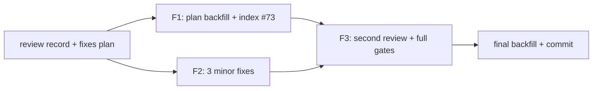

# IKU55P 首轮评审修复方案

- 来源评审记录：[2026-11-10-which-key-auto-trigger-code-review.md](../reviews/2026-11-10-which-key-auto-trigger-code-review.md)（REQUEST_CHANGES：0 BLOCKER / 1 MAJOR / 3 MINOR）
- 主计划：[which-key-auto-trigger-plan.md](which-key-auto-trigger-plan.md)；子计划总纲：[which-key-auto-trigger-plans/overview.md](which-key-auto-trigger-plans/overview.md)
- 日期：2026-11-10；状态：已落盘，无人值守自动批准（未向用户询问）

## 一、目标与非目标

- 目标：闭环 M-1（计划文档回填与两处偏离记录），同轮修掉 3 项 minor；第二轮 `code-review-expert` 复审确认 blocker / major 归零；主代理亲跑全量门禁并回填最终数字。
- 非目标：**不重新设计门控方案**。依据 `task-orchestration.md` §二.6 的「存在 blocker/major → 回到步骤 2 重新设计」：本轮唯一 major 是流程文档缺失，评审实测已确认产品行为与 issue 四行矩阵 / 7 条验收标准逐条吻合、六道门禁全绿，无设计缺陷可改；这一裁决属于流程偏离，按 `plan-before-execute.md` §二.4 在此显式登记并附实测依据（评审记录 §一 / §四）。
- 非目标：不改 CHANGELOG 生成物、不改 `<f9>` / 总开关语义、不新增架构守卫、不推送、不合并。

## 二、备选方案与否决理由

| 方案 | 做法 | 裁决 |
| --- | --- | --- |
| A（采纳） | 一次性回填主计划 / 总纲 / 六份子计划的实测与偏离，登记评审索引 #73；同轮修 3 项 minor；再派第二轮评审复核 | 采纳：一次性消除 M-1 与所有 minor，避免 minors 转成长期待办；第二轮评审提供独立复核 |
| B | 只修 M-1，3 项 minor 按 §二.6「仅 minor 登记待办」挂起 | 否决：三项 minor 都落在本次改动的代码块 / 文档 / 用例内，修复成本极低且其中两项会误导后续维护；用户本次要求严格纪律 |
| C | 按字面「回到步骤 2」重做门控设计（如把闸门移到 L3 调度层） | 否决：评审实证当前设计正确且与架构注入模式一致，重新设计只会引入无依据的行为风险 |

## 三、分步实施（输入 / 独占文件 / 输出 / 验收命令）

### F1（文档回填与索引，主代理派 `plan-executor`）

- 输入：本方案、评审记录 §一 / §二 / §三 / §五、各波执行者报告（数据由任务书内嵌）、`git log --oneline master..HEAD` 7 笔提交清单。
- 独占文件：`.trae/documents/which-key-auto-trigger-plan.md`、`.trae/documents/which-key-auto-trigger-plans/overview.md`、同目录 `which-key-auto-trigger-{config,docs,gate,tests,smoke}-plan-{a,b,c,d,e}.md`、`.trae/reviews/README.md`。
- 具体改动：
  1. 主计划 §十 回填：wave-1..3 实测命令与退出码、首轮评审六道门禁数字（pyright 0 / pytest 0 / 架构 38 / 覆盖率 93.03% / 冒烟 124/124·1511 / changelog 0）、两处偏离及依据、7 笔提交清单、迭代轮次 1 的裁决（不重新设计）。
  2. 总纲 §七 回填：逐波验收命令与退出码、子代理存活 / 零产出、评审结论、偏离、提交清单。
  3. plan-a / b / c / d / e 各补「执行回填」小节：实际命令 + 退出码 + 报告要点；plan-d 补用例 9 断言偏离（依据：`_PanelRecorder.shown` append-only，`shown == []` 不可达；替代 4 项断言等价强度）；plan-e 补 `snapshot_svg` 位置偏离（依据：首版块外 `ScreenStackError`、全仓 25 场景均在块内、`--svg` 单跑 18/18）。
  4. `.trae/reviews/README.md` 散文段与索引表登记 **#73**（2026-11-10 IKU55P 首轮评审，REQUEST_CHANGES 1 MAJOR / 3 MINOR，链接本评审记录与修复方案），并按既有惯例登记编号分歧（master 侧已用 #72，合并回 master 时按日期重排）。
- 输出：回填区不再有占位符；两份偏离有落盘依据；评审索引可追溯。
- 验收命令（worktree 根，PowerShell）：
  `.venv\Scripts\python.exe -c "from pathlib import Path; import sys; paths=[Path('.trae/documents/which-key-auto-trigger-plan.md'),Path('.trae/documents/which-key-auto-trigger-plans/overview.md')]; bad=[str(p) for p in paths if '收尾时由主代理填写' in p.read_text(encoding='utf-8')]; print('placeholders:', bad); sys.exit(1 if bad else 0)"`
  `git diff --check`
  （纯文档变更按 `misc-rules.md` §三豁免测试门禁；最终全量门禁由主代理收尾执行。）

### F2（3 项 minor 修复，与 F1 并行，主代理派 `plan-executor`）

- 输入：评审记录 m-1 / m-2 / m-3、本方案。
- 独占文件：`yate/docs/which-key.en.md`、`yate/docs/which-key.zh.md`、`yate/flows/whichkey_flows.py`、`tests/test_whichkey_flows.py`。
- 具体改动：
  1. m-1：`which-key.en.md:37-44` / `which-key.zh.md:31-35` 将「four / 四个分支」改为五个判定并重列：总开关短路 → 钉住速查页 → `which_key_auto` 闸门 → `ctrl+w` 组合 → 挂起候选，其余隐藏；保留既有优先级与「不吞按键」表述，双语同步。
  2. m-2：`yate/flows/whichkey_flows.py:35-41` 把 `#:` 注释拆为两条语义：master 谓词 `False` 短路所有分支且 F9 no-op（pinned 状态保留）；auto 谓词 `False` 只抑制 `ctrl+w` / pending 分支，`toggle()` 与 pinned sheet 不受影响。注释全 ASCII，代码逻辑零改动。
  3. m-3：`tests/test_whichkey_flows.py:434` 收紧为 `assert panel.clears == clears_before`；`:528` 收紧为 `assert panel.clears == 1`（refresh 一次）并在 `toggle()` 后断言仍 `== 1` 与 `panel.last == "clear"`；不得放宽其它断言、不得改 helper。
- 输出：文档计数与实现一致；类型注释不再混淆两个谓词；两条断言能区分「F9 no-op」与「错误清面板」。
- 验收命令（worktree 根，PowerShell）：
  `.venv\Scripts\python.exe -m pyright yate/flows/whichkey_flows.py tests/test_whichkey_flows.py`
  `.venv\Scripts\python.exe -m pytest tests/test_whichkey_flows.py -q`
  `.venv\Scripts\python.exe -m pytest tests/test_whichkey_flows.py -q -n 1`
  `git diff --check`
  四条退出码均须 0；并行口径下如有 flake 用 `-n 1` 复核并修用例。

### F3（第二轮复审与收尾，主代理）

- 派 `code-review-expert` 复审范围 `master..HEAD`（含修复波提交），重点复核 M-1 与 3 minor 是否闭环、是否有回归；结论须为 0 BLOCKER / 0 MAJOR。
- 主代理亲自跑全量门禁六条（pyright / pytest -n auto / 架构 / 覆盖率 --cov-fail-under=75 / 冒烟 --jobs 4 / changelog check）+ `git diff --check`，记录退出码。
- 回填最终结论与数字到主计划 §十 / 总纲 §七 / 本方案 §五，按 `git-commit-message.md` 单独提交；只提交、不推送、不合并。

## 四、风险与回滚

| 风险 | 缓解 | 回滚 |
| --- | --- | --- |
| 回填数字与实测不符 | 只引用评审记录 §一与各波主代理复核输出，不引用执行者自述 | 修正数字并复跑 |
| 索引编号与 master 冲突 | 登记 #73 并注明编号分歧、合并时重排 | 调整编号说明 |
| minor 修复引入断言回归 | F2 四条验收命令 + 第二轮复审 | 回退 F2 对应文件 |
| 第二轮评审零产出 | 按 `task-orchestration.md` §三 主代理兜底并如实标注；判死前给足窗口、查落盘产物 | 主代理按剧本自审并登记 |

## 五、回填区

（F3 完成后由主代理填写：第二轮评审结论、六道门禁实测退出码与数字、修复波提交清单、工作树与推送状态。）
