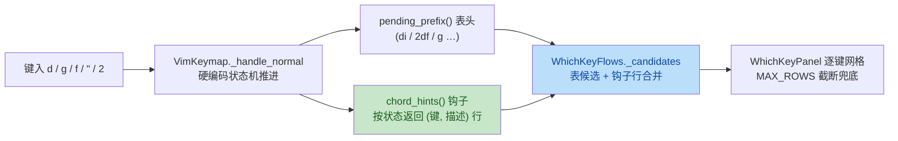

# which-key hardcoded chord hints plan

来源：用户反馈（2026-10-19）——按 `d` 后面板不显示任何候选，而 vim-which-key
会把可接续键一张张列出。根因：vim 操作符/移动/前缀是 `_handle_normal` 的
硬编码分支，不在绑定表，`WhichKeyFlows._candidates` 只扫绑定表。

执行落点：worktree `D:\Programming\yate-which-key`（feat/which-key 分支）。

## 一、目标与非目标

**目标**：面板在 vim 硬编码组合挂起时逐键列出真实可接续的下一键与描述：
操作符待决态（`d` 后列 `w b e h l j k 0 $ G`、`dd`、`i a` 文本对象、
`g f F t T`、`; ,`）、前缀跟随态（`g`→gg、`f/F/t/T`→`{char}`、`r`→`{char}`）、
寄存器等待态（`a-z` 行）、计数态（`2` 后列操作符/移动/前缀/缩进）；
表头如实反映已键入弦（`di` 而非 `d`）。

**非目标**：不改任何派发行为；不给 INSERT/VISUAL 加候选（无组合状态）；
不把硬编码移动迁入绑定表（那是行为重构，超出本次范围）。

## 二、备选方案与否决理由

- **选定**：仿 `reserved_keys` 先例——硬编码知识归 L1 键位图所有，新增
  `Keymap.chord_hints()` 钩子按当前挂起状态返回 `(键标, 描述)` 对；
  L3 流程合并表候选与钩子行。键位图自描述，L3 不认识 vim。
- 否决（把硬编码键补进绑定表作为 mirror 行）：会污染 `:check-keys`
  reserved 语义（mirror 行永不派发，报告噪音翻倍），且 mirror 行的
  spec 前缀匹配天然对不上计数态（`2d`）。
- 否决（L3 whichkey_flows 内置 vim 硬编码表）：把键位图内部知识复制进
  L3，两处漂移，违反 R14/§一 的归属原则。

## 三、分步实施

### Step 1 — L1 钩子（base.py + vim.py）

- `yate/keymaps/base.py`：`Keymap` 增 `chord_hints() -> tuple[tuple[str, str], ...]`
  返回 `()`（docstring：硬编码分支的可接续键提示，表驱动键位图为空）。
- `yate/keymaps/vim.py`：`VimKeymap.chord_hints()` 按 NORMAL 态分支：
  1. `pending_register == ""` → `(("a-z", "named register"),)`；
  2. `obj_scope` 已定 → 8 行对象表：`w` word、`'`、`"`、`t` HTML tag、
     `( b`、`[ ]`、`{ B`、`< >`（与 `editor_core/textobjects.py`
     `_PAIR_ALIASES` + w/'/"/t 对齐）；
  3. `prefix == "g"` → `(("g", "go to line N / first line (gg)"),)`；
  4. `prefix in (f,F,t,T)` → 单行 `{char}`（desc 按 f/F/t/T 区分 find/till、
     forward/backward）；
  5. `prefix == "r"` → `(({char}", "replace char"),)`；
  6. `op` 已武装 → `op` 行（desc 按 d/y/c 区分 delete/yank/change line）+
     `i a` 文本对象 + 移动 `w b e h l j k 0 $ G` + 前缀 `g f F t T` +
     `; ,`（仅 `last_find` 非空时）；
  7. 仅计数（`count_str` 非空）→ 操作符 `d y c` + 移动 + 前缀 + `> <`；
  8. 其余（INSERT/VISUAL/无挂起）→ `()`。
- `pending_prefix()` 追加 `obj_scope`（表头读 `di`），docstring 同步。

### Step 2 — L3 合并（whichkey_flows.py）

- `_candidates`：表扫描后追加 `self.keymaps.active.chord_hints()` 行
  （按标签订重，表行优先），docstring 删除「空结果表头-only」的旧说明。

### Step 3 — 测试

- `tests/test_vim_keymap.py`：`chord_hints` 状态矩阵（op 武装列出 w/d/i；
  `di` 表头；g/f/r 前缀；寄存器等待；INSERT 返回空；计数态）。
- `tests/test_whichkey_flows.py`：op 武装后 `refresh()` 面板含硬编码行
  （真实 VimKeymap 实例置 `op="d"` → panel rows 非空且含 `w`）。

### Step 4 — 双语手册

- `yate/docs/which-key.zh.md` / `.en.md`：重写 §2 vim 段（硬编码延续行
  逐键列出），删除 §4「计数加操作符只显示表头」限制，补表头含
  `obj_scope` 的说明。

### Step 5 — 全量门禁

- `.venv\Scripts\python.exe -m pyright yate/ tests/ tools/`
- `.venv\Scripts\python.exe -m pytest tests/ -q`（含架构 35 用例）
- 回填本计划实测结果。

## 四、改动文件清单

| 文件 | 步骤 |
|---|---|
| `yate/keymaps/base.py` | 1 |
| `yate/keymaps/vim.py` | 1 |
| `yate/flows/whichkey_flows.py` | 2 |
| `tests/test_vim_keymap.py` | 3 |
| `tests/test_whichkey_flows.py` | 3 |
| `yate/docs/which-key.zh.md` / `.en.md` | 4 |
| `.trae/documents/which-key-hardcoded-hints-plan.md` | 回填 |

## 五、风险与回滚

- `chord_hints` 只读实例挂起状态，无派发路径改动——回归面仅面板内容；
- 行数超 MAX_ROWS 由面板既有截断 + overflow 提示兜底；
- 单提交落地，`git revert` 整体回退。

## 六、流程图

## 七、执行结果与偏离记录（2026-10-19 回填）

**实测门禁**（worktree `D:\Programming\yate-which-key`）：

- `python -m pyright yate/ tests/ tools/` → **0 errors, 0 warnings, 0 informations**；
- `python -m pytest tests/ -q` → **2551 passed, 9 skipped**（含架构守卫
  `test_architecture.py` 35 用例，无回归）。

**偏离记录**：

1. 实现细节一处：`@override` 需补在 `VimKeymap.chord_hints` 上
   （pyright `reportImplicitOverride`），属计划隐含要求；
2. 两条既有测试按新行为更新断言：
   `test_candidates_exclude_completed_and_unrelated_specs` 原断言
   `"G" not in keys` 针对**表 spec**；现在 `G` 作为硬编码移动提示行合法
   出现，改为钉住其描述为 `last line`（spec 排除语义由 `gg`/`y{motion}`
   断言保留）；新增的 find-repeat 测试初版用第二次按 `d` 触发了 `dd`
   而非重新武装操作符，改为注入 `last_find` 后直接观察 `chord_hints`；
3. 其余与计划一致，无未决项。
