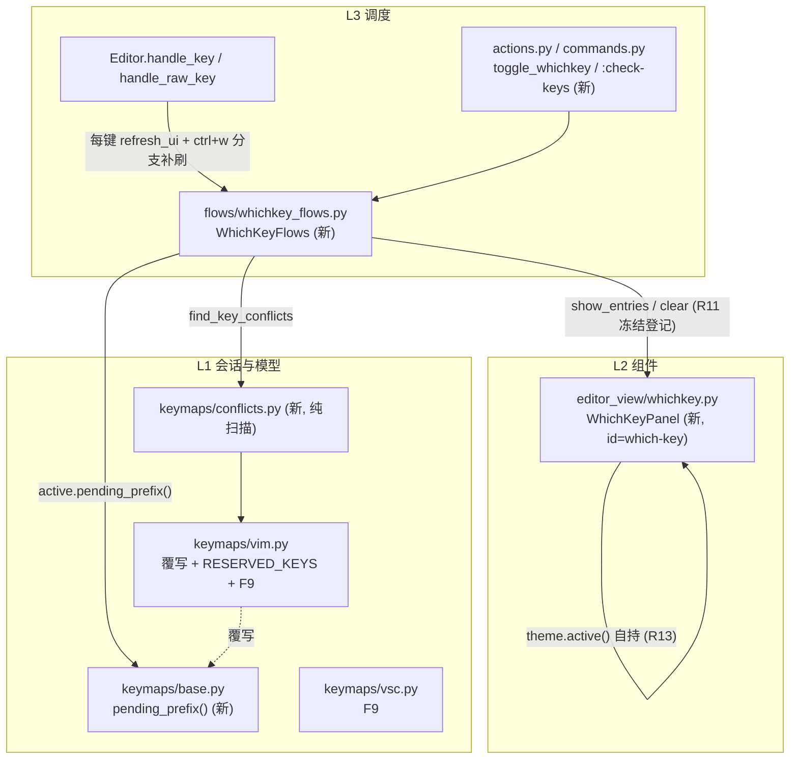

# which-key 实施方案（issue IKLY1Y：Keymap 的 visual 反馈）

状态：**待评审（未批准，不进入实施）**。任务判据：跨层（L1+L2+L3+规则/手册）、
预计改动 ≥ 3 个源码文件、需调研（chord 态观测面）——满足 plan-before-execute
§一全部主要判据，走方案先行。拆分与波次见
[which-key-plans/overview.md](which-key-plans/overview.md)。

## 一、需求逐条回应（issue 五点）

| # | issue 要求 | 方案落点 |
|---|---|---|
| 1 | statusbar 或其他地方有 panel，显示快捷键组合和说明 | 独立面板 `WhichKeyPanel`（L2）组合进底部 dock、statusbar 之上（不扩 statusbar 职责，理由见备选 A 否决）；行格式 = key 标签 + 描述，来源是活动 `Keymap.bindings` 的 `description` 字段（缺失回退动作名，与 F1 帮助页同策略） |
| 2 | UI 参考 which-key.nvim | 挂起 chord 时实时弹出「下一步候选」网格 + 顶部已输入序列 header；超量截断提示 `… N more — F1`（全量查询仍走既有 F1 `HelpScreen`，职责不重叠） |
| 3 | 实时更新 / toggle 开关 | 双通道：vim 模式按键后 chord 未决 → 自动显示、chord 结束即隐（数据源是新 `pending_prefix()` 钩子，经每键刷新通道）；`<f9>` / `toggle_whichkey` action 钉住整表，再按关闭。vsc 模式只有钉住通道（vsc 无前缀态，见第四节） |
| 4 | vim 简单、vsc 需更多考虑 | vim：chord 态本来就在 `VimKeymap` 实例字段里，覆写一个只读钩子即可；vsc：无状态单键分发、无「输入到一半」，故 which-key 在 vsc 下语义为「钉住式速查表」（按 category 分组），不做伪前缀推断 |
| 5 | 键位冲突检测 | 纯扫描模块 `yate/keymaps/conflicts.py`（L1）：同一 raw key 重复绑定（后条在 `_index` 中遮蔽前条）+ 被 vim 硬编码分支抢占的键（绑定永不生效）；报告经 `:check-keys` 命令 → `OutputScreen` 浮层 |

## 二、目标与非目标

### 目标

1. L1 数据面：`Keymap.pending_prefix()` 只读观测钩子（vsc 恒空、vim 覆写）、
   `VimKeymap.RESERVED_KEYS` 导出、纯冲突扫描 `keymaps/conflicts.py`、
   两种 keymap 登记 `<f9>` 绑定（动作名 `toggle_whichkey`）。
2. L2 面板：`editor_view/whichkey.py::WhichKeyPanel` 纯渲染组件 +
   `resources/which-key.tcss`，R13 自持主题，R10 不消费任何键。
3. L3 接线：`flows/whichkey_flows.py::WhichKeyFlows`（候选计算 + 面板驱动 +
   钉住态 + 冲突报告出口，§三.8 六步全走）；`Editor` 组装（id `#which-key`、
   compose 进 `#bottom`、每键刷新 + ctrl+w 分支补刷新）；内置表登记
   `toggle_whichkey` action 与 `:check-keys` 命令；R11 白名单登记。
4. 文档：双语手册成对新增；架构边界规则 R9 / §一 / R11 回写。

### 非目标

- 不做 yaterc 配置项 / 钉住态持久化（会话内有效；后续按需立项）；
- 不向扩展 API 暴露 which-key（`ExtensionAPI` 14 名冻结，不动）；
- 不检测「绑定指向未注册动作」：vim 绑定表大量使用带空格的伪动作名
  （`"move left"` 等，实际走硬编码分支），静态判定必然误报；如需可后续在
  `ActionRunner` 运行期统计；
- 不改 `EditorView` / `statusbar.py`（全仓唯一 L2→L3 例外面不再扩大）；
- vsc 不做伪前缀自动弹出（见需求 #4 的语义裁定）；
- 不新增 `Protocol` / 共享 context 类型 / EventBus（R2、§四）。

## 三、架构裁定与条款对照

| 条款 | 触碰 | 处置 / 守卫 |
|---|---|---|
| R4 | `keymaps/*` 不得 import editor_view | 新增 `conflicts.py` 纯逻辑零 UI 导入；守卫 `test_keymaps_services_and_models_stay_ui_free` |
| R5/R7 | action / command 走内置表 | `actions.py` / `commands.py` 各 +1 注册，外壳装载路径不变；守卫 `test_editor_does_not_import_action_tables` / `test_shell_loads_the_builtin_tables` |
| R9 | 新 widget id `#which-key` | `Editor` 传 id；样式组件自持（`#statusbar` 先例）；规则文档 R9 清单回写（plan-f）；外壳 `app.tcss` 无需改动 |
| R10 | 面板不得吞键 | `Static` 无焦点不消费键事件；测试 `test_panel_never_consumes_key_events` |
| R11 | L3 flows 新增 editor_view 导入 | `UI_FROZEN_FILES` 登记 `flows/whichkey_flows.py`（`yate.editor_view` + `yate.editor_view.whichkey`）；守卫 `test_collaborators_keep_widget_coupling_frozen` |
| R13 | 组件自持主题 | `theme.attach` 广播上色，L3 不碰 `.styles.*`；守卫 T1/T2 用例 |
| §三.8 | 新流程模块接入 | 命名 `WhichKeyFlows`、类属性声明、`_build_pane_stack` 工厂构造、`__init__` 顺序注释、白名单登记、规则清单同步——六步全走；守卫 `test_flow_modules_hold_no_app_handle` / 命名守卫 |

## 四、关键设计决策

1. **挂起态观测 = L1 只读轮询，而非回调广播**：`handle_raw_key` 每键必经
   `refresh_ui`，同步读 `pending_prefix()` 零额外通路；§四 门槛（≥3 场景）
   未达，不新增信号。
2. **候选匹配 = 绑定表字面前缀规则**：`spec.startswith(pending) and
   len(spec) > len(pending)`（`{...}` 占位符只出现在首字符之后，字面前缀安全：
   `d` → `dd` / `d{motion}`；`f` → `f{char}`；`"` → `"{a-z}`）。复杂 chord 树
   （完整 which-key.nvim 语义）不做——yate 绑定表是平铺 spec，前缀规则已覆盖
   全部现存形态且零误报（测试钉住）。
3. **ctrl+w 窗口 chord 属于 which-key 显示范围**：`WindowFlows.window_pending`
   已是只读属性，注入 `StateQuery` 探针，十四个第二键以常量表渲染（文案与
   现有提示串一致）。
4. **vsc 语义 = 钉住速查表**：vsc `handle_key` 是无状态单键查找，不存在
   「输入到哪一级」；伪造前缀态（如把修饰键当 prefix）会产出大量不可达候选，
   违背 which-key 的价值，故明确裁定不做（issue 第 4 点的 vsc 部分）。

## 五、备选方案与否决理由

| 备选 | 否决理由 |
|---|---|
| A. 面板做进 statusbar 单行 | 单行放不下 which-key 网格；statusbar 已背负 R14 唯一 L2→L3 例外，继续加职责违反单一职责；`mode_chip` 已是共享纯函数，再加面板逻辑会推动 statusbar 超阈 |
| B. ModalScreen 全屏 overlay | which-key 的价值是「输入中不抢焦点」；modal 会被 `has_modal_screen` 闸门接管输入，破坏按键派发路径与实时性 |
| C. floating 弹层（completion popup 式 offset 悬浮） | 悬浮定位与 pane 分割 / 滚动 / 终端 dock 的边界交互复杂（completion 自身有专有定位逻辑）；dock 内静态槽位一行组合、零定位代码 |
| D. Keymap 层内建 UI 通知（chord 变化回调） | L1 必须保持 UI-free（R4）；KeyUi 已是回调记录，再加广播面违反最小改动；轮询语义在本场景每键一次，成本可忽略 |
| E. 冲突检测放 L3 flows | 纯逻辑无 UI，落 L1 `keymaps/` 可被命令、未来帮助页与测试直接复用，且不触碰 R4/R11 面 |
| F. 用 `services/events.py` EventHub 广播 chord 变化 | §四 明文：新增信号需 ≥3 处场景且订阅者动态增删；当前唯一消费者是 which-key 面板，同步轮询足够 |
| G. 复用 F1 HelpScreen 兼作实时面板 | 全量参考页与增量候选提示是两种交互；混用会让 F1 变成「半屏闪现」，且 HelpScreen 无输入态概念 |

## 六、分步实施与波次

波次表（调度唯一依据，详见 [which-key-plans/overview.md](which-key-plans/overview.md)）：

| 波次 | 子计划 | 输入 | 改动文件（源码） | 输出 | 验收命令（worktree venv，节选，全量见子计划） |
|---|---|---|---|---|---|
| wave-1 | [plan-a](which-key-plans/which-key-keymap-observer-plan-a.md) ∥ [plan-b](which-key-plans/which-key-conflicts-plan-b.md) ∥ [plan-c](which-key-plans/which-key-panel-plan-c.md) | 本方案 §三/§四 + 各子计划任务书 | a：`keymaps/base.py`、`keymaps/vim.py`、`keymaps/vsc.py`；b：`keymaps/conflicts.py`(新)；c：`editor_view/whichkey.py`(新)、`resources/which-key.tcss`(新) | `pending_prefix()` / `RESERVED_KEYS` / F9 绑定；冲突扫描模块；面板组件与样式 | `pytest tests/test_vim_keymap.py tests/test_vsc_keymap.py tests/test_keymaps_conflicts.py tests/test_whichkey_panel.py -q --cov-fail-under=0`；`pyright yate/keymaps/ yate/editor_view/whichkey.py`；`pytest tests/test_architecture.py -q --cov-fail-under=0` |
| wave-2 | [plan-d](which-key-plans/which-key-flows-plan-d.md) | wave-1 三产物（`pending_prefix` / `find_key_conflicts` / `WhichKeyPanel`） | `flows/whichkey_flows.py`(新) | WhichKeyFlows（候选计算 + 面板驱动 + 钉住态 + 冲突报告出口） | `pytest tests/test_whichkey_flows.py -q --cov-fail-under=0`；`pyright yate/flows/whichkey_flows.py`；架构测试按 `-k` 排除 R11 耦合用例（时序说明见子计划验收节） |
| wave-3 | [plan-e](which-key-plans/which-key-wiring-plan-e.md) | wave-2 产物（`WhichKeyFlows`） | `editor.py`、`actions.py`、`commands.py`、`tests/test_architecture.py`(白名单) | Editor 组装 + 内置表 + R11 登记 + 全量门禁复绿 | `pytest tests/test_architecture.py -q --cov-fail-under=0`（无 `-k`）；`pyright yate/ tests/`；`pytest tests/ -q --cov-fail-under=0`；手工冒烟（子计划 §验收） |
| wave-4 | [plan-f](which-key-plans/which-key-docs-plan-f.md) | wave-3 实测事实 | `.trae/rules/architecture-boundaries.md`、`yate/docs/which-key.en.md`(新)、`which-key.zh.md`(新) | 规则回写 + 双语手册 | 纯文档，按 misc-rules §三豁免测试，人工核对清单见子计划 |

每步的「输入 / 改动文件 / 输出 / 验收命令」细则以上表子计划链接为准
（每份子计划自包含三要素测试用例与命令）。

## 七、风险清单与回滚路径

| 风险 | 等级 | 缓解 | 回滚 |
|---|---|---|---|
| `pending_prefix()` 漏统计新增 chord 形态 | 低 | 逐形态测试钉住；方法 docstring 写明契约（新增 chord 必须同步覆写） | 局部 revert vim.py 钩子，面板退化为钉住-only |
| 面板挤压编辑区 / 宽度溢出 | 低 | CSS `max-height` + `display:none` 默认；`theme.cell_len` 计宽 | 关闭组合点一处即整体隐藏 |
| `<f9>` 个别终端不可达 | 低 | action 与 `:check-keys` 双通道冗余；手册注明 | 无需回滚 |
| R11 白名单漏登记 / 规则文档漂移 | 中 | 验收跑架构测试拦截；plan-f 在 wave-3 后按实测回写 | 还原白名单键 + 规则段 |
| 每键候选扫描性能 | 低 | 绑定表 ~60 条 O(n)，不做预优化；实测劣化再议缓存 | 无状态，无回滚面 |
| 误伤既有按键路径（R10 二次派发） | 低 | 面板不消费键；ctrl+w 分支补刷新只加渲染 | 还原 handle_key 一处缩进改动 |

**总体回滚路径**：四个波次各自独立成 commit；任何波次失败
`git checkout -- <该波文件>` + 删除新建文件即可退回上一波；无数据迁移、
无配置兼容面。全部波次完成后仍可通过删除面板组合点（editor.py compose
一处）一键停用功能，保留 L1/L3 资产待后续启用。

## 八、与其它计划的关系

- 依赖既有：2026-10-17 层秩切分（`keymaps/keys.py` L0）、`WindowFlows`
  ctrl+w 状态机、R14 门面（本方案不触碰）。
- 不依赖、不阻塞其它在途任务；波次内可按 subagent-workflow 并行下发
  （wave-1 三子计划文件互不重叠）。
