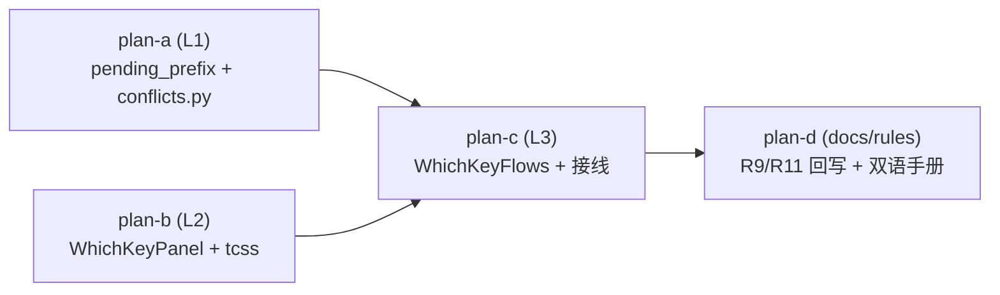

# which-key 子计划总纲

issue IKLY1Y「Feature - 实现Keymap的visual反馈」（which-key 面板）的实施子计划索引。
主计划见 [../which-key-plan.md](../which-key-plan.md)：目标 / 非目标、备选方案与否决理由、
波次表、风险清单与回滚路径均在主计划维护；本文只做索引与调度视图。

## 子计划索引

| 子计划 | 波次 | 层 | 独占文件（源码） | 主题 |
|---|---|---|---|---|
| [which-key-keymap-data-plan-a.md](which-key-keymap-data-plan-a.md) | wave-1 | L1 | `yate/keymaps/base.py`、`yate/keymaps/vim.py`、`yate/keymaps/vsc.py`、`yate/keymaps/conflicts.py`(新) | 挂起 chord 观测 + 冲突扫描 + F9 绑定 |
| [which-key-panel-plan-b.md](which-key-panel-plan-b.md) | wave-1 | L2 | `yate/editor_view/whichkey.py`(新)、`yate/resources/which-key.tcss`(新) | which-key 面板组件（纯渲染、自持主题） |
| [which-key-wiring-plan-c.md](which-key-wiring-plan-c.md) | wave-2 | L3 | `yate/flows/whichkey_flows.py`(新)、`yate/editor.py`、`yate/actions.py`、`yate/commands.py`、`tests/test_architecture.py` | 流程模块 + 接线 + 内置表 + 守卫登记 |
| [which-key-docs-plan-d.md](which-key-docs-plan-d.md) | wave-3 | 文档/规则 | `.trae/rules/architecture-boundaries.md`、`yate/docs/which-key.en.md`(新)、`yate/docs/which-key.zh.md`(新) | R9/R11/flows 清单回写 + 双语手册 |

测试文件（不计入判据，随各子计划列出）：`tests/test_keymaps_conflicts.py`、
`tests/test_whichkey_panel.py`、`tests/test_whichkey_flows.py`（均新建）；
`tests/test_vim_keymap.py` / `tests/test_vsc_keymap.py` / `tests/test_keymap_set.py` 仅追加。

## 执行波次表

| 波次 | 子计划 | 并行性 | 进入条件 |
|---|---|---|---|
| wave-1 | plan-a ∥ plan-b | 文件互不重叠，可并行 | 无 |
| wave-2 | plan-c | 串行 | wave-1 全部验收命令退出码 0 |
| wave-3 | plan-d | 串行 | wave-2 验收通过（规则文本需回写 wave-2 实测事实） |

## 依赖关系

波次一经批准不得在执行中临时重排；确需调整须回填本文与主计划并说明实测依据。
