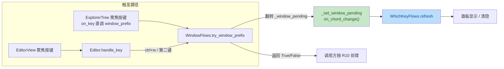

# which-key review fixes plan

来源：feat/which-key 分支 TRAE-code-review 审查（2026-10-18），用户批准修复全部 5 项。
执行落点：worktree `D:\Programming\yate-which-key`（feat/which-key 分支）。

## 一、目标与非目标

**目标**：修复审查报告的 5 项问题——explorer 聚焦时 ctrl+w 面板缺口（major）、
`pending_prefix` docstring 失真、reserved 集归属下沉、RESERVED_KEYS 测试等值化、
WINDOW_CHORDS 与提示串同步钉住。

**非目标**：不改 which-key 功能形态与面板渲染；不动 R9/R11/R14 登记面；
不做 `:check-keys` 报告格式调整；不拆分任何超阈值文件。

## 二、备选方案与否决理由

### 问题 1（explorer ctrl+w 刷新缺口）

- **选定**：状态所有者 `WindowFlows` 增加回调字段 `on_chord_change`，在
  `_window_pending` 两处翻转点统一通知；`Editor.handle_key` 的手动
  `whichkey.refresh()` 移除（单点通知，双路径覆盖）。
- 否决 A（explorer 注入复合 lambda `window_prefix` 后置 refresh）：
  把刷新语义埋进接线表达式，explorer 端难读，且 cancel 路径（返回 False）
  仍无通知点，编辑器聚焦武装、explorer 按键取消的面板悬挂修不掉。
- 否决 B（调整 `_build_pane_stack` 构造顺序，把 `on_chord_change` 作为
  WindowFlows 构造参数）：WhichKeyFlows 的 `window_pending` 探针 lambda 虽是
  惰性求值，但重排组装顺序触碰 wave-e 钉死的装配注释与顺序语义，风险大于收益；
  同函数两行之上的 `explorer_tree.window_prefix = ...` 已确立事后绑定先例。

### 问题 3（reserved 集归属）

- **选定**：`Keymap` 基类新增类属性 `reserved_keys: frozenset[str] = frozenset()`，
  `VimKeymap` 覆写为 `RESERVED_KEYS`；`conflicts_report` 改读
  `self.keymaps.active.reserved_keys`，删除 `name == "vim"` 与 `RESERVED_KEYS`
  导入。键位图自描述，L3 不认识具体键位图名。
- 否决（`getattr(keymap, "RESERVED_KEYS", ...)` 鸭子探测）：隐式约定，
  pyright strict 下需 `# type: ignore` 或 cast，违反 §三.3。

### 问题 5（提示串同步）

- **选定**：提示串抽为 `window_flows` 模块常量 `WINDOW_CHORD_HINT`（原串原样），
  在 `tests/test_whichkey_flows.py` 加漂移守卫测试：断言 `WINDOW_CHORDS`
  每个描述词都出现在常量里。
- 否决（由 WINDOW_CHORDS 拼装生成提示串）：需要 window_flows 反向 import
  whichkey_flows（其携带 editor_view 耦合），方向错误；且无法还原手工排版的
  分组空格形态。

## 三、分步实施

### Step 1 — WindowFlows 弦状态通知回调（修复问题 1）

- 输入：`yate/flows/window_flows.py`
- 改动：
  1. `__init__` 增加声明字段 `self.on_chord_change: Callable[[], None] | None = None`；
  2. 新增私有方法 `_set_window_pending(value: bool) -> None`：写状态 +
     `on_chord_change` 非空时调用；
  3. `try_window_prefix` 两处翻转（consume `= False`、arm `= True`）改走该方法；
  4. 提示串抽为模块常量 `WINDOW_CHORD_HINT`（字面原样，含漂移守卫注释），
     `try_window_prefix` 改用常量。
- 输出：弦状态翻转必然通知观察者，explorer 路径同样生效。
- 验收：`python -m pytest tests/test_window_flows.py tests/test_whichkey_flows.py -q` 全绿。

### Step 2 — Editor 接线改单点通知（修复问题 1 收尾）

- 输入：`yate/editor.py`
- 改动：
  1. `_build_pane_stack` 在构造 `WhichKeyFlows` 之后补
     `ed.window_flows.on_chord_change = ed.whichkey.refresh`
     （紧跟 `explorer_tree.window_prefix` 先例）；
  2. `handle_key` 的 `try_window_prefix` 分支删除手动 `self.whichkey.refresh()`
     （回调已覆盖），保留 `return True`；
  3. 组装顺序注释补 `on_chord_change` 说明。
- 输出：refresh 单点化，explorer 聚焦武装/消费/取消 chord 面板均随动。
- 验收：`python -m pyright yate/` 零诊断。

### Step 3 — reserved 集下沉键位图（修复问题 3）

- 输入：`yate/keymaps/base.py`、`yate/keymaps/vim.py`、`yate/flows/whichkey_flows.py`
- 改动：
  1. `Keymap` 增类属性 `reserved_keys: frozenset[str] = frozenset()`（带注释：
     硬编码分支吞掉的原始键集合，表驱动键位图为空）；
  2. `VimKeymap` 覆写 `reserved_keys = RESERVED_KEYS`；
  3. `WhichKeyFlows.conflicts_report` 删 `name == "vim"` 分支与
     `RESERVED_KEYS` 导入，改传 `self.keymaps.active.reserved_keys`，docstring 同步。
- 输出：`conflicts.py` 注入式设计不变，L1 自描述。
- 验收：`python -m pytest tests/test_keymaps_conflicts.py tests/test_whichkey_flows.py -q` 全绿。

### Step 4 — vim docstring 与 RESERVED_KEYS 测试等值化（修复问题 2、4）

- 输入：`yate/keymaps/vim.py`、`tests/test_vim_keymap.py`
- 改动：
  1. `pending_prefix` docstring 改为如实描述：顺序为 count、operator、prefix
     （示例 `2df`）；`"` 仅在等待寄存器字母期间显示，字母落下后随 op 武装折叠；
  2. `test_reserved_keys_match_hardcoded_consumers` 改为字面量全集等值断言
     （9 键逐一列字面量），保留 `"0"` / F1 排除断言与语义注释。
- 输出：文档与实现一致；集合增删在测试面强制同步。
- 验收：`python -m pytest tests/test_vim_keymap.py -q` 全绿。

### Step 5 — 提示串漂移守卫测试（修复问题 5）

- 输入：`tests/test_whichkey_flows.py`
- 改动：新增 `test_window_chord_hint_covers_whichkey_rows`：从 `WINDOW_CHORDS`
  取描述词集合，逐词断言出现在 `window_flows.WINDOW_CHORD_HINT`。
- 输出：两处文案任一漂移即测试失败。
- 验收：`python -m pytest tests/test_whichkey_flows.py -q` 全绿。

### Step 6 — 全量门禁

- 验收命令（worktree 根执行，解释器用主 worktree 的 venv）：
  `D:\Programming\yate\.venv\Scripts\python.exe -m pyright yate/ tests/ tools/`
  `D:\Programming\yate\.venv\Scripts\python.exe -m pytest tests/ -q`
- 计划文档回填实测结果与偏离记录。

## 四、改动文件清单

| 文件 | 步骤 |
|---|---|
| `yate/flows/window_flows.py` | 1 |
| `yate/editor.py` | 2 |
| `yate/keymaps/base.py` | 3 |
| `yate/keymaps/vim.py` | 3、4 |
| `yate/flows/whichkey_flows.py` | 3 |
| `tests/test_vim_keymap.py` | 4 |
| `tests/test_whichkey_flows.py` | 5 |
| `.trae/documents/which-key-review-fixes-plan.md` | 回填 |

## 五、风险与回滚

- **风险 1**：`on_chord_change` 回调在 `try_window_prefix` 内同步触发 refresh，
  refresh 内部再调 `_window_pending()` 探针——无重入写，无环（只读探针）。
- **风险 2**：删除 `Editor.handle_key` 手动 refresh 后若回调未接线（理论不可能：
  `_build_pane_stack` 无条件赋值），面板退化为不随动——由 Step 6 全量测试与
  既有 test_whichkey_flows 决策序用例兜底。
- **风险 3**：`Keymap` 新增类属性被扩展系统子类继承——空集默认语义不变，
  `find_key_conflicts` 注入面不受影响。
- **回滚**：单提交落地，`git revert` 即整体回退；无数据/配置迁移。

## 六、流程图（问题 1 修复后通知路径）

## 七、执行结果与偏离记录（2026-10-18 回填）

**实测门禁**（worktree `D:\Programming\yate-which-key`，解释器 `.venv\Scripts\python.exe`）：

- `python -m pyright yate/ tests/ tools/` → **0 errors, 0 warnings, 0 informations**；
- `python -m pytest tests/ -q` → **exit 0 全绿**（含既有弦路径用例
  `test_app_panes.py::test_vim_window_prefix_cancelled_by_other_keys`）；
- `python -m pytest tests/test_architecture.py -q` → **35 passed**（守卫面无回归）；
- 受影响子集先行验证：`test_whichkey_flows.py + test_vim_keymap.py +
  test_keymaps_conflicts.py` 共 174 passed。

**偏离记录**：

1. 计划 Step 1/Step 6 验收命令写了 `tests/test_window_flows.py`——该文件不存在
   （ctrl+w 弦行为测试实际居于 `tests/test_app_panes.py`），按真实文件名执行，
   全量套件覆盖，验收语义不变；
2. 超出计划字面的两处小增补（同属 Step 3/4 输出语义）：
   `tests/test_vim_keymap.py` 增加 `test_vim_keymap_carries_reserved_keys_hook`
   （钉 VimKeymap.reserved_keys is RESERVED_KEYS、VscKeymap 为空集）；
   `tests/test_whichkey_flows.py` 增加
   `test_reserved_keys_come_from_the_active_keymap`（钉 flow 只读 active 键位图
   的 hook、不再比较键位图名）；
3. Step 3 落地时 `VimKeymap` 类 docstring 由单句扩为多行（合并原「Pending chord
   state」段与新增 reserved_keys 说明段），其余文件改动与计划一致。

**结论**：5 项审查问题全部修复，门禁全绿，无未决项。
