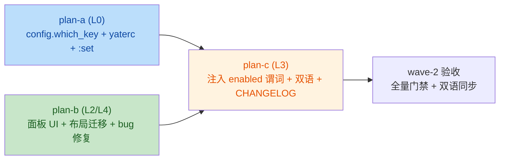

# which-key UI redesign 总纲

issue IKLY1Y which-key 面板第二轮：UI 重设计 + 「一直显示 VIM」根因修复 +
yaterc 开关。前置子计划归档于
[`../which-key-plans/overview.md`](../which-key-plans/overview.md)（wave-1～4 已
落地，含 hardcoded-hints 批次），本目录沿用 `plan_<a|b|c>` 命名续作。

执行落点：worktree `D:\Programming\yate-which-key`（`feat/which-key` 分支）。
本文不重复事实细节，只做调度视图与跨子计划约束。

## Step 0 — 前置（独立于本任务，不属于任一子计划的交付）

进入 wave-1 之前须完成的两个收尾步骤，不进入本任务提交边界：

1. **沙箱修复**：worktree `.venv` 解析到主仓
   `D:\Programming\yate`，须在 worktree 内重装：
   `.venv\Scripts\python.exe -m pip install -e ".[dev]"`，并以
   `python -c "import yate; print(yate.__file__)"` 自证指向
   `D:\Programming\yate-which-key\yate\__init__.py`。
2. **隔离前任务产物**：worktree 内 hardcoded-hints 批次（修改
   `yate/keymaps/{base,vim}.py`、`yate/flows/whichkey_flows.py`、
   `tests/test_vim_keymap.py`、`tests/test_whichkey_flows.py`、
   `yate/docs/which-key.{en,zh}.md`，未跟踪计划文档
   `which-key-hardcoded-hints-plan.md`）按 `which-key-hardcoded-hints-plan.md`
   §七「实测门禁全绿」记录属既定产物，本任务与之在
   `yate/docs/which-key.{en,zh}.md` 与 `tests/test_whichkey_flows.py` 上重叠，
   故 Step 0 单独提交该批次
   （`feat(keymaps): list hardcoded chord continuations in the which-key panel`）。

进入 wave-1 的判据：上述两步各自验收命令退出码 0。两条任一未达成本启动 wave-1。

## 目标

1. **面板 UI 改为右侧浮动圆角边框面板**（用户选定 lazyvim which-key 第三种
   风格）：`#editor-col` 内绝对定位，右缘贴齐（留 1 列边距）、垂直居中（不遮
   tabbar/breadcrumbs），圆角边框、顶部嵌当前弦 / 键位图名面包屑标题（`border_title`），
   纵向条目列表，pinned 分组行 `▸ <category>` 观感；弹层贯通主题色
   （CSS 主题变量 + R13 `theme.active()` 双通路）。
2. **「一直显示 VIM，其他信息都没有」根因修复**：面板从 `#bottom`（固定 2 行，
   与 statusbar/prompt 三分挤压）迁入 `#editor-col`，结构性消除挤压；
   子计划 plan-b 含独立验证用例。
3. **F9 toggle 保留**：`toggle_whichkey` 动作维持两键位表绑定；行为语义不变
   （首次切换钉住整表，再次切换解除）；`pinned` 状态由 `WhichKeyFlows` 持有。
4. **yaterc 新增 `which_key` 开关**（布尔标量，默认 `True`）：禁用时
   `WhichKeyFlows.refresh` 直接 `panel.clear()`，F9 toggle 静默无操作
   （pinned 状态保留，再次启用后继续生效）；`:set which_key=off/on` 立即生效
   （与 `support_mouse` 同形态：每次 `refresh` 重读 `config.which_key`，`:set`
   不需额外分发）。

## 非目标

- 不动数据 API：`WhichKeyFlows.show_entries` / `clear` / `refresh` /
  `toggle` / `conflicts_report` 签名与语义不变；面板 `show_entries` / `clear`
  不变。
- 不改 pinned 触发方式（F9 动作绑定、`toggle()` 实现均在原位）。
- 不把 hardcoded vim 键位词汇（motions/operators 等）作为独立 category 纳入
  全表（pinned sheet）——hardcoded-hints 批次已将 `chord_hints()` 接入候选
  网格；将同一数据再写入 `_sheet_entries` 等于把键位图内部知识复制到 L3，
  违反 R14/§一 的归属原则。保留现状：pinned 全表只列绑定表行。
- 不做可滚动面板（保持 `MAX_ROWS` 截断 + overflow 提示）。
- 不新增窗口缩放/位置持久化；面板位置完全由 `_place()` 派生（`on_resize` +
  `call_after_refresh` 重锚）。
- 不改 `:check-keys` 报告格式（与本任务无关）。

## 子计划索引

| 子计划 | 波次 | 层 | 独占文件（源码） | 主题 |
|---|---|---|---|---|
| [which-key-ui-redesign-plan-a.md](which-key-ui-redesign-plan-a.md) | wave-1 | L0 | `yate/config.py`、`yate/yaterc_options.py`、`yate/commands.py`、`yate/yaterc.example`、`yate/docs/yaterc.en.md`、`yate/docs/yaterc.zh.md` | `which_key` 标量布尔选项：字段、`KNOWN_OPTIONS`、`_extract_which_key`、`:set` apply、`SET_OPTION_SPECS`、`yaterc.example` 注解、双语手册表 |
| [which-key-ui-redesign-plan-b.md](which-key-ui-redesign-plan-b.md) | wave-1 | L2 + L4(壳 CSS) | `yate/editor_view/whichkey.py`、`yate/resources/which-key.tcss`、`yate/resources/app.tcss`、`yate/editor.py`、`tests/test_whichkey_panel.py` | 面板 UI 重设计（右侧浮动 + 圆角 + `border_title`）、布局迁移（`#bottom` → `#editor-col`，`whichkey` 层）、bug 修复、单列 + 自适应键宽 + 主题变量、面板测试迁移与定位用例 |
| [which-key-ui-redesign-plan-c.md](which-key-ui-redesign-plan-c.md) | wave-2 | L3 + 文档/规则 | `yate/flows/whichkey_flows.py`、`yate/editor.py`、`tests/test_whichkey_flows.py`、`yate/docs/which-key.{en,zh}.md`、`CHANGELOG.md` / `CHANGELOG.zh.md`、`yate/docs/yaterc.{en,zh}.md`（仅引用，不重写） | L3 流程注入 `which_key_enabled` 谓词（每次 refresh 重读）、`Editor` 注入 `lambda: ed.config.which_key`、`toggle` 禁用态短路、双语手册章节里关于本轮的措辞更新、CHANGELOG 条目 |

测试文件（不计入判据，随各子计划列出）：`tests/test_config.py`、
`tests/test_set_options.py`（plan-a 追加），`tests/test_whichkey_panel.py`
（plan-b 改造），`tests/test_whichkey_flows.py`（plan-c 适配 + 追加）。
`tests/test_architecture.py` 仅随 plan-c 末段回归（wave-2 必须复绿）。

## 执行波次表

| 波次 | 子计划 | 并行性 | 进入条件 |
|---|---|---|---|
| wave-1 | plan-a ∥ plan-b | 文件互不重叠（plan-a 仅动 L0 与 yaterc 双语文档；plan-b 仅动 L2 + L4 app.tcss + editor.py 的 compose 段），可并行 | Step 0 两条验收命令均退出码 0 |
| wave-2 | plan-c | 串行 | wave-1 全部子计划验收命令退出码 0；`config.which_key` 字段（plan-a）与 `WhichKeyPanel.is_which_key_enabled`（plan-b 不直接提供字段，由 plan-c 注入）齐备 |

> 波次一经批准不得在执行中临时重排；确需调整须回填本文并说明实测依据。

## 依赖关系

跨子计划契约：

- **API 不变契约**：plan-b 不改 `WhichKeyPanel.show_entries` / `clear` /
  `ChordEntry` 形态（`header: str`、`entries: Sequence[ChordEntry]`）；plan-c
  不改 `WhichKeyFlows.refresh` / `toggle` / `conflicts_report` 签名与现有
  行为语义（除新增 `which_key_enabled: Callable[[], bool]` 构造参数）。
- **配置字段契约**：plan-a 落地 `YateConfig.which_key: bool = True`、
  `KNOWN_OPTIONS` 含 `"which_key"`；plan-c 通过 `ed.config.which_key` 读取
  （无需 plan-a 注入额外回调）。
- **R9 契约**：面板 widget id `#which-key` 由 `Editor`（plan-e 历史落地）
  于 `compose()` 传入（[editor.py:162](../../yate/editor.py)）；plan-b 仅迁移
  yield 位置，id 不变。
- **R13 契约**：panel 维持 `theme.attach(self, self._repaint)` +
  `theme.active()` 取色（plan-b 不动 `on_mount`/`on_unmount`/`_repaint`）；
  边框颜色由 tcss CSS 变量经 `themes.py::to_textual_theme` 桥接
  （[themes.py:535+](../../yate/editor_view/themes.py)）。

## 风险与回滚

- **风险 A：定位时序竞态** —— `on_resize` 与 `call_after_refresh` 并发回写
  `styles.offset` 可能漂移。plan-b 用例覆盖 `show_entries` 后断言右缘贴合
  与垂直下限；冒烟截图（textual-pilot）兜底。同一 offset 幂等写入，无重排
  风暴。
- **风险 B：`#editor-col` 增层遮挡补全弹窗** —— `whichkey` 置于补全弹窗
  （`lsp-popup`) 之上；面板仅在弦挂起的瞬时显示，与补全同时可见概率低
  且面板透明背景不影响焦点流（自身 `can_focus=False`，R10）。
- **风险 C：禁用态 + 已 pin 切换遗留** —— 用户禁用时若面板刚 pin，pin
  状态仍保留；再次启用后立刻显示 pin 全表（不打扰）。文档说明该语义。
- **风险 D：`call_after_refresh` 失效** —— 若面板因故未挂载（`display: None`
  时 Textual 8.2.8 跳过布局），`_place` 写入 0 offset 后下次 mount
  `on_resize` 重锚，幂等兜底。
- **回滚**：wave-2 单提交落地
  `feat(which-key): float the panel on the right and add a yaterc on/off switch`；
  `git revert` 整体回退；plan-a 与 plan-b 提交可独立 revert（前者只动 L0
  与文档，后者只动 L2 + L4 app.tcss 与 editor.py compose 段）。

## 与前置子计划的关系

- 本目录所有改动是 `which-key-plans/overview.md`（wave-1～4）落地后的 UI 续作。
- `which-key-plans/which-key-keymap-observer-plan-a.md` 落地了
  `Keymap.chord_hints()` 与 `RESERVED_KEYS`（hardcoded-hints 批次续作）；
  本目录 plan-c 不再触碰 L1 键位图（词汇归属维持 hardcoded-hints 取舍）。

## 边界触碰清单（`architecture-boundaries.md`）

| 改动 | 触碰条款 | 守卫用例 |
|---|---|---|
| 面板 id 不变，迁移到 `#editor-col` | R9 | `test_no_unregistered_upward_imports`（不变）+ 视觉验证 |
| 面板增 `border_title` + 主题变量 | R13 | `test_no_class_level_scrollbar_renderer_patch` / `test_editor_does_not_paint_widget_styles`（不变） |
| `WhichKeyFlows` 注入 `Callable[[], bool]`（不持 App 句柄） | §四 能力注入 | `test_flow_modules_hold_no_app_handle`（不变）；`test_app_annotations_are_precise`（不变） |
| `WhichKeyFlows` 继续 import `yate.editor_view.whichkey` | R11 | `UI_FROZEN_FILES` 已含该条目（不变） |
| `flows/whichkey_flows.py` 末增 config 引用 | R11 / §三.8 | 同上；该模块未新增 `editor_view` 导入 |
| `config.py` / `yaterc_options.py` / `yaterc.example` / `commands.py` / `yaterc.example` | R4（UI-free L0 面） | `test_keymaps_services_and_models_stay_ui_free`（不变；这些文件始终在 UI-free 名单） |
| `editor.py` 仅动 `compose()` yield 顺序 | R3 / R7（不破） | `test_editor_view_does_not_import_upward`（不变） |
| `app.tcss` 增 `whichkey` 名 | R9（id 冻结与壳 CSS 同步） | 视觉验证 |

## 已知问题登记（用户实测反馈，2026-10-19）

**ISSUE-1：面板不随窗口 resize 重锚定**（用户实测截图：面板停在旧位置，
未贴新窗口右缘）。

- **现象**：窗口缩放后，浮动面板保持原 `styles.offset`，脱离右缘贴合与
  垂直居中。
- **根因（已核实）**：`WhichKeyPanel.on_resize` 的触发面是面板自身
  region/container_size 变化 + `show_entries` 后的 `call_after_refresh`。
  窗口 resize（或侧栏开合）改变 `#editor-col` 尺寸，但面板是 absolute +
  auto 尺寸、自身 region 不变——Textual 8.2.8 正常 reflow 路径
  （`screen.py` `_on_size_update` else 分支）只向 `shown | resized` 集合
  发 `Resize`，面板不在其中，永远收不到重锚信号（假设成立）。
- **修复（已落地，ddfe1bb）**：`#editor-col` 改用 `EditorColumn(Vertical)`
  （editor_view/whichkey.py），其 `on_resize` 把容器自身的 resize 事件
  转发给 `WhichKeyPanel.reanchor()`；pilot 回归用例
  `test_container_resize_reanchors_panel`（resize 前后断言 offset 重算）
  与真实 App 探针（100→130 列，offset 26→56）双重验证。
- **处置**：已关闭（随 ddfe1bb 落地，2f8a86f 的 clamp 收敛进一步覆盖
  resize 后盒体越界的边界）。

## 执行结果与偏离记录（2026-10-19 回填）

### 提交清单（本任务边界）

| 提交 | 内容 |
|---|---|
| `e5db046` | Step 0：hardcoded-hints 批次单独提交（前任务收尾） |
| `7b8fda9` | 计划文档（本目录） |
| `5844bdd` | wave-1 / plan-b：面板右侧浮动重设计 + 布局迁移（bug 根因修复） |
| `6ad5673` | wave-1 / plan-a：`which_key` yaterc 选项（L0 数据面） |
| `ddfe1bb` | wave-2 / plan-c：L3 开关注入 + commands 接线 + ISSUE-1 resize 转发修复 |
| `2f8a86f` | 审核迭代：review 五条发现全量修复（F1 clamp + 预算收敛、F2 注释、F3 注解、F4/F5 测试） |

### 实测门禁（最终态，主代理亲跑）

- `pyright yate/ tests/ tools/` → **0 errors, 0 warnings, 0 informations**；
- `pytest tests/ -q` → **2562+ passed, 9 skipped**（含架构 35 用例；
  审核修复后再跑全绿）；
- 覆盖率（评审员实测）→ **92.07%** ≥ 75 门，改动文件 whichkey.py 92% /
  whichkey_flows.py 96% / config.py 99%；
- 冒烟（textual-pilot，真实 YateApp）：`d` 弦候选面板右缘贴合
  （offset=容器宽-自宽-1）+ border_title `d`；F9 pin 全表 border_title
  `vim`、`▸ Vim: motion` 分组行；`set which_key=off` 后按键面板不再出现、
  重新启用恢复；resize 重锚 26→56 实测；80x16 矮终端 pin 全表 clamp
  （盒 36x12 @ (9,2)，`… 56 more — F1` 提示行在盒内可见）。

### 偏离记录（相对已批准方案）

1. **波次调整**：plan-a 从 wave-1 挪出 `commands.py` 接线与
   `test_set_options.py`（依赖 plan-c 的 `WhichKeyFlows.clear()`），
   与 plan-c 合并为 wave-2 提交（ddfe1bb），避免中间提交 pyright 红；
   plan-a 提交（6ad5673）只含 L0 数据面。依据：`_apply_which_key` 调
   `editor.whichkey.clear()` 在 plan-c 落地前无法通过 pyright strict。
2. **tcss 属性名**：方案写的 `title-color` / `title-text-style` 在
   Textual 8.2.8 引发 StylesheetParseError，实际为
   `border-title-color` / `border-title-style`（执行员 mount 实测）。
3. **ISSUE-1 修复超出原方案**：方案未含 resize 转发；用户实测反馈后
   新增 `EditorColumn`（见上节），并连带评审 F1 的 clamp + 行预算收敛。
4. **CHANGELOG 不手改**：方案计划手写条目，实际 CHANGELOG 由
   `python -m tools.changelog generate` 生成（文件头明令禁手改），
   收尾时统一再生成，条目自动携带提交 SHA。
5. **评审语义修正**：`test_toggle_noop_when_which_key_disabled` 按
   实现语义断言「禁用期 toggle 不 pin、重新启用后仍隐藏」；「启用时
   pin → 禁用 → 恢复」由 F5 补测
   `test_pinned_sheet_survives_disable_and_reenable` 钉住。
6. 其余与方案一致；评审结论 **0 blocker / 1 major（F1，已修）**，
   F2-F5 同步修复，无未决项。
