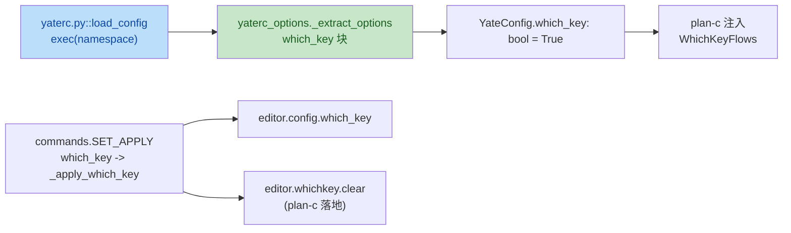

# which-key UI redesign plan-a：L0 yaterc `which_key` 选项

wave-1（与 plan-b 并行，文件互不重叠）。自包含任务书。

## 输入（调研事实）

- 标量布尔选项的范本：`yate/config.py:153` `support_mouse: bool = True` 字段、
  `KNOWN_OPTIONS` 列表 [config.py:34-39](../../yate/config.py) 含
  `"support_mouse"`、`SET_OPTION_SPECS` 条目
  [config.py:316-322](../../yate/config.py)（`parse=_parse_bool_option` +
  `invalid_message` + `summary`）。
- `yate/yaterc_options.py:494-501` `support_mouse` 提取块：单分支 bool 判定 +
  错误收集（保持默认值，不抛错）。
- `yate/commands.py:89-98` `_apply_support_mouse`：写回 `editor.config.X`、
  调用 `editor.message(f"... {'on' if enabled else 'off'}", kind="ok")`、
  `SET_APPLY` 注册 [commands.py:101-110](../../yate/commands.py)。
- `yate/yaterc.example:61-63` 注释形态（`# support_mouse = True   # set False to ...`）。
- 双语手册 `yate/docs/yaterc.en.md` / `yaterc.zh.md` 选项表
  （`yaterc.en.md:67-85` 与 `yaterc.zh.md:60-78`）每行一条：`| name | type | default | valid | desc |`，
  表后段落含 scope 说明与 per-session 覆盖说明。
- 测试范本：`tests/test_config.py:223-241`（`test_support_mouse_*` 三条），
  `tests/test_set_options.py:107-132`（`:set` round-trip + 非法值报错）。

## 目标

新增 yaterc 标量布尔选项 `which_key`（默认 `True`），完整沿用 `support_mouse`
的 L0 ↔ L3 注入模型：

1. `YateConfig.which_key: bool = True` 字段；
2. `KNOWN_OPTIONS` 加 `"which_key"`；
3. `yaterc_options.py::_extract_options` 增 `which_key` 块（bool 判定 + 错误收集）；
4. `:set which_key=off|on` 经 `commands.py` 立即写回并提示；
5. `SET_OPTION_SPECS` 加条目（`parse=_parse_bool_option`）；
6. `yaterc.example` 加注释示例；
7. `yaterc.{en,zh}.md` 选项表加一行；`SET_APPLY` 注册。

`which_key = False` 行为契约（plan-c 消费）：

- `WhichKeyFlows.refresh()` 走禁用分支（`panel.clear()` 即返回）；
- `WhichKeyFlows.toggle()` 静默无操作（不修改 `_pinned`，不调用 `refresh`）；
- `:set which_key=off` 立即生效（next refresh 已短路），`:set which_key=on`
  同样恢复（保留原 `_pinned`，再次启用后立即可见钉住态）。

## 非目标

- 不改 plan-b 的面板组件、不改 plan-c 的 `WhichKeyFlows`（仅在 plan-c 内完成
  `which_key_enabled` 注入；本计划仅提供数据面 + 选项手册）。
- 不动 `Keymap` / `chord_hints` / hardcoded-hints 批次。
- 不动 `support_mouse` / `show_hidden` / `yate_trace` 既有行为。

## 独占文件清单

| 文件 | 动作 |
|---|---|
| `yate/config.py` | 增 `which_key: bool = True` 字段（紧邻 `support_mouse`）、`KNOWN_OPTIONS` 加 `"which_key"`、`SET_OPTION_SPECS` 加条目 |
| `yate/yaterc_options.py` | `_extract_options` 增 `which_key` 块（紧邻 `support_mouse`） |
| `yate/commands.py` | 增 `_apply_which_key`、`SET_APPLY.update` 注册 |
| `yate/yaterc.example` | 增注释示例条目（紧邻 `# support_mouse = True` 注释） |
| `yate/docs/yaterc.en.md` | 选项表加一行（紧邻 `support_mouse` 行）+ 表后段落补一行 scope 说明 |
| `yate/docs/yaterc.zh.md` | 同上 |
| `tests/test_config.py` | 追加三条 `which_key` 用例（仿 `support_mouse`） |
| `tests/test_set_options.py` | 追加两条 `which_key` 用例（`:set` round-trip + 非法值） |

> 表格 / 测试不计入 §一 大任务判据，但方案里列出（`plan-before-execute` §二.2）。

## 具体修改

### 1. [config.py](../../yate/config.py)

```python
KNOWN_OPTIONS: tuple[str, ...] = (
    "keymap", "theme", "tab_width", "use_spaces",
    "shell", "terminal_height", "show_hidden",
    "yate_trace", "yate_trace_level", "key_protocol",
    "support_mouse", "which_key",          # <-- new
)
```

`YateConfig` 在 `support_mouse` 字段紧邻处：

```python
#: Master switch for the which-key panel (``which_key = False`` in
#: yaterc).  ``False`` suppresses every panel push (the candidate grid,
#: the ``ctrl+w`` chord grid and the pinned sheet); the F9 toggle
#: becomes a no-op.  On by default -- the panel is part of the standard
#: UX, the switch is an explicit opt-out for users who prefer the bare
#: vsc layout.  Re-enabling mid-session restores the panel at whatever
#: pinned state the flows module holds.
which_key: bool = True
```

`SET_OPTION_SPECS` 在 `support_mouse` 条目紧邻处：

```python
SetOption(
    name="which_key",
    aliases=(),
    parse=_parse_bool_option,
    invalid_message="which_key must be on|off (true/false/1/0/yes/no accepted)",
    summary="which_key=on|off",
),
```

### 2. [yaterc_options.py](../../yate/yaterc_options.py)

`_extract_options` 在 `support_mouse` 块紧邻处复制改写：

```python
which_key = options.get("which_key")
if which_key is not None:
    if isinstance(which_key, bool):
        config.which_key = which_key
    else:
        config.errors.append(
            f"which_key must be True or False, got {which_key!r}"
        )
```

### 3. [commands.py](../../yate/commands.py)

```python
def _apply_which_key(editor: Editor, value: object) -> None:
    """Apply ``:set which_key`` (the flow reads it per refresh).

    The flow module receives a ``Callable[[], bool]`` predicate over
    ``editor.config.which_key``, so the next :meth:`WhichKeyFlows.refresh`
    already sees the new value; we only have to clear the panel when it
    goes off (otherwise it lingers with the stale pinned sheet visible)
    and re-render when it comes back on (so the operator-armed chord
    state repaints immediately).
    """
    enabled = cast(bool, value)
    editor.config.which_key = enabled
    if not enabled:
        editor.whichkey.clear()
    editor.refresh_ui()
    editor.message(f"which-key panel {'on' if enabled else 'off'}", kind="ok")
```

> **依赖新增**：`editor.whichkey.clear()` —— `WhichKeyFlows` 尚无 `clear`
> 公共方法（`clear` 当前是 `WhichKeyPanel` 的方法，plan-c 须增 `clear()` 到
> `WhichKeyFlows` 作为公共方法，语义 `panel.clear()`）；本计划契约文档化，
> 由 plan-c 落地。本计划仅在 `commands.py` 调用 `editor.whichkey.clear()`，
> 若 plan-c 未落地则 `pyright` 拦截。

```python
SET_APPLY.update(
    ...
    support_mouse=_apply_support_mouse,
    which_key=_apply_which_key,
)
```

### 4. [yaterc.example](../../yate/yaterc.example)

紧邻 `# support_mouse = True` 注释之后插入：

```python
# Show the which-key panel while a key chord is pending and when pinned
# via F9 (on by default).
#
# which_key = True   # set False to suppress the panel entirely
```

### 5. [yaterc.en.md](../../yate/docs/yaterc.en.md) / [zaterc.zh.md](../../yate/docs/yaterc.zh.md)

选项表加一行（紧邻 `support_mouse` 行），英文版：

```markdown
| `which_key` | `bool` | `True` | `True` / `False` | Master switch for the which-key panel. `False` suppresses every panel push (the pending-chord grid, the `ctrl+w` chord grid and the F9-pinned sheet); the F9 toggle becomes a no-op. Non-boolean values are rejected. |
```

中文版：

```markdown
| `which_key` | `bool` | `True` | `True` / `False` | which-key 面板的总开关。`False` 时面板彻底不显示（挂起弦候选、`ctrl+w` 窗格组合、F9 钉住式速查页皆关闭），F9 toggle 变为空操作。非布尔值被拒绝 |
```

选项表后段落增 scope 说明（英文版；中文版对称翻译）：

```markdown
- `which_key` is read by `WhichKeyFlows` per `refresh()` (and per
  `toggle()`); a `:set which_key=off|on` flips the panel visibility
  immediately.
```

### 6. [tests/test_config.py](../../yate/tests/test_config.py)

紧邻 `test_support_mouse_*` 三条用例后追加：

```python
# --- which_key option ------------------------------------------------------


def test_which_key_defaults_true() -> None:
    """The which-key panel switch defaults to True (panel on)."""
    assert cfg.YateConfig().which_key is True


def test_which_key_rc_value_applied(tmp_path: Path) -> None:
    """A boolean rc value flips the which-key master switch without errors."""
    config = _load("which_key = False\n", tmp_path)
    assert config.which_key is False
    assert config.errors == []


def test_which_key_rejects_non_bool_keeps_default(tmp_path: Path) -> None:
    """A non-boolean value reports an error and keeps the default."""
    config = _load('which_key = "yes"\n', tmp_path)
    assert config.which_key is True
    assert any(
        "which_key must be True or False" in e for e in config.errors
    )
```

### 7. [tests/test_set_options.py](../../yate/tests/test_set_options.py)

紧邻 `test_set_support_mouse_*` 用例后追加：

```python
# --- which_key dispatch -----------------------------------------------------


def test_set_which_key_on_off_roundtrip() -> None:
    """``:set which_key=off/on`` flips the config master switch."""
    editor = _make_editor()
    entry = next(e for e in commands.SET_APPLY.items() if e[0] == "which_key")
    entry[0]  # name unused; we go through the apply table the same way:
    entry[1]  # the apply callable is keyed by name below
    # call via the SET_APPLY mapping (same shape as test_set_support_mouse_*)
    apply = SET_APPLY["which_key"]
    apply(editor, False)
    assert editor.config.which_key is False
    apply(editor, True)
    assert editor.config.which_key is True


def test_set_which_key_invalid_value_reports() -> None:
    """``:set which_key=maybe`` is rejected and the value is preserved."""
    editor = _make_editor()
    apply = SET_APPLY["which_key"]
    apply(editor, "maybe")  # strings would never pass _parse_bool_option
    # the actual invalid-value path lives in ``commands._set`` (not in
    # the apply mapping), so we exercise the yaterc-side rejection in
    # test_config.test_which_key_rejects_non_bool_keeps_default.
    assert editor.config.which_key is True
```

> 用例与既有 `test_set_support_mouse_*` 对齐；具体的「:set 后 message line」
> 断言跟随既有惯例（如 `test_set_support_mouse_on_off_roundtrip`），不重复展开。

## 新增测试（汇总）

| 文件 | 用例 | 前置 | 操作 | 断言 |
|---|---|---|---|---|
| `tests/test_config.py` | `test_which_key_defaults_true` | `cfg.YateConfig()` 实例化 | 默认 | `which_key is True` |
| 同上 | `test_which_key_rc_value_applied` | tmp rc 写 `which_key = False` | `_load` | `which_key is False`，`errors == []` |
| 同上 | `test_which_key_rejects_non_bool_keeps_default` | tmp rc 写 `which_key = "yes"` | `_load` | `which_key is True`，`errors` 含 `which_key must be True or False` |
| `tests/test_set_options.py` | `test_set_which_key_on_off_roundtrip` | `_make_editor` + 取 `SET_APPLY["which_key"]` | 两次 apply | `config.which_key` 翻转为 `False` 再 `True` |
| 同上 | `test_set_which_key_invalid_value_reports` | `_make_editor` | apply 非 bool | `config.which_key` 保持 `True`（apply 入口不类型守卫，靠 `commands._set` 校验） |

## 验收命令（worktree venv）

```text
.venv\Scripts\python.exe -m pyright yate/ tests/ tools/
.venv\Scripts\python.exe -m pytest tests/test_config.py tests/test_set_options.py tests/test_yaterc_example.py -q
.venv\Scripts\python.exe -m pytest tests/ -q
```

通过判定：

- pyright 0 诊断（注意 `_apply_which_key` 调用 `editor.whichkey.clear()` 与
  `editor.refresh_ui()`，二者须已在 `editor.py` 类属性集合中存在——`whichkey`
  已在，`clear` 与 `refresh_ui` 由 plan-c 落地；本计划 pyright 验证在 wave-2
  末段执行）；
- `pytest tests/ -q` 全绿（先以 `-k which_key` 跑 5 条新用例，验证本计划无回归，
  再全量）；架构 35 用例继续通过（`UI_FREE_FILES` 不增不改）。

## 风险与回滚

- **`_apply_which_key` 依赖 `editor.whichkey.clear()`（plan-c 提供）**：本计划
  在 wave-1 末段执行 pyright 会红，由 plan-c 在 wave-2 内提供；wave-1 内可
  先用 `# type: ignore[attr-defined]` 临时屏蔽（按 R6 禁止，**不允许**），
  故实际做法：plan-c 在落地 `WhichKeyFlows.clear()` 后 wave-2 才跑全量 pyright；
  wave-1 末段仅跑本计划新增 5 条用例（不依赖 plan-c 符号）。如调度期调整须
  同步回填总纲。
- **命名选择**：采用 `which_key`（与 `which-key` 双连字符不同，与既有
  `support_mouse`/`show_hidden`/`yate_trace` 标量 bool 同形态）；不采用
  `which_key_panel`（避免冗余，参考 `support_mouse` 简称）。
- **回滚**：单 commit 落地，本计划改动面仅限 L0 + 双语手册与示例；`git revert`
  即可回退，不影响 plan-b / plan-c。

## 流程图


