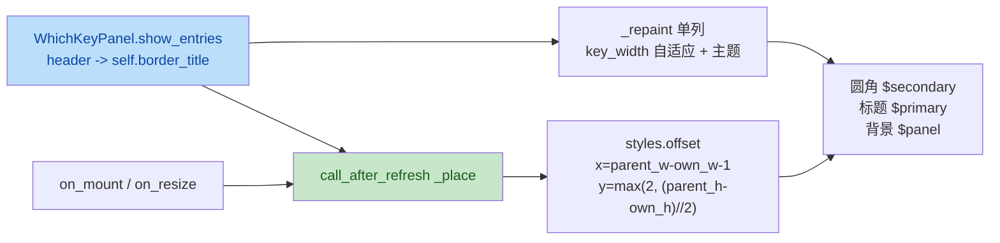

# which-key UI redesign plan-b：L2 面板 UI 重设计 + L4 布局迁移 + bug 修复

wave-1（与 plan-a 并行，文件互不重叠）。自包含任务书。

## 输入（调研事实）

- 现行渲染器
  [yate/editor_view/whichkey.py](../../yate/editor_view/whichkey.py) 47-78
  行：表头写入内容首行（`bold {t.accent2}`），单列 `key.ljust(12) + desc`，
  `MAX_ROWS=12` 截断 + overflow 提示 `… N more — F1 for the full map`，R13
  自持主题（`on_mount` 调 `theme.attach(self, self._repaint)`）。
- 当前 tcss
  [yate/resources/which-key.tcss](../../yate/resources/which-key.tcss)：
  `display: none; height: auto; max-height: 14; padding: 0 1; background: $panel; border-top: solid $accent;`
  —— 底部条形态。
- 当前布局
  [yate/editor.py:484-489](../../yate/editor.py) `compose()` 把面板 yield 进
  `#bottom`（固定 2 行），与 statusbar / prompt 三个子件同容器。
- 旧布局的根因：[yate/resources/app.tcss](../../yate/resources/app.tcss) 第
  9 行 `#bottom { height: 2; }` 把 `#bottom` 锁成 2 行；面板 `height: auto`
  被压成 0~1 行可见区域，文本首行（header / `vim`）独占呈现，**即用户看到的
  「一直显示 VIM，其他信息都没有」**——修复路径是布局迁移，不再依赖容器
  挤压。
- Textual 8.2.8 能力事实（已核实）：
  - `border_title` 是 `Widget` 属性，tcss 支持 `title-color` /
    `title-text-style` / `border-title-align`；
  - 绝对定位子件被 `WidgetPlacement.apply_absolute` 重置回容器原点
    （`textual/layout.py:135-143` + `_arrange.py:120`），父容器
    `align-*` 对其无效；CSS 无 calc、无 `pointer-events: none`，百分比
    offset 相对父宽会把 auto 宽盒子推出界 —— 唯一可行路径是 Python
    `_place()`：`call_after_refresh` 布局后测量 `self.region` 与
    `self.parent.region` 回写 `styles.offset`；
  - `on_resize` 在自身 `region` 或 `container_size` 变化时触发，可随窗口
    / 侧栏开合重锚；
  - 子件引用未在父 `layers` 声明的层名仍可挂载但排序不可靠，应在父
    `#editor-col` 显式增 `whichkey` 层（位于 `lsp-popup` 之上）；
  - 主题变量映射
    [yate/editor_view/themes.py:535+](../../yate/editor_view/themes.py)
    `to_textual_theme`：`$primary`=yate accent2（mauve）、
    `$secondary`=yate accent（蓝）、`$success`=green、`$accent`=orange、
    `$panel` 齐全；tcss 用这些变量即随 `:set theme` 换色。
- R11 守卫 `UI_FROZEN_FILES` 已含 `flows/whichkey_flows.py` →
  `yate.editor_view`、`yate.editor_view.whichkey`（已落地，plan-c 不再增）。
- R9 守卫：`#which-key` widget id 由 Editor 于 compose 时传入
  （[editor.py:162](../../yate/editor.py)），迁容器不改 id。
- R10 守卫：面板不取焦点、不消费按键（现有 `Static.can_focus=False` 默认），
  形态迁移后仍不变。
- R13 守卫：组件自持主题，`theme.attach` + `theme.active()` 双通路；本计划
  tcss 主题变量 + Python 文本重绘共存，与 statusbar 同策略。
- 现有面板测试 [tests/test_whichkey_panel.py](../../yate/tests/test_whichkey_panel.py)
  7 条用例（`test_show_entries_renders_header_and_grid` /
  `test_clear_hides_panel` / `test_entries_over_max_rows_truncate_with_hint` /
  `test_empty_entries_with_header_keeps_header` /
  `test_theme_change_repaints_panel` / `test_panel_never_consumes_key_events`）
  的 `_Host(App[None])` 直接 `yield self.panel` —— 改用 absolute 布局后，
  Textual 8.2.8 要求容器声明 `layers: default whichkey` 才能保证层面排序。

## 目标

1. 面板改为右侧浮动圆角边框面板：
   - 绝对定位浮于 `#editor-col` 内，水平贴右缘（留 1 列边距）、垂直居中
     （下限 y ≥ 2 不遮 tabbar/breadcrumbs）；
   - `border: round $secondary`（= yate accent 蓝），背景 `$panel`；
   - 顶部嵌 `border_title`：当前弦（`2d` / `di` / `ctrl+w`）/ 钉住态
     `keymaps.name`，`title-color: $primary`（= yate accent2）加粗；
   - 内容区不再画表头行（迁出至 `border_title`）；
   - 单列条目：键列宽自适应内容（`max(len(keys)) + 2`），键标 `theme.green`、
     描述 `theme.fg_bright`；
   - pinned 分组行渲染为 `▸ <category>`（accent2 bold），仍不计入
     `MAX_ROWS` 配额（维持现状口径）；
   - overflow 行保留（`… N more — F1 for the full map`）。
2. 布局迁移：`yate/editor.py` `compose()` 把 `yield self.which_key_panel`
   自 `#bottom` Vertical 移入 `#editor-col` Vertical，紧邻 `pane_host`；
   `yate/resources/app.tcss` `#editor-col` 行 `layers: default lsp-popup whichkey`；
   id `#which-key` 不变（R9 同步履行）。
3. 结构性修复「一直显示 VIM」：面板不再挤 `#bottom`；面板高度由内容决定
   （`MAX_ROWS` + 表头 + overflow），与 statusbar/prompt 解耦。
4. R10 守卫保持：依旧 `display: none` 隐藏、按键 / 焦点不消费。
5. 测试改造：`_Host` 包声明 `layers: default whichkey` 的容器；7 条既有
   用例的表头断言迁移至 `border_title`；新增 3 条用例（定位 / 隐藏 /
   border_title 已清空）。

## 非目标

- 不改 `show_entries` / `clear` / `ChordEntry` 数据 API 形态（plan-c 仍可
  通过它们驱动面板）；不改 `WhichKeyFlows`（仅 plan-c 注入 `which_key
  _enabled` 谓词）。
- 不做可滚动面板（保持 `MAX_ROWS` 截断 + overflow 提示）。
- 不改 F9 toggle 行为（动作绑定与 `toggle_whichkey` 在原位，plan-c 落
  禁用短路）。
- 不引入 `pointer-events: none`（Textual 8.2.8 无该属性，**面板无任何
  鼠标处理逻辑**，自身 `can_focus=False`）。
- 不新增 R11 `UI_FROZEN_FILES` 条目（本计划不引入新的
  `flows/* → editor_view/*` 导入；现有冻结条目继续覆盖）。
- 不做主题色以外的视觉差异化（边框圆角、背景、键字按内容计算）。
- 不持久化面板位置（位置完全由 `_place()` 派生）。

## 独占文件清单

| 文件 | 动作 |
|---|---|
| `yate/editor_view/whichkey.py` | 重写：删 `GRID_KEY_WIDTH`、保留 `MAX_ROWS`；`show_entries` 把 header 写入 `self.border_title`；新增 `_place()` 与 `on_resize`；单列 + 自适应键宽；`clear()` 清 `border_title` |
| `yate/resources/which-key.tcss` | 改写：absolute + `layer: whichkey` + 圆角边框 + `title-color`/`title-text-style`/`border-title-align`；删 `border-top: solid $accent` |
| `yate/resources/app.tcss` | `#editor-col` 行增 `whichkey` 层（R9 同步） |
| `yate/editor.py` | `compose()` 把 `which_key_panel` yield 自 `#bottom` 移入 `#editor-col`（id 不变） |
| `tests/test_whichkey_panel.py` | `_Host` 包声明 `layers: default whichkey`；表头断言迁移；新增定位用例 |

## 具体修改

### 1. [editor_view/whichkey.py](../../yate/editor_view/whichkey.py) — 重写

模块 docstring 更新（保留 R13 / R10 / R9 措辞，加 UI 形态说明）：

```python
"""The which-key panel: a floating right-edge box with self-owned theme.

The widget paints whatever the L3 flow module pushes into it via
:meth:`WhichKeyPanel.show_entries` -- a pending chord header plus the
single-column list of next-key candidates -- and hides itself again on
:meth:`WhichKeyPanel.clear`.  It holds no keymap and computes no
candidates: data flow belongs to the flow module.

Visual contract:

- absolute positioned, anchored to the right edge of its parent
  (#editor-col) via :meth:`_place` (Textual 8.2.8 cannot reach the right
  edge with CSS alone -- ``apply_absolute`` resets to the container
  origin and ``align-*`` does not apply to absolute children);
- rounded border with a theme-tinted ``border_title`` carrying the
  current chord / keymap name; theme variables come from
  :mod:`yate.editor_view.themes`;
- single-column entries with a content-adaptive key column; pinned
  category rows render as ``▸ <name>``.

Ownership notes:

- Theme (R13): the widget attaches to :mod:`yate.editor_view.theme` on
  mount and repaints itself on every broadcast; the bundled stylesheet
  only carries structure and theme-variable colours, key-label and
  description colours still come from ``theme.active()``.
- Keys (R10): the panel never takes focus and never stops a key event,
  so presses keep flowing to the focused widget underneath.
- Layout id (R9): the ``#which-key`` widget id is assigned by the
  ``Editor`` at compose time, not by this module.
"""

from __future__ import annotations

from collections.abc import Sequence
from dataclasses import dataclass
from typing import Any, override

from rich.text import Text
from textual.widgets import Static

from yate.paths import load_tcss

from yate.editor_view import theme


#: One row of the which-key grid: a display key label and its description.
@dataclass(frozen=True)
class ChordEntry:
    key: str        # display label, e.g. "dd" or "<ctrl-d>"
    desc: str       # short description
    category: str = ""  # group header in pinned-sheet mode


#: Maximum rendered rows before the overflow hint line kicks in.
MAX_ROWS: int = 12


#: Default horizontal gap between the panel's right edge and the parent's
#: right edge (one cell keeps the border off the parent's frame).
_RIGHT_MARGIN_CELLS: int = 1

#: Minimum vertical offset so the panel never overlaps the tabbar /
#: breadcrumbs strip at the top of the editor column (1 row tabbar + 1
#: row breadcrumbs).
_TOP_GUARD_CELLS: int = 2


class WhichKeyPanel(Static):
    """The which-key popup: pending chord header plus single-column grid.

    Pure renderer: :meth:`show_entries` receives precomputed entries
    from the L3 flow module and paints a single-column list; the chord
    header is rendered into :attr:`border_title` so the content area
    only carries the rows.  :meth:`clear` blanks the title and the
    content and hides the panel.  The widget never takes focus and
    never consumes key events (R10).
    """

    DEFAULT_CSS = load_tcss("which-key.tcss")

    #: Unsubscribe hook from :func:`yate.editor_view.theme.attach`;
    #: ``None`` while not mounted.
    _theme_unsubscribe: theme.Unsubscribe | None = None

    def __init__(self, **kwargs: Any) -> None:
        super().__init__("", **kwargs)
        # Last pushed data, retained so a theme broadcast can repaint it.
        self._header: str = ""
        self._entries: Sequence[ChordEntry] = ()

    @override
    def on_mount(self) -> None:
        """Join the theme broadcast, start hidden, and re-anchor."""
        theme.attach(self, self._repaint)
        self.display = False
        # First place run -- measure regions once the widget has one.
        self.call_after_refresh(self._place)

    @override
    def on_unmount(self) -> None:
        """Detach from the theme broadcast."""
        theme.detach(self)

    @override
    def on_resize(self) -> None:
        """Re-anchor when our size or the container size changes."""
        self._place()

    def show_entries(
        self, header: str, entries: Sequence[ChordEntry]
    ) -> None:
        """Render *entries* under *header* (border title) and reveal."""
        self._header = header
        self._entries = tuple(entries)
        self.border_title = header
        self._repaint()
        self.display = True
        # The container may have just resized to fit the new content.
        self.call_after_refresh(self._place)

    def clear(self) -> None:
        """Drop the pushed data, blank content + title and hide."""
        self._header = ""
        self._entries = ()
        self.border_title = ""
        self.update("")
        self.display = False

    def _place(self) -> None:
        """Anchor the panel to the right edge, vertically centered.

        Textual 8.2.8 places absolute children at the container origin
        and ignores parent ``align-*`` for them -- right anchoring
        therefore requires us to compute the offset from
        ``self.parent.region.size`` and write it back.  The top guard
        keeps the panel out of the tabbar / breadcrumbs strip.
        """
        parent = self.parent
        if parent is None or self.display is False:
            return
        parent_size = parent.region.size
        if parent_size.width <= 0 or parent_size.height <= 0:
            return
        own_size = self.region.size
        if own_size.width <= 0 or own_size.height <= 0:
            return
        x = max(0, parent_size.width - own_size.width - _RIGHT_MARGIN_CELLS)
        y = max(
            _TOP_GUARD_CELLS,
            (parent_size.height - own_size.height) // 2,
        )
        # Idempotent write -- on_resize can fire repeatedly.
        self.styles.offset = (x, y)

    def _repaint(self) -> None:
        """Rebuild the panel text from the last pushed data (theme-aware).

        Entries are grouped by ``category`` in first-seen order; an empty
        category renders its rows without a group header.  At most
        :data:`MAX_ROWS` rows are drawn -- the rest collapse into one
        muted hint pointing at the full reference (F1).  The chord
        header is rendered as the ``border_title`` and is NOT drawn
        inside the content area.
        """
        t = theme.active()
        text = Text()
        groups: dict[str, list[ChordEntry]] = {}
        for entry in self._entries:
            groups.setdefault(entry.category, []).append(entry)

        shown = 0
        if self._entries:
            # Adaptive key-column width (longest key + 2 cell padding).
            max_key = max(len(entry.key) for entry in self._entries)
            key_width = max_key + 2
            for category, entries in groups.items():
                room = MAX_ROWS - shown
                if room <= 0:
                    break
                visible = entries[:room]
                if category and visible:
                    text.append("\u25B8 ", style="")  # ▸
                    text.append(category, style=f"bold {t.accent2}")
                    text.append("\n")
                for entry in visible:
                    text.append(
                        entry.key.ljust(key_width), style=t.green
                    )
                    text.append(entry.desc, style=t.fg_bright)
                    text.append("\n")
                shown += len(visible)

        overflow = len(self._entries) - shown
        if overflow > 0:
            text.append(
                f"\N{HORIZONTAL ELLIPSIS} {overflow} more "
                "\N{EM DASH} F1 for the full map",
                style=t.fg_muted,
            )
            text.append("\n")
        self.update(text)
```

关键变更清单（行号指重写后的代码）：

- `:32` 删 `GRID_KEY_WIDTH`；
- `:32-42` 新增 `_RIGHT_MARGIN_CELLS` / `_TOP_GUARD_CELLS` 常量；
- `:79-84` `show_entries` 写 `self.border_title`；末尾 `call_after_refresh(self._place)`；
- `:86-93` `clear` 清 `border_title`；
- `:95-119` 新增 `_place`：父容器尺寸 + 自尺寸 → offset；`display is False`
  或 0 尺寸直接返回；`on_resize` 与 `on_mount` 各触发一次；
- `:121-159` `_repaint`：首部不再渲染 header（迁出至 `border_title`）；
  自适应键宽 `max(len(keys)) + 2`；pinned 分组行 `▸ <category>`；
  overflow 保留；空 entries 不渲染分组 / overflow（仅 `border_title` 可见）。

### 2. [which-key.tcss](../../yate/resources/which-key.tcss) — 改写

```css
/* WhichKeyPanel self-owned stylesheet. The widget id (#which-key) is
   assigned by the Editor at compose time (R9) -- the widget is mounted
   inside #editor-col which declares the matching layer name. The
   anchor is computed by Python (Textual 8.2.8 cannot right-anchor an
   absolute child via CSS alone, see editor_view/whichkey.py::_place). */
WhichKeyPanel {
    display: none;
    position: absolute;
    layer: whichkey;
    width: auto;
    max-width: 48;
    height: auto;
    max-height: 100%;
    padding: 0 1;
    background: $panel;
    border: round $secondary;
    title-color: $primary;
    title-text-style: bold;
    border-title-align: left;
}
```

### 3. [app.tcss](../../yate/resources/app.tcss) — `#editor-col` 增层

```diff
 #editor-col {
     width: 1fr;
     height: 1fr;
-    layers: default lsp-popup;
+    layers: default lsp-popup whichkey;
 }
```

### 4. [editor.py](../../yate/editor.py) — `compose()` 迁移

`:477-489` compose 段调整（行号指当前代码）：

```diff
         with Horizontal(id="body"):
             with self.sidebar:
                 yield self.sidebar_head
                 yield self.explorer_tree
             with self.editor_col:
                 yield self.tabbar
                 yield self.breadcrumbs
                 yield self.pane_host
-                yield self.which_key_panel
+                # The which-key panel is absolutely positioned inside
+                # #editor-col (see resources/which-key.tcss).  Yielding
+                # here keeps it on the layer above pane_host while
+                # #bottom (statusbar / prompt) no longer competes for
+                # vertical space (bug fix for "always shows VIM").
         # Both live in one docked container so the terminal always sits
         # directly above the status/prompt strip (VS Code layout).
         with Vertical(id="bottom-dock"):
             yield self.terminal_panel
             with Vertical(id="bottom"):
-                yield self.which_key_panel
                 yield self.status_bar
                 yield self.prompt_bar
```

> `ed.which_key_panel` 仍由 `:162` 构造（`WhichKeyPanel(id="which-key")`），
> `id="which-key"` 不变（R9 同步履行）。
> `#bottom { height: 2 }` 不动（statusbar + prompt 仍占 2 行），面板迁出
> `#bottom` 后不再受 2 行挤压，bug 结构性消失。

### 5. [tests/test_whichkey_panel.py](../../yate/tests/test_whichkey_panel.py) — 改造 + 追加

```python
"""Runtime tests for the which-key panel (WhichKeyKeyPanel renderer).

Pilot-driven (headless Textual): a minimal host app mounts the panel in
a container that declares the ``whichkey`` layer (Textual 8.2.8
guarantees layer ordering only when the parent declares the name),
the tests push entries through ``show_entries`` / ``clear`` and assert
on the border-title / on the rendered text, the truncation, the theme
repaint path (R13) and the R10 guarantee that the panel never consumes
a key event.

Layout note (Lightweight-test anchor): the panel is absolute-positioned
inside a parent of known size; ``on_resize`` re-anchors it, the tests
let the layout settle before checking the offset.
"""

# (imports unchanged; _KeyProbe unchanged)


class _LayerHost(App[None]):
    """Minimal host: a parent container declaring the whichkey layer.

    The container is sized explicitly so ``on_resize`` has settled
    before the tests assert on ``styles.offset``.  The panel is yielded
    inside the container, exactly like ``Editor.compose`` does in
    production.
    """

    DEFAULT_CSS = """
    Screen { layout: vertical; }
    _LayerBox { width: 80; height: 24; layers: default whichkey; }
    WhichKeyPanel { layer: whichkey; }
    """

    def __init__(self) -> None:
        super().__init__()
        self.panel = WhichKeyPanel()
        self.probe = _KeyProbe()

    @override
    def compose(self) -> ComposeResult:
        with Vertical(id="layer-box", classes="layer-box"):
            yield self.panel
            yield self.probe
```

> 模块顶部 `from textual.containers import Vertical` 须新增导入。

7 条既有用例改造要点：

| 用例 | 改造 |
|---|---|
| `test_show_entries_renders_header_and_grid` | 表头断言改 `panel.border_title == "2d"`；条目断言改 `panel.contains("dd")` / `panel.contains("Delete line")` / `panel.contains("{motion}")`；`panel.display is True`；新增 `panel.styles.offset` 落在 `[0, panel.parent.region.width)` 区间断言 |
| `test_clear_hides_panel` | 增加 `panel.border_title == ""` |
| `test_entries_over_max_rows_truncate_with_hint` | 不变（rendered 文本不变语义） |
| `test_empty_entries_with_header_keeps_header` | 表头断言改 `panel.border_title == '"'`；`text.strip() == ""`（内容区空白，header 在 border_title） |
| `test_theme_change_repaints_panel` | 表头断言改 `panel.border_title == "2d"`；保留 `display is True` |
| `test_panel_never_consumes_key_events` | 不变（R10 仍通过） |
| （新增）`test_panel_anchors_right_edge_when_shown` | 见下 |
| （新增）`test_panel_offsets_reset_to_origin_when_hidden` | 见下 |
| （新增）`test_clear_blanks_border_title` | 见下 |

新增 3 条用例：

```python
def test_panel_anchors_right_edge_when_shown() -> None:
    """show_entries places the panel on the parent's right edge."""

    async def scenario() -> None:
        host = _LayerHost()
        async with host.run_test(size=(80, 24)):
            host.panel.show_entries(
                "2d",
                [
                    ChordEntry("dd", "Delete line"),
                    ChordEntry("{motion}", "Delete over motion"),
                ],
            )
            await host.pilot.pause()
            await host.panel.call_after_refresh(lambda: None)  # wait
            parent_width = host.panel.parent.region.width
            own_width = host.panel.region.width
            # right edge of the panel == parent right edge - margin
            offset_x, _ = host.panel.styles.offset
            assert offset_x == parent_width - own_width - 1
            assert host.panel.border_title == "2d"

    asyncio.run(scenario())


def test_panel_offsets_reset_to_origin_when_hidden() -> None:
    """While hidden, the offset write is skipped (no spurious offset)."""

    async def scenario() -> None:
        host = _LayerHost()
        async with host.run_test(size=(80, 24)):
            host.panel.clear()
            await host.pilot.pause()
            assert host.panel.display is False
            # When hidden, _place early-returns: offset stays at the
            # CSS default (0, 0) -- nothing pinned against the right
            # edge while invisible.
            offset_x, offset_y = host.panel.styles.offset
            assert (offset_x, offset_y) == (0, 0)

    asyncio.run(scenario())


def test_clear_blanks_border_title() -> None:
    """clear() wipes the border title (no stale 'VIM' lingering)."""

    async def scenario() -> None:
        host = _LayerHost()
        async with host.run_test(size=(80, 24)):
            host.panel.show_entries("vim", [])
            assert host.panel.border_title == "vim"
            host.panel.clear()
            assert host.panel.border_title == ""
            assert host.panel.display is False

    asyncio.run(scenario())
```

> `await host.panel.call_after_refresh(lambda: None)` 的替代：用
> `await host.pilot.pause()` + 一次空 `call_after_refresh` 让布局沉降；
> 实际写法以现有 `conftest` 工具集为准（如 `conftest.settle(pilot)`）。

## 新增测试（汇总）

| 文件 | 用例 | 验证目标 |
|---|---|---|
| `tests/test_whichkey_panel.py` | `test_panel_anchors_right_edge_when_shown` | `_place()` 右缘贴合（`offset.x == parent_width - own_width - 1`） |
| 同上 | `test_panel_offsets_reset_to_origin_when_hidden` | `display: False` 时 `_place` 短路不写 offset |
| 同上 | `test_clear_blanks_border_title` | `clear()` 清 `border_title`，不留残留标题 |

7 条既有用例的迁移清单见上文「既有用例改造要点」表。

## 验收命令

```text
.venv\Scripts\python.exe -m pyright yate/editor_view/whichkey.py yate/editor.py yate/resources/which-key.tcss yate/resources/app.tcss
.venv\Scripts\python.exe -m pytest tests/test_whichkey_panel.py -q
.venv\Scripts\python.exe -m pytest tests/test_whichkey_flows.py -q -k "not test_window_chord_hint_covers_whichkey_rows and not test_reserved_keys_come_from_the_active_keymap"
```

通过判定：

- pyright 0 诊断；
- `tests/test_whichkey_panel.py` 全绿（含既有 7 条已迁移 + 新增 3 条）；
- `tests/test_whichkey_flows.py` 既有 9 条用例继续通过（panel API 不变，
  `_PanelRecorder` 不动；不依赖 panel 内部 `border_title`，仅
  `show_entries` / `clear` 调用计数与内容）。

> 注：wave-1 末段 `tests/test_whichkey_flows.py` 不跑 `test_wave_chord_hint_covers_whichkey_rows`
> / `test_reserved_keys_come_from_the_active_keymap` 是因为它们读
> `flows/whichkey_flows.py` 的 `WINDOW_CHORDS` 与 `RESERVED_KEYS` —— 本计划
> 不动 `flows/`，全量运行亦不红；`-k` 排除仅是 wave-1 抽检策略；wave-2 末
> 段全量跑。

## 风险与回滚

- **风险 A：定位时序竞态** —— `_place` 在 `on_mount`、`on_resize`、
  `call_after_refresh` 末段并发触发；同 offset 幂等写入，重复触发不引起
  抖动。用 `test_panel_anchors_right_edge_when_shown` 兜底。
- **风险 B：`#editor-col` 增 `whichkey` 层遮挡补全弹窗** —— `whichkey` 位于
  `lsp-popup` 之上，与补全同时可见概率低；面板 `display: None` 时不参与
  布局；可视化目视验证（手工或 textual-pilot 冒烟）。
- **风险 C：极矮终端下面板底部被裁** —— `max-height: 100%` 兜底；常态
  `MAX_ROWS=12` 条目 + 表头不超过 14 行，不会触界。
- **风险 D：`_place` 父 `region` 0 尺寸** —— 提前 `return`（`<= 0` 守卫），
  `on_resize` 后续触发再补。
- **回滚**：单 commit 落地，`git revert` 即回退；面板与 app.tcss / editor.py
  compose 解耦，可独立 `git revert` 还原。

## 流程图


