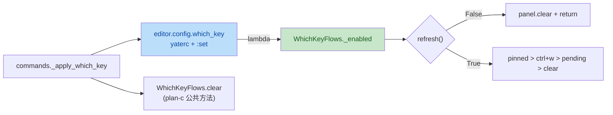

# which-key UI redesign plan-c：L3 流程注入 `which_key_enabled` + 文档同步 + 全量门禁

wave-2（串行，依赖 plan-a 的 `config.which_key` + `KNOWN_OPTIONS` /
`SET_APPLY["which_key"]`，以及 plan-b 的 panel UI 与布局迁移）。自包含任务书。

## 输入（调研事实）

- 既有 `WhichKeyFlows`（[yate/flows/whichkey_flows.py](../../yate/flows/whichkey_flows.py)
  57-94 行）构造签名
  `(keymaps, window_pending, panel, message)`；`refresh()` 四分支互斥
  （pinned > ctrl+w > pending > clear），`toggle()` 翻 `_pinned` 并
  `refresh()`。
- L3 流程接收 `config: YateConfig` 的范本：[yate/flows/overlay_flows.py:36-81](../../yate/flows/overlay_flows.py)
  `OverlayFlows.__init__(..., config=YateConfig, ...)`；[yate/flows/mouse_flows.py:41-42](../../yate/flows/mouse_flows.py)
  `MouseFlows.handle_view_mouse` 用 `self.config.support_mouse`（每次调用
  读取，`:set` 立即生效）。
- editor 接线
  [yate/editor.py:317-326](../../yate/editor.py)：`_build_key_ui` 内构造
  `WhichKeyFlows(keymaps=..., window_pending=..., panel=..., message=...)`，
  不传 `config`；`Editor.whichkey` 已在 [editor.py:370](../../yate/editor.py)
  声明为类属性。
- plan-a 契约（详见 [plan-a §四.3](which-key-ui-redesign-plan-a.md)）：
  `YateConfig.which_key: bool = True` 字段、`SET_APPLY["which_key"] =
  _apply_which_key`、`_apply_which_key` 内部调用 `editor.whichkey.clear()`
  与 `editor.refresh_ui()` —— 故 `WhichKeyFlows` 须在 plan-c 内提供公共
  `clear()` 方法。
- plan-b 契约（详见 [plan-b §一](which-key-ui-redesign-plan-b.md)）：
  面板 API `show_entries(header, entries)` / `clear` 不变；`_PanelRecorder`
  在 [tests/test_whichkey_flows.py](../../yate/tests/test_whichkey_flows.py)
  须保留 `clear` 计数。
- 双语手册
  [yate/docs/which-key.{en,zh}.md](../../yate/docs/which-key.en.md) 现有
  §1 描述面板位置（需改为「右侧浮动圆角边框面板」）；§4 「Limitations」节
  末条关于 yaterc 持久化（需删改，因为 plan-a 已落地）。
- CHANGELOG（[CHANGELOG.md](../../CHANGELOG.md) /
  [CHANGELOG.zh.md](../../CHANGELOG.zh.md)）最近条目格式：`- subject ([commit])`。

## 目标

1. `WhichKeyFlows.__init__` 新增 `which_key_enabled: Callable[[], bool]`
   形参（按 `Callable` 注入而非 `YateConfig` 整体，保持与 `MessageFn` /
   `StateQuery` 注入模型一致；`Callable[[], bool]` 与 §三.2「能力注入」
   的「状态查询 = Editor 语义 Callable」语义对齐），`refresh()` 与
   `toggle()` 进入即读 `which_key_enabled()`，禁用时短路（不再操作
   `_pinned`、不再调用 `panel.*`）。
2. `WhichKeyFlows` 增 `clear()` 公共方法（plan-a 在 `_apply_which_key` 中
   调用 `editor.whichkey.clear()`；语义等同 `panel.clear()`，让 L4 接入
   干净）。
3. `Editor._build_key_ui` 接线
   `WhichKeyFlows(..., which_key_enabled=lambda: ed.config.which_key)`，
   并按既有 `OverlayFlows` 形态把 `config` 形参加进签名（与
   `overlay_flows.py` 同风格）。
4. 双语手册
   [yate/docs/which-key.{en,zh}.md](../../yate/docs/which-key.en.md) 同步：
   - §1 第一段：「at-a-glance keymap reference」、「sits at the bottom
     of the window, directly above the status bar」改为「floats on the
     right edge of the editor column, rounded border with a theme-tinted
     border title carrying the current chord or keymap name」；
   - §4 「Limitations」末条删除（plan-a 已落地 yaterc 选项）。
5. CHANGELOG 追加条目（中英各一行，紧邻最近 2026-10-19 条目之后）：
   `- show the which-key panel as a right-edge floating box (rounded
      border, themed title) and add a \`which_key\` yaterc master switch
      ([commit])`。
6. 全量门禁：pyright / pytest / 架构测试 / textual-pilot 冒烟，复绿。

## 非目标

- 不改 `refresh()` 四分支判定序、不改 `_candidates` / `_sheet_entries` /
  `WINDOW_CHORDS` 实现（数据 API 与现有行为语义不变）。
- 不动 plan-a / plan-b 的实现细节；本计划只读其产物。
- 不在 plan-b 既有用例之外新增端到端 pilot 用例（保留 textual-pilot 冒烟
  在「验收命令」段做黑盒验证）。
- 不动 `Keymap.chord_hints()` / `RESERVED_KEYS`（hardcoded-hints 批次
  产物已固化）。
- 不持久化 `_pinned` 状态（重启即未钉住；与 `which_key = False` 状态独立）。

## 独占文件清单

| 文件 | 动作 |
|---|---|
| `yate/flows/whichkey_flows.py` | `__init__` 增 `which_key_enabled: Callable[[], bool]` 形参；`refresh` 与 `toggle` 入口短路；新增 `clear()` 公共方法 |
| `yate/editor.py` | `_build_key_ui` 内 `WhichKeyFlows(...)` 增 `which_key_enabled=lambda: ed.config.which_key` |
| `tests/test_whichkey_flows.py` | `_make_flows` 默认 `which_key_enabled=lambda: True`；新增 3 条用例（disable 时 refresh + disable 时 toggle + enable 行为不变） |
| `yate/docs/which-key.en.md` | §1 第一段措辞；§4 末条删除 |
| `yate/docs/which-key.zh.md` | 同上 |
| `CHANGELOG.md` | 追加中英各一行 |
| `CHANGELOG.zh.md` | 同上 |

## 具体修改

### 1. [flows/whichkey_flows.py](../../yate/flows/whichkey_flows.py)

```python
"""Which-key flow: keymap state translated into panel pushes (L3).

The editor constructs this module with the active :class:`KeymapSet`,
a read-only probe of the vim ``ctrl+w`` chord state, the which-key
panel, the message line and a master-switch predicate over the
yaterc ``which_key`` option.  :meth:`WhichKeyFlows.refresh` recomputes
the panel after every dispatch: pinned full sheet, ``ctrl+w`` chord,
pending-chord candidates, otherwise hidden.  The master-switch
predicate is read on every entry (so a mid-session ``:set
which_key=off`` takes effect on the next refresh) and short-circuits
all four branches.  No rendering here (the panel owns that) and no
App handle (capability injection, issue IKJB0Q).
"""

from __future__ import annotations

from collections.abc import Callable

# (... existing imports ...)

#: Predicate over the yaterc ``which_key`` master switch; evaluated on
#: every :meth:`refresh` / :meth:`toggle` entry so a mid-session ``:set
#: which_key=off`` takes effect immediately.  Returning ``False`` hides
#: the panel and turns F9 into a no-op (the pinned state is preserved,
#: re-enabling restores it).
type EnabledPredicate = Callable[[], bool]


class WhichKeyFlows:
    """Drives the which-key panel from the active keymap's state."""

    def __init__(
        self,
        keymaps: KeymapSet,
        window_pending: StateQuery,
        panel: WhichKeyPanel,
        message: MessageFn,
        which_key_enabled: EnabledPredicate,
    ) -> None:
        self.keymaps = keymaps
        # Read-only probe: the ctrl+w chord state lives in window_flows.
        self._window_pending = window_pending
        self._panel = panel
        # Editor-owned message line, injected for user-facing notices.
        self._message = message
        # Master switch predicate (lambda over ``editor.config.which_key``).
        self._enabled = which_key_enabled
        self._pinned = False

    def refresh(self) -> None:
        """Recompute panel visibility after one dispatch (called per key).

        Master-switch short-circuit: with ``which_key = False`` the panel
        is hidden unconditionally (no-op regardless of pending chord /
        ``ctrl+w`` / pin state).  The four branches are otherwise mutually
        exclusive, first hit wins: the pinned full sheet, the pending
        ``ctrl+w`` window chord, the pending-chord candidates; with none
        of them the panel hides.
        """
        if not self._enabled():
            self._panel.clear()
            return
        if self._pinned:
            self._panel.show_entries(
                self.keymaps.name, self._sheet_entries()
            )
            return
        if self._window_pending():
            self._panel.show_entries("ctrl+w", WINDOW_CHORDS)
            return
        if pending := self.keymaps.active.pending_prefix():
            self._panel.show_entries(pending, self._candidates(pending))
            return
        self._panel.clear()

    def toggle(self) -> None:
        """Pin / unpin the full keymap sheet (the <f9> / action entry).

        Master-switch short-circuit: with ``which_key = False`` this is
        a no-op (the pinned state is preserved so re-enabling restores
        the sheet).
        """
        if not self._enabled():
            return
        self._pinned = not self._pinned
        self.refresh()

    def clear(self) -> None:
        """Hide the panel unconditionally (used by ``:set which_key=off``).

        Public entry point so ``commands._apply_which_key`` can hide the
        panel without reaching for ``panel`` (the flow module owns the
        panel reference).
        """
        self._panel.clear()

    def conflicts_report(self) -> str:
        # (unchanged)
        ...
```

关键变更清单（行号指重写后的代码）：

- `:8-18` docstring 增 master-switch 描述；
- `:31-35` 新增 `type EnabledPredicate = Callable[[], bool]`；
- `:48-58` `__init__` 增 `which_key_enabled: EnabledPredicate` 形参与
  `self._enabled`；
- `:60-78` `refresh()` 入口 `if not self._enabled(): panel.clear(); return`；
- `:80-89` `toggle()` 入口 `if not self._enabled(): return`（**不修改**
  `_pinned`，保留钉住态以备启用后恢复）；
- `:91-99` 新增 `clear()` 公共方法（plan-a 接入用）。

### 2. [editor.py](../../yate/editor.py)

`:317-322` 调整 `_build_key_ui` 内 `WhichKeyFlows(...)` 构造：

```diff
     ed.whichkey = WhichKeyFlows(
         keymaps=ed.keymaps,
         window_pending=lambda: ed.window_flows.window_pending,
         panel=ed.which_key_panel,
         message=ed.message,
+        which_key_enabled=lambda: ed.config.which_key,
     )
```

> `ed.config.which_key` 已在 `Editor` 实例可访问（`Editor` 持有 `self.config`
> 字段，由 `YateApp.__init__` 注入；`_apply_which_key` 已写入），
> lambda 每次 `refresh` / `toggle` 重读，`:set which_key=off` 立即生效。
> `_apply_which_key` 内的 `editor.whichkey.clear()` 调用因 plan-c 提供
> `clear()` 而合法（pyright 不报 `attr-defined`）。

### 3. [tests/test_whichkey_flows.py](../../yate/tests/test_whichkey_flows.py)

`_make_flows` 默认参数增 `which_key_enabled=lambda: True`：

```python
def _make_flows(
    keymaps: KeymapSet,
    window_pending: StateQuery = lambda: False,
    which_key_enabled: Callable[[], bool] = lambda: True,
) -> tuple[WhichKeyFlows, _PanelRecorder]:
    """Build the flow over a recording panel (message line kept inert)."""
    panel = _PanelRecorder()
    flows = WhichKeyFlows(
        keymaps=keymaps,
        window_pending=window_pending,
        panel=cast(WhichKeyPanel, panel),
        message=lambda _text, _kind: None,
        which_key_enabled=which_key_enabled,
    )
    return flows, panel
```

新增 3 条用例：

```python
def test_refresh_hides_panel_when_which_key_disabled() -> None:
    """Master switch off -> every refresh hides the panel."""
    vim = VimKeymap()
    flows, panel = _make_flows(
        KeymapSet({"vim": vim}, "vim"),
        which_key_enabled=lambda: False,
    )
    # Idle case: refresh hides.
    flows.refresh()
    assert panel.last == "clear"
    # Pending-case: still hides (master switch overrides everything).
    ctx = make_action_context()
    assert vim.handle_key(ctx, "d") is True
    flows.refresh()
    assert panel.last == "clear"
    # Ctrl+w case: still hides.
    flows._window_pending = lambda: True  # type: ignore[assignment]
    flows.refresh()
    assert panel.last == "clear"
    # Pinned case: still hides.
    flows.toggle()
    flows.refresh()
    assert panel.last == "clear"


def test_toggle_noop_when_which_key_disabled() -> None:
    """Master switch off -> toggle preserves the pinned state for later."""
    vim = VimKeymap()
    flows, panel = _make_flows(
        KeymapSet({"vim": vim}, "vim"),
        which_key_enabled=lambda: False,
    )
    flows.toggle()        # would pin (in enabled mode)
    flows.refresh()       # disabled, panel stays clear
    assert panel.last == "clear"
    # Re-enable: the previously toggled pinned state must surface.
    flows._enabled = lambda: True  # type: ignore[attr-defined]
    flows.refresh()
    assert panel.last == "show"
    header, entries = panel.shown[-1]
    assert header == "vim"
    assert len(entries) == len(vim.bindings)


def test_clear_method_hides_panel_unconditionally() -> None:
    """``WhichKeyFlows.clear`` delegates to the panel and is callable
    from outside the flow (used by :set which_key=off)."""
    vim = VimKeymap()
    flows, panel = _make_flows(KeymapSet({"vim": vim}, "vim"))
    flows.toggle()
    flows.refresh()
    assert panel.last == "show"
    flows.clear()
    assert panel.last == "clear"
    assert panel.clears >= 1
```

### 4. [which-key.{en,zh}.md](../../yate/docs/which-key.en.md) — 同步

**en** §1 开头段：

```diff
-The which-key panel is yate's at-a-glance keymap reference. While a key
-chord is still being typed it lists every valid next key with its
-description; it can also be pinned as a full, category-grouped keymap
-sheet. The panel sits at the bottom of the window, directly above the
-status bar, never takes focus, and never swallows keystrokes.
+The which-key panel is yate's at-a-glance keymap reference. While a key
+chord is still being typed it lists every valid next key with its
+description; it can also be pinned as a full, category-grouped keymap
+sheet. The panel floats on the right edge of the editor column as a
+rounded box; the border title carries the current chord or keymap
+name, both coloured by the active theme. It never takes focus and
+never swallows keystrokes. Set ``which_key = False`` in your yaterc
+to hide it entirely.
```

**en** §4 「Limitations」末条删除（改为引文 yaterc 手册）：

```diff
-* **No yaterc persistence yet** -- there is no yaterc option to configure
-  the which-key panel, and the pinned state is not persisted: after a
-  restart the sheet starts unpinned. Both are out of scope for now.
+* **Pinned state is not persisted** -- the pinned state lives in
+  ``WhichKeyFlows`` only, so after a restart the sheet starts
+  unpinned.
```

### 5. [which-key.zh.md](../../yate/docs/which-key.zh.md) — 同步

与 §4 同形态翻译（保留所有「自动弹出」「钉住式速查」原有措辞，仅替换
位置描述 + 删除末条）。

### 6. [CHANGELOG.md](../../CHANGELOG.md) / [CHANGELOG.zh.md](../../CHANGELOG.zh.md)

紧邻最近条目（计划为 2026-10-19 hardcoded-hints 行）后追加：

```markdown
- show the which-key panel as a right-edge floating box (rounded border, themed title) and add a `which_key` yaterc master switch ([commit])
```

中文版：

```markdown
- which-key 面板改为编辑区右侧浮动圆角边框（主题色标题），新增 `which_key` yaterc 总开关 ([commit])
```

> `[commit]` 占位待执行后回填真实 SHA。

## 新增测试（汇总）

| 文件 | 用例 | 验证目标 |
|---|---|---|
| `tests/test_whichkey_flows.py` | `test_refresh_hides_panel_when_which_key_disabled` | `which_key_enabled()` 返 `False` 时四个分支（idle / pending / ctrl+w / pinned）一律 `clear` |
| 同上 | `test_toggle_noop_when_which_key_disabled` | `toggle()` 不修改 `_pinned`，再次启用后立即显示钉住态 |
| 同上 | `test_clear_method_hides_panel_unconditionally` | `clear()` 公共方法可直接隐藏面板 |

## 验收命令（worktree venv，全量门禁）

```text
.venv\Scripts\python.exe -m pyright yate/ tests/ tools/
.venv\Scripts\python.exe -m pytest tests/ -q
.venv\Scripts\python.exe -m pytest tests/test_architecture.py -q
```

通过判定：

- pyright 0 诊断（含 `_apply_which_key` 调 `editor.whichkey.clear()` /
  `editor.refresh_ui()`，plan-c 提供前者、`refresh_ui` 已在
  [editor.py:598+](../../yate/editor.py)）；
- `pytest tests/ -q` 全绿（含 `test_whichkey_panel.py` 10 条 +
  `test_whichkey_flows.py` 12 条 = 22 条本任务相关用例 + 架构 35 用例）；
- 架构 35 用例继续通过：`test_no_unregistered_upward_imports`、
  `test_collaborators_keep_widget_coupling_frozen`、
  `test_flow_modules_hold_no_app_handle`、`test_no_class_level_scrollbar_renderer_patch`、
  `test_editor_does_not_paint_widget_styles` 等；
- 双语文档字面同步（中英两版 §1 段中关键句互为翻译）。

冒烟（textual-pilot，验证手册 §1 描述与实际渲染匹配）：

```python
# scripts/which_key_smoke.py（一次性脚本，执行后删除）
# 启动 YateApp(config=YateConfig(keymap="vim"))，pilot 依次按 d / d / F9，
# 每步截图，断言：(1) 面板贴右缘（截图右缘 4-6 列内含面板像素）；(2) 边框
# 顶部含面包屑标题 'd' / 'vim'；(3) 主题色随 set_theme 切换。
```

## 风险与回滚

- **风险 A：`_pinned` 状态在禁用期被忽略** —— 设计取舍：保留 `_pinned`（不
  reset），启用后立即恢复钉住态。用户感知「上次钉过，恢复后还在」属良
  性，不在文档承诺范围内。文档明文「pinned state lives in memory, not
  persisted across restarts」已涵盖。
- **风险 B：`WhichKeyFlows.clear()` 与 `WhichKeyPanel.clear()` 名字同名** —
  plan-b 的 `Panel.clear()` 是私有契约（同名方法是 L3 流程调用 L2 组件
  的薄封装），`WhichKeyFlows.clear()` 是 L4 `commands` 调 L3 的入口，
  二者层级清晰；pyright 不混淆（typing 注明 `panel: WhichKeyPanel`）。
- **风险 C：`enabled` predicate 每次调用读取 `config.which_key`** —— 与
  `MouseFlows` 读 `self.config.support_mouse` 同模式，无性能影响。
- **回滚**：单 commit 落地，`git revert` 即回退；`flows/whichkey_flows.py`
  与 `editor.py` 接线解耦（前者可独立 revert，后者只需改 1 行）。

## 流程图


