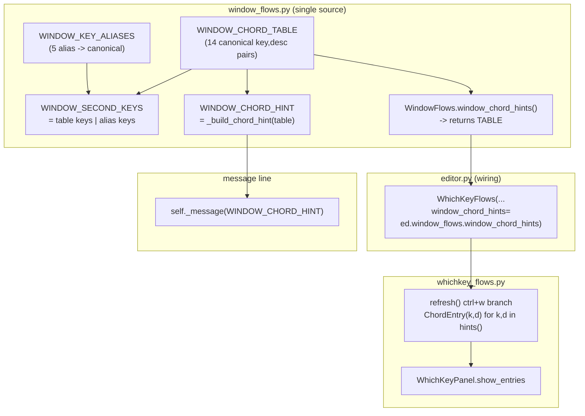

# which-key ctrl+w chord single-source plan (IKQ3IT)

## 一、目标与非目标

### 目标

把 vim `ctrl+w` 弦的"能按什么键"从三份独立硬编码（`_WINDOW_KEYS` 派发集合、
`WINDOW_CHORD_HINT` 提示文本、`WINDOW_CHORDS` 面板行）收敛为**单一来源**：

1. `window_flows.py` 持有一张模块级规范表（canonical key -> description），
   面板行与提示文本均由它派生；
2. 派发集合由规范表 + 别名映射派生（别名键 `plus` / `minus` / `less_than_sign` /
   `greater_than_sign` / `equals_sign` 不出现在面板行，仍只用于派发归一化）；
3. `whichkey_flows.py` 不再含 `WINDOW_CHORDS`，面板行由构造注入的 hint 源产出；
4. 新增守卫测试覆盖"派发 <-> 面板"一致性面。

### 非目标

- 不动 vim `chord_hints()` 机制；
- 不把 `:` 命令整合进 which-key；
- 不为扩展系统新增窗口操作注册 API；
- 不改变 `ChordEntry` 数据类或 `WhichKeyPanel` 渲染逻辑。

## 二、备选方案与否决理由

### 方案 A（选定）：window_flows 持有规范表，hint 源以 Callable 注入 whichkey_flows

- `window_flows.py` 定义模块级规范表 `WINDOW_CHORD_TABLE`（14 行 canonical key +
  description）与别名映射 `WINDOW_KEY_ALIASES`；
- `WindowFlows.window_chord_hints()` 方法返回规范表（纯数据过边界）；
- `WhichKeyFlows` 构造注入 `window_chord_hints: Callable[[], tuple[tuple[str, str], ...]]`；
- `WINDOW_CHORD_HINT` 由规范表派生（group by description）；
- `WINDOW_SECOND_KEYS`（公开名，替换 `_WINDOW_KEYS`）由规范表键 + 别名键派生。

**选定理由**：flows 模块间零横向 import 的现状保持不变（参照 `editor.py:357`
`window_pending=lambda: ed.window_flows.window_pending` 先例）；数据过边界，
`ChordEntry` 仍由 `whichkey_flows` 自行构造，L2 类型不泄漏到 L3 数据定义。

### 方案 B（否决）：维持三份常量 + 加强守卫测试

- 保留 `_WINDOW_KEYS` / `WINDOW_CHORD_HINT` / `WINDOW_CHORDS` 三份常量；
- 新增守卫测试断言三者一致。

**否决理由**：issue 原文明确指出"改动窗口键位需人工同步三处，漏改即漂移"。
加强守卫只能让漂移**被检测到**，不能**防止漂移**。维护成本未降低，
只增加了测试失败后的修复步骤。

### 方案 C（否决）：whichkey_flows 反向 import window_flows

- `whichkey_flows.py` 直接 `from yate.flows.window_flows import WINDOW_CHORD_TABLE`。

**否决理由**：破坏 flows 模块间零横向 import 的现状（`architecture-boundaries.md`
R11 冻结登记虽未显式禁止 flows 间 import，但现有 flows 模块全部只向下依赖
L0/L1，无横向边）。构造注入已有先例（`window_pending` lambda），
无需为数据打破惯例。

## 三、数据形态设计

### 3.1 规范表（window_flows.py 模块级）

```python
#: Canonical second-key rows of the vim ``ctrl+w`` chord.  Each entry is
#: ``(key, description)``; the description keywords flow into both the
#: message-line hint and the which-key panel rows (single source).
WINDOW_CHORD_TABLE: tuple[tuple[str, str], ...] = (
    ("h", "move"),
    ("j", "move"),
    ("k", "move"),
    ("l", "move"),
    ("s", ":split"),
    ("v", ":vsplit"),
    ("q", "close"),
    ("o", ":only"),
    ("ctrl+w", "cycle"),
    ("+", "resize"),
    ("-", "resize"),
    ("<", "resize"),
    (">", "resize"),
    ("=", "resize"),
)
```

### 3.2 别名映射（window_flows.py 模块级）

```python
#: Raw-symbol aliases the terminal driver may emit instead of the canonical
#: character.  Dispatch normalises through these; the panel never shows them.
WINDOW_KEY_ALIASES: dict[str, str] = {
    "plus": "+",
    "minus": "-",
    "less_than_sign": "<",
    "greater_than_sign": ">",
    "equals_sign": "=",
}
```

### 3.3 派发集合（派生）

```python
#: All keys accepted as the second half of a vim ``ctrl+w`` chord
#: (canonical + aliases).  Derived from the table so adding a row to
#: ``WINDOW_CHORD_TABLE`` automatically expands dispatch.
WINDOW_SECOND_KEYS: frozenset[str] = (
    frozenset(key for key, _ in WINDOW_CHORD_TABLE)
    | frozenset(WINDOW_KEY_ALIASES)
)
```

### 3.4 提示文本（派生）

```python
def _build_chord_hint(
    table: tuple[tuple[str, str], ...],
) -> str:
    """Group keys by description, join into the arm-hint message line."""
    groups: dict[str, list[str]] = {}
    for key, desc in table:
        groups.setdefault(desc, []).append(key)
    parts = [f"{' '.join(keys)} {desc}" for desc, keys in groups.items()]
    return "ctrl+w (" + ", ".join(parts) + ")"

WINDOW_CHORD_HINT: str = _build_chord_hint(WINDOW_CHORD_TABLE)
```

生成的提示文本形如：
`"ctrl+w (h j k l move, s :split, v :vsplit, q close, o :only, ctrl+w cycle, + - < > = resize)"`

与现串措辞略有差异（括号替代了原串的 `ctrl+w-  (...)` 形态），但所有描述词
（`:split` / `:vsplit` / `close` / `:only` / `move` / `cycle` / `resize`）均出现，
`test_window_chord_hint_covers_whichkey_rows` 适配后仍绿。

### 3.5 window_chord_hints() 方法

```python
class WindowFlows:
    ...
    def window_chord_hints(self) -> tuple[tuple[str, str], ...]:
        """Return the canonical ctrl+w chord rows (pure data for the panel)."""
        return WINDOW_CHORD_TABLE
```

返回纯 `tuple[tuple[str, str], ...]`——数据过边界，`ChordEntry` 构造仍归
`WhichKeyFlows`。

### 3.6 WhichKeyFlows 构造注入

```python
type WindowChordHintsFn = Callable[[], tuple[tuple[str, str], ...]]
```

`WhichKeyFlows.__init__` 新增参数 `window_chord_hints: WindowChordHintsFn`。
`refresh()` 中 ctrl+w 分支改为：

```python
if self._window_pending():
    entries = [ChordEntry(k, d) for k, d in self._window_chord_hints()]
    self._panel.show_entries("ctrl+w", tuple(entries))
    return
```

**注入点**：`editor.py:355` 构造处直接注入（构造顺序已保证 `window_flows` 先建）。
不用晚绑定——`window_chord_hints` 是纯数据返回，无状态依赖，构造时即可绑定。

```python
ed.whichkey = WhichKeyFlows(
    keymaps=ed.keymaps,
    window_pending=lambda: ed.window_flows.window_pending,
    window_chord_hints=ed.window_flows.window_chord_hints,  # NEW
    panel=ed.which_key_panel,
    message=ed.message,
    which_key_enabled=lambda: ed.config.which_key,
)
```

## 四、分步实施

### 步骤 1：window_flows.py 单一来源改造

**输入**：`yate/flows/window_flows.py`（现状 :31-46）。

**改动**：

1. 替换 :31-46 为：
   - `WINDOW_CHORD_TABLE`（14 行 tuple，见 §3.1）；
   - `WINDOW_KEY_ALIASES`（dict，见 §3.2）；
   - `WINDOW_SECOND_KEYS`（派生 frozenset，见 §3.3）；
   - `_build_chord_hint()` 私有函数 + `WINDOW_CHORD_HINT` 模块常量（派生，见 §3.4）。
2. `WindowFlows` 类新增 `window_chord_hints()` 方法（见 §3.5）。
3. `try_window_prefix` :187 的 `_WINDOW_KEYS` 改为 `WINDOW_SECOND_KEYS`。
4. `resize_pane` :152-166 的别名分支不变（仍按 `("+", "plus")` 等判定）——
   别名映射是派发归一化逻辑，与规范表正交。

**输出**：`_WINDOW_KEYS` 消失；`WINDOW_SECOND_KEYS` / `WINDOW_CHORD_TABLE` /
`WINDOW_KEY_ALIASES` / `WINDOW_CHORD_HINT` 公开；`window_chord_hints()` 方法可用。

**验收命令**：

```powershell
.venv\Scripts\python.exe -m pyright yate/flows/window_flows.py
.venv\Scripts\python.exe -m pytest tests/test_whichkey_flows.py -q
```

### 步骤 2：whichkey_flows.py 删除 WINDOW_CHORDS，注入 hint 源

**输入**：`yate/flows/whichkey_flows.py`（现状 :36-55, :73-113）。

**改动**：

1. 删除 :36-55 的 `WINDOW_CHORDS` 常量及其注释块。
2. 新增 `type WindowChordHintsFn = Callable[[], tuple[tuple[str, str], ...]]`
   （PEP 695 `type` 语句，满足 `test_callable_aliases_use_type_statements`）。
3. `WhichKeyFlows.__init__` 新增参数 `window_chord_hints: WindowChordHintsFn`，
   存为 `self._window_chord_hints`。
4. `refresh()` :107-109 改为：
   ```python
   if self._window_pending():
       entries = [ChordEntry(k, d) for k, d in self._window_chord_hints()]
       self._panel.show_entries("ctrl+w", tuple(entries))
       return
   ```

**输出**：`WINDOW_CHORDS` 消失；`WhichKeyFlows` 接受 hint 源注入。

**验收命令**：

```powershell
.venv\Scripts\python.exe -m pyright yate/flows/whichkey_flows.py
.venv\Scripts\python.exe -m pytest tests/test_whichkey_flows.py -q
```

### 步骤 3：editor.py 接线

**输入**：`yate/editor.py`（现状 :355-361）。

**改动**：

:355-361 `WhichKeyFlows` 构造处新增一行：

```python
ed.whichkey = WhichKeyFlows(
    keymaps=ed.keymaps,
    window_pending=lambda: ed.window_flows.window_pending,
    window_chord_hints=ed.window_flows.window_chord_hints,  # IKQ3IT
    panel=ed.which_key_panel,
    message=ed.message,
    which_key_enabled=lambda: ed.config.which_key,
)
```

**输出**：`WhichKeyFlows` 构造带 hint 源。

**验收命令**：

```powershell
.venv\Scripts\python.exe -m pyright yate/editor.py
.venv\Scripts\python.exe -m pytest tests/test_whichkey_flows.py -q
```

### 步骤 4：测试适配与新增守卫

**输入**：`tests/test_whichkey_flows.py`。

**改动**：

1. :20 import 改为 `from yate.flows.window_flows import WINDOW_CHORD_TABLE, WINDOW_SECOND_KEYS, WINDOW_KEY_ALIASES`；
   删除 `WINDOW_CHORDS` import。
2. :21 `WINDOW_CHORD_HINT` import 保留（仍从 `window_flows` 取）。
3. :48-62 `_make_flows` 工厂新增 `window_chord_hints` 参数，缺省值为
   `lambda: WINDOW_CHORD_TABLE`（测试内自给自足，不依赖 WindowFlows 实例）。
4. :106-117 `test_refresh_shows_window_chords_while_ctrlw_pending`：
   - `len(entries) == len(WINDOW_CHORD_TABLE) == 14`；
   - `keys == {key for key, _ in WINDOW_CHORD_TABLE}`。
5. :230-239 `test_window_chord_hint_covers_whichkey_rows`：
   - 改为从 `WINDOW_CHORD_TABLE` 取描述词集合，断言每个描述词出现在 `WINDOW_CHORD_HINT`。
6. **新增守卫测试** `test_window_dispatch_keys_match_panel_rows`：
   ```python
   def test_window_dispatch_keys_match_panel_rows() -> None:
       """Non-alias dispatch keys == panel rows (one-to-one); aliases stay off-panel."""
       canonical = {key for key, _ in WINDOW_CHORD_TABLE}
       aliases = frozenset(WINDOW_KEY_ALIASES)
       # Table keys are unique, so every non-alias dispatch key maps to
       # exactly one panel row.
       assert len(WINDOW_CHORD_TABLE) == len(canonical)
       # Every canonical key appears in dispatch set.
       assert canonical <= WINDOW_SECOND_KEYS
       # Aliases appear in dispatch set.
       assert aliases <= WINDOW_SECOND_KEYS
       # No alias leaks into the panel rows.
       panel_keys = {key for key, _ in WINDOW_CHORD_TABLE}
       assert panel_keys & aliases == frozenset()
       # Dispatch set is exactly canonical + aliases (no stray keys).
       assert WINDOW_SECOND_KEYS == canonical | aliases
   ```

**输出**：既有测试适配新 API；新增守卫覆盖"派发 <-> 面板"一致性。

**验收命令**：

```powershell
.venv\Scripts\python.exe -m pytest tests/test_whichkey_flows.py -v
.venv\Scripts\python.exe -m pytest tests/test_architecture.py -q
```

### 步骤 5：全量门禁

**验收命令**：

```powershell
.venv\Scripts\python.exe -m pyright yate/ tests/ tools/
.venv\Scripts\python.exe -m pytest tests/ -q -n auto
```

**通过标准**：pyright 零诊断；pytest 全绿；`test_architecture.py` 37 passed。

## 五、Mermaid 数据流



## 六、风险清单与回滚路径

| 风险 | 概率 | 影响 | 缓解 |
|---|---|---|---|
| 提示文本措辞变化导致用户脚本/文档引用失效 | 低 | 低 | 提示文本是 UI 展示，无外部 API 契约；测试断言只检查描述词存在性 |
| `_build_chord_hint` 的 dict 迭代顺序在 Python 3.7+ 保证插入序，但未来维护者可能误改 | 低 | 低 | 函数私有 + docstring 说明 |
| `WINDOW_SECOND_KEYS` 公开名暴露后，外部模块可能直接 import | 低 | 低 | 当前只有 `window_flows` 内部使用；公开是为了测试可访问 |
| 别名映射遗漏导致某键派发失败 | 极低 | 中 | 守卫测试 `test_window_dispatch_keys_match_panel_rows` 拦截 |

**回滚路径**：本计划改动集中在 4 个文件，无数据库 / 配置迁移。回滚即 `git revert`。

## 七、独占文件清单（plan-executor 单波执行）

| 文件 | 改动类型 |
|---|---|
| `yate/flows/window_flows.py` | 修改（常量重构 + 新方法） |
| `yate/flows/whichkey_flows.py` | 修改（删 WINDOW_CHORDS + 新参数） |
| `yate/editor.py` | 修改（接线 +1 行） |
| `tests/test_whichkey_flows.py` | 修改（适配 + 新增守卫） |

不触碰架构边界：无新增 L3->L2/L4 连线，`UI_FROZEN_FILES` 不变，
`test_architecture.py` 37 用例不受影响。

## 八、执行与评审回填（闭环记录）

### 执行（plan-executor，单波）

- 改动 4 文件：+111 / -53；与计划 §四 步骤 1-5 逐节吻合。
- 步骤验收：步骤 1/3/4 的 pyright（各文件 0 诊断）与定向 pytest（最终 17 passed）
  全部 exit 0；步骤 2/3 中间的 `pytest tests/test_whichkey_flows.py` 曾出现
  `WINDOW_CHORDS` 导入失败的收集错误（exit 2）——测试适配排在步骤 4 的预期中间态，
  非缺陷。
- 实现细节偏离（2 处，均无设计影响）：
  1. 测试额外 import 公共类型别名 `WindowChordHintsFn`（计划 §四.4 第 1 点的
     import 清单只列 `WhichKeyFlows`）——`_make_flows` 新参数注解复用 §3.6
     定义的别名，避免测试内重写内联 `Callable`；
  2. `from yate.flows.window_flows import (...)` 括号分行——4 名合并单行 113 字符，
     超仓库 100 字符行宽上限。

### 主代理独立复核

- `pyright yate/ tests/ tools/` → 0 errors, 0 warnings, 0 informations（exit 0）；
- `pytest tests/ -q -n auto` → exit 0 全绿；
- `pytest tests/test_architecture.py tests/test_whichkey_flows.py -q` → 54 用例全过。

### 评审（code-review-expert）

实测门禁：pyright 零诊断；全量 pytest 三跑（run 1 出 3 个 theme 全局态并行失败 →
`-n 1` 复核通过 → run 2 / run 3 全绿；master 基线 stash 对照全绿）；架构 37 passed；
覆盖率 `--cov-fail-under=75` 下 **92.31%**（改动行零缺失）；冒烟 **117/117 场景、
1407/1407 检查项**。issue 验收标准 1-5 逐条达成；派发集合 19 键与旧 `_WINDOW_KEYS`
完全等价、面板行序逐位一致（零行为漂移）。

结论：**通过**。问题清单与处置：

| 级别 | 问题 | 处置 |
|---|---|---|
| major | 既有测试基建：`theme` 模块级全局态在 xdist 并行下跨用例串扰（`test_highlight` / `test_hex_view` 偶发），与本分支零 import 关系、基线对照排除因果 | 不阻塞本分支；登记为独立待办（建议 conftest 增 autouse fixture 每用例复位主题） |
| minor | `WINDOW_KEY_ALIASES` 注释 "Dispatch normalises through these" 与实际机制不符（归一在 `resize_pane` 硬编码元组，映射值无消费者） | 已修复：注释改为如实描述派发接受面与 `resize_pane` 的映射职责 |
| minor | `WINDOW_SECOND_KEYS` 注释 "automatically expands dispatch" 是半真承诺（新表键未接 `_window_command` 分支会静默落 resize else） | 已修复：注释补 "wire the matching behavior branch in ``_window_command`` separately" |
| minor | 本文档 §二 概述节 `WINDOW_KEY_ALIAS_MAP` 与 §3.2/实现的 `WINDOW_KEY_ALIASES` 命名漂移 | 已修复：统一为 `WINDOW_KEY_ALIASES` |

### minor 修复后复跑门禁（主代理）

- `pyright yate/ tests/ tools/` → 0 诊断（exit 0）；
- `pytest tests/test_whichkey_flows.py -q` → 17 passed；
- `pytest tests/ -q -n auto` → exit 0 全绿。
- 冒烟未复跑：修复仅为注释与本文档文本，无行为差异（冒烟 117/117 结果对最终
  代码仍然有效）。

### 遗留待办（另行立项）

- theme 全局态并行串扰：conftest autouse fixture 每用例后复位主题（见评审 major 条目）。
