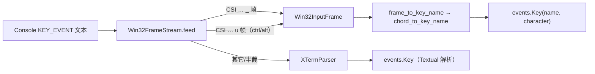

# win-kitty-chord-fix：Windows 和弦驱动双协议冲突修复方案（issue IKPTMH）

> 来源：`.trae/reviews` 无对应记录；issue 正文
> <https://gitee.com/jermaine/yate/issues/IKPTMH>（2026-10-23）。
> 关联计划：[`win-keybinding-protocol-plan.md`](./win-keybinding-protocol-plan.md)（D1 / D3 / P3.2）。
> 执行方式：用户授权无人值守执行（免逐步批准），仍按 `task-orchestration.md`
> §二 闭环推进并逐步提交。

## 一、目标与非目标

**目标**

1. 修复 WezTerm（`enable_kitty_keyboard = true`）下 `alt+shift+p` / `alt+shift+s`
   等和弦失效、并在约 100ms 后回放 `[112;4u` 类杂散字符的回归。
2. 使 `Win32FrameStream` 具备 kitty CSI-u（`u` 终止符）帧的识别与归一化能力，
   与 win32 `_` 帧共用同一条 `chord_to_key_name` 命名管线（plan D1 / P3.2 的
   分帧器契约补齐）。
3. 明确「同一次会话只启用一种键盘协议」的决策，并写入协议计划 D3。

**非目标**

- 不实现 `CSI ? u` 查询式协商状态机（plan P5，独立立项）。
- 不改 `key_protocol` 取值语义（仍为 `auto` / `legacy`）。
- 不改 Textual 私有 API 网关（`textual_internals.py`）。
- 不新增 `:keys` 面板 / `[keyboard]` diag（plan P7，未落地）。

## 二、事实与根因（取证）

| # | 事实 | 位置 |
|---|---|---|
| F1 | 和弦驱动在启动序列里同时推送 kitty（`\x1b[>1u`）与 win32-input-mode（`\x1b[?9001h`） | `yate/keyproto/driver_windows.py:272-279` |
| F2 | Textual 原生 Windows 驱动只推 kitty、不推 `?9001h` | `.venv/Lib/site-packages/textual/drivers/windows_driver.py:95-101` |
| F3 | 分帧器只认 `_` 终止帧；kitty `u` 终止序列整段作为残余进入 `XTermParser` | `yate/keyproto/frames.py:37`、`:44` |
| F4 | Textual 8.2.8 的 `_re_extended_key` 能解析完整的 `CSI 112;4u`（实测得到 `Key alt+shift+p`），但 ESC 超时重放路径会把拆包的序列按字符重放 | `textual/_xterm_parser.py:41-43`、`:176-198`、`:233-244`；实测见下 |
| F5 | 停止序列的 kitty pop（`\x1b[<u`）由父类 `stop_application_mode` 写出，本驱动经 `super()` 调用，**并未缺失**（issue 的次要缺陷描述与代码不符） | `yate/keyproto/driver_windows.py:288-293` + `windows_driver.py:122-134` |
| F6 | 协议计划 D3 明确禁止「同时开两种」（双份事件 / 优先级不确定） | `win-keybinding-protocol-plan.md:219` |

实测取证（Textual 8.2.8，`.venv`）：

```text
>>> XTermParser().feed("\x1b[112;4u")
Key alt+shift+p None
```

结论：`?9001h` + `>1u` 双推送违反 D3；kitty 感知终端（WezTerm）一旦响应 kitty 推送，
编码优先级移向 kitty，`CSI … u` 序列进入不含 kitty 帧处理的分帧器/legacy 解析链路，
在拆包（ESC 先到、其余后到）时被 ESC 超时机制按字符重放，即 issue 症状。

## 三、备选方案与否决理由

| 方案 | 内容 | 结论 |
|---|---|---|
| A（采纳） | 启动只启用一种协议：Windows 下只推 `?9001h`，不再推 `>1u`；同时补齐分帧器对 kitty `u` 帧的归一化（残留 kitty 模式下仍可解码） | 采纳：直接消除双协议优先级冲突（D3），且对「上一次会话崩溃留下的 kitty 残留」有防御 |
| B | 启动前发 `CSI ? u` 查询，有应答才推 kitty、否则推 win32 | 否决：需要运行期协商状态机 + 输入线程先于协议推送，属 plan P5 范围；本轮无人值守执行不宜引入时序型启动逻辑，且无真机 WezTerm 可验证 |
| C | 只删 `>1u`、不补 kitty 帧解码 | 否决：遗留 kitty 状态（崩溃残留 / 其他转发层）下仍会把 `CSI … u` 交给 legacy 解析器，缺陷类未闭合 |
| D | 自己解码全部 kitty 序列（含导航/F 键/文本键） | 否决：与 Textual 解析器重复实现、存在语义漂移；只需覆盖 yate 可命名的 ctrl/alt 和弦，其余原样交给解析器 |

## 四、设计

### 4.1 启动协议（`driver_windows.py`）

- 删除 `self.write("\x1b[>1u")`；只保留 `\x1b[?9001h`。
- 模块 docstring 与 `start_application_mode` docstring 记录「只启用一种协议」，
  并说明 kitty pop 由父类 teardown 写出（F5）。
- 停止序列不变（`\x1b[?9001l` + `super()`）。

### 4.2 分帧器（`frames.py`）

- 新增 kitty 帧识别：`_KITTY_FRAME_RE = \x1b\[([0-9:;]+)u`。
- 只翻译 **带 ctrl 或 alt** 且键码落在 yate 命名集合内的帧（字母 / 数字 / space /
  `/ \` [ \ ]`）；super/hyper/meta 或未命名键码 → 原样留在残余，交给 Textual。
- 翻译结果复用 `Win32InputFrame`（VK + `dwControlKeyState` 位 + 字符），因此
  命名仍走唯一的 `frame_to_key_name` → `chord_to_key_name` 管线（D1 收敛）。
- kitty 修饰键位（`1+shift|alt|ctrl`）→ win32 位（`SHIFT_BIT` / `ALT_BITS` / `CTRL_BITS`）。
- `event=3`（release）→ `flags=0`，随 `is_key_down` 丢弃，避免双触发。
- 保留前缀 `_HOLD_RE` 扩展为 `\x1b\[[0-9;:]*\Z`，跨 read 边界的半截 kitty 帧也被
  保留到下一次 feed。

### 4.3 数据流



## 五、分步实施

### 步骤 1：分帧器扩展

- 输入：`yate/keyproto/frames.py`
- 改动：kitty 正则/解码/翻译、`_HOLD_RE` 加 `:`、模块 docstring 一段说明。
- 验收：`.venv\Scripts\python.exe -m pytest tests/test_keyproto.py -q`

### 步骤 2：驱动协议收敛

- 输入：`yate/keyproto/driver_windows.py`
- 改动：删 `\x1b[>1u` 写入；docstring 记录单协议决策与 teardown 的 pop 归属。
- 验收：`.venv\Scripts\python.exe -m pytest tests/test_keyproto.py -q`

### 步骤 3：测试

- 输入：`tests/test_keyproto.py`
- 新增用例：
  - `test_frame_stream_translates_kitty_chords_to_canonical_names`：
    `\x1b[112;4u` → `alt+shift+p`；`\x1b[49;5u` → `ctrl+1`；`\x1b[101;6u` → `ctrl+shift+e`；
    `\x1b[47;3u` → `alt+/`；`\x1b[32;5u` → `ctrl+space`。
  - `test_frame_stream_leaves_untranslatable_kitty_sequences_to_the_parser`：
    无修饰 `\x1b[97u`、仅 shift `\x1b[112;2u`、未命名键码 `\x1b[57358;5u`、super 位
    `\x1b[97;9u` 均原样留在残余。
  - `test_frame_stream_drops_kitty_release_events`：`\x1b[112;4:3u` → 帧但 name/char 均为空。
  - `test_frame_stream_holds_partial_kitty_sequence`：`\x1b[112` + `;4u` 跨 feed 解码。
  - `test_windows_driver_enables_one_keyboard_protocol`：源码文本断言含 `?9001h`、
    不含 `>1u`（与 `test_support_mouse_gate_lives_in_app_on_event` 同型守卫）。
- 验收：`.venv\Scripts\python.exe -m pytest tests/test_keyproto.py -q`

### 步骤 4：协议计划回填

- 输入：`.trae/documents/win-keybinding-protocol-plan.md`
- 改动：D3 增补 2026-10-23 校准（issue IKPTMH：Windows 和弦驱动只启用 win32-input-mode，
  kitty 不推送；分帧器 `u` 终止符落地）。
- 验收：纯文档，按 `misc-rules.md` §三 豁免测试。

### 步骤 5：门禁与提交（主代理亲自）

```powershell
.venv\Scripts\python.exe -m pyright yate/ tests/ tools/ pack/
.venv\Scripts\python.exe -m pytest tests/ -q -n auto
.venv\Scripts\python.exe -m pytest tests/test_architecture.py -q
.venv\Scripts\python.exe -m pytest tests/ --cov=yate --cov-branch -n auto
.venv\Scripts\python.exe -m tools.smoke_test run --jobs 4
```

按 `task-orchestration.md` §二 提交纪律逐步提交；不推送。

## 六、风险与回滚

| 风险 | 影响 | 缓解 / 回滚 |
|---|---|---|
| 移除 kitty 推送使「只支持 kitty、不支持 win32-input-mode」的 Windows 终端退回 legacy | 该类终端失去 ctrl+数字等 CK 级能力 | 与 stock 之前行为不同但安全（legacy 路径保留）；`key_protocol` 逃生门不变；后续 P5 协商可恢复 |
| kitty 帧翻译与 Textual 解析语义不一致 | 个别键名漂移 | 只翻译 ctrl/alt + 可命名键；其余整段交还解析器；用例覆盖 |
| 半截序列保留导致延迟 | 最多一次 read 周期 | 保留仅限 `ESC[` 前缀，`_PENDING_MAX` 上限不变 |
| 回滚路径 | — | 单笔 revert（两个源文件 + 测试 + 文档），无数据/配置迁移 |

## 七、执行结果回填（2026-10-23）

**偏离与修正**

1. F5 推翻 issue 的"次要缺陷"：`stop_application_mode` 经 `super()` 已写出
   `\x1b[<u`，**未缺失**。本轮不改该路径，仅在注释中标注归属，避免与上游
   teardown 顺序分叉（不改代码）。
2. 未采用 issue 修复方向 1 的"先发 `CSI ? u` 查询"分支：属 plan P5 协商状态机，
   本轮按 issue 允许的第二分支（Windows 默认不推 kitty）落地；P5 仍需另行立项。
3. 方案 A 额外补了 issue 修复方向 2（`u` 终止符解码）作为残留 kitty 状态的防御，
   但**只翻译带 ctrl/alt 的可命名键**；导航/F 键/多码点文本等一律原样交还
   Textual 解析器，避免与上游 kitty 解码语义分叉。

**实测门禁（worktree `.venv`，Python 3.13.2 / Textual 8.2.8）**

| 门禁 | 命令 | 结果 |
|---|---|---|
| 单元 | `pytest tests/test_keyproto.py -q` | 20 passed |
| pyright | `pyright yate/ tests/ tools/ pack/` | 0 errors, 0 warnings |
| 全量 | `pytest tests/ -q -n auto` | 全绿（含 11 条既有 skip） |
| 架构 | `pytest tests/test_architecture.py -q` | 36 passed |
| 覆盖率 | `pytest tests/ --cov=yate --cov-branch` | 92.03%（门槛 75%） |
| 冒烟 | `python -m tools.smoke_test run --jobs 4` | 112/112 scenarios，1354/1354 checks |

**新增测试**（`tests/test_keyproto.py`）：kitty 和弦翻译、不可翻译序列透传、
release 丢弃、跨 feed 半截序列、驱动单协议源码守卫，共 5 条。

## 八、PR 预审查修复回填（2026-10-24）

pr-review（base=master）发现 1 项 MAJOR + 2 项 MINOR，本轮回填 MAJOR 与
int 上限加固（MINOR 3 仍留 P3/P5 `kitty.py` 跟进）。

**MAJOR：kitty 和弦帧不得伪造可打印字符**

- 根因比审查初稿更深一层：`str.isprintable()` 对空串**恒为 True**（vacuously
  true），因此即使把 UCS 字段置 0、`char_text` 返回 `""`，`Key(..., character="")`
  仍是 `is_printable=True`——修复必须同时把"无字符"归一为 `None`。
- 落点 1：`_kitty_to_win32_frame` 的 `char` 默认值由 `code` 改为 `0`，与真实
  win32 弦帧（如 `\x1b[49;2;0;1;40;1_`，UCS=0）一致；只有显式 text 字段才产生字符。
- 落点 2：驱动两处 `deliver` 改 `character=... or None`，使合成事件与 Textual 自身
  解析 `\x1b[112;4u` 的结果（`character=None`）一致，杜绝对
  `diff_pane.py` 的 `is_printable` 插入分支与终端转发泄漏字符。
- 证据：`Key("alt+shift+p", character="").is_printable is True`、
  `Key(..., character=None).is_printable is False`；
  Textual 解析 `\x1b[112;4u` → `character=None`。

**MINOR：超长参数串在 int() 前丢弃**

- 审查建议的 `return None` **不足**：`textual/_xterm_parser.py:366-374` 的
  `_parse_extended_key` 对同一串还会 `int()` 并同样抛 `ValueError`；故改为在
  `Win32FrameStream.feed`（`_` 帧）与 `_split_kitty_frames`（`u` 帧）中，对
  `len(参数) > _PENDING_MAX` 的匹配**整段丢弃**（保留其前后文本），`int()` 永不
  见到超长串。实测 Python 3.13 对 5000 位串抛
  `ValueError: Exceeds the limit (4300 digits)`；驱动外层 `except` 会让输入线程结束。

**测试变更**：`test_frame_stream_translates_kitty_chords_to_canonical_names` 断言
`frames[0].char == 0` / `frame_to_char == ""`；新增
`test_frame_stream_drops_pathological_overlong_frames`（`_` 与 `u` 两种）与
`test_synthesized_chords_never_look_printable`（含两处驱动归一化源码守卫）。

**复测门禁（worktree `.venv`）**

| 门禁 | 命令 | 结果 |
|---|---|---|
| pyright | `pyright yate/ tests/ tools/` | 0 errors, 0 warnings |
| 单元 + 架构 | `pytest tests/test_keyproto.py tests/test_architecture.py -q -n 0` | 58 passed |
| 全量 | `pytest tests/ -q -n auto` | 全绿，exit 0 |

