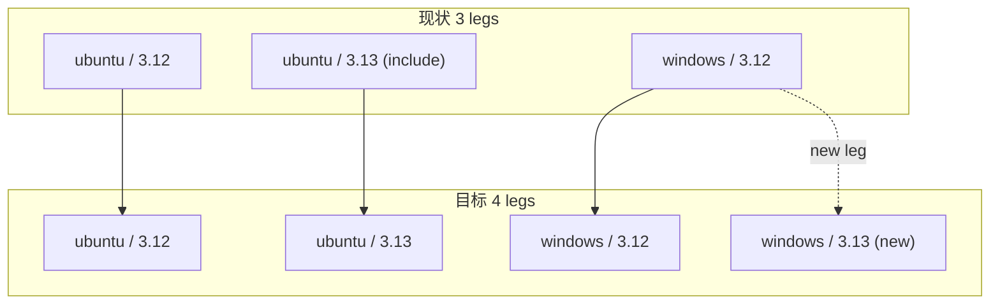

# windows-py313-ci-plan

> 任务来源：用户 2026-11-05「为 Windows 平台也添加 py13 环境测试」。
> 状态：方案待批准；批准后按选定范围实施。
> 关联：[ci-worksteal-timeout-plan.md](ci-worksteal-timeout-plan.md)（去掉 worksteal + 修文件管理器父目录膨胀，本次新腿的前置稳定性条件）。

## 一、目标与非目标

**目标**

1. GitHub Actions 的 `test` job 从 3 条腿扩到 **4 条**：`ubuntu-latest × {3.12, 3.13}` +
   `windows-latest × {3.12, 3.13}`；
2. 清除 `../../.github/workflows/test.yml` 里「3.13 只在 Linux」的过时注释，保留
   py3.13 的 tree-sitter 约束说明；
3. 配置改动可解析、既有门禁不回退。

**非目标**

- 不改 `smoke` job（Windows / 3.12 独立 UI 冒烟）与 `lint` job（Ubuntu / 3.12，
  `--pythonplatform Windows` 是 pyright 分析平台开关，与 runner Python 版本无关）；
- 不改 Gitee 流水线 `../../.workflow/test.yml`（Linux / 3.12；其注释「pyright 与
  3.13 腿只在 GitHub 跑」在新增 Windows 3.13 后语义仍成立，只是复数，属随下次
  修改迁移的存量措辞）；
- 不加 macOS 腿（审计 A14 明确「macOS 视用户群需求」，用户未要求）；
- 不改 worker 数 / `timeout-minutes` / 覆盖率阈值；
- 不改 CHANGELOG（changelog gate 实测 exit 0，unreleased 段滞后为既有状态，
  按 release 刷新；历史 CI 改动提交同样不改 CHANGELOG）。

## 二、调研事实（每条带证据）

| # | 事实 | 证据 |
|---|---|---|
| 1 | 当前 3 条腿：`include` 只补了 Ubuntu 3.13 | `../../.github/workflows/test.yml:49-57` |
| 2 | A14 原始审计建议就是「矩阵扩为 os × python [3.12, 3.13]」，实施时按 cost control 只落 Linux 3.13 | `.trae/reviews/2026-10-07-repo-architecture-audit.md:177`；`repo-audit-fixes-plans/repo-audit-fixes-ci-plan-e.md:31-46` |
| 3 | 本机开发即 Windows / Python 3.13.2，且刚跑过全量五项门禁全绿 | `.venv\Scripts\python.exe -V` → `Python 3.13.2`；`ci-worksteal-timeout-plan.md` §七（pyright 0 / pytest exit 0 / 架构 37 / 覆盖率 92.84% / 冒烟 121·1463） |
| 4 | py3.13 的 tree-sitter 堆损坏由 `<0.26` 上界守住，Windows 同适用 | `../../pyproject.toml:32` 与 `:72-78` 注释；`../../.github/workflows/test.yml:53-54` |
| 5 | 新腿不会复现 2026-11-05 的 `WaitForScreenTimeout` | 上一轮已去掉 `--dist=worksteal` 并把 `tests/test_file_manager.py` 的 workspace 根嵌套一层，父目录恒定 1 个兄弟 |
| 6 | 无测试断言 CI 矩阵；changelog gate 现状 exit 0 | `git grep matrix -- tests` 仅命中无关用例名；`python -m tools.changelog check` → `released changelog sections are up to date` / exit 0 |
| 7 | PyYAML 6.0.3 在本机 venv 可用，可做一次性结构验收 | `.venv\Scripts\python.exe -c "import yaml"` |

## 三、备选方案与否决理由

| 方案 | 内容 | 裁决 |
|---|---|---|
| A. 全矩阵 2×2 | `python-version: ['3.12', '3.13']` 进主轴，删除 `include` 块与 cost-control 注释，改写为双平台双版本说明 | **推荐**。正是 A14 原始建议；4 组合一目了然；清除过时注释 |
| B. 追加 include 条目 | 保留 `include`，补 `- os: windows-latest, python-version: '3.13'` | 否决。腿数与成本完全相同，但矩阵仍像「例外补丁」，且「Linux leg only」注释照样要改，可读性更差 |
| C. 单独加一个 job | 复制 `test` job 的四步配置专跑 Windows 3.13 | 否决。重复配置，未来漂移 |
| D. 连 smoke / lint 一起切 3.13 | 三个 job 都扩版本 | 否决。用户说的是「环境测试」= pytest 矩阵；lint 的 `--pythonplatform Windows` 与 runner 版本无关；冒烟翻倍成本无实证需求 |
| E. 给 `test_gate_config.py` 加矩阵文本守卫 | 断言 4 条腿 | 否决（本轮）。PyYAML 非项目显式依赖，纯文本断言易脆；改用一次性 YAML 解析验收，不新增长期维护面 |

## 四、实施步骤

### 步骤 1：方案文档

- 输入：本文件；输出：`docs(plan)` 单独提交。

### 步骤 2：CI 矩阵（唯一代码文件 `../../.github/workflows/test.yml`）

- 动作：`strategy.matrix` 改为
  ```yaml
        matrix:
          os: [ubuntu-latest, windows-latest]
          python-version: ['3.12', '3.13']
  ```
  删除 `include` 块；把 4 行注释改写为「两条 OS 各跑 3.12 / 3.13；`tree-sitter<0.26`
  pin 守住 py3.13 堆损坏；覆盖率 `fail_under` 单源在 pyproject」。
- 验收命令：
  ```powershell
  .venv\Scripts\python.exe -c "import yaml, pathlib, itertools; d=yaml.safe_load(pathlib.Path('.github/workflows/test.yml').read_text()); m=d['jobs']['test']['strategy']['matrix']; print(sorted(itertools.product(m['os'], m['python-version'])))"
  .venv\Scripts\python.exe -m pytest tests/test_gate_config.py -q -n 1
  .venv\Scripts\python.exe -m tools.changelog check
  ```
- 期望：4 组合 `(ubuntu-latest, 3.12) / (ubuntu-latest, 3.13) / (windows-latest, 3.12) / (windows-latest, 3.13)`；
  门禁用例 5 passed；changelog gate exit 0。

### 步骤 3：收尾门禁与提交

```powershell
.venv\Scripts\python.exe -m pyright yate/ tests/ tools/ pack/
.venv\Scripts\python.exe -m pytest tests/ -q -n auto
.venv\Scripts\python.exe -m pytest tests/test_architecture.py -q
.venv\Scripts\python.exe -m pytest tests/ --cov=yate --cov-branch -n auto
.venv\Scripts\python.exe -m tools.smoke_test run --jobs 4
```

- 回填本文件 §六真实数字，按 `git-commit-message.md` 单独提交（`ci(test)`），
  **只提交、不推送**（推送需用户显式要求）。

## 五、风险与回滚

| 风险 | 缓解 |
|---|---|
| CI 成本 3 腿 → 4 腿（+1 runner / 次） | 用户明确要求；`fail-fast: false` 保证单腿失败不取消其它腿 |
| Windows py3.13 墙钟逼近 `timeout-minutes: 15` | 上一轮 CI Ubuntu py3.13 为 470.74s（含 3×30s 超时）；去掉 worksteal 有尾部空转增量但预算仍有余量；首轮 CI 观察后再定是否调预算 |
| py3.13 依赖在 Windows 上表现不同 | 本机 Windows 3.13.2 已完成全量门禁实证；`tree-sitter<0.26` pin 保持 |
| 覆盖率 `fail_under=75` 在两条平台腿口径不同 | `../../pyproject.toml:160-171` 已记录：Linux 总覆盖率仅在 CI 可见，阈值取 75 以兼容互斥分支；本机 Windows 实测 92.84% |

回滚路径：单文件、单笔提交，`git revert` 即整体回退；无产品代码与依赖变更。

## 六、矩阵（Mermaid）



## 七、执行记录（收尾回填，2026-11-05）

- [x] 步骤 1 方案文档：提交 `e1064cf`。
- [x] 步骤 2 矩阵改动：提交 `66fc2f9`（唯一代码文件 `../../.github/workflows/test.yml`）。验收实测：
  - PyYAML 解析 `strategy.matrix` → 4 组合 `(ubuntu-latest, 3.12/3.13)` +
    `(windows-latest, 3.12/3.13)`，`include` 消失；`Run pytest suite` 仍为
    `python -m pytest tests --cov=yate --cov-branch --cov-report=term-missing -n auto`
    （无 worksteal）；`jobs` 仍为 `lint / smoke / test`；`timeout-minutes: 15` 未变；
    `YAML_ASSERTIONS=OK` / exit 0。
  - `pytest tests/test_gate_config.py -q -n 1` → 5 passed / exit 0；
    `python -m tools.changelog check` → exit 0。
- [x] 步骤 3 全量门禁（主代理亲跑，退出码均为 0）：

  | 门禁 | 实测 |
  |---|---|
  | `python -m pyright yate/ tests/ tools/ pack/` | 0 errors / 0 warnings / 0 informations |
  | `python -m pytest tests/ -q -n auto` | exit 0（本环境 `-q` 无汇总行，按退出码为准） |
  | `python -m pytest tests/test_architecture.py -q` | 37 passed |
  | CI 原命令（含 `--cov-report=term-missing`） | 3382 passed / 10 skipped，TOTAL 92.86%，`fail_under=75` 通过，149.64s |
  | `python -m tools.smoke_test run --jobs 4` | 121/121 scenarios，1463/1463 checks，78.59s |

- [x] 提交状态：本任务三笔（`e1064cf` 方案 / `66fc2f9` 代码 / 本回填），
  **只提交、不推送**。

### 环境事实（非偏离）

- 本任务开工时 `origin/master` 已同步到 `7072a39`（上一轮 worksteal 修复的 5 笔
  已被推送，非主代理执行），故开工时 `master` 仅 ahead 1；本任务未执行 `git push`。
- Windows / py3.13 腿的**实际 CI 墙钟尚未观测**：需推送后看 GitHub Actions；
  以现有 470s 基线对 15min 预算仍有余量，若新腿超时再评估 `timeout-minutes`。

### 偏离记录

- 无。范围、文件清单、验收命令均按批准的方案 A 执行；未加矩阵文本守卫
  （§三 E 已否决），未改 smoke / lint / Gitee 流水线。
