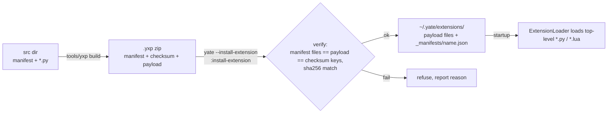
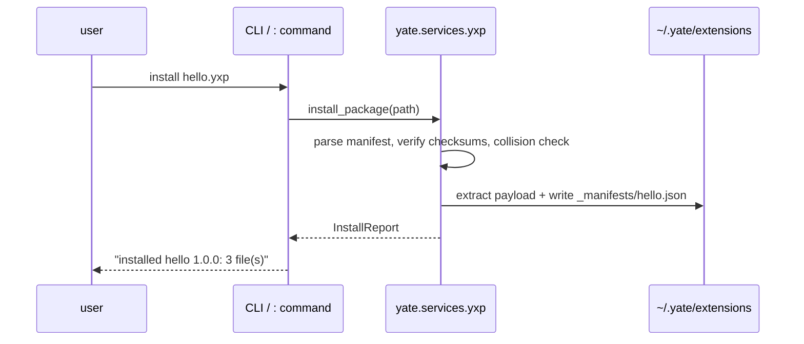

# yxp-package-plan — Extension packages (.yxp), issue IKL74M

Source: <https://gitee.com/jermaine/yate/issues/IKL74M> (Enhance — extension
system STEP 2, follow-up of IKK4K6 STEP 1, which is already merged into
master). Branch `feat/yxp-package`, worktree `../yate-yxp-package`
(fresh venv, sandbox verified: `import yate` resolves to the worktree).

**Unattended mode note**: the user explicitly requested the full
plan → execute → review → fix → commit → push loop unattended; that
instruction is the plan approval for this document (deviation from the
interactive 【批准】 step is deliberate and recorded here).

## 1. Goal

- A standard extension-package format: a zip file named `*.yxp`
  (Yate eXtension Package) containing payload files plus two metadata
  members: `manifest` (file list + package metadata) and `checksum`
  (per-file SHA-256).
- A packaging tool under `tools/`: `python -m tools.yxp build|verify`.
- yate CLI flags: `--install-extension FILE`, `--uninstall-extension NAME`,
  `--list-extensions` (side commands, print a report and exit).
- Editor `:` commands: `:install-extension FILE`, `:uninstall-extension NAME`,
  `:list-extensions`.
- Installation = verify + extract the payload into `~/.yate/extensions/`.
- When `manifest` / `checksum` are present in a package, loading (install)
  must verify the file list and checksums. (The issue text writes
  `--list-exnteions`; the typo is fixed to `--list-extensions`.)
- Detailed bilingual documentation and a buildable example package.

## 2. Non-goals

- No signatures / author trust chains (plain SHA-256 only, per the issue).
- No remote registry or network install.
- No changes to the startup loader: `ExtensionLoader` keeps loading
  top-level `*.py` / `*.lua`; verification happens when a package is
  processed (install / verify), not on every editor start.
- No per-package subdirectories under `~/.yate/extensions/` (see §4.1).

## 3. Key facts from the code survey

| Fact | Where |
|---|---|
| Side-command pattern (parse → handle → exit, lazy imports) | [yate/cli.py](../../../yate/cli.py) `main()` — `--setup-defaults`, `--install-font` precedents |
| Loader globs only top-level `*.py` / `*.lua`, skips `_`-prefixed files; directories are never globbed | [yate/services/extensions/loader.py](../../../yate/services/extensions/loader.py) `load_directory` |
| `~/.yate/extensions` is a managed dir; `cleanup_defaults` removes it wholesale | [yate/services/user_setup.py](../../../yate/services/user_setup.py) `MANAGED_DIRS` |
| Builtin `:` commands register in `register_commands(registry, editor)`; commands may import `yate.editor` (R5) | [yate/commands.py](../../../yate/commands.py) |
| Multi-line output overlay exists: `OutputScreen(title, output, returncode)` | [yate/editor_view/modals.py](../../../yate/editor_view/modals.py) |
| `OverlayFlows` already imports `editor_view.modals` (R11-frozen) and is the L3 place to push screens | [yate/flows/overlay_flows.py](../../../yate/flows/overlay_flows.py) |
| `services/*` is UI-free (R4 guard surface `UI_FREE_PACKAGES`) — right layer for zip/hash/file logic | tests/test_architecture.py |
| Architecture tests cover `yate/` + `tools/`: 800-line guard, no relative imports, lazy %-formatting logs, PEP 695 type aliases | tests/test_architecture.py |
| Wheel ships only `yate/`; `tools/` is repo-side (dev), so the packaging tool does not need to ship in the wheel | pyproject.toml |

## 4. Design

### 4.1 Package format (.yxp)

A `.yxp` file is a plain zip (suffix communicates the role). Members:

- `manifest` — JSON:
  `{"name": "...", "version": "...", "description": "...", "author": "...", "files": ["<relpath>", ...]}`
  (`name` required, `^[A-Za-z0-9._-]+$`; `version` defaults `"0.1.0"`;
  `files` must equal the payload member set).
- `checksum` — JSON: `{"<relpath>": "<64-hex sha256>", ...}`; optional
  per the issue, but the bundled tool always writes it.
- payload: the extension files themselves (any relative paths; only
  top-level `*.py` / `*.lua` auto-load at startup, everything else is
  extracted as data).

Rejected member names: absolute paths, drive letters, `..` segments,
backslashes (zip convention is `/`).

### 4.2 Install model

- Payload extracts **flat** into `~/.yate/extensions/` (exactly what the
  issue asks; keeps `ExtensionLoader` untouched).
- Ownership record per installed package:
  `~/.yate/extensions/_manifests/<name>.json` — the full manifest +
  checksums + install timestamp. The records directory is invisible to the
  loader (directories are not globbed) and is removed together with the
  managed `extensions/` dir by `--cleanup-defaults`.
- Collision policy: a target file already on disk that is not owned by the
  same package name → refuse the install (list collisions). Reinstalling
  the same name is an upgrade: overwrite its files **and delete stale
  files** present in the old record but absent from the new manifest.
- `uninstall` removes exactly the recorded files (missing files are
  tolerated and reported), then the record. Unknown name → error.
- `list` reads all records, sorted by name.

### 4.3 Layering

- New L0 service `yate/services/yxp.py` (pure zip/hash/file logic; R4-safe
  because `services/*` is a UI-free guard package). Public surface:
  `YxpManifest`, `YxpPackage`, `InstallReport`, `UninstallReport`,
  `InstalledPackage`, `read_package`, `install_package`,
  `uninstall_package`, `list_packages`, `format_install_report`,
  `format_uninstall_report`, `format_package_list`, plus the
  `YxpError` exception family.
- `yate/cli.py`: three flags in one mutually-exclusive side group; lazy
  `from yate.services import yxp`; exit 1 on errors (existing convention).
- `yate/commands.py`: three `:` commands; multi-line output goes through a
  new `OverlayFlows.show_output(title, text)` (pushes `OutputScreen`),
  keeping `commands.py` free of `editor_view` imports.
- New tool package `tools/yxp/` (`__init__.py`, `__main__.py`, `cli.py`):
  `build` enumerates the source dir (skipping `manifest`, `checksum`,
  `__pycache__`, `*.pyc`), requires a `manifest` file carrying the
  metadata, regenerates `files` + `checksum` members; `verify` reuses
  `yate.services.yxp.read_package`.
- Example package source: `tools/yxp/example/hello_yxp/`.

### 4.4 Flow diagrams

## 5. Alternatives considered (rejected)

1. **Per-package subdirectory** (`~/.yate/extensions/<name>/`) — rejected:
   the loader only globs top-level files; making it recursive would change
   discovery semantics for every existing source, and the issue says
   "解压到 ~/.yate/extensions 目录下".
2. **Records under `~/.yate/data/`** — rejected: `data/` is runtime
   diagnostics; ownership belongs next to the installed files so
   `--cleanup-defaults` (which removes `extensions/`) stays consistent.
3. **Signature verification** — rejected: out of scope, the issue asks for
   manifest + checksum only.
4. **Startup re-verification of installed packages** — rejected: hash cost
   on every start for no stated requirement; can be added later on top of
   the records.
5. **Hand-authored `files` list in the source manifest** — rejected:
   error-prone; the tool computes the file list and rewrites the manifest.

## 6. Implementation waves

Files are disjoint inside a wave; waves a → (b ∥ c) → d.

### Wave a — L0 service + unit tests
- New: `yate/services/yxp.py`, `tests/test_yxp.py`
- Acceptance: `.venv\Scripts\python.exe -m pytest tests/test_yxp.py -q` green;
  `pyright yate/services/yxp.py tests/test_yxp.py` zero diagnostics.

### Wave b — CLI flags + `:` commands + output overlay
- Edit: `yate/cli.py` (parser + epilog + handlers),
  `yate/flows/overlay_flows.py` (`show_output`),
  `yate/commands.py` (three commands)
- Tests: extend `tests/test_cli.py` (flag parsing, mutual exclusion),
  `tests/test_yxp.py` (command registration, format helpers)
- Acceptance: `pytest tests/test_cli.py tests/test_yxp.py -q` green.

### Wave c — packaging tool + example
- New: `tools/yxp/__init__.py`, `tools/yxp/__main__.py`,
  `tools/yxp/cli.py`, `tools/yxp/example/hello_yxp/manifest`,
  `tools/yxp/example/hello_yxp/hello_yxp.py`
- Tests: `tests/test_tools_yxp.py` (build layout, exclusions, verify
  roundtrip, build→install integration)
- Acceptance: `pytest tests/test_tools_yxp.py -q` green.

### Wave d — docs (bilingual sync) + plan backfill
- Edit: `yate/docs/extensions.en.md`, `yate/docs/extensions.zh.md`
  (new "Extension packages (.yxp)" section: format, CLI, `:` commands,
  tools/yxp usage, security notes), this plan (results + deviations)
- Acceptance: pure docs; no test gate (misc-rules §三), but the full gate
  still runs once at close (mixed change set).

## 7. Risks / rollback

- Zip-slip / path traversal → member-name validation before any write;
  tests cover `..`, absolute, drive-letter, backslash cases.
- Overwriting user hand-placed files → collision check refuses; the user
  moves or removes the file first (message names the path).
- Rollback: feature is additive (one new service module, one new tool
  package, additive flags/commands); revert the branch.

## 8. Final gate

`python -m pyright yate/ tests/ tools/` zero diagnostics;
`python -m pytest tests/ -q` all green;
`pytest tests/test_architecture.py -q` all green;
smoke: build the example → install into a temp `~/.yate` → list →
uninstall, all via the real entry points.

## 9. Results (backfilled at close)

- Wave a: service module 437 lines, 41 unit tests in `tests/test_yxp.py`
  (covers manifest/checksum validation, zip-slip, tamper, collision,
  upgrade stale-file removal, uninstall, list, record persistence).
- Wave b: CLI flags `--install-extension/--uninstall-extension/
  --list-extensions` in one mutually exclusive group; `OverlayFlows.
  show_output()` added; three `:` commands registered; 6 new tests.
- Wave c: `tools/yxp` build/verify + example `hello_yxp`; 12 tests
  including build→install→list→uninstall integration.
- Wave d: bilingual docs section added; plan backfilled.
- Full gate: pyright 0 diagnostics; pytest 891 passed; architecture
  32 passed; smoke roundtrip OK; pr-review round 1 findings fixed.
