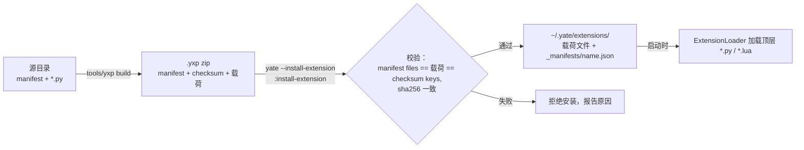
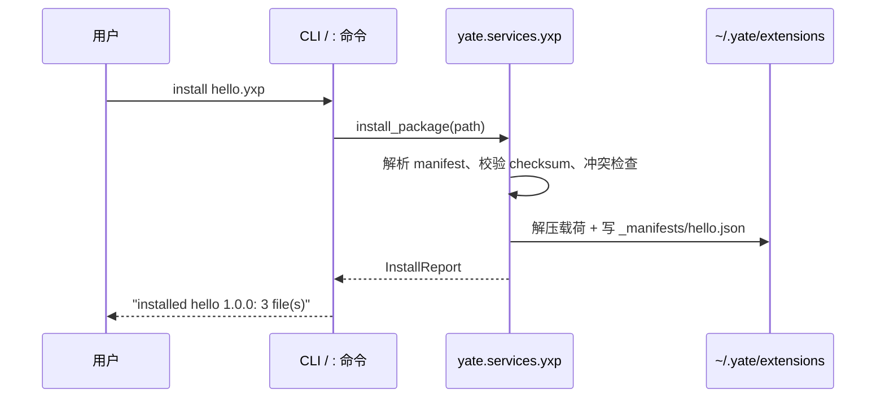

# yxp-package-plan — 扩展包 .yxp（issue IKL74M）

来源：<https://gitee.com/jermaine/yate/issues/IKL74M>（Enhance — 扩展系统
增强 STEP 2，承接已合入 master 的 IKK4K6 STEP 1）。分支 `feat/yxp-package`，
worktree `../yate-yxp-package`（独立 venv，已验证 `import yate` 指向本
worktree）。主 worktree（`d:\Programming\yate`）保持只读，仅用于参照。

**无人值守说明**：用户已明确指示按「领会 → 方案 → 执行 → 审核（pr-review
迭代至无 issue）→ 提交推送」闭环执行并全程无人值守；本方案文档即该指示下
的既定方案，交互式批准步骤按用户指令免除，特此记录。

## 1. 目标

- 标准扩展包格式：`*.yxp`（Yate eXtension Package）zip 包，内含载荷文件
  与两个元数据成员：`manifest`（文件清单 + 包元数据）与 `checksum`
  （逐文件 SHA-256）。
- `tools/` 下的打包工具：`python -m tools.yxp build|verify`。
- yate CLI 选项：`--install-extension FILE`、`--uninstall-extension NAME`、
  `--list-extensions`（side 命令，打印报告后退出）。
- 编辑器 `:` 命令：`install-extension` / `uninstall-extension` /
  `list-extensions`。
- 安装 = 校验 + 把载荷解压到 `~/.yate/extensions/`。
- 包内存在 `manifest` / `checksum` 时，安装（加载处理）必须校验文件清单
  与 checksum。issue 原文 `--list-exnteions` 为笔误，按
  `--list-extensions` 实现。

## 2. 非目标

- 不做签名 / 作者信任链（仅 SHA-256，按 issue 要求）。
- 不做远程源、网络安装。
- 不改启动加载器：`ExtensionLoader` 仍只扫描顶层 `*.py` / `*.lua`；校验
  发生在包处理（安装 / verify）时，而非每次启动。
- 不在 `~/.yate/extensions/` 下按包建子目录（见 §4.1）。

## 3. 调研事实清单

| 事实 | 位置 |
|---|---|
| side 命令模式（解析 → 处理 → 退出，惰性导入）| `yate/cli.py` `main()`，先例 `--setup-defaults` / `--install-font` |
| 加载器只 glob 顶层 `*.py` / `*.lua`，跳过 `_` 前缀；目录不参与 glob | `yate/services/extensions/loader.py` `load_directory` |
| `~/.yate/extensions` 是托管目录；`cleanup_defaults` 整目录移除 | `yate/services/user_setup.py` `MANAGED_DIRS` |
| 内置 `:` 命令在 `register_commands(registry, editor)` 登记；commands 可 import `yate.editor`（R5）| `yate/commands.py` |
| 多行输出浮层已存在：`OutputScreen(title, output, returncode)` | `yate/editor_view/modals.py` |
| `OverlayFlows` 已 import `editor_view.modals`（R11 冻结面），是 L3 推屏的正确位置 | `yate/flows/overlay_flows.py` |
| `services/*` 是 UI-free 守卫包（R4，`UI_FREE_PACKAGES`）——zip/哈希/文件逻辑的正确层级 | `tests/test_architecture.py` |
| 架构测试覆盖 `yate/` + `tools/`：800 行阈值、禁相对导入、日志惰性 %-format、PEP 695 type 别名 | `tests/test_architecture.py` |
| wheel 只打包 `yate/`；`tools/` 属仓库侧（开发工具），无需进 wheel | `pyproject.toml` |

## 4. 设计

### 4.1 包格式（.yxp）

`.yxp` 即普通 zip（后缀表明用途）。成员：

- `manifest` — JSON：`{"name", "version", "description", "author",
  "files"}`。`name` 必填且须匹配 `^[A-Za-z0-9._-]+$`（同时兼作安装记录
  文件名）；`version` 缺省 `"0.1.0"`；`files` 必须与包内载荷成员完全
  一致。
- `checksum` — JSON：`{"<相对路径>": "<64 位十六进制 sha256>", ...}`；
  按 issue 允许缺省，但官方打包工具总是写入。
- 载荷：扩展文件本体（相对路径任意；仅顶层 `*.py` / `*.lua` 会在启动时
  被自动加载，其余作为数据文件解压）。

非法成员名一律拒绝：绝对路径、盘符、`..` 段、反斜杠（zip 惯例用 `/`）、
保留目录 `_manifests/`。

### 4.2 安装模型

- 载荷**平铺**解压到 `~/.yate/extensions/`（issue 原文要求；加载器无需
  改动）。
- 归属记录：`~/.yate/extensions/_manifests/<name>.json` — 完整 manifest
  + checksums + 安装时间。记录目录对加载器不可见（目录不参与 glob），
  且随 `--cleanup-defaults` 一并移除。
- 冲突策略：目标文件已存在且不属于同名包 → 拒绝安装（列出冲突文件）。
  同名重装即升级：覆盖自家文件，并删除「旧记录有、新 manifest 无」的
  过时文件。
- 卸载严格按记录删文件（缺失容忍并上报），再删记录；未知名字报错。
- 列表读全部记录，按名字排序；损坏记录以 `error` 字段呈现而非整体
  失败。
- 失败回滚：提取中途失败时删除已写文件、不落记录，旧安装不受影响；
  记录只在全部载荷落盘后写入。

### 4.3 分层

- 新增 L0 服务 `yate/services/yxp.py`（纯 zip/哈希/文件逻辑；`services/*`
  在 R4 守卫面内）。公共面：`YxpManifest` / `YxpPackage` / `InstallReport`
  / `UninstallReport` / `InstalledPackage`、`read_package` /
  `install_package` / `uninstall_package` / `list_packages`、
  `format_install_report` / `format_uninstall_report` /
  `format_package_list`，以及异常族 `YxpError`。
- `yate/cli.py`：三个选项收进一个互斥组；惰性
  `from yate.services import yxp`；出错 exit 1（沿用既有约定）。
- `yate/commands.py`：三个 `:` 命令；多行输出走新增
  `OverlayFlows.show_output(title, text)`（推 `OutputScreen`），
  `commands.py` 保持不 import `editor_view`。
- 新工具包 `tools/yxp/`（`__init__.py` / `__main__.py` / `cli.py`）：
  旗标式 CLI（互斥）`--create NAME` / `--pack DIR` / `--verify FILE`。
  `--create` 生成源目录脚手架（`manifest` 元数据文件 + 起步扩展模块，
  `--dir` 选父目录、`--force` 替换既有脚手架）；`--pack` 枚举源目录
  （跳过 `manifest`、`checksum`、`__pycache__`、`.git`、`*.pyc`），要求
  源目录带 `manifest` 元数据文件，重算 `files` 与 `checksum` 成员
  （`--output` 自定输出、`--force` 覆盖）；`--verify` 复用
  `yate.services.yxp.read_package`。
- 示例包源码：`tools/yxp/example/hello_yxp/`。

### 4.4 流程图

## 5. 备选方案与否决理由

1. **按包建子目录**（`~/.yate/extensions/<name>/`）— 否决：加载器只
   glob 顶层文件；改成递归会改变所有现存源扩展的发现语义，且 issue 写
   明「解压到 ~/.yate/extensions 目录下」。
2. **记录放 `~/.yate/data/`** — 否决：`data/` 是运行时诊断区；归属记录
   应与被装文件同处，`--cleanup-defaults`（整删 `extensions/`）才能保持
   一致。
3. **签名校验** — 否决：超出范围，issue 只要求 manifest + checksum。
4. **启动时复验已装包** — 否决：每次启动都付哈希成本，issue 无此要求；
   记录结构已为将来扩展留好位置。
5. **源 manifest 手写 `files` 列表** — 否决：易错；工具负责计算文件
   列表并重写 manifest。

## 6. 实施波次

波内文件互不相交；顺序 a →（b ∥ c）→ d。

### Wave a — L0 服务 + 单元测试（已完成，commit 60f4878）
- 新增：`yate/services/yxp.py`、`tests/test_yxp.py`
- 验收：`pytest tests/test_yxp.py -q` 全绿（42 用例）；pyright 零诊断。
  覆盖：manifest/checksum 校验、zip-slip、篡改、冲突、升级清理过时
  文件、卸载、列表、记录损坏容错。

### Wave b — CLI 选项 + `:` 命令 + 输出浮层（代码完成，待提交）
- 修改：`yate/cli.py`（epilog + 互斥组 + 处理逻辑）、
  `yate/flows/overlay_flows.py`（`show_output`）、`yate/commands.py`
  （三个命令）；`tests/conftest.py` 提升 `make_yxp` 公共构造器；
  `tests/test_cli.py` 追加选项解析/互斥/main 级用例；`tests/test_yxp.py`
  追加命令注册与格式化用例。
- 验收：`pytest tests/test_cli.py tests/test_yxp.py -q` 全绿（91 用例）；
  pyright 零诊断（已实测通过）。

### Wave c — 打包工具 + 示例（已完成，commit b6f4518 + 旗标式改版）
- 新增：`tools/yxp/__init__.py`、`tools/yxp/__main__.py`、
  `tools/yxp/cli.py`、`tools/yxp/example/hello_yxp/manifest`、
  `tools/yxp/example/hello_yxp/hello_yxp.py`
- 测试：`tests/test_tools_yxp.py`（脚手架、build 布局、排除项、verify
  往返、build→install 集成、互斥旗标）
- 验收：`pytest tests/test_tools_yxp.py -q` 全绿（19 用例）。

### Wave d — 双语文档 + 方案回填
- 修改：`yate/docs/extensions.en.md`、`yate/docs/extensions.zh.md`
  （新增 "Extension packages (.yxp)" 章节：格式、CLI、`:` 命令、
  tools/yxp 用法、安全须知），本方案回填真实结果与偏离记录。
- 验收：纯文档；按 misc-rules §三豁免测试，但收尾仍跑一次全量门禁
  （混合变更集）。

## 7. 风险与回滚

- zip-slip / 路径穿越 → 写盘前逐个校验成员名；测试覆盖 `..`、绝对路径、
  盘符、反斜杠、保留目录。
- 覆盖用户手工放置的文件 → 冲突检查拒绝，错误信息点名路径，用户先行
  移除。
- 回滚：功能纯增量（一个新服务模块、一个新工具包、追加式选项/命令），
  整分支 revert 即可。

## 8. 收尾门禁

`python -m pyright yate/ tests/ tools/` 零诊断；`pytest tests/ -q` 全绿；
`pytest tests/test_architecture.py -q` 全绿；冒烟：构建示例包 → 装入
临时 `~/.yate` → list → uninstall，全程走真实入口。

## 9. 偏离记录

- 无设计偏离。执行纪律事故两次：Wave b 与 Wave d 部分编辑误落主
  worktree（`d:\Programming\yate`），均已即时把改动迁移回本 worktree 并
  还原主 worktree（`git checkout --`），主 worktree 复核干净；后续所有
  编辑一律显式指定 worktree 绝对路径。
- 用户补充设计（2026-10-14）：`tools.yxp` 由 `build` / `verify` 子命令
  改为旗标式 CLI `--create NAME`（新增脚手架能力，生成 manifest 元数据
  文件 + 起步扩展模块）/ `--pack DIR`（原 build）/ `--verify FILE`，
  三者互斥；`yxp.NAME_RE` 随之提升为公共常量供工具复用。文档与测试
  同步更新。
