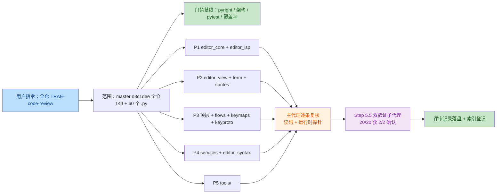
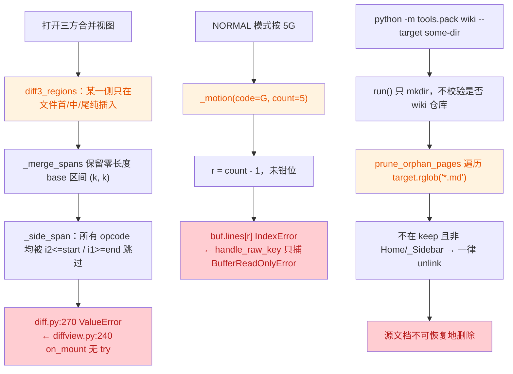

# 2026-10-20 全仓库 TRAE-code-review 审核（master `d8c1dee`，新 worktree 重跑）

- 分支：`enh/full-repo-trae-review`（worktree `../yate-full-repo-trae-review`，沙箱 `.venv` 新建重建并自证）
- 范围：按用户指令对**全仓库**执行 `TRAE-code-review` 技能审核（`yate/` 15 个包/目录 144 个 `.py`、
  `tools/` 60 个 `.py`；`tests/` 不逐行审，由门禁覆盖）；基线 = `master` `d8c1dee`
- 技能来源：IDE 内置技能 `TRAE-code-review`（`builtin_skills/TRAE-code-review/SKILL.md`）
- 形态：**只读事实文档**（doc-conventions §二.1）——只记录发现与核对结论，不含修复排期；
  修复动作若获批准，另立 `.trae/documents/<task>-plan.md`
- 交叉引用：前序全仓审核
  [`2026-10-18-full-repo-audit-r3.md`](2026-10-18-full-repo-audit-r3.md)、
  [`2026-10-17-full-repo-audit.md`](2026-10-17-full-repo-audit.md)、
  四技能联合审核 [`2026-10-17-four-skill-review.md`](2026-10-17-four-skill-review.md)

## 一、门禁复测（主代理亲跑，worktree 沙箱）

| 门禁 | 命令 | 结果 |
|---|---|---|
| pyright strict | `.venv\Scripts\python.exe -m pyright yate/ tests/ tools/` | **0 errors / 0 warnings / 0 informations**，exit 0 |
| 架构守卫 | `.venv\Scripts\python.exe -m pytest tests/test_architecture.py -q` | **36 passed**，exit 0（规则 §六 记载 35 条，实测 36 条） |
| 覆盖率 | `pytest tests/ -q --cov --cov-branch` | **92.06% ≥ 75%**，fail_under 通过 |
| 全量回归 | `.venv\Scripts\python.exe -m pytest tests/ -q` | 首轮（带 `--cov`）`1 failed`：`tests/test_manual.py::test_dismiss_within_debounce_window_leaves_no_pending_timer`；该用例**隔离复跑通过** → 判为 full-suite 负载下的 timing flake（`subagent-workflow.md` §三.3 已知形态）。第二轮全量复跑（不带 `--cov`）：进度 **100%**，日志 `FAILED|ERROR|failed` 命中数 **0**，**全绿** |

四道门禁无红线：pyright / 架构 / 覆盖率均全绿，唯一失败项经隔离复跑通过。

## 二、执行方式

按技能 Step 1–6 执行，评审分区并行、只读：

1. **分区（5 个只读 `code-explorer` 子代理，批内 3 + 2）**：
   P1 `editor_core` + `editor_lsp`；P2 `editor_view` + `editor_term` + `editor_sprites`；
   P3 `yate/` 顶层 16 模块 + `flows/` + `keymaps/` + `keyproto/`；
   P4 `services/`（含 `extensions/` 门面）+ `editor_syntax/` + `extensions/`；
   P5 `tools/`。任务书统一绑定 `.trae/rules/architecture-boundaries.md` 与
   `python-coding-style.md`，要求 `文件:行号 + 证据 + 可达性 + 严重度`，禁止纯描述/猜测类意见。
2. **主代理逐条复核**：20 条 BLOCKER/MAJOR 候选全部回读源码；其中 2 条用运行时探针实测
   （`diff3_regions` 四组输入全部抛 `ValueError`；`TextBuffer.paste` 三组粘贴的光标落点）。
3. **技能 Step 5.5 交叉验证**：2 个独立只读子代理对同一份 20 条清单并行判定
   `exists / severity / line_ok`，互不可见。结果 **20/20 均获 2/2 确认**（高置信）；
   严重度分歧 4 条按"取更保守方 + 标注"处理（见 §五）。

## 三、变更与缺陷分布

三条最高严重度缺陷的实际可达路径：

## 四、BLOCKER（3 条，2/2 交叉确认）

### B-1 `yate/editor_core/diff.py:269-270` — 三方合并在"单侧纯插入"时必抛 `ValueError`

- 证据（运行时探针实测，四组输入全部抛错）：
  `base=["a","b","c"]` + `local` 在行首/行中/行尾多一行、`remote` 未改，
  `diff3_regions(...)` → `RAISE ValueError base span [0,0) / [1,1) / [3,3) is not covered by opcodes`。
- 根因：`diff3_regions`（:179-182）把 `_merge_spans` 合并后的区间直接交给 `classify`，
  而 `SequenceMatcher` 的 `insert` opcode 的 base 区间是零长度 `(k, k)`；`_side_span` 的
  两个跳过条件（`i2 <= start continue` / `i1 >= end break`）对零长度区间把**所有** opcode 跳过，
  `pieces` 为空即 `raise`。
- 可达性：`yate/editor_view/diffview.py:240` 在 `_recompute()` 中无 `try`，由
  `on_mount`（:153）直接调用——即"打开一个某侧仅在末尾追加一行的三方合并"就崩。
  `tests/test_editor_core_diff.py:105-124` 三条用例全是等长替换型，插入路径零覆盖。
- 建议：`start == end` 时返回 `(j, j)` 折叠映射（把插入点映射到对侧同位置），不落到 `raise`。

### B-2 `yate/keymaps/vim.py:1241` — `{count}G` 越界 `IndexError`（异常冒出按键泵）

- 证据：`if count is not None: r = count - 1`（:1241）→ `first_non_blank(buf.lines[r])`（:1248）/
  `len(buf.lines[r])`（:1245）。`set_cursor` 的钳位发生在**参数求值之后**，
  3 行文件里按 `5G` 即 `buf.lines[4]` 越界。
- 可达性：`_MOTION_CODES` 含 `"G"`（:53），NORMAL 分支 `_handle_normal`（:716-719）
  直接传 `_typed_count()`；`yate/editor.py::handle_raw_key`（:801-811）只捕
  `BufferReadOnlyError` → 异常进入 Textual `on_key`。
- 对照：同文件的 `_resolve_gg`（:1016）已做 `min(target-1, len-1)`，可见是漏钳位而非设计。
- 建议：`r = max(0, min(count - 1, len(buf.lines) - 1))`，并补 `5G` 越界用例。

### B-3 `tools/pack/wiki.py:467-480` — `prune_orphan_pages` 无条件删除 target 下全部非生成 `*.md`

- 证据：`for existing in target.rglob("*.md")` 中，除 `.git` 路径与
  `Home.md` / `_Sidebar.md` / `Home.en.md` / `_Sidebar.en.md` 四个保护名，其余一律 `unlink()`；
  `run()`（:1419-1467）只 `target.mkdir(parents=True, exist_ok=True)` 后即调用
  `prune_orphan_pages(target, expected)`，**不校验 target 是否 wiki 仓库**（不查 `.git`、不要求 manifest）。
- 可达性：`tools/pack/cli.py:105-112` 的 `--target` 只当普通目录用；
  `wiki --target .`（或 `--target .trae/documents`）会把仓库内源 Markdown 全部删除。
- 建议：prune 前断言 `(target/".git").exists() or target 为空目录`，并拒绝位于 `repo_root` 内的 target。

## 五、MAJOR（9 条）

| # | 位置 | 问题 | 证据要点 | 验证 |
|---|---|---|---|---|
| M-1 | `yate/editor_core/buffer.py:1063-1067` | 行式粘贴（register 以 `\n` 结尾）文档中部 `p`/`P` 后光标落在粘贴块**下一行**，且 count 粘贴（`3p`）块序交错 | 探针：`["aaa","bbb","ccc"]` + 光标 `(1,0)` + 寄存器 `"aaa\n"` → 行正确但光标 `(3,2)`（应为 `(2,3)`）；末行分支（:1052）正确 | 2/2（A 判 MINOR，取保守 MAJOR） |
| M-2 | `yate/editor_lsp/parsing.py:215` | `for entry_raw in cast(list[Any], raw)`：`diagnostics` 为 `null`/缺失时 `TypeError` | `manager.py:550` 传 `params.get("diagnostics")`；`client.py:471-491` 读循环兜底 `except` → `_fail_pending` + `state=FAILED`，与函数 docstring（:191-196）"单条畸形通知不杀连接"自相矛盾 | 2/2 |
| M-3 | `yate/editor_lsp/manager.py:136-137` | 同名服务器重注册时旧 `LspClient` 只 `pop` 不 `stop` → 语言服务器子进程泄漏 | `shutdown_all`（:631）只遍历 `self._clients`，被摘除项再无人清理；`client.stop()` 是唯一终止子进程路径 | 2/2 |
| M-4 | `yate/editor_view/terminal.py:315` | `render_line` 每行都调 `emulator.view_lines()`（`editor_term/emulator.py:755-778` 逐行 `list(line)` 复制全部 rows）→ 每帧 O(rows²·cols) 复制 | Textual 每帧逐行调 `render_line`；`view_lines` 的注释只避免了行指针拼接，未避免单元复制 | 2/2 |
| M-5 | `yate/flows/document_flows.py:400` | `:saveas` 用 `Path(text)`，未走同文件 `resolve_input_path`（:101-115，`expanduser` + workspace 根） | `:e` / 异步打开均走 `resolve_input_path`；Windows shell 把 `~` 原样传入 → 落成字面 `~` 目录或按进程 cwd 解析 | 2/2（A 判 MINOR，取保守 MAJOR） |
| M-6 | `yate/yaterc.py:201-208` | 三个 `_extract_*` 在 `exec` 的 `try` 之外；`yaterc_options.py:236` `sorted(...)` 遇混合类型键抛 `TypeError` → 启动崩溃 | 与 `yaterc.py:195` "rc 错误只进 `config.errors`"契约冲突 | 2/2 |
| M-7 | `yate/services/fonts.py:387-388` | `cast(dict[str, Any], data.setdefault("profiles", {}))` 运行期无效；旧版 WT `"profiles": [...]` 时 `profiles.setdefault` 抛 `AttributeError` | `configure_windows_terminal` 的 `try` 只覆盖读/写；`ensure_font` 无捕获，破坏 `(bool, message)` 契约 | 2/2 |
| M-8 | `yate/services/yxp.py:309` | `_verify_digests` 对每个成员 `zf.read(name)` 全量读入内存，全文件无 `file_size`/总量上限 | `.yxp` 是外部输入；高压缩比成员可在校验阶段内存耗竭 | 2/2 |
| M-9 | `tools/changelog/cli.py:136-140` | `--check` 下**任何** `GitError` 都 `return 0`（打印 SKIP），而 `gitdata.py:47` 的 15s 超时也抛 `GitError` | 真实 git 故障 → CI 门禁静默变绿 | 2/2 |

## 六、MINOR

### 6.1 已交叉确认（2/2）

| # | 位置 | 问题 |
|---|---|---|
| m-1 | `yate/editor_view/diff_pane.py:362-379` | 内联高亮 `span` 按"非空单元格"自增，而 `cells` 由 `theme.expand_char` 展开（tab 占多个 `" "` 单元）→ 含 tab 行的 inline 高亮左移错位（方向由验证者校正，缺陷成立） |
| m-2 | `yate/editor_view/find_replace.py:106,256` | 每次重绘对每个命中文件做两次 `Path.resolve()`，root 可提到循环外 |
| m-3 | `yate/extensions/example_ext.py.example:76,89` | 模板直改 `buf.lines[row]` 未调 `mark_content_changed()`（`buffer.py:177-190` 明文要求）→ 照抄模板的 `:upper` 高亮缓存/修改标记不刷新 |
| m-4 | `yate/editor_syntax/engine.py:83` | `return ts_backend  # type: ignore[no-any-return]`：该码是 mypy 码、pyright 不识别（等价于整行静默），应改 `cast(SyntaxBackend, ts_backend)`（§4.4） |
| m-5 | `yate/editor_term/emulator.py:276` | `elif ord(ch) >= 0x20` 把 DEL(0x7f) 当 1 宽可打印字符写入网格 |
| m-6 | `yate/editor_syntax/regex_backend.py:385` | 先按 `line.find(spec.line_comment)` 截断再扫引号 → `key = "a#b"` 从 `#` 起整行被涂成注释 |
| m-7 | `yate/keymaps/vim.py:388,674,1093,1348` | 热路径裸 `assert`（`-O` 下失效），与 `session.py:339` "用显式 raise"约定不一致 |
| m-8 | `yate/services/extensions/bridges.py:159-170` | `HighlightExtensionBridge.register` 未接 `_record_undo`（对比 events/ui 桥），`register_language` 无反向注销 → setup 失败回滚后语言 spec 残留（仅内存态） |

### 6.2 主代理单验证（未进 Step 5.5 清单）

| # | 位置 | 问题 |
|---|---|---|
| m-9 | `yate/editor_core/search.py:100-101` | 搜索跳转直写 `buffer.anchor`/`buffer.cursor`，绕过 `set_cursor` → `_goal_col` 残留（`buffer.py:127-132`） |
| m-10 | `yate/editor_core/document.py:229-230` | `save(path)` 在写盘前改绑 `self.path`，写失败留下错误路径与失效的 `_resolved` |
| m-11 | `yate/editor_core/buffer.py:1030-1031` | `delete_to_line_start` 内三行无效赋值（anchor 立刻被清、cursor 与当前值相同），易误读为"先建选区" |
| m-12 | `yate/editor_view/chrome.py:181` | 面包屑每次重绘两次 `resolve()`（`refresh_ui` → 每键） |
| m-13 | `yate/editor_view/theme_files.py:73` | 失败的主题文件不进 `_loaded_theme_files` → 每次 `load_theme_paths` 重新 `exec` 并重复报同一错误 |
| m-14 | `yate/services/yxp.py:480-484` | 备份读取失败只 `log.warning`，随后仍 `unlink` → 回滚时该文件内容已丢 |
| m-15 | `yate/logs.py:347-361` | `_write_header` / `faulthandler.enable` 失败分支未 `handle.close()`（句柄仍在 `try` 内） |
| m-16 | `yate/session.py:211` | 循环内重复 `old.resolve()`（循环不变量） |
| m-17 | `yate/services/extensions/loader.py:104-109` | 去重循环对已加载项逐个 `resolve()` → 启动期 O(n²) 系统调用（`resolved` 已算过未复用） |
| m-18 | `yate/services/shell.py:53` | `except OSError: pass` 静默吞异常（§4.5 要求记日志） |
| m-19 | `yate/editor_lsp/parsing.py:67,91,186` | 三处 `Any` 缺 `# noqa: Any - <理由>`（同文件 :124 有，属遗漏） |
| m-20 | `yate/editor_view/panes.py:530` | `compose()` 缺返回注解（同包惯例 `-> ComposeResult`） |
| m-21 | `yate/app.py:175,293` | `watch_theme` / `on_key` 缺 `@override`（同文件其余钩子都有） |
| m-22 | `yate/keymaps/registry.py:9-11` | `from __future__` 后空 2 行（§1.1 组间空 1 行） |
| m-23 | `tools/pack/wiki.py:571-577` | `except OSError: pass` 静默吞异常 |
| m-24 | `tools/pack/wiki.py:78,844-847` | `GITHUB_WIKI_URL` 写死上游 wiki，`--push` 无条件 `remote add github` 并推送（fork 场景推错仓库；由子代理 MAJOR 下调） |
| m-25 | `tools/changelog/cli.py:299` | `--limit` 无区间校验，`--limit 0` 得空历史却仍覆写四个 changelog |
| m-26 | `tools/pack/cli.py:246-250` | `add_subparsers(required=True)` 后的兜底 `error(...)` 不可达（死代码） |
| m-27 | `tools/pack/rosters.py:21` | `from tools.pack.icon import repo_root` 借道再导出，应从 `tools._util` 直接取 |

## 七、撤回 / 降级记录（技能 Step 5 纪律）

- **撤回**：`tools/pack/wiki.py:629` `subprocess.Popen(..., shell=True)` 判为**非缺陷**——
  `--translate-cmd` 的 CLI 帮助（`tools/pack/cli.py:113-120`）明确把它定义为
  "shell command translating ... on stdin"，shell 语义是文档化契约，非注入面。
- **降级**：`tools/pack/wiki.py:78` 硬编码上游 wiki（子代理判 MAJOR）→ MINOR：
  `--push` 是维护者显式动作，失败仅非零退出、无数据损坏。
- **降级**：`bridges.py:159` 未记 undo（一验证者判 MAJOR）→ MINOR：残留仅内存态、
  重启即消失，且 `api.sprites` 侧本就提供手动 `unregister`。
- **修正**：`diff_pane.py` 高亮错位方向为**左移**（验证者 B 校正），缺陷本身成立。
- **剔除**：`editor.py:669` "活跃视图写两遍"为误读（:674-676 显式跳过 active），不进本表；
  `whichkey.refresh()` 逐键重建（:683）属 `whichkey_flows.py:91` docstring 明示的每键设计，不报。

## 八、局限与未覆盖面

- `tests/`（108 个 `.py`）未逐行审：由 pyright / 36 条架构守卫 / 全量回归覆盖，
  测试内部质量问题（如断言偏弱）不在本轮范围。
- 6.2 的 19 条 MINOR 为主代理单验证（未进 Step 5.5 双验证清单），置信度低于 §四/§五条目。
- 性能类结论均为静态热路径判断，**未做 profiler 实测**（§6.3 "不无依据优化"），
  修前须以实测确认（M-4 / m-2 / m-12 / m-17）。
- 打包体积、冒烟 / Textual pilot 人工目验、真实终端矩阵不在本轮范围。

## 九、结论

- 门禁：pyright 0/0/0、架构 36 passed、覆盖率 92.06% ≥ 75%，**均 exit 0**；
  全量回归首轮 1 条 timing flake（隔离复跑通过）。
- 缺陷：**3 BLOCKER / 9 MAJOR / 27 MINOR**（20 条候选全部经 2/2 交叉确认，
  另 19 条 MINOR 为主代理单验证）。
- 三条 BLOCKER 均为"正常使用即可触发"：打开含单侧插入的三方合并、vim 下 `5G`、
  `tools.pack.wiki` 传错 `--target`。**不得原样合并至主干前不修**。

## 十、处置状态（回填，2026-10-20）

修复方案：[`../documents/trae-review-fixes-plan.md`](../documents/trae-review-fixes-plan.md)
（子计划 `trae-review-fixes-plans/`，波次 W-A → W-E 串行）。

| 范围 | 提交 | 条目 | 状态 |
|---|---|---|---|
| W-A 核心与 LSP | `148fa4a` | B-1、M-1、M-2、M-3、m-9、m-10、m-11、m-19 | 8/8 已修（先红后绿） |
| W-B 组件与终端 | `29a79d2` | M-4、m-1、m-2、m-5、m-12、m-13、m-20 | 7/7 已修 |
| W-C 顶层/flows/keymaps | `b32bd5d` | B-2、M-5、M-6、m-7、m-16、m-22 | 6/6 已修；**m-21 登记不修**（pyright 证明 Textual 无静态基成员，`@override` 非法） |
| W-D services/syntax/extensions | `41ae9fc` | M-7、M-8、m-3、m-4、m-6、m-8、m-14、m-15、m-17、m-18 | 10/10 已修（含跨波补齐 LSP / tree-sitter 回滚） |
| W-E tools + logs | 见 `trae-review-fixes-plans/overview.md` §5.1 | B-3、M-9、m-23、m-24、m-25、m-26、m-27、m-28 | 8/8 已修（首轮评审 2 BLOCKER + 6 MAJOR 全部解决后 APPROVE） |

合计：**39 条已修 + 1 条登记不修（m-21）+ 1 条执行期追加（m-28，已修）**；
`sanity` 项（性能类 M-4）实测收益为噪声级，按判据保留实现并如实登记。

偏离与实测依据（含 B-3 / M-9 判据重设计、worker 线程不写终端、URL 锚定解析）逐条记录在
`trae-review-fixes-plans/overview.md` §5.2，本记录不重复。
