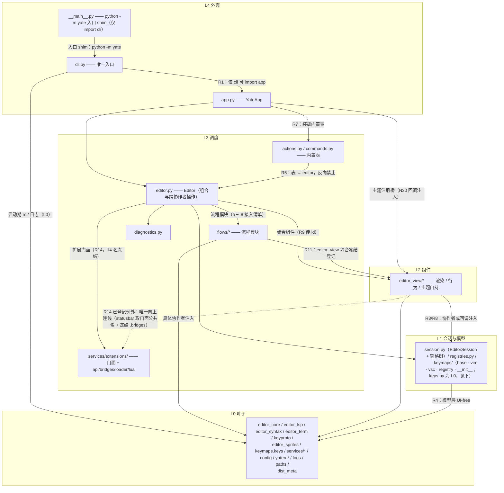

# yate 架构边界规则

本规则固化「分层重构」后的目标架构。完整方案与执行记录见
[`.trae/documents/app-layering-refactoring-plans/`](../documents/app-layering-refactoring-plans/overview.md)
（总纲 `overview.md` + `plan_a`…`plan_g`）。
**所有新增/修改代码都必须遵守，不得因为新功能而破坏这些边界。**

## 一、依赖方向（硬性规则）

```
L4 外壳：app.py（YateApp） / cli.py（唯一入口） / __main__.py（`python -m yate`
         入口 shim，仅 import cli；守卫 `_LAYER_RANKS` 已按 L4 计）
L3 调度：editor.py（Editor）/ actions.py / commands.py / flows/ 子包
         （completion_flows.py / prompt_flows.py / document_flows.py / window_flows.py /
         extension_flows.py / shell_flows.py / overlay_flows.py / lsp_sync.py /
         prompt_completion.py / mouse_flows.py）/ diagnostics.py /
         services/extensions/（子包：门面 __init__ + api / bridges / loader / lua 子模块，
         见 R14）
L2 组件：editor_view/*
L1 会话与模型：session.py（EditorSession + 窗格树模型：Leaf / Split / ViewState / 树操作）/
         registries.py（依赖 keymaps.base 的 ActionContext，层级位于 keymaps 之上、
         actions/commands/editor 之下）/
         keymaps/（2026-10-17 层秩切分：`keys.py` 属 **L0**（键位记法，零上层依赖）；
         `base.py` / `vim.py` / `vsc.py` / `registry.py` / `__init__.py` 属 **L1** ——
         `base.py` 持有 `ActionContext`（内含 `EditorSession`）与 `ActionFunc`，
         `registry.py` 持有 `KeymapSet`）
L0 叶子：editor_core / editor_lsp / editor_syntax / editor_term / keyproto /
        editor_sprites / logs / paths / config / yaterc.py / yaterc_options.py /
        services/* / keymaps/keys.py
        （2026-09-28 核对补入：`keyproto/` 键弦模型与 Windows 驱动、`editor_sprites/`
        屏保精灵数据/渲染，二者皆为纯 L0 叶包。
        2026-10-07 A2 定案：`keyproto/driver_windows.py` 经
        `keyproto/textual_internals.py` 收口 Textual 私有 API（升级 Textual 先查该文件）；
        `yate.logs` 为 R12 统一 tracing 的豁免依赖；
        2026-10-17 层秩切分（S-1）：键位记法下沉为 L0 单文件 `keymaps/keys.py`，
        `keymaps/` 其余收敛为 L1 —— 切分后 **L0 无任何向上连线**（`keyproto/legacy.py`
        作为 L0 消费者改从 `keymaps/keys.py` 取记法），故本行不再登记 L0 例外；
        补入 `dist_meta.py`（stdlib-only：运行期供 `diagnostics.py`、构建期供 `pack/_common.py`）；
        补入 `yaterc.py` / `yaterc_options.py`（同经 R4 的 `UI_FREE_FILES` 单文件守卫面
        收口，守卫 `_LAYER_RANKS` 未单列故默认落 L0，本行与之一致））
插件：extensions/*（由 L4 外壳经 L3 services/extensions/loader.py 装载；只依赖
         services/extensions 门面暴露的 ExtensionAPI / ExtensionContext 与 L0 叶子，
         禁止 import editor / editor_view / app）
```

- **硬性依赖连线图**（2026-10-17 增补）：**实线**箭头是**允许**的依赖方向，除下图
  **虚线**标出的**唯一已登记例外**（`EV -.-> EXTF`：R14 的 L2→L3 扩展门面读取，
  条文登记见 R14 条目、守卫侧冻结于 §六 `UPWARD_EDGES_FROZEN`）与 L4 内的入口同层边
  （`__main__.py --> cli.py --> app.py`）外，其余一律**严格向下**；
  图中**未画出的连线一律禁止**（含反向箭头与跨层跳跃），R1 / R3 / R4 / R5 / R11 / R14
  的禁线条款与 §六 32 个架构守卫用例共同构成本图的执法面。新增任何 import 连线前，
  先对照本图与 §一 各 R 条款；需要新增合法连线时必须先修订本图并补守卫用例。



- **R1 — `YateApp` 是顶层，不被下层引用**：`yate/` 内只有 `cli.py` 允许 `import yate.app`。
- **R2 — 禁止"全应用协议"**：不得新增 `Protocol`。例外（**存量冻结白名单，共 4 个类**）：
  `editor_view/editor.py::PaneRegistry`（本轮唯一新增：打断 `PaneHost ↔ EditorView` 的构造环，见 Plan B）、
  `editor_syntax/engine.py::SyntaxBackend`、`editor_syntax/ts_backend/backend.py::_TsPoint` / `_TsNode`
  （后三者先于本轮重构存在，属叶包内部；后两个是可选依赖 py-tree-sitter 的私有结构化类型）。
  需要共享状态时传**具体对象**。
- **R3 — `editor_view/*` 不得 import `yate.editor` / `yate.app`**：组件只接受具体协作者
  （`EditorSession` / `Workspace` / `PromptBar` / `LspManager` / `KeymapSet` / `Textual App`）
  或 `Callable` 回调。
- **R4 — `keymaps/*`、`services/*`、`keyproto/*`、`editor_sprites/*`、`editor_core/*`、`session.py`、`registries.py`、`config.py`、`yaterc.py`、`yaterc_options.py`、`dist_meta.py` 不得 import `editor_view`**。
  （2026-09-28 核对补入 `keyproto/*`、`editor_sprites/*`：二者已是
  `tests/test_architecture.py` `UI_FREE_PACKAGES` 的守卫面，规则文本此前漏列。）
  （`config.py` 于 N30 加入：yaterc 主题能力由 L4 `cli.py` 以回调注入
  `load_config(register_theme=..., load_theme_paths=...)`，L0 不再反向拉起 L2 组件包。
  `yaterc.py` 于 2026-10-07 加入：自 `config.py` 拆出的加载器，同为 L0 单文件守卫面
  `UI_FREE_FILES`。`yaterc_options.py` 于 2026-10-08 加入：自 `yaterc.py` 拆出的
  选项解析器（big-module-split f 波），同为 L0 单文件守卫面 `UI_FREE_FILES`。）
- **R5 — 内置表单向**：`actions.py` / `commands.py` 可以 import `yate.editor`；反向禁止
  （`editor.py` 不得 import 它们，否则成环）。
- **R6 — 禁止 `TYPE_CHECKING`**：全仓库 **0 处**（已达成，架构测试拦截回归）。
- **R11 — 冻结 UI 耦合**：L3 流程模块（`flows/` 子包：`completion_flows.py` / `prompt_flows.py` /
  `document_flows.py` / `window_flows.py` / `extension_flows.py` / `shell_flows.py` /
  `overlay_flows.py` / `lsp_sync.py` / `prompt_completion.py` / `mouse_flows.py`；
  2026-10-07 自根目录迁入，`completion.py`、`overlays.py` 同步更名为 `*_flows.py`）
  **允许** import `editor_view`（存量耦合，冻结；其中 `extension_flows.py` 实测不
  import `editor_view`，故不在 `UI_FROZEN_FILES` 白名单——2026-10-16 审计核对）；
  禁止向上 import `yate.editor` / `yate.app`，且**新增** `editor_view` 导入必须先在
  `tests/test_architecture.py` 的 `UI_FROZEN_FILES` 白名单中登记（键为 `yate/` 下
  相对路径，flows/ 迁移后带 `flows/` 前缀；
  `document_flows.py` 于 editor-split wave-3 登记为 panes/explorer/commandline；
  `window_flows.py` 于 wave-4 以同组面登记）。
- **R7 — 外壳装载内置表**：`YateApp.__init__` 调 `populate(editor.actions, editor)` 与
  `register_commands(editor.commands, editor)`。
- **R8 — 共享模型用具体对象**：跨层传递 `EditorSession` / `KeymapSet` / `ActionRegistry` /
  `CommandRegistry` 本身，不再为每个消费者定义窄协议。
- **R9 — 组件 id 归调度层**：`Editor` 构造 widget 时必须带上 id
  （`#sidebar` `#sidebar-head` `#explorer` `#editor-col` `#tabbar` `#breadcrumbs` `#terminal-dock` `#statusbar`），
  `compose()` 里再带上容器 id（`#body` `#bottom-dock` `#bottom`）。
  其中 `#statusbar` 只是 widget id（其样式由组件自持：
  `yate/resources/status-bar.tcss`——组件 `DEFAULT_CSS` 均为打包 tcss 资源、
  经 `yate.paths.load_tcss` 装载，issue IKJHPH；类选择器 `StatusBar` 不变），
  其余 id 均被外壳 CSS 直接引用——该 CSS
  已不再内联于 `app.py`，而是打包资源 `yate/resources/app.tcss`
  （`YateApp.CSS = paths.load_tcss("app.tcss")`；公共加载器 `yate/paths.py` 的
  `load_tcss()` 供 L2 组件同源装载自有 tcss，如 `screensaver.tcss`；文件头注释即声明
  "selector ids are frozen by R9"）：改 id 必须同步改该 `.tcss` 文件。
- **R10 — 一次按键只派发一次**：`EditorView.on_key` 处理后 `event.stop()` / `prevent_default()`，
  未被消费的键不得冒泡到外壳二次派发。
- **R12 — 日志统一 tracing（2026-09-27）**：yate 内全部运行时日志一律走模块级
  `log = tracing.get_logger(__name__)`（含无 App 上下文的驱动线程 / worker / 回调）；
  **禁止**为访问 Textual devtools 日志（`app.log` / widget `self.log`）而
  `import textual.app` 或为 `app` 属性补类型注解，业务代码不得直连 devtools 通道。
  devtools 可视化由 L4 `YateApp` 统一桥接：`textual.logging.TextualHandler`
  挂到 tracing 根 logger（回调模式；devtools 未连接或 tracing 未开启时零输出），
  L0 不因日志在 import 时引入 textual 依赖（闸门 handler 定义在 `yate/logs.py`
  的 `create_devtools_bridge()` 工厂里，`textual.logging` 由工厂内懒加载，
  `import yate.logs` 保持 stdlib-only 导入面）。

  **devtools 桥接方案**（Textual 8.2.8 实证）：

  ```mermaid
  flowchart LR
      A["业务模块 (L0-L3)<br/>log = tracing.get_logger(__name__)"] --> B["tracing 根 logger<br/>(stdlib logging, 'yate')"]
      B -->|YATE_TRACE=1| C[trace 文件<br/>~/.yate/data/logs/]
      B -->|"create_devtools_bridge (logs.py 工厂, tracing 闸门)"| D[devtools 控制台]
      D -.->|devtools 未连接| E[静默丢弃]
      C -.->|tracing 未设| E
      style A fill:#bbdefb,color:#0d47a1
      style B fill:#c8e6c9,color:#1a5e20
      style D fill:#fff3e0,color:#e65100
  ```

  - **机制依据**：Textual 的 `App._logger = Logger(self._log, app=self)`——callable 写死为
    devtools 写入器，**无回调/注入 API**；官方反向桥是 `textual.logging.TextualHandler`
    （stdlib `logging.Handler`，`emit` 经 `active_app` 转发 devtools）。tracing 即 stdlib
    logging，挂载即通；
  - **挂载点唯一**：`YateApp.on_mount`（L4 生命周期）以 `create_devtools_bridge()`
    构造桥并挂到 `yate` 根
    logger，`on_unmount` **按身份**摘除本实例所挂的 handler（多 App 实例互不误摘；
    重挂载前先摘旧实例防泄漏），handler 跟随 App 实例生命周期，不进程级残留，
    `stderr=False, stdout=False`（无 devtools 时绝不污染 TTY）；
  - **闸门语义（YATE_TRACE 单开关，2026-09-27 评审后收紧）**：挂到根 logger 的桥是
    `yate/logs.py` 工厂内的 `_TracingGatedTextualHandler`——`emit` 先查
    `tracing.is_enabled()`，**tracing 禁用
    时 devtools 一并禁用**（未配置的 `yate` logger 有效级别继承 root 的 WARNING，
    WARNING+ record 会到达每个 handler，闸门在 handler 层把它们全部挡下，devtools
    通道零输出）；devtools 断连时 `TextualHandler.emit` 自查 `active_app` 后静默；
  - **例外登记**：无。扫描实证全仓唯一历史违规（`driver_windows.py` 经 `self.app.log`）
    已随 R12 落地清除（commit `003263e`）；
  - **守卫**：§六「R12」条目（2026-09-28 核对修正：共 **4 个用例**——
    `test_logging_never_touches_devtools_channel` / `test_ui_free_layers_do_not_import_textual_app`
    两条 AST 静态取证，加 `test_devtools_bridge_follows_app_lifecycle` /
    `test_devtools_bridge_forwards_only_while_tracing_enabled` 两条运行时用例；负向演练通过）。
- **R13 — 组件自持主题与滚动条注入（2026-09-27，theme-ownership T1/T2 治理）**：
  主题着色的所有权归 L2 组件——组件在挂载或收到主题广播时自行读 `theme.active()`
  上色；L3 `Editor` 只触发 `theme.set_theme(name)`（内部经 `theme.subscribe()` 回调
  列表 1:N 广播），**禁止**直改 widget 样式（`.styles.background` /
  `.styles.scrollbar_*`）或定义 `apply_theme` / `update_sidebar_head` 类转发方法；
  Textual 主题注册（`app.register_theme` / `get_theme_variable_defaults`）仍归 L4 外壳。
  滚动条渲染器只允许 per-widget 实例注入
  （`editor_view.scrollbars.apply_slim_scrollbars(widget)`），**禁止**类级
  `ScrollBar.renderer = ...` 进程级 monkey-patch（ClassVar 赋值会泄漏到同进程
  全部 Textual App，含测试嵌套）。
  **守卫**：§六「T1 / T2」条目（theme-ownership Plan D 新增两条用例）。
- **R14 — 扩展系统机件子包化（2026-10-13，Gitee IKK4K6 note_51571449）**：
  扩展系统机件仅居于 `yate/services/extensions/` 子包（门面 `__init__.py` + `api.py` /
  `bridges.py` / `loader.py` / `lua/`）；门面导入路径 `yate.services.extensions` 不变
  （14 个公共名再导出**冻结**，插件与手册按名导入零破坏），内部子模块为非公共 API——
  yate 内代码（extensions 包自身除外）只可 `from yate.services.extensions import <公共名>`，
  直引 `api` / `bridges` / `loader` / `lua` 子模块视为违规；存量直引冻结在架构测试的
  `EXTENSION_SUBMODULE_FROZEN` 白名单（`editor_view/statusbar.py` 的 `UiExtensionBridge`
  类型注解——14 名门面不含该名），新增直引必须先登记；`tests/**` 直测内部机件，不在
  拦截面。`yate/services/events.py`（editor 直用的通用事件枢纽）与 `user_setup.py`
  非扩展机件，不随迁。
  **L2→L3 已登记例外**（2026-10-17 审计）：`editor_view/statusbar.py` 取本门面公共名
  （`ExtensionLoader`）与冻结的 `.bridges`（`UiExtensionBridge`，见 §六
  `EXTENSION_SUBMODULE_FROZEN`）以渲染扩展状态段，`statusbar.py:83-84` 为构造参数注入；
  这是 2026-10-17 层秩切分后全仓**唯一**的向上连线，由 §六 的层秩守卫冻结；
  L2 新增到 L3 的连线必须先在本条登记。
  `yate/services/yxp.py`（`.yxp` 包装卸逻辑）**不随迁**本子包：它不含扩展运行时耦合，
  归属仍为 `services/`（与 `events.py` / `user_setup.py` 同理）。
  **守卫**：§六「R14」条目（两条用例：直引拦截 + 门面 14 名冻结）。

## 二、分层职责

| 层 | 可以做什么 | 不可以做什么 |
|---|---|---|
| `YateApp`（L4） | Textual 生命周期、`CSS`（装载 `yate/resources/app.tcss`）、主题桥（`get_theme_variable_defaults` / `theme.*` 注册）、驱动选择（`get_driver_class`）、事件转发与空闲探测（`on_event`）、装载内置表 | 不持有业务状态、不实现业务操作（屏保只由外壳"轮询 + 触发 action"，画面与精灵渲染分别归 `editor_view/screensaver.py` 与 `editor_sprites/*`） |
| `Editor`（L3） | 组合模型/服务/组件，实现横跨多个协作者的"操作" | 不做渲染、不做文本算法、不直接持有 widget 内部状态 |
| 表与流程模块（L3） | 把内置能力登记进注册表（`populate` / `register_commands`）；把单一流程独立成模块（`flows/completion_flows.py`、`flows/prompt_completion.py`、`diagnostics.py`） | 不被 `editor.py` 反向导入 |
| `editor_view/*`（L2） | 自己的渲染、行为与主题着色（自持，R13），构造注入具体协作者或回调 | 不 import `yate.editor` / `yate.app`；不直连 LSP 状态 |
| `EditorSession` / `KeymapSet` / 注册表（L1） | 文档、标签、搜索、键映射集合（`keymaps/` 除 L0 记法 `keys.py` 外整体在本层）、动作与命令容器、**窗格状态模型**（`Leaf` / `Split` / `ViewState` + 树纯操作，无 UI） | 不 import `editor_view`、不碰 Textual |
| 叶子（L0） | 纯逻辑（编辑器内核、LSP 客户端、语法、终端模拟、键弦模型与 Windows 驱动 `keyproto/*`、屏保精灵数据与纯渲染 `editor_sprites/*`、配置、日志、路径、shell、workspace、字体、空闲跟踪 `services/idle_tracker.py`、dist 元数据 `dist_meta.py`、键位记法 `keymaps/keys.py`） | 不 import 上层（2026-10-17 切分后：零例外） |

## 三、接口与代码形态设计

1. 不建中央接口文件、不建"公共类型层"（`app_features/*`、`interfaces.py`、`*Protocol` 命名均已废止）。
2. 需要"能力"时：优先传**具体对象**；确实是 1:1 回调时用 `Callable` 类型别名或 `*Ui` 记录
   （如 `KeyUi`、`PromptCompleter`），不引入协议类。
3. 禁止用 `Any` / `# type: ignore` 掩盖类型不匹配（pyright strict 必须真正成立）。
4. 读写分离：读状态用只读属性 / 查询方法；只有真正的命令才用操作方法。
5. 包 `__init__.py` 分层约定（2026-10 评审 A1 定案，三层表述）：
   ① 包根**默认惰性**：不 re-export 子模块符号，避免 `import yate.X` 连带加载整层；
   ② UI / 服务包（`editor_view` / `services`）**禁止** re-export（现状惯例成文化，
   `editor_view/__init__.py` 与 `services/__init__.py` 的"deliberately not re-exported"
   声明为范本）；**唯一例外**：`editor_view/theme.py` 作为主题广播枢纽与门面再导出
  （big-module-split d 波产物，2026-10-17 审计登记，模块 docstring 已自述），不视为本款禁止项；
   ③ 纯 L0 叶包（`editor_core` / `editor_lsp` / `editor_syntax` / `editor_term`）
   允许**有限** re-export 作为插件公共 API 面（插件手册明文示例
   `from yate.editor_syntax import LangSpec`），且**重量级实现模块**（如
   `editor_lsp.manager`）不得进包根；例外须在各包 `__init__.py` docstring 注明
   （守卫：`test_leaf_package_reexports_carry_exception_note`、
   `test_editor_lsp_package_root_is_light`）。`keymaps` 自 2026-10-17 起整体属 **L1**
   （`keys.py` 除外），其包根 re-export 仍按本款登记并受同一守卫检查。
6. **能用函数实现的就不造类**：内置表（`populate` / `register_commands` / `load_startup_extensions`）、
   纯计算（`prompt_completions` / `format_report` / `mode_chip` / `fuzzy_match`）、数据操作
   （`session.py` 的 `find_leaf` / `replace_node` …）一律用函数。
7. **文件体量阈值处置（2026-10-07，评审 A11）**：单文件超过 **800 行**触发处置评审。
   守卫面自 2026-10-09 起覆盖 `yate/` 与 `tools/`（`tests/` 不设限）。
   - 拆分判定：多职责混合型**必拆**（判据：模块 docstring 无法用一句话概括，或文件含
     ≥2 个互不引用的职责块）；单一职责长文件可登记豁免。
   - 豁免名单（登记即合规；修改文件时须同步更新行数。名单与
     `tests/test_architecture.py` 的 `SIZE_EXEMPT_FILES` 守卫集合**两处同步维护**，
     big-module-split 各波拆分完成后同步收缩）：
     `keymaps/vim.py`（2026-10-16 审计复测 1184 行，motion/operator/text-object
     单一键映射域，维持豁免）、
     `editor.py`（构造工厂约 300 行 + `:set` setter，A8 表驱动落地后 2026-10-07
     复核仍超；extension-system-enhance 波 2026-10-13 实测 983 行；
     2026-10-16 审计复测 1024 行，构成职责随调度层操作增长，维持豁免，
     已登记为下一个 big-module-split 候选）、
     `editor_core/buffer.py`（文本模型/撤销/多点原语单一职责，2026-10-10
     评审后由口径注记上提正式名单；2026-10-16 审计复测 1069 行，维持豁免）、
     `tools/pack/wiki.py`（2026-10-09 登记 1487 行，2026-10-16 审计复测 1495 行；
     pack wiki 站点生成/翻译/进度单一职责，#29/#31/#33 三轮评审均在该文件收敛，
     拆分另行立项）、
     `editor_syntax/langdefs.py`（2026-10-12 登记 813 行，语言注册表声明式数据
     单一职责；full-review-fixes 新增两个测试缝存取器后越线，拆分会触碰
     big-module-split plan-a 钉死的原地 patch 语义，零行为收益）。
   - 2026-10-09 复核口径修正：`Measure-Object -Line` 不计空行，
     实际行数以 `splitlines()`（守卫口径）为准——`buffer.py` 据此复测
     820 行维持豁免（2026-10-10 多光标 wave-3 复测 994 行、评审修复后
     1051 行，同日上提至上方正式名单；同日第四轮 AI 评审复测 1061 行，
     O7 docstring 折行增一行后定稿 1062 行）。
   - 已出名单：`editor_syntax/regex_backend.py`（2026-10-08 big-module-split
     a 波：语言定义迁入 `regex_langdefs.py`——2026-10-09 上提为包顶层
     `langdefs.py`，见 §六 #28；拆分后两文件均低于阈值）；
     `editor_view/diffview.py`（2026-10-08 big-module-split b 波：Pane 侧
     迁入 `diff_pane.py`，screen 侧留在原文件，两文件均低于阈值）；
     `editor_view/editor.py`（2026-10-08 big-module-split c 波：高亮与
     欢迎页迁入 `highlighting.py` / `welcome.py`，拆分后三文件均低于阈值）；
     `editor_view/theme.py`（2026-10-08 big-module-split d 波：主题数据/校验/
     Textual 桥迁入 `themes.py`、字符几何迁入 `cells.py`、自定义主题文件
     加载迁入 `theme_files.py`，原文件保留广播枢纽并作门面再导出，
     拆分后四文件均低于阈值）；
     `editor_term/emulator.py`（2026-10-08 big-module-split e 波：调色板与
     按键映射迁入 `palette.py` / `keys.py`，拆分后三文件均低于阈值）；
     `editor_lsp/manager.py`（2026-10-08 big-module-split f 波：线格式解析
     迁入 `parsing.py`，状态编排留在原文件，两文件均低于阈值）；
     `yaterc.py`（2026-10-08 big-module-split f 波：选项提取/校验迁入
     `yaterc_options.py`，rc 发现与 exec 循环留在原文件，两文件均低于阈值）；
     `services/extensions.py`（2026-10-11 extensions-split：798 行临阈值
     预防性拆分，原文件保留门面再导出冻结插件导入路径，四文件均低于阈值）；
     `config.py` 拆分后 310 行（2026-10-07 A9，加载器迁入 `yaterc.py`），
     不再需要豁免。
   - 负面清单：`logs.py`（2026-10-16 审计复测 690 行）明确不拆——crash/tracing/devtools 桥三服务内聚，
     模块 docstring 已论证共存理由。
8. **新增 L3 流程模块接入清单（评审 A18）**：保持构造显式注入，**不建共享 context 类型**
   （§三.1 红线）：
   1. 模块命名 `*_flows.py`、类名 `*Flows`（同步适配器按动词命名如 `LspSync`，见 §五命名守卫）；
   2. 在 `editor.py` 声明类属性（类型注解 + `None` 初值）；
   3. 在对应 `_build_*` 工厂内构造，注入具体协作者与回调（不得持有 App 句柄，
      守卫 `test_flow_modules_hold_no_app_handle`）；
   4. 更新 `Editor.__init__` 组装顺序注释；
   5. 如需 `editor_view` 导入，先登记 `tests/test_architecture.py` 的 `UI_FROZEN_FILES`（R11）；
   6. 同步 §一 L3 清单与本清单。

## 四、跨模块交互

| 场景 | 规定机制 |
|---|---|
| 1:1 操作 / 查询 | 直接调用具体协作者的方法（`session` / `workspace` / `lsp` / widget） |
| 1:N 低频广播 | 回调列表或构造注入的回调（如 `EditorSession(on_closed=...)`、`TabBar(on_activate=...)`、`theme.subscribe(listener)` 返回退订函数） |
| L0 需要 UI 能力 | 构造参数注入 `Callable`（N30 模式：`load_config(register_theme=..., load_theme_paths=...)`，由 L4 `cli.py` 传入 `editor_view.theme` 同名函数；缺省 `None` = headless） |
| L3 需要外壳能力 | 语义能力注入（issue IKJB0Q）：**动词**=绑定方法注入（`spawn=app.run_worker` / `push_screen=app.push_screen`），pyright 在接线处自动推导完整签名；**状态查询**=Editor 语义 `Callable`（`has_modal_screen` / `explorer_focused` / `current_screen`）。`editor.py` 是 L3 唯一 `App[None]` 持有者与能力分发点，流程模块不得持有 App 句柄（守卫：§六「能力注入」条目） |
| UI 事件 | Textual messages（`on_key` / `Input.Submitted` / `MouseDown` 等） |
| 异步任务 | Textual `App.run_worker(...)`；调度层提供 `*_later` 便捷入口（如 `open_path_later`）；防抖定时用 `asyncio.get_running_loop().call_later` |
| 日志（含无 App 上下文的线程/worker/回调） | 模块级 `log = tracing.get_logger(__name__)`（R12）；devtools 可见性由 L4 `TextualHandler` 桥提供，业务代码不直连 `app.log` / `self.log` |
| 插件注册 | `ActionRegistry` / `CommandRegistry` / `Keymap.add_binding`（经 `ExtensionContext` 暴露）；`setup` 失败由 loader 统一快照-恢复回滚（A13 定案：registries 的 `unregister` / Keymap 的 `remove_binding` + `ExtensionAPI` 作用域记录） |

- **禁止**：全局 EventBus、字符串事件名、下层直接读写高层私有状态（`app._xxx`）。
- 新增信号的门槛：出现 ≥3 处"通知方不知道谁在监听且订阅者动态增删"的场景后再评估，
  且保持同线程同步派发。

## 五、新增功能自检清单

提交前逐项确认：

- [ ] 依赖方向向下：没有 `import yate.app`、没有导入上层实现类？
- [ ] 状态放在正确的层：文档 / 标签 / 搜索 → `EditorSession`；键映射 → `KeymapSet`；
      动作与 `:` 命令 → `ActionRegistry` / `CommandRegistry`；窗格树模型（`Leaf` / `Split` /
      `ViewState` + 树纯操作）→ `session.py`（L1，不得挪回 `editor_view`，也不得新建类型层）？
- [ ] 组件行为写在组件内部（自持），而不是加回 `Editor` 或外壳？
- [ ] `Editor` 只新增"横跨多个协作者的操作"；单一流程已拆成独立模块（参照 `flows/completion_flows.py`，接入清单见 §三.8）？
- [ ] 没有新增 `Protocol`（除 `PaneRegistry`）、`TYPE_CHECKING`、`Any`、`# type: ignore`？
- [ ] 没有使用 `*Feature` / `*Host` / `*Ops` / `*Delegate` / `*Controller` 命名？
      （白名单：`PaneHost`、`PaneManager`、`LspManager`；流程模块按职责命名：
      UI 流程编排一律 `*Flows`，同步适配器按动词命名如 `LspSync`；
      存量流程模块已统一为 `ShellFlows` / `CompletionFlows` / `OverlayFlows`）
- [ ] 新 widget 需要外壳 CSS 时，id 已由 `Editor` 传入（R9），且已同步
      `yate/resources/app.tcss`（外壳 CSS 现为该打包资源，非 `app.py` 内联字符串）？
- [ ] 新按键路径不会造成二次派发（R10）？
- [ ] 按键分支只消费自己真正处理的键，未识别的键 fall-through 到后续分发，不无条件 `return True`
      （历史缺陷：补全弹窗曾吞掉全部按键，`Ctrl+S` / `Ctrl+Z` 失效）？
- [ ] 日志走 tracing（R12）：没有 `self.log` / `self.app.log` 调用，没有为日志而
      import `textual.app`？
- [ ] 主题与滚动条归组件自持（R13）：没有在 L3 直改 widget `.styles.*` 着色、
      没有类级 `ScrollBar.renderer` patch、新主题感知组件已订阅
      `theme.subscribe` 自行上色？
- [ ] `python -m pyright yate/ tests/ tools/` 零诊断、`python -m pytest tests/ -q` 全绿？

## 六、防回归

`tests/test_architecture.py` 已落地 **32 个用例**（2026-10-17 实测复核：
`python -m pytest tests/test_architecture.py -q` → `32 passed`；用例清单见文末对照）：

- **R1** 仅 `cli.py` 可 `import yate.app`（`app.py` 自身豁免）；
- **R2** 全仓（yate + tests + tools）无 `AppProtocol`；`yate/interfaces.py` 不存在；
  除 4 个冻结白名单外无任何 `Protocol` 类；
- **R3** `editor_view/*` 不 import `yate.editor` / `yate.app`（子模块前缀匹配，不误伤 `editor_core` /
  `editor_lsp` / `editor_syntax` / `editor_term`）；`yate/app_features/` **目录**不存在（只删 `__init__.py`
  不够：残留目录会被当作空命名空间包导入，掩盖删除）；
- **R4** `keymaps/*`、`services/*`、`keyproto/*`、`editor_sprites/*`、`editor_core/*`、`dist_meta.py`、`session.py`、
  `registries.py`、`config.py`、`yaterc.py`、`yaterc_options.py` 不 import `editor_view`
  （严格 0 违规；`config.py` 为 N30 新增守卫面，`yaterc.py` 为 2026-10-07 A9 拆分加入，
  `yaterc_options.py` 于 2026-10-08 big-module-split f 波加入，`keyproto/*`、`editor_sprites/*` 于
  2026-09-28 核对补入，守卫面见 `tests/test_architecture.py` 的
  `UI_FREE_PACKAGES` / `UI_FREE_FILES`；负向验证过拦截有效）；
  （R4 是 **UI 耦合**约束，与层秩无关：`keymaps/*` 同时是 UI-free 面与该包按文件切分的
  L0/L1 混合面，见 §一。）
- **窗格模型归 L1**（`test_pane_model_lives_in_l1_session`）：`Leaf` / `Split` / `ViewState` 与
  `find_leaf` 等树操作由 `session.py` 拥有；`editor_view/` 只 import、不再重导出
  （`editor_view/pane_types.py` 已删除，`panes.py` 无 backward-compatibility 重导出段）；
- **R11** `flows/completion_flows.py` / `flows/prompt_completion.py` / `flows/mouse_flows.py`
  不向上依赖，`editor_view` 导入必须落在冻结集合内；
- **support_mouse 闸门**（issue IKJRFK，2026-10-08 新增）：
  `test_support_mouse_gate_lives_in_app_on_event` 文本断言闸门（`support_mouse` 判定）
  必须位于 `YateApp.on_event` 中 `await super().on_event(event)` 之前——禁用态在
  Textual 转发（含内建 widget 与 Click 合成）前丢弃一切 MouseEvent；
- **R5** `editor.py` 不 import `yate.actions` / `yate.commands`；
- **R7** 只有 `app.py` 导入内置表，且 `YateApp.__init__` 调用
  `populate(self.editor.actions, self.editor)` / `register_commands(self.editor.commands, self.editor)`；
- **R6** 全仓无 `TYPE_CHECKING`；
- **日志惰性格式**（`test_log_calls_use_lazy_percent_formatting`）：`log.*` 调用禁止 f-string
  消息（AST 拦截，python-coding-style 4.6）；
- **R12** yate 全仓无 `self.log` / `self.app.log` devtools 通道访问（AST 取证，docstring
  提及不误报）；  UI-free L0（`keymaps/*` `services/*` `keyproto/*` `editor_sprites/*`
  `editor_core/*` `dist_meta.py` `session.py` `registries.py` `config.py` `yaterc.py` `yaterc_options.py`
  `logs.py`，见
  `tests/test_architecture.py` 的 `UI_FREE_PACKAGES` / `UI_FREE_FILES`）不 import `textual.app`；
  另有两条运行时用例：`test_devtools_bridge_follows_app_lifecycle`（挂载期恰好 1 个
  handler、`on_unmount` 按身份摘除）与
  `test_devtools_bridge_forwards_only_while_tracing_enabled`（tracing 关闭时闸门阻断、
  开启时转发 1 条）；
- **T1**（`test_no_class_level_scrollbar_renderer_patch`）全仓禁止类级
  `ScrollBar.renderer = ...` 进程级 patch（正则锚定行首，`widget.vertical_scrollbar.renderer`
  等带接收者的实例赋值不误伤）；注入统一走 `editor_view.scrollbars.apply_slim_scrollbars(widget)`；
- **T2**（`test_editor_does_not_paint_widget_styles`）`editor.py` 无 `def apply_theme` /
  `def update_sidebar_head` / `.styles.background =` / `.styles.scrollbar_`（文本断言；
  Editor 自有的布局职责如 terminal dock 高度不误伤）；
- **注册表归属**（langdefs 上提，2026-10-09 新增）：`editor_syntax` 的语言注册表归包顶层
  `langdefs.py` 所有，`regex_backend` 与 `ts_backend` 平行依赖它；
  `ts_backend/*` 禁止 import `regex_backend`（守卫：§六 #28）；
- **能力注入**（issue IKJB0Q，2026-09-30 新增两条）：`test_app_annotations_are_precise`
  AST 扫 `yate/**` 禁 `App[Any]` / `App[object]` 下标（`App[None]` 是唯一精确形态）；
  `test_flow_modules_hold_no_app_handle` AST 扫 `yate/*.py` 顶层与 `yate/flows/*.py`
  （排除 `editor.py`）
  禁 `self.app` 属性链——动词与查询都是注入能力，Editor 是 L3 唯一 App 句柄持有者。
  两条均经负向演练（临时回填违规确认拦截后还原）；
- **命名守卫** yate 下标识符不得为 `*Feature` / `*Host` / `*Ops` / `*Delegate` /
  `*Controller` / `AppProtocol`
  （白名单：`PaneHost`；`*Manager` 允许。流程模块按职责命名：UI 流程编排一律
  `*Flows`，同步适配器按动词命名如 `LspSync`，禁新增 `*Controller`）。
- **回调别名**（issue IKJUWP，2026-10-07 新增一条）：
  `test_callable_aliases_use_type_statements` AST 扫 `yate/**` 的**模块级与类级**
  赋值——`X = Callable[...]`、`X: Callable[...] = ...`、`typing.Callable[...]`、
  字符串前引号写法，以及藏在模块级 `if` / `while` / `try` 里的同类绑定——一律判违规，
  必须写成 PEP 695 `type X = ...`（`ast.TypeAlias` 节点）；同时禁
  `typing.TypeAlias` / `TypeAliasType` 导入（3.12 上二者都多余）。
  **不在拦截范围**：函数体内的实例属性（`self._hook: Callable[...] = None`）与
  "元素是回调的数据表"（`dict[str, Callable[...]]`）——它们不是别名定义，
  按 §三.6 与 R-C 保持内联。负向演练过：6 类违规全部拦截，3 类放行形态零误伤。
- **R14**（扩展机件子包化，2026-10-13 新增两条）：`test_extension_machinery_hides_behind_facade`
  AST 扫 `yate/**`（排除 `services/extensions/` 包自身；`tests/` 不在扫描面）禁直引
  `yate.services.extensions.{api,bridges,loader,lua}`，存量直引冻结在
  `EXTENSION_SUBMODULE_FROZEN` 白名单（`editor_view/statusbar.py` 的
  `UiExtensionBridge` 类型注解），并断言三个旧机件模块与 `services/lua/` 目录不复存在
  （负向演练：空白名单扫描恰好命中 statusbar 一处）；
  `test_extension_facade_exports_the_frozen_plugin_names` 运行时断言门面 `__all__`
  恒为 14 名白名单（`EXTENSION_FACADE_NAMES`）且逐名可解析。

**32 个用例逐条对照**（2026-10-17 实测 `32 passed`）：

| # | 用例 | 守卫项 |
|---|---|---|
| 1 | `test_no_app_protocol` | R2 |
| 2 | `test_interfaces_module_is_gone` | R2 |
| 3 | `test_no_new_protocols` | R2（4 类白名单） |
| 4 | `test_no_type_checking` | R6 |
| 5 | `test_only_cli_imports_app` | R1 |
| 6 | `test_editor_view_does_not_import_upward` | R3 |
| 7 | `test_app_features_package_is_gone` | R3 |
| 8 | `test_keymaps_services_and_models_stay_ui_free` | R4 |
| 9 | `test_collaborators_keep_widget_coupling_frozen` | R11 |
| 10 | `test_editor_does_not_import_action_tables` | R5 |
| 11 | `test_shell_loads_the_builtin_tables` | R7 |
| 12 | `test_no_banned_identifier_names` | 命名守卫 |
| 13 | `test_pane_model_lives_in_l1_session` | 窗格模型归 L1 |
| 14 | `test_log_calls_use_lazy_percent_formatting` | 日志惰性格式 |
| 15 | `test_logging_never_touches_devtools_channel` | R12 |
| 16 | `test_ui_free_layers_do_not_import_textual_app` | R12 |
| 17 | `test_devtools_bridge_follows_app_lifecycle` | R12 |
| 18 | `test_devtools_bridge_forwards_only_while_tracing_enabled` | R12 |
| 19 | `test_no_class_level_scrollbar_renderer_patch` | T1 |
| 20 | `test_editor_does_not_paint_widget_styles` | T2 |
| 21 | `test_app_annotations_are_precise` | 能力注入（禁 `App[Any]` / `App[object]`） |
| 22 | `test_flow_modules_hold_no_app_handle` | 能力注入（流程模块禁 `self.app`） |
| 23 | `test_editor_lsp_package_root_is_light` | §三.5（A1：包根不连带加载 `editor_lsp.manager`） |
| 24 | `test_leaf_package_reexports_carry_exception_note` | §三.5（A1：叶包 re-export 须带例外注明） |
| 25 | `test_callable_aliases_use_type_statements` | 回调别名（IKJUWP：PEP 695 `type` 语句） |
| 26 | `test_support_mouse_gate_lives_in_app_on_event` | support_mouse 闸门（IKJRFK：App 层单点禁用鼠标） |
| 27 | `test_source_files_within_size_threshold` | 文件体量阈值（A11：>800 行须登记豁免，`SIZE_EXEMPT_FILES` 镜像 §三.7 名单） |
| 28 | `test_ts_backend_never_imports_regex_backend` | 注册表归属（langdefs 平行依赖：ts_backend 禁借 regex_backend） |
| 29 | `test_no_relative_imports` | 绝对导入（IKKS4C：全仓禁 `from .X`，包内引用写全路径；§六清单此前漏登，2026-10-13 补齐） |
| 30 | `test_extension_machinery_hides_behind_facade` | R14（扩展机件仅居 `services/extensions/`：禁直引子模块 + 旧路径不复存在） |
| 31 | `test_extension_facade_exports_the_frozen_plugin_names` | R14（门面 14 名白名单冻结，逐名可解析） |
| 32 | `test_no_unregistered_upward_imports` | 层秩向上连线（2026-10-17：切分后白名单仅 statusbar 2 条，`extensions/` 跳过） |

架构测试失败 = 阻塞合并，不得用豁免注释绕过。

## 七、与其它规则的关系

- 本规则是**架构边界**的权威来源。`python-coding-style.md` 中旧有的 `TYPE_CHECKING` 条款
  （§1.3 / §3.2 / §4.3）已按本规则修订，二者冲突时以本规则为准。
- 架构决策变更必须**同步更新**本规则与
  `.trae/documents/app-layering-refactoring-plans/`（总纲 + 对应 Plan）。
- 前序重构（拆分并移除 `AppProtocol`）的方案文档：
  [`.trae/documents/split-app-protocol-plan.md`](../documents/split-app-protocol-plan.md)；其产物
  `app_features/` 已在本轮 Plan D 删除。
