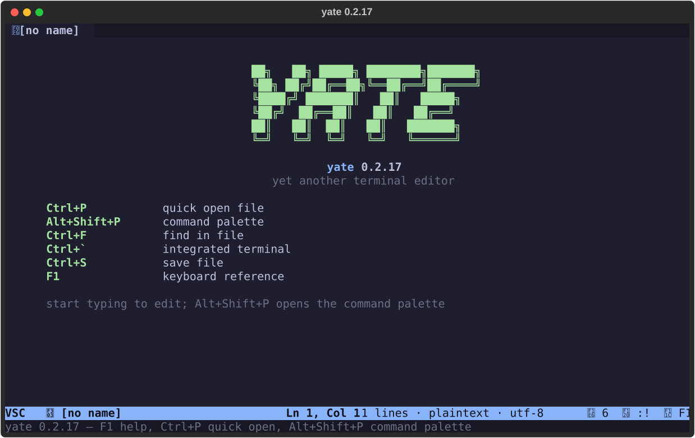

# yate screenshots

Generated by `python -m tools.screenshots` from the scenario registry
in `tools/screenshots/scenarios.py`.  Every image is a deterministic
100x30 SVG captured from the real application through Textual's pilot;
the report shots (smoke / pytest / pyright / diag) are Rich re-renders
of real subprocess output.

> **Font note**: the SVGs embed a Fira Code `@font-face` from cdnjs.
When an SVG is embedded through ``, browsers do not load external
resources, so the text falls back to the viewer's monospace font.
Nerd Font private-use glyphs (file-type icons) render as boxes unless
a Nerd Font is installed on the viewing machine.

> **Report note**: the smoke / pytest / pyright / diag screenshots are
samples of real runs -- durations, counts and timestamps change between
regenerations.  The screensaver shot samples one animation frame, so
the walker position varies per run too.

### welcome-screen

Empty untitled buffer startup showing the welcome screen.

空缓冲区启动，显示欢迎界面。
